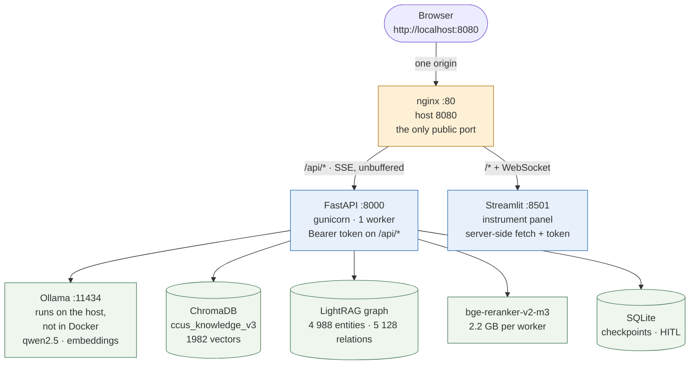
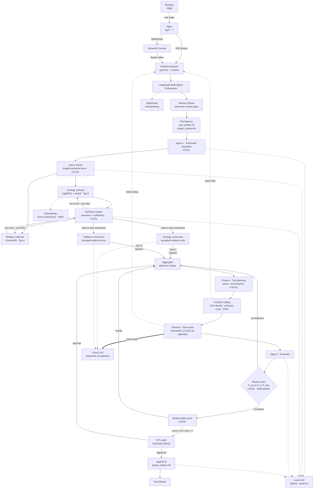

# CCUS Multi-Agent Risk Assessment System

**A Local-first Hybrid AI system for CCUS risk assessment using LangGraph, GraphRAG (LightRAG), and deterministic physical tools.**

<!-- 中文注释：基于 LangGraph 多智能体 + LightRAG 知识图谱 + 物理计算工具的 CCUS 风险评估系统。
     架构定位是 Local-first Hybrid —— 本地负责隐私与确定性（参数提取、图谱检索、物理校验），
     云端负责智商（长文本报告生成）。 -->

<p>
  
  
  
  
  
  
  
  
  
</p>

<p>
  <a href="https://github.com/qinruizhang001-hash/petro-rag-agent/actions/workflows/ci.yml"></a>
  <a href="LICENSE"></a>
  
</p>

---

## System topology

<!-- 中文注释：这张图回答的是"东西跑在哪、谁能连谁"，不是业务数据流（业务流在下面的 Architecture 一节）。
     要点：只有 nginx 一个容器对外；8000/8501 退到回环地址；
     Ollama 不在 Docker 里，跑在宿主机上（内存 + GPU 两个原因）；
     容器之间用服务名互访，写 localhost 会连到容器自己。 -->

Four containers, **one public port**. Everything else lives on the Docker network and is reachable only by service name — `localhost` inside a container means *that container*, which is the single most common way this stack gets misconfigured.



| Service | Host port | Role |
|---|---|---|
| `nginx` | **8080 → 80** | Single entry point. `/api/*` → backend, `/*` → frontend |
| `frontend` | 127.0.0.1:8501 | Streamlit console; calls the backend server-side, never from the browser |
| `backend` | 127.0.0.1:8000 | FastAPI under gunicorn; `/docs` is the only reason this port is open at all |
| `ollama` | **not in the stack** | Runs on the host and is reached at `host.docker.internal:11434` — see below |

**Why Ollama is not a container here.** It was, until the memory arithmetic was done. A 7B model is ~4 GB resident, and the backend already pays 2.2 GB of private reranker per worker; on a 16 GB laptop that is the whole budget. Worse, a containerised Ollama gets no GPU — Docker Desktop does not pass the RTX through without extra setup — so `qwen2.5` would fall back to CPU and the geology branch would go from ~70 s to several minutes. The host copy is already on CUDA with the models downloaded, so the stack borrows it. The cost is that a fresh machine needs Ollama installed first; `docker-compose.yml` documents how to put it back in the stack if that trade stops being the right one.

The bottom row is **not four more containers** — `docker compose ps` shows three, and ChromaDB, the LightRAG graph, the reranker and the SQLite checkpoints all live *inside the backend process*. That is a deliberate choice rather than a shortcut: a 20 ms embedded vector lookup does not deserve a network hop, and a 2.2 GB cross-encoder that every request touches does not belong behind an HTTP boundary. What it costs is memory — every worker holds its own copy — and the deployment notes state that bill rather than hiding it.

Per-stage routing means one request touches both sides of the diagram: retrieval and scoring never leave the machine, while the prose a human will read is the only thing that goes to a paid model.

---

## Three core highlights

| | Highlight | The number |
|---|---|---|
| 1 | **SSE through a reverse proxy, without losing the stream** | 1 port · 2 upstreams · 0 CORS config |
| 2 | **Dynamic model routing** | **¥0.00287** per assessment vs **≈¥0.041** at list price — a stated counterfactual, not a customer bill |
| 3 | **1499 unit tests, 1428 of them on every push** | 1214 stdlib-only · 63 ops-API · 78 dependency-backed without torch · 17 gate/graph · 56 chart/UI; the other 71 need torch/chromadb/plotly and run locally. The E2E suite is self-hosted and prints its own count |
| 4 | **Temporal conflict detection + Monte Carlo UQ + closed-loop plan** | latest-timestamp wins · mean + 90 % CI over 100 runs · 5 priors · Gaussian-copula correlation · Sobol first-order/total · probability → ok/warn/alert with a Wilson interval · then a constrained solve for well count / pressure cap / rate that meets the budget |

### 1. SSE that actually streams — the three nginx lines that are correctness, not tuning

A streaming endpoint behind a default nginx config is a silent downgrade: the response is still *correct*, it just arrives after 90 seconds in one lump. Nothing errors, nothing logs, and the only symptom is that the UI feels broken.

```nginx
location /api/ {
    proxy_pass http://backend;      # no trailing slash — it would eat the /api prefix
    proxy_buffering off;            # without this, the stream is flushed at the end
    proxy_read_timeout 900s;        # nginx defaults to 60 s; one assessment takes 90–150 s
}
```

Two more that fail just as quietly, on the frontend side: the WebSocket `Upgrade` / `Connection` pair (without it Streamlit sits on *"Please wait..."* forever) and `Host $http_host` rather than `$host` — `$host` drops the `:8080`, Streamlit's XSRF check compares `Origin` against `Host`, and the page answers `Invalid origin`.

The payoff is structural, not cosmetic: the browser sees **one origin**, so CORS stops being a thing to configure and cannot be configured wrong. 8000 and 8501 are bound to loopback and exist only for debugging — `curl 127.0.0.1:8000/health` when you cannot tell whether the frontend died or nginx forwarded wrong.

### 2. 93 % below an all-cloud counterfactual — and the report does not get worse

Routing is per stage, not per system (`ROUTE_<STAGE>=local|cloud|cloud:provider/model`). The escalation rule is deliberately conservative: **short input *and* the knowledge base actually matched** — measured relevance `0.9947 ≥ 0.05`, not a keyword guess. Extraction, retrieval, reranking, physics validation and scoring never leave the machine; only the prose that a human will read goes to a paid model.

A full assessment, measured end to end:

| | All-cloud baseline | This system |
|---|---|---|
| Tokens | 15.4k | 15.4k |
| Cost | ≈¥0.041 | **¥0.00287** |
| Difference vs that counterfactual | — | **93 % lower** |

**What this table is not:** it is not a bill, and it is not a claim that this system saves an operator money. The baseline is the same token count priced at public list price — we do not know anyone's contract price, cache discount, or volume terms, so there is no real "saving" to report, only a computable counterfactual. The dashboard caption says exactly that, and a unit test pins the wording.

Three honest caveats, because a cost table that flatters itself is worthless:

- **Local inference is not free.** ~60 tok/s at 250 W is ≈¥0.7 per million output tokens — the same order of magnitude as the paid numbers above. Pricing it at zero would make "saved" look better than it is, so the dashboard prices electricity.
- **The baseline is a stated counterfactual** (`saved_cny = all tokens at list price − actual`), not "your last bill". The API response carries `baseline_note` saying exactly this.
- **Degradation is recorded, never silent.** With no cloud key the report stage falls back to the local model and writes the reason into `model_routing`, so "we thought it was on the cloud" is auditable instead of invisible.

Parallelism is the other half of the latency story: the geology branch (139.94 s) and the wellbore branch (21.77 s) run in the same superstep, so wall-clock is 139.94 s instead of the 161.71 s serial sum — **1.16×** for free, because the graph is a fan-out and not a queue.

### 3. End-to-end assertions through the real HTTP path — including the ones that prove nothing is fake

The suite drives the running system: SSE frames are parsed off the wire, the human-approval gate is exercised over HTTP (`hitl` → `review` → reject → rewrite → approve), and every cost row is re-derived from the price table rather than trusted.

**1499 unit tests, of which 1428 run on every push** (1214 that import nothing outside the standard library · 63 that drive the ops and knowledge-base APIs against a bare `FastAPI()` with only `fastapi`/`httpx` installed · 78 that need `ragas`/`openai`/`tiktoken` but still no torch · 56 that need matplotlib/plotly to actually build the figures · 17 that drive the real graph with a mocked LLM). The remaining 71 need torch, chromadb or plotly and run locally — they are not counted as CI coverage, because they are not. The five groups are separate jobs on purpose: when a dependency-backed test is dropped into the stdlib-only job, all three Python versions go red for a reason that has nothing to do with the logic under test — which is exactly what happened on this branch before the split. The ops-API group is its own job for a related reason: `api_ops` deliberately does not import `api_server`, because that module loads the whole LangGraph and a 2.2 GB reranker at import time, and an interface test that needs a reranker is not an interface test. The end-to-end suite needs Ollama and a built graph index, so it runs on a self-hosted runner and prints its own PASS/FAIL count — CI cannot produce that number, and this README does not invent one.

The assertions that earn their place are the ones written against a *specific* way things go silently wrong:

- **Auth returns 404, not 401, for a valid token on a missing thread.** Asserting 200 would only prove the route exists; 404 proves the request got *past* the dependency. A token check wired to nothing still returns 200 to everyone.
- **A well-written report that contradicts physics is scored 0 and sent back** — with a numeric correction (`≤ 227 bar`, `≥ 1 649 m`), not a vague complaint.
- **The PINN tool returns 109.951 bar against an analytic 110.000.** "The model planned the call" and "the number reached the report" are pinned as two separate assertions, because both have failed independently.
- **`/health` probes are real**: Ollama 15–27 ms, Chroma 1–2 ms, SQLite 4 ms — against `ccus_knowledge_v3` with `1982 vectors` and a checkpoint DB with `779 rows`. A probe that re-derives its own paths once reported "healthy" against an empty directory; the current one imports the app's own constants.

### 4. Two answers a point estimate cannot give

A retrieval system that returns both `200 bar (2025-06)` and `300 bar (2026-03)` has not
found two facts — it has found one *trend* and one *contradiction*. Averaging them, or
quoting whichever chunk ranked higher, produces a number that is wrong in a way nobody
can see. And a report that states `ρ = 661 kg/m³` with no interval is claiming a
precision the inputs do not have.

**Temporal layer** (`core/temporal.py`, pure functions, no model):

```text
"2025年6月，A-1井实测地层压力为200 bar。"   ┐
"2026年3月，A-1井地层压力升至300 bar。"     ┘
   → 2 claims → 1 conflict (A-1井 · 地层压力, +50.0 %, 9 个月)
   → notice injected into the context **after** pruning:
     "必须优先采用时间戳最新的数据 … 禁止取平均"
```

Three details that decide whether this works or quietly misfires:

- **A bare four-digit number is not a date.** `埋深 2000 m` must not become the year 2000,
  or every report inherits a century of phantom conflicts. A timestamp requires `年` or a
  `-` / `/` separator.
- **Keywords are scoped to the gap between two numbers**, not the sentence. Otherwise
  `压力 200 bar，温度 80℃` yields two pressure readings and a fabricated `−60 %` conflict.
- **The notice is injected after context pruning**, because it is an instruction. A
  summariser rewrites "必须用最新数据" into "存在历史差异" and the constraint evaporates.

**Uncertainty layer** (`core/uq.py` + `core/sensitivity.py` + `core/risk_policy.py` + `core/optimize.py`):
every physical tool perturbs its input 100 times and reports a distribution, a sensitivity
ranking, a decision level, and — when the decision is not "ok" — the plan that would fix it.

```text
250 bar / 80 ℃   →  661 kg/m³（90 % CI 643–681，100 次蒙特卡洛，输入 ±5 % 均匀扰动）
2500 m / 375 bar →  注入可行 53 % · 压裂风险 47 %（标称判定：注入可行）
                    决策：告警 P(压裂风险)=47.0 %（95 % 区间 37.5 %–56.7 %）达到告警阈值 20 %
                    敏感性：深度 一阶 32 %／总效应 70 %；注入压力 一阶 31 %／总效应 68 %
2500 m / 380 bar →  策略：推荐 2 口井、井底压力 316 bar（破裂压力 379 bar 的 83 %），
                    速率 18.94 Mt/yr 与当前持平；样本外复核未观测到压裂（0/1000，上界 0.4 %）
```

The perturbation is **uniform ±5 %** — an instrument error bound, not a 1σ. Treating ±5 %
as 1σ and sampling normally widens the 90 % interval to ±8.2 %, while the report still
says "±5 %"; the two conventions are both defensible, but mixing them is not. The interval
is a **percentile** interval (`p5`–`p95`), not `mean ± 1.645σ`, because the injection
verdict is a step function and its output distribution is skewed near the fracture
threshold — exactly where the answer matters.

The report prompt gets both constraints as generated text (`core/uq.uq_block`), and
`aggregate` re-appends the interval by code if the model writes only the mean. Measured
behaviour: local 7B drops injected numbers from the prose roughly every other run, which
is why the numeric fallback is not optional.

**Five things that were missing, and what each one changes**

1. **Priors are not all uniform.** `Marginal` implements five: `uniform` (bounded, δ is the
   bound), `normal` (δ is 1σ), `lognormal` (δ is σ in log space — the right shape for
   permeability, injectivity and rate, which are positive and multiplicative), `triangular`
   (min / mode / max, the shape expert judgement actually produces) and `beta` (bounded with
   a tunable interior mode). Each carries a `perturbation_label()` that goes into the report,
   because "±5 %" without a distribution name is unreadable: the same ±5 % is a ±4.5 %
   interval under uniform and ±8.2 % under normal. Tests pin each prior's variance to its
   analytic value (δ/√3, δ, √(e^{δ²}−1), δ/√6, δ/√5) — a silent change of what `rel_sigma`
   means would otherwise pass every test and only widen the intervals.

2. **Inputs can be correlated.** Independence is an assumption, not a fact: the same density
   log drives both σv and σhmin, and the same depth interpretation drives both pore pressure
   and temperature. `JointSampler` injects a correlation matrix with a **Gaussian copula**
   (`z = L·g` → `u_i = Φ(z_i)` → `ε_i = F_i⁻¹(u_i)`), which changes the joint structure and
   **leaves each marginal untouched** — otherwise "adding correlation" and "changing the
   prior" get mixed together and the report cannot attribute the wider interval to either.
   The ρ you pass is the **latent** correlation, not the Pearson correlation of the marginals:
   for uniform marginals the two differ by `ρ_edge = (6/π)·arcsin(ρ/2)` (ρ=0.8 → 0.786),
   which is asserted in the tests. The measured value is returned alongside the requested one
   (`corr_empirical`), so a report never quotes a number nobody verified.
   It matters: at 2500 m / 375 bar, P(fracture) is **47 % independent and 20 % at ρ=0.9** —
   positive correlation is *protective* here, because a deeper reservoir raises the fracture
   pressure at the same time as the injection pressure. Independence was over-predicting risk
   by 27 percentage points, silently.

3. **Sensitivity (Sobol), not just spread.** Monte Carlo says how uncertain the answer is; it
   does not say *which input* caused it, and those two answers lead to different actions
   (re-survey the depth vs. recalibrate the gauge). `core/sensitivity.py` implements
   Saltelli's first-order and total-effect estimators with Latin-hypercube base samples,
   validated against analytic benchmarks (`f = x₁ + 2x₂` → S = 0.20/0.80 with no interaction;
   `f = x₁x₂` → S = 3/7, S_T = 4/7, interaction = 1/7). Two implementation details are load
   bearing and both were caught by those benchmarks: the textbook estimator
   `mean(f_B·(f_AB−f_A))/V` has enormous variance when the model mean dwarfs its spread
   (it returned 0.569 for a true 0.80 on the additive case — it looked like "pressure doesn't
   matter"), so the implemented one is centred; and Sobol assumes independent inputs, so a
   non-identity correlation matrix **raises** rather than returning numbers that would be
   quoted as findings.

4. **The probability reaches a decision.** "12 % fracture risk" is not a conclusion; "12 %
   versus our acceptance threshold" is. `core/risk_policy.py` maps `P(risky)` onto
   ok / warn / alert and returns the rule, the thresholds, and their provenance. The
   thresholds are **policy, not physics** — ISO 27914:2017 and DNV-RP-J203 require a
   quantified acceptance criterion but do not prescribe one — so they are configurable
   (`UQ_WARN_P_LEAK` / `UQ_ALERT_P_LEAK`), validated (inverted or out-of-range values raise),
   and the report is told to say so. The default 5 % is a **resolution** argument, not a risk
   argument: at N=100 that is five samples, the point below which a binomial proportion stops
   carrying useful relative precision. And because a probability without its interval cannot
   be thresholded honestly, every decision carries a Wilson 95 % interval and a `resolved`
   flag — at 2500 m / 375 bar the true P(risky) is 0.4016 (analytic), yet three N=100 runs
   returned 0.35, 0.43 and 0.47. Near a threshold, `resolved=False` says "indistinguishable at
   this sample size" instead of pretending the point estimate is exact.

5. **The loop closes: a diagnosis is not a plan.** Everything above answers "how dangerous is
   this?" — none of it answers "what should we do instead". `core/optimize.py` does, and it is
   a **constraint solve, not a generation**: the LLM is not allowed to propose a rate, because
   a rate it invents cannot be checked. The decision variable is the **bottom-hole pressure
   cap**, not the rate, because that is the actual causal chain — risk depends on pressure
   alone, pressure plus injectivity gives rate (`q = n·J·(p − P_h)`), and wells multiply rate
   at fixed pressure. Optimising the rate directly would search the wrong degree of freedom:
   it would "reduce risk" by turning the pump down, when the mechanism is lowering the
   pressure.
   The solve is exact rather than iterative. Leakage happens when
   `p·(1+ε_p) > 1.5·P_h(d_i)`, i.e. when `p > 1.5·P_h(d_i)/(1+ε_p) ≡ P_s,i` — so **the risk is
   just the empirical CDF of `P_s`**, and "the largest pressure whose Wilson upper bound stays
   under budget" is an order statistic, not a bisection. No tolerance, no iteration count, and
   no way to confuse "no better solution exists" with "the search did not converge". `P_s` is
   algebraically identical to `pressure_model.verdict_of`, so the optimizer's risk and
   `injection_risk_uq`'s risk agree **sample for sample** at the same seed; a test asserts
   that, because two modules disagreeing about "fracture probability" while both citing
   themselves would be invisible in the report.
   The constraint uses the Wilson **upper** bound, not the point estimate: at n=100, "4.9 %,
   below the 5 % budget" is a false statement — the interval is [2.0 %, 11.4 %]. Requiring
   `p_upper ≤ budget` is what "compliant" should mean, and it is why the optimizer runs
   n=1000 (the report's 100 is for showing a distribution, not for making a decision: at
   n=100 the bound permits zero hits).
   It also checks itself out of sample. Solving on one batch of samples and then quoting the
   risk from **the same batch** is optimistically biased — the solver picked the most
   favourable order statistic in that batch. A second independent batch is drawn and reported
   separately; when the two disagree beyond binomial noise the note says the plan is sitting
   on the threshold. Measured at 2500 m / 380 bar: P(fracture) = 50.3 % → the plan is **2
   wells at 316 bar for the same 18.94 Mt/yr**, and the out-of-sample recheck finds 0/1000
   hits (upper bound 0.4 %). Same throughput, half the pressure, one more well.
   Two things it refuses to hide. First, `skin=0` is optimistic: real completion damage cuts
   injectivity by `ln(re/rw)/(ln(re/rw)+S)` (63 % at S=5), and the model has no wellbore
   friction and no non-Darcy term either, so the reported rate is a **pressure-constrained
   ceiling**, not an achievable rate — that sentence ships in `notes` and in the prompt.
   Second, the risk curve is a **step**, not a ramp: between ~1.36× and ~1.66× hydrostatic the
   hit rate goes from 0 to 1, and that band's width is set by the ±5 % perturbation, not by
   geology. A reader who only sees "recommended 316 bar, 4 % risk" will assume there is room
   to push; the frontier chart is what shows that 30 bar more is the edge.

---

## Quick start

### 中文

**前提**（三个，缺一个起不来）：Docker Desktop；宿主机上的 **Ollama** 且已 `ollama pull qwen2.5 nomic-embed-text`，并监听 `0.0.0.0:11434`（`setx OLLAMA_HOST 0.0.0.0:11434` 后重启 Ollama）；`./models/bge-reranker-v2-m3`（2.2 GB）**不在 git 里**，缺了后端根本起不来 —— 它不是降级，是 import 时崩。细节见 [Deployment](#deployment-docker)；16 GB 机器的**最小配置与内存账**见 `docs/deploy-minimal.md`。

```bash
git clone https://github.com/qinruizhang001-hash/petro-rag-agent.git
cd petro-rag-agent

# ① 改配置（就一个文件：.env.docker）
#    API_TOKEN      换成随机串：openssl rand -hex 24
#    CLOUD_API_KEY  可选，填了报告阶段走云端，不填自动降级到本地并记录原因

# ② 起栈（首次构建 5-10 分钟，装 torch 与依赖）
docker compose up -d --build

# ③ 打开浏览器
#    http://localhost:8080
```

两个 key 别搞混：

| 变量 | 管什么 | 不填会怎样 |
|---|---|---|
| `API_TOKEN` | **本系统** `/api/*` 的 Bearer 口令，前后端读同一个值 | 鉴权关闭，后端启动日志打警告（本地开发可以，对外别这样） |
| `CLOUD_API_KEY` | **模型厂商**的 key（DeepSeek / OpenAI 等，OpenAI 兼容即可） | 报告阶段降级到本地 `qwen2.5`，`model_routing` 里写明原因 |

起来之后先验一下依赖，这一步不需要 token：

```bash
curl -s http://localhost:8080/api/health | python -m json.tool
# status: ok / degraded —— ollama、chroma、sqlite 各自带实测耗时
```

### English

**Prerequisite** (three, all required): Docker Desktop; **Ollama on the host** with `qwen2.5` and `nomic-embed-text` pulled, listening on `0.0.0.0:11434` (`setx OLLAMA_HOST 0.0.0.0:11434`, then restart it); and `./models/bge-reranker-v2-m3` (2.2 GB), **not in git** — the backend cannot start without it (`core/reranker.py` loads it at import time, so it dies before serving). Details in [Deployment](#deployment-docker); the 16 GB **minimum configuration and memory budget** is in `docs/deploy-minimal.md`.

```bash
git clone https://github.com/qinruizhang001-hash/petro-rag-agent.git
cd petro-rag-agent

# 1) Configure — one file, .env.docker
#    API_TOKEN      -> replace with a random string: openssl rand -hex 24
#    CLOUD_API_KEY  -> optional; without it the report stage degrades to local
#                      and records the reason in model_routing

# 2) Bring the stack up (first build takes 5-10 min: torch + deps)
docker compose up -d --build

# 3) Open http://localhost:8080
```

Two different keys, easy to confuse:

- **`API_TOKEN`** — the bearer token *this system* requires on `/api/*`. Backend and frontend read the same value from the same `env_file`, so it cannot be changed on one side only. Empty = auth off, with a warning at startup.
- **`CLOUD_API_KEY`** — the *model provider's* key (DeepSeek / OpenAI / any OpenAI-compatible endpoint). Empty is a supported configuration, not a failure.

Verify the dependencies before touching the UI — this endpoint needs no token:

```bash
curl -s http://localhost:8080/api/health | python -m json.tool
```

`status: ok` means all four probes passed; `degraded` names the one that did not, with its measured latency. Full deployment notes, the network contract, and an eight-row troubleshooting table: [Deployment](#deployment-docker).

---

---

## Quality gate — hard, not advisory (v2.1)

<!-- 中文注释：这一节回答"报告到底能不能出门"。旧实现的三个软闸门（解析失败默认 10 分、
     重试两次强制放行、模型分覆盖物理否决）已经全部删除，这里记录的是**当前**语义。 -->

A report leaves this system only through one gate. The gate has three exits, and **no fourth one**:

| Gate status | Meaning | What happens |
|---|---|---|
| `passed` | reviewer score ≥ 8 **and** no blocking physics violation | → HITL gate → history memory → END |
| `rewrite` / `blocked_physics` | below threshold, or the report contradicts the pressure limits | → back to `aggregate`, at most 2 rewrites |
| `failed` | budget exhausted, judge unparseable, or physics veto unresolved | → `mark_failed` → END, `status: failed` |

Three behaviours that used to be soft and are now hard:

1. **An unparseable judge is a failure, not a 10/10.** The reviewer retries once with a stricter format instruction; if it still returns nothing scoreable, the gate status is `judge_unparseable` and the report is blocked. Previously it defaulted to `score = 10` and passed — a truncated Ollama response and an excellent report were indistinguishable in the logs.
2. **Running out of rewrites is a failure, not a pass.** `retry_count >= 2` used to force the `pass` branch with a warning in the log. The API still returned 200 and the report still went into history memory. Now the third exit writes `quality_gate.status = failed`, sets `report_status = failed`, and skips `save_file_memory` — a rejected report must not become a prior for the next assessment.
3. **A physics veto cannot be outvoted.** When `utils/physics_rules.py` finds a blocking contradiction, the reviewer model is not even called for a score, so no amount of good prose can rescue it. In the reverse direction the model can only lower the score, never raise a physics failure back to a pass.

When the veto is a physics contradiction, the body is **quarantined**: `final_report` keeps only the blocking banner, and the original draft moves to `draft_report` for audit. A report that says "injection is smooth, risk is controllable" while `P_inj > P_frac` must not be delivered in any form — not even with a warning stapled to the top.

Everything above is readable from one field. `quality_gate` is in the state, in the API response (`/api/analyze/sync`, the SSE `done` event, `/api/review/{tid}`), and in the UI as a red banner that replaces the green "assessment complete" line.

### Reproduce the block in 30 seconds

```bash
pip install -r requirements-graph.txt          # langgraph + openai + dotenv, no torch
python -m unittest -v tests.test_negative_gate
```

That test runs the **real graph** from `workflow.py` (real `evaluate`, real `physics_rules`, real conditional edges) with a mocked LLM that writes "injection is smooth, risk controllable" for a 400 bar / 2500 m case. It asserts the run ends with `status: failed`, that the body is quarantined, and that the delivered text contains none of "风险可控 / 注入顺畅 / 可通过验收". A control case at 300 bar / 2500 m passes through the same graph, so the test cannot be satisfied by blocking everything.

It is part of the `unit-graph` job in `ci.yml`, i.e. it runs on **every push**. The previous version of this test lived only in `e2e.yml` (self-hosted, manual trigger) and consequently ran approximately never.

### Physics rules are auditable

`physics_check` now carries `rules_version` (`2026.10-r1`) and `rules`: every parameter with its value, unit and source. `ρ = 1030 kg/m³` cites Batzle & Wang (1992); `1.5 × hydrostatic` cites Hubbert & Willis (1957) and the 1.4–1.8× practice range, with the default taken as the midpoint. The UI prints the version under the physics banner and puts the full table behind an expander.

They are also **overridable** — `CCUS_RHO_WATER`, `CCUS_FRACTURE_RATIO`, `CCUS_MIN_PLAUSIBLE_BAR`, `CCUS_MAX_PLAUSIBLE_BAR` — because a basin's brine density is a local fact, not a constant. Out-of-range values fall back to the default rather than silently turning every report into a violation (`CCUS_FRACTURE_RATIO=15` is a typo, not a policy). A unit test asserts that changing the ratio actually changes the verdict, so the parameters cannot become decorative.

The 1-D PINN is marked **teaching demo** in three places — the MCP tool description, the payload (`usage_scope: teaching-demo`, `not_for_safety_verdict: true`), and the sentence the report quotes. It does not participate in the safety verdict, and `tests/test_physics_audit.py` asserts that `utils/physics_rules.py` never mentions it.

---

## 30 minutes to a first assessment

<!-- 中文注释：给"刚 clone 下来、什么都没有"的人一条可执行路径。
     重点是每一步失败时**看到什么**，而不是假装依赖不存在。 -->

Nothing in this repo ships the 2.2 GB reranker or a vector store. That is deliberate (they are data, not code), and it means a fresh clone cannot start the server until you supply them. Start by asking what is actually missing:

```bash
python scripts/preflight.py
```

```
[OK  ] python                    3.13.15（需要 ≥ 3.10）
[OK  ] reranker                  model.safetensors，2.1 GB
[FAIL] ollama                    http://127.0.0.1:11434 不可达（<urlopen error ...>）
[FAIL] ollama:qwen2.5            未找到（现有：无）
[FAIL] chroma                    目录不存在：.../chroma_petro
[WARN] lightrag                  未建图谱（lightrag_storage/ 不存在）
```

Each `FAIL` prints the exact command that fixes it. The exit code is 1 only for blocking items, so it can gate a script.

| # | Step | Time | If you skip it |
|---|---|---|---|
| 1 | `python -m venv .venv && pip install -r requirements.txt` | ~5 min | nothing imports |
| 2 | `ollama pull qwen2.5` (and `nomic-embed-text`) | ~10 min | `APIConnectionError` / `model not found` |
| 3 | `python -c "from huggingface_hub import snapshot_download as s; s('BAAI/bge-reranker-v2-m3', local_dir='models/bge-reranker-v2-m3')"` | ~10 min | `OSError: Unrecognized processing class` at import — the backend dies before serving |
| 4 | `python workflow.py` | ~2 min | — |

**Step 4 works without a knowledge base.** With an empty `chroma_petro/` and no `lightrag_storage/`, both retrieval branches degrade, the report says so in a code-appended data-completeness note, and the physics gate still runs on your parameters. That is the honest minimum: you get a real report with real numbers and an explicit "this part has no evidence", not a fabricated one.

To make retrieval real, put PDFs in `ccus_docs/` and run `python ingest_ccus_batch.py` (and `python graph_rag_test.py` for the graph index). The PDFs are not in git — 18 arXiv papers are 125 MB and each carries its own licence.

If all you want is to verify the **gate** rather than run an assessment, skip steps 1–4 entirely: `pip install -r requirements-graph.txt` plus `python -m unittest tests.test_negative_gate` takes about 90 seconds and needs no model at all.

---

## Deployment: what was actually broken

<!-- 中文注释：2026-10-19 的三次 Deploy 全红，原因不是代码。这里记录诊断依据与现在的行为，
     避免下一个人从"红的"直接推断"部署逻辑坏了"。 -->

Deploy runs #1–#3 (commits `4f62ac3`, `94dac2f`, `18c8f63`) all failed at the same step, and the logs say the same sentence three times:

```
2026-10-19T15:33:46.4736826Z 2026/10/19 15:33:46 Error: missing server host
2026-10-19T15:48:36.2330622Z 2026/10/19 15:48:36 Error: missing server host
2026-10-19T15:57:30.0073567Z 2026/10/19 15:57:30 Error: missing server host
##[error]Process completed with exit code 1.
```

Three seconds after checkout, before any SSH handshake. The step dump confirms why: `INPUT_HOST`, `INPUT_USERNAME` and `INPUT_KEY` are all empty strings — the `SSH_HOST` / `SSH_USERNAME` / `SSH_PRIVATE_KEY` secrets were never configured for this repository. Nothing was wrong with `deploy.sh`, the server, or the Docker build; the workflow simply had nowhere to connect. (The timing was the first clue — `deploy.sh` cannot fail that fast — but the log line is the proof, and it is the same line in all three runs.)

The old workflow had no way to say that. Every push to `main` produced a red X identical to a genuine deployment failure, so the red X stopped carrying information.

Current behaviour, in two jobs:

* `config-check` — reads the three secrets. All present → `configured=true`. **None** present → the deploy job is skipped, and the job summary states in bold that nothing was deployed ("this is not a successful deployment, it is a repository without a deploy target"). **Partially** configured → the job fails, because that is a real misconfiguration and skipping it would hide a typo.
* `deploy` — runs only when `configured=true`, and on failure prints the last 40 lines of `/var/log/ccus-deploy.log` from the server, so the Actions page shows the actual reason instead of `exit code 1`.

There is no public demo URL: this system needs a GPU-hosted 7B model and a 2.2 GB reranker per worker, and the repository has no hosted instance behind it. The supported path is the 30-minute local one above, which `scripts/preflight.py` verifies step by step.

---

## 🚀 Key Achievements

<!-- 中文注释：四条硬指标。每一条都能在本仓库内用脚本复现，审计记录在 docs/graph-normalization.json，
     不是估算值。数字之所以精确到个位，是因为它们来自 --dry-run 预演 + 真实执行的双重记录。 -->

| # | Metric | Before → After | Change |
|---|--------|----------------|--------|
| 1 | Knowledge-graph connected components | 247 → **84** | **−66 %** |
| 2 | Largest connected component | 83 → **244** nodes | **×2.9** |
| 3 | Rerank candidate fragments | 120 → **87** | **−28 %** |
| 4 | Rerank latency (identical Top-1 / Top-2) | 76 s → **51 s** | **−33 %** |

### 1–2. From a fragment cloud to a geological knowledge network

Naively ingesting the 23-paper CCUS corpus produced 765 entities — but **247 separate islands**, the largest holding only 83 nodes. The cause was not a weak extractor: **5.6 % of the nodes were author affiliations, publication years and paper titles.** Every paper mentions the same university and the same year, so those nodes became *cross-paper false hubs* — they connected unrelated papers to each other while the actual geology stayed disconnected.

Two interventions fixed it, and the measurement shows which one mattered:

| Stage | Nodes | Edges | Components | Largest | What changed |
|-------|------:|------:|-----------:|--------:|--------------|
<!-- 中文注释：下表记录的是 2026-10 首次实体归一化实验的规模（12 篇论文 / 8.1% 正文覆盖）。
     2026-10-25 全文重建后图谱为 4,988 实体 / 5,128 关系（加 162 个策展节点前为 4,826 / 5,008），
     绝对数字已变，但表里的**相对结论**（类型约束 > 别名归并）在全文语料上仍然成立。 -->
| Default LightRAG type table | 765 | 559 | 247 | 83 | — |
| **+ 8-type domain ontology** | 433 | 426 | **96** | 252 | explicit *never-extract* list |
| + corpus screening | 422 | 419 | 91 | 252 | `ccus4.pdf` dropped (NOMA paper, not CCUS) |
| **+ entity disambiguation** | 389 | 400 | **84** | **244** | 17 alias groups merged, 8 dirty nodes deleted |

> **Scope of this table: the first 12-paper, abstract-level build.** It is here because it is the measurement that decided the design, not because it describes the graph today. The current full-text graph is **4,988 entities / 5,128 relations / 1,226 components / largest component 3,073**. The same relative ordering holds on it, which is why the conclusion below survives — but anyone quoting 389 / 400 as this project's graph size is quoting a measurement taken on eleven times less text.

**The ontology constraint did 61 % of the work (247 → 96); alias merging only did 91 → 84.** That is the useful finding: *typed* extraction beats *synonym* merging, because the damage was never "two names for one thing" — it was "things that should not be entities at all." Merging `CO2` / `Carbon Dioxide (CO2)` matters, but deleting `AGH University of Krakow` matters far more.

The merge rules are deliberately boring — case, plural, parenthetical gloss, citation suffix, plus a hand-written synonym table. No fuzzy matching, no edit distance, no embedding similarity: **a missed merge costs one edge, a wrong merge permanently fuses two distinct geological concepts.** `normalize_graph.py` therefore defaults to `--dry-run`, which replays the whole plan through a union-find projection before touching storage; on that 12-paper corpus the projection (389 / 400 / 84 / 244) matched the real rebuild exactly, so the 15-minute re-ingest never had to be repeated.

### 3–4. 33 % off the rerank, with the answer left untouched

The default LightRAG caps pulled 120 candidate fragments through a cross-encoder for 76 s — long enough to blow the frontend's 120 s timeout. Tightening two knobs gave back a third of the latency **without changing the retrieved evidence**:

| `LIGHTRAG_TOP_K` / `CHUNK_TOP_K` | Fragments | Rerank | Top-1 score | Top-2 fragment |
|----------------------------------|----------:|-------:|------------:|----------------|
| `40 / 20` (default) | 120 | 76 s | 0.9679 | — |
| **`25 / 12`** | **87** | **51 s** | **0.9679** | **identical** |

Those 33 extra candidates were never going to be selected. Two honest caveats, both measured rather than assumed: after disambiguation the same `25 / 12` yields **124–150 fragments instead of 87**, because alias merging gives every node more relations and the cross-encoder is linear in candidates — connectivity is paid for in the rerank stage. And tightening further to `15 / 8` was tested and **rejected**: it saves 3 s but the second-best fragment changes to a worse one (0.0553 → 0.0334).

### Beyond the graph

- **Physics instead of vibes** — numerical claims are produced by Function Calling against deterministic tools (PVT, fracture gradient, caprock integrity), not by asking the model to recall a number. A rule engine then re-checks the report's conclusions against hard physics before any model is allowed to grade it.
- **Tools as a protocol, not an import** — the three numeric tools (CO₂ density, PINN pressure, graph retrieval) are served over MCP. The main system discovers them at runtime instead of carrying a hard-coded schema list, and the same server drops into Cursor or Claude Desktop unchanged. The tool layer is verified by a real stdio round-trip, not by stubs.
- **Learns, but does not trust itself** — every 20 assessments the system reflects on its own history and distils priors. Reflection is followed by a verifier that argues against each pattern, because the measured failure mode was spurious patterns arriving at exactly the same 0.80 confidence as real ones. In the simulation, 4 patterns were distilled and 3 were rejected.
- **Decoupled by construction** — FastAPI backend and Streamlit frontend speak over SSE, so the pipeline is testable without a browser. **1499 unit tests** (1428 in CI: 1214 stdlib-only · 63 ops/KB-API · 78 dependency-backed without torch · 17 gate/graph · 56 chart/UI), plus a self-hosted end-to-end suite that exercises the real HTTP path.
- **An instrument panel, not a chat window** — the frontend is a two-column console: parameters and live pipeline state on the left, a real formation-pressure-vs-depth curve on the right, with the report and the run's cost/timing dashboard on separate tabs. The chart is drawn by the browser from the *same* physics module the back-end PNG uses, so the two cannot disagree.

---

## Overview

<!-- 中文注释：项目定位——面向 CO2 地质封存（CCUS）的风险评估系统。用户输入一段项目描述，
     系统自动提取参数、检索知识图谱、调用物理计算工具、生成结构化风险报告，
     再由**确定性规则引擎**核对物理一致性，最后由模型评审质量。 -->

This project is a **Local-first Hybrid** AI system for **CO2 Capture, Utilization and Storage (CCUS)** risk assessment. Given a free-text project description (reservoir type, injection pressure, temperature, fault conditions), the system extracts key geological parameters, retrieves evidence from a domain knowledge graph, invokes physical calculation tools when numerical constraints are required, and produces a structured risk report — which is then checked against hard physics by a rule engine, scored by an automated reviewer, and held for human approval when the conclusion is a safety-critical one.

**The architecture is explicitly hybrid, and the split is a design decision, not an accident:**

- **Local (Ollama)** — parameter extraction, graph retrieval + reranking, physics validation, quality scoring, history compression. Sensitive project data never leaves the machine, and these steps are short, structured, and do not benefit from a frontier model.
- **Cloud (via gateway)** — the final report generation. Long-form reasoning and professional wording is the one step where model quality is directly visible in the deliverable, so it is the only step worth paying for.

Put differently: **sensitive data extraction and local retrieval run on Ollama; the high-intelligence report generation goes through the gateway to the cloud.** A cloud key is optional — without one, the report stage degrades to the local model and records the downgrade explicitly rather than pretending nothing happened.

The design goal is **trustworthy domain AI**: every claim in the generated report is grounded in retrieved graph evidence, numerical values come from deterministic tools rather than model guesswork, and the physical conclusions are checked by code before any model is allowed to grade them.

<!-- 中文注释：设计目标——可信的领域 AI：报告结论基于图谱证据，数值来自确定性工具（不靠模型猜），
     物理结论先由代码核对再交给模型评分；生成循环有上限（防无限重写）。 -->

---

## Screenshots

<!-- 中文注释：真实运行截图（非设计稿）——监控台形态的评估界面、本次运行的数据看板、LightRAG 构建的知识图谱。 -->

**Console — report tab.** Left rail: the project description, three numeric parameters, and the live pipeline state with per-stage durations from the server. Right: the formation-pressure-vs-depth curve for 2 000 m / 250 bar, with the safe-window band, both threshold lines marked at reservoir depth, and the work point labelled **安全** (+53 bar of margin). Below the chart, the streamed report renders inside the first tab:


**Console — dashboard tab.** The same run's economics: wall-clock **1.9 min**, **15.4k** tokens, **¥0.00287**, **93 %** below the all-cloud list-price counterfactual. The timing bars show why the fan-out exists — the geology branch's 71 s and the wellbore branch's 14 s overlap, so wall-clock (1.2 min) is shorter than the serial sum (1.4 min), a **1.20×** speedup. Below, token spend per stage, split input/output, with every cost row re-derivable from the price table:


**Before the refactor** — the same system, laid out as a chat window: one textarea, one red button, one column of prose, and the formation-pressure chart as a static PNG somewhere below the fold. Kept at `docs/legacy/ui-chatbot-input.png` and `docs/legacy/ui-chatbot-stream.png` because "it used to look like ChatGPT" is the claim the [console section](#console-ui--an-instrument-panel-not-a-chat-window) is answering.

**Knowledge graph** — **4,988 entities / 5,128 relations**: 4,826 extracted by LightRAG from the full text of 22 CCUS papers, plus 162 curated nodes with references (see §4). The figure draws the **top 700 nodes by degree** out of the largest connected component (3,073 nodes / 4,407 edges, 62 % of the graph), which is the causal chain the retriever actually reasons over (`CO2 plume → caprock → fault → wellbore integrity → monitoring`). Its hubs are domain concepts, not metadata: `CO2` (252 edges), `Reservoir` (222), `CO2 Plume` (177), `Permeability` (164), `Fault` (91), `Caprock` (90), `Saline Aquifer` (73), `Pressure` (71).

The figure is a **degree-ranked subsample, not a thumbnail of the whole graph**, and the subtitle says so. Two reasons, both concrete. (a) At 3,073 nodes on a 1560×1000 canvas each node gets under 20×20 px, so the type colours in the legend cannot be told apart — the drawing stops carrying information. (b) The full SVG is **2.52 MB**, and CI has a guard that no tracked file may exceed 1 MB (`.github/workflows/ci.yml`, "Guard against corpus binaries"). That guard exists to catch accidentally committed corpora and models, and weakening it for a derived artefact is the wrong trade — so the renderer caps nodes, caps tooltip descriptions, and now prints its own byte size against the 1 MB limit. Result: 700 nodes, 1,592 edges, **721 KB**, ~16 s to regenerate instead of 9 minutes. Full graph: `--max-nodes 0` (≈9 min, and do not commit the output).

Two things about this figure are worth saying out loud. First, `Poland` (100 edges) sits fifth: one long policy review contributes an entire country-specific subgraph, which is how a graph gets big without getting deeper. Second, **17.9 % of the nodes are isolated** and there are 334 multi-node components — reading nine times more text made connectivity *worse*, not better (15.5 % → 17.9 %), because the new material brought in many peripheral entities that nothing links to. Relation normalisation is now the top graph-quality item, ahead of adding papers.

Regenerate with `python render_graph_svg.py` (≈10 s; `--max-nodes N` to change the sample size). The SVG carries relation descriptions on hover, so open the [raw file](docs/knowledge-graph.svg) rather than reading the thumbnail.

---

## Architecture — Local-first Hybrid (Local Privacy + Cloud Intelligence)

<!-- 中文注释：链路——Streamlit 前端 → FastAPI 后端 → LangGraph 多智能体 → LightRAG 图谱检索 + Reranker
     → 物理规则校验 → 本地 LLM 或云端网关 → Function Calling 物理计算 → 人工闸门。 -->

### What runs where

| Layer | Runs on | Why it lives there |
|---|---|---|
| Parameter extraction (Agent 1) | **Local** Ollama · Qwen2.5 | Raw project descriptions may contain commercially sensitive well/reservoir data; extraction is structured and short, a 7B model is enough |
| Query rewriting + Self-RAG grading | **Local-only** Ollama · Qwen2.5 | Rewriter and grader stay on-device; rejected local or optional web evidence is withheld from generation |
| Graph retrieval + reranking (geology branch) | **Local** LightRAG + bge-reranker | The corpus and the query never need to leave the machine |
| Vector retrieval (wellbore branch) | **Local** ChromaDB | Same reason; and it is a 20 ms embedding lookup, not a network call |
| Physics validation (Agent 4, rule layer) | **Local** pure Python | Determinism beats intelligence here — see [Physics-consistency gate](#physics-consistency-gate) |
| Report scoring (Agent 4, model layer) | **Local** | Judging structure and grounding is cheap; no need for a frontier model |
| History compression | **Local** | Pure information extraction |
| **Branch conclusions + final synthesis** | **Cloud** via gateway (DeepSeek by default) | Long-form engineering prose is exactly where model quality shows. These are the only steps worth paying for |
| Human approval (HITL gate) | **Human** | A safety-critical conclusion should not be auto-approved |

Everything is per-stage configurable (`ROUTE_<STAGE>=local|cloud|cloud:provider/model`), except `query_rewrite` and `grade`, which are hard-pinned to the local Ollama model so raw questions and retrieved snippets never leave the machine. If the cloud is unreachable or unconfigured, the branch and report stages degrade to the local model and the degradation is recorded in `model_routing` — it is never silent.

Before generation, `rewrite_query` creates separate English technical search queries for geology and wellbore while preserving the original question and extracted parameters. Each retrieval branch returns its Top-K candidates to the local `grade` node, which judges the two branches in **two separate calls** — one branch per prompt, against its own rewritten query. That split is deliberate: a single combined prompt made the 7B grader score wellbore snippets against the whole question ("cement degradation does not answer the pressure-management question"), so a legitimate branch was rejected purely because the question happened to be geological. Evidence is also budgeted per call (1200 characters per snippet, 2000 per branch) because the local model's 4096-token window is smaller than four raw Chroma chunks, and a `400 context size exceeded` used to withhold *every* branch at once.

A relevance score below `SELF_RAG_MIN_SCORE` (default `0.55`) triggers one bounded alternate pass: LightRAG switches from `hybrid` to `mix`, while ChromaDB expands the query and candidate pool. If evidence still fails grading—or that branch's grader is unavailable—only that branch abstains and its rejected snippets are withheld from report generation; the other branch keeps its evidence. One rule overrides all of that: **at least one branch's evidence always reaches the generator.** Withholding both looks like the cautious choice and is the opposite — a report with zero evidence can only be written from model memory, which is precisely the hallucination Self-RAG exists to prevent, and leaves RAGAS nothing to check claims against. When nothing passes, the higher-scored branch is kept and `retrieval_grade.fallback_domain` records which one, so the degradation stays visible instead of silent. Optional Tavily results are graded separately by the same local-only evaluator before they can be added to the geology prompt. Set `SELF_RAG_MIN_SCORE` in `.env` to tune the acceptance threshold.



<!-- 中文注释：四个 Agent 分工——1 参数提取、2 图谱检索+精排、3 报告生成（两阶段：先规划工具、再流式写终稿）、
     4 评审（先跑确定性物理规则，再让模型打分）。
     物理规则与模型打分是**串联**的：规则说矛盾就直接 0 分打回，模型根本没机会给漂亮但错误的报告打高分。
     人工闸门用 interrupt_before 暂停，通过 → 落盘，驳回 → 带意见回 report 重写。
     token 与图表都从节点内部经由 config 里的回调推给 API，再转成 SSE。 -->

### Physics-consistency gate

The evaluator used to be a pure LLM grader, which is a black box: a report that says "risk is controllable" while the injection pressure exceeds the formation fracture pressure can still score 9/10 if it is well written. In CCUS that is not a cosmetic problem — the report becomes an engineering basis.

So the evaluator now runs in two layers, **in this order**:

1. **Rule layer (`utils/physics_rules.py`, pure Python, no model).** It recomputes the two hard limits from the extracted depth and compares them with what the report claims:

   ```
   P_h(d)    = ρ_w·g·d / 1e5        ρ_w = 1030 kg/m³
   P_frac(d) = 1.5 · P_h(d)

   P_inj > P_frac  → caprock fracturing / leakage — the report MUST say so
   P_inj < P_h     → cannot inject — the report MUST NOT claim "smooth injection"
   otherwise       → inside the safe injection window
   ```

   A contradiction is **blocking**: the report gets score 0, is sent back for rewrite, and receives a *numeric* correction instruction (e.g. "lower bottom-hole pressure to ≤ 227 bar, or deepen the reservoir to ≥ 1 649 m"), not a vague "there is a physical error".

2. **Model layer.** Only if the rules pass does the LLM score structure, grounding and actionability — with the rule-engine verdict injected into its prompt as ground truth, so it cannot overrule a deterministic conclusion.

The distinction between `blocking` and `warning` matters: *"the report says it is safe, but it is not"* is a contradiction and blocks; *"the report did not mention it"* is an omission and only warns. Text matching is directional — `"破裂压力 379 bar 高于注入压力"` (a **safe** claim) is deliberately *not* counted as acknowledging the risk, and negations (`未超过` / `不超过` / `没有超过`) are excluded.

### Deep physics — beyond "is the pressure arithmetic consistent?"

The two-line gate above answers one question: *is the injection pressure between the pore pressure and the fracture pressure?* It cannot answer the questions an actual project asks, because the failure modes it cannot see are earlier and more common:

| Question | Why the two-line gate cannot answer it | Module |
|---|---|---|
| Will an existing fault slip? | Slip is controlled by effective normal stress on the fault plane, not by the fracture pressure. A fault can be reactivated **below 1.5 × hydrostatic** — while `P_inj < P_frac` still holds | `utils/geomechanics.py` |
| Will the caprock leak? | Buoyancy `Δρ·g·H` depends on the CO₂ column, and Δρ depends on the CO₂ density, which the old `ρ = 1.9·P/T` got wrong by **460×** | `utils/caprock.py` + `utils/co2_properties.py` |
| How does CO₂ actually move? | Single-phase arithmetic has no saturation front, no mobility ratio, no fingering | `utils/relperm.py` + `utils/flow1d.py` |
| What if a real simulator exists? | There was no contract to plug one in | `utils/reservoir_backend.py` |

**Geomechanics (`2026.10-g1`).** Terzaghi effective stress plus Mohr–Coulomb: `P_p,crit = σ_n − (τ − C)/μ`, and the slip ratio `τ/(μ·σ'_n)` is evaluated at the *injected* pore pressure, not the in-situ one. The result is computed two ways (slip ratio ≥ 1, and applied overpressure ≥ activation margin) and the two are asserted to agree — they are the same inequality, so a disagreement means a bug, not a judgement call. Two further details that are easy to get wrong and are locked by tests:

- **The two "worst planes" are different angles.** The plane closest to slipping *now* is `argmax τ/(σ_n − P_p)`; the plane that slips *first as pressure rises* is `argmin P_p,crit`, which is the classical `45° + φ/2` (60.5° at μ = 0.6). Using the first where the second is meant gives 53.5° — 7° optimistic, silently.
- **Shear slip and tensile opening are separate mechanisms.** Once `P_p > σ_n` the plane is jacked open; friction and cohesion stop being the controlling parameters. Reported as `tensile_opening` with its own wording, because the mitigation differs (lower pressure vs. re-evaluate the fault).

**Caprock (`2026.10-c1`).** Two independent failure paths, reported separately because they fail at different conditions: capillary breakthrough (`P_c = 2γcosθ/r`, buoyancy `Δρ·g·H`) and mechanical failure (`P_inj ≥ σ_hmin + T_0`). The dynamic mode turns an injection rate into a column height through the 1-D solver and returns a breakthrough time. The one-directional bias is stated in the output rather than buried: the 1-D model ignores gravity segregation, so the column is **under**estimated and the breakthrough time is an **upper bound** — optimistic, not a safety margin.

**Two-phase flow (`2026.10-rp1` / `2026.10-f1`).** Brooks–Corey relative permeability, Buckley–Leverett front by the Welge tangent construction, and a 1-D finite-volume solver (CFL-limited, upwind) validated against that analytic solution: front position 0.9138 vs 0.9110, saturation just behind the front 0.3849 vs 0.4045, average behind 0.4922 vs 0.4940, mass balance error 0.0. The tangent is taken from the **gas** end; taking it from the water end is the classic sign error and reports `S_g = 0.17` instead of `0.49` — a factor of three, with no exception raised.

**Simulator adapter (`2026.10-b2`).** The versioned `ccus-sim-result/2` contract requires an exact input-case echo, explicit units, finite time/pressure/saturation series and JSON boolean `converged: true`. An external result that is missing, stale or malformed now returns `ok: false`; only an explicit `allow_screening_fallback=True` returns analytical screening with `degraded: true` and the reason. The separate `compare_screening_to_external` quantifies differences on a covered time axis with user-supplied tolerances, but requires declared common measurement support and always reports `source_identity_verified: false`: a synthetic test of the comparator is not field validation.

**Blocking policy — the part that matters most.** These judgements run on *assumed* parameters (stress gradients, pore-throat radius). Blocking a report because "under a default stress profile you would slip" is its own kind of error: it stops projects that have no problem. So the deep layer is allowed to block in exactly two cases — the input explicitly mentions a fault (with a dip angle), or it explicitly gives a CO₂ column height / injection rate. Otherwise it contributes facts and sensitivity only. The decision, and the reason for it, is returned in the `policy` field and logged, so "why was this not blocked" is answerable after the fact.

The deep verdict is also injected into the report prompt as fact lines (`render_facts`) so the report can state it, with the assumption kept **on the same line as the number** — a 7B model copies line by line, and a caveat on its own line is a caveat that does not survive into the report.

### Human-in-the-loop

The graph contains a `hitl_gate` node. Three compile targets share the same graph definition:

| Graph | Compile flags | Behaviour |
|---|---|---|
| `app` | `checkpointer`, no `interrupt_before` | gate auto-approves and **records** `human_decision.auto = true` |
| `app_stream` | **no checkpointer** | gate auto-approves; no checkpoint at all — see the contract below |
| `app_hitl` | `checkpointer` + `interrupt_before=["hitl_gate"]` | pauses before the gate; state persists in SQLite, so approval can arrive hours later from a different request |

**Which endpoints can be resumed, and which cannot.** This is a contract, not an implementation detail, because every response that carries a `thread_id` invites the caller to try to approve it:

| Endpoint | `thread_id` returned | Checkpoint | Can be resumed with `/api/approve`? |
|---|---|---|---|
| `POST /api/analyze` (SSE) | yes, for log correlation | **none** | **No.** `SqliteSaver` has no async support, so `app_stream` is compiled without a checkpointer. If the connection drops, that run is gone — there is no state to resume |
| `POST /api/analyze/sync` | **no** | yes | **No.** It never stops at the gate, so there is no "awaiting approval" state. No `thread_id` is returned precisely so nobody tries |
| `POST /api/analyze/hitl` | yes | yes | **Yes.** The only endpoint that returns `status: "awaiting_approval"` |

Every one of those responses carries `human_review.auto`. On the auto paths it is always `true`, and the console renders it as a warning directly under "assessment complete" rather than a caption further down — a `✅` next to an unreviewed report is the misreading this field exists to prevent.

**The backend runs exactly one gunicorn worker, and that is a correctness constraint.** `SqliteSaver` has no cross-process mutual exclusion: two workers connecting to the same `checkpoint.db` fail on concurrent writes. Measured on Windows, 2 processes × 60 checkpoint writes × 10 rounds = 1,200 writes: **3 failures with the default settings, and 3 failures with WAL + `busy_timeout=30s`**. The error is `OperationalError: attempt to write a readonly database`, raised in `SqliteSaver.put`'s `INSERT` — so it is not a HITL-only problem, it is *any* node finishing that can kill a run.

WAL does not fix it, and that is worth stating plainly: WAL addresses `SQLITE_BUSY` (lock waiting), while this is the Windows VFS mapping a sharing violation to `SQLITE_READONLY`, which never invokes the busy handler. "Add WAL and you are multi-worker safe" is the plausible-sounding fix that does not hold. `gunicorn.conf.py` therefore clamps `WEB_CONCURRENCY` to 1 and prints why; `CHECKPOINT_ALLOW_MULTI_WORKER=1` is the escape hatch for a future Postgres/Redis saver.

Throughput does not depend on worker count: `UvicornWorker` serves requests concurrently on the event loop and the blocking work (LLM calls, reranking) runs in `asyncio.to_thread`. What a second worker would definitely buy is a second 2.2 GB copy of the reranker. WAL is still enabled, for a different reason: `/health` reads `checkpoint.db` on its own connection, and under a rollback journal a read during a write returns "database is locked" — which the probe used to report as "0 checkpoints".

One honest boundary: `checkpoint.db` lives inside the container and is **not** on a volume, so "approval can arrive hours later" holds across worker restarts, not across `docker compose down`. Point `CHECKPOINT_DB` at a mounted directory if you need that.

```bash
# 1) run until the gate, get the report + physics verdict
curl -s -X POST http://127.0.0.1:8000/api/analyze/hitl \
     -H 'Content-Type: application/json' \
     -d '{"user_input":"某CCUS项目埋深2000m，注入压力250bar，温度80℃"}'
# → {"status":"awaiting_approval","thread_id":"hitl_...","report":"...","physics_check":{...}}

# 2) reject with a reason → rewrites and stops at the gate again
curl -s -X POST http://127.0.0.1:8000/api/approve \
     -H 'Content-Type: application/json' \
     -d '{"thread_id":"hitl_...","approved":false,"reviewer":"you","comment":"补充断层活化的定量影响"}'

# 3) approve → persists to project_history.md and ends
curl -s -X POST http://127.0.0.1:8000/api/approve \
     -H 'Content-Type: application/json' \
     -d '{"thread_id":"hitl_...","approved":true,"reviewer":"you"}'
```

Rejections are capped (`_MAX_HUMAN_REJECTIONS = 2`). Without a cap, "human keeps rejecting / machine keeps rewriting" is an unbounded spend, and it is almost always caused by a review comment that did not say what to change.

---

## Parallel Fan-out / Fan-in

<!-- 中文注释：extract 之后同时触发地质与井筒两条分支，两条都写完后在 aggregate 合流。
     为什么不是"一个检索节点查两个库"：两个域的问题性质不同，检索的失效模式也不同。 -->

After parameter extraction the graph **splits into two branches that run in the same superstep**, and joins them before anything is written:

| Branch | Store | Answers | Why that store |
|---|---|---|---|
| `geology` | LightRAG graph (4 988 entities / 5 128 relations) + bge-reranker | "what is the relation between fault reactivation and injection pressure" | Multi-hop, cross-paper — needs entities and relations, not sentences |
| `wellbore` | ChromaDB raw chunks (Top-4) | "which papers mention casing corrosion or annular pressure" | Single-fact, lexical — graph extraction would miss `环空带压` entirely if it never became an entity |

Both branches **generate their own conclusion** (150–250 characters) rather than returning raw fragments, so the aggregate stage receives two digested opinions instead of thousands of characters of evidence. Raw evidence only ever enters a branch's own prompt.

### Measured, not assumed

`python bench_parallel.py` runs one workflow and reads the timestamps each branch writes into state:

```
地质分支        74.72 s
井筒分支        19.01 s
串行需          93.73 s   （两者相加）
并行实际        74.73 s   （扇出墙钟）
重叠            19.00 s
加速比           1.25 ×
汇总节点        14.92 s
```

Inside the full E2E suite the same numbers read 1.16× / 1.05× in one run and 1.23× / 1.05× / 1.34× / 1.34× in the next — the wellbore branch only takes 5–20 s, so the more the geology rerank dominates, the less there is to overlap.

**The honest part: this does not make the pipeline faster.** The linear graph measured ~98 s per workflow. The fan-out graph measured 121 / 121 / 121 s in one run and 107 / 107 / 76 / 69 s in the next; the suite as a whole went 447 s → 513 s → 425 s → 413 s. (Those totals predate Step 5-B, which adds a fourth workflow for the PINN question — the suite now reports 540–650 s, and the two figures are not comparable.) That spread (~100 s between runs with no code change) is larger than the effect being claimed, so the workflow-level comparison **cannot settle it either way**. The only number worth quoting is the within-run overlap, because both branches are timed against the same clock and the same rerank candidate set. Three effects, all measured:

1. **Two extra generations per request.** Each branch writes its own conclusion, so the cloud is called twice more. That is the price of the architecture, not a bug.
2. **GPU contention.** The wellbore branch's generation runs *while* the cross-encoder is reranking, and both compete for the same GPU. Geology took 74.7 s with the sibling running versus ~61 s of pure retrieval+rerank work — the overlap is real but it is not free.
3. **Rerank candidate count varies run to run** (100 → 146 fragments for the same input, because LightRAG's keyword extraction is not deterministic). Cross-encoder cost is linear in candidates, so this alone moves the total by ~30 s and swamps any architectural comparison. It is also why the suite total moves by ±90 s between runs, and why 513 s and 425 s are both reported instead of whichever one flatters the change.

What the split buys is **fault isolation, per-domain evidence, and independent routing** — a wellbore failure now costs a paragraph instead of the whole report. If you want latency back, the lever is a faster cross-encoder or fewer candidates, not the fan-out; claiming parallelism made this faster would be dishonest arithmetic.

### Two traps that fail loudly, but only if you know where to look

1. **Concurrent writes need reducers.** Two branches writing the same state key in one superstep raises `InvalidUpdateError: At key 'token_usage': Can receive only one value per step`. `token_usage` and `model_routing` therefore carry `Annotated[dict, merge_dict]` reducers in `core/state.py`; the branch products use *separate fields* (`geology_report` / `wellbore_report`) so there is nothing to merge and nothing to overwrite.
2. **A branch that raises destroys the other branch's work.** In LangGraph a node exception fails the whole superstep, discarding whatever the sibling already computed. So `geology` and `wellbore` catch everything and record it in `geology_status` / `wellbore_status` instead of raising.

### Degradation is code, not a prompt instruction

If a branch produces nothing, `aggregate` still writes a report — but the missing module is stated in the report body, **appended deterministically** rather than left to the model:

```
> ⚠️ **数据完整性提示**：本次报告未能获得全部分支的证据，
> 以下模块失败，其结论**不代表该维度无风险**，请人工复核：
> - 地质模块未能提供可用证据，请人工复核（原因：Self-RAG 相关性不足）
```

The wording matters: without "不代表该维度无风险", a reader interprets a missing section as *no risk* — the most dangerous possible misreading of a safety report. `utils/branch_merge.py` owns this logic as pure functions, so all four combinations (both ok / geology down / wellbore down / both down) are unit-tested without a model.

The rewrite loop (`evaluate → aggregate`) **does not re-run the branches**: the conclusions are already in state, and a rewrite changes wording and structure, not evidence. That is both cheaper and semantically correct.

---

## Literature Expansion Pipeline

The corpus is an **input**, not part of the repository. Three scripts take it from "5 hand-picked papers" to a 22-paper corpus and a knowledge graph you can defend: fetch, ingest, then disambiguate. All three are safe to re-run, and each one is idempotent for a different reason.

### 1. Fetch — `fetch_ccus_papers.py`

```bash
python fetch_ccus_papers.py --target 18          # download
python fetch_ccus_papers.py --dry-run            # rank only, download nothing
```

arXiv is the source because it exposes a public REST API, serves stable PDF links, and has no anti-bot layer — a scraper aimed at publisher pages breaks on the next redesign and gets rate-limited at 2 a.m. The cost is recall quality: arXiv's `all:` field is **full-text**, so `all:"CO2 sequestration"` happily returns plankton carbon fixation, livestock emissions and drone-based gas sensing. All three contain the phrase and none of them are about geological storage.

So the script filters twice:

1. **Geological-context gate (hard).** Title + abstract must contain at least one of `geological / caprock / aquifer / reservoir / fault / saline / subsurface / wellbore / …`, otherwise the paper is discarded. This single rule removes the biological-sequestration class entirely.
2. **Relevance scoring (soft).** Core terms (`CO2 storage`, `CCUS`, `caprock`, `fault reactivation`, `breakthrough pressure`) weigh 2.5–3; method terms (`machine learning`, `surrogate`, `inversion`, `monitoring`) weigh 1. Terms in the *title* score again, because a paper that announces itself as CCUS is more reliable than one that mentions it once in the abstract.

On the current run: **163 candidates → 120 unique → 105 passing the gate → top 18 selected**. Every paper's arXiv id, title, the query that found it, and its score go into `ccus_docs/manifest.json` — so "where did this corpus come from" has an answer that does not depend on remembering.

### 2. Ingest — `ingest_ccus_batch.py`

```bash
python ingest_ccus_batch.py --graph-budget 3000    # both stores
python ingest_ccus_batch.py --skip-graph           # vectors only
python ingest_ccus_batch.py --stats                # what do I have now
python ingest_ccus_batch.py --reset-stuck          # recover from an interrupted run
```

Two stores, treated differently because their costs differ by three orders of magnitude:

| | ChromaDB (`ccus_knowledge_v3`) | LightRAG (knowledge graph) |
|---|---|---|
| Cost driver | embedding only | one LLM entity-extraction call **per chunk** |
| Scope | full text, 1200-char chunks | first `--graph-budget` chars per paper |
| Measured | seconds for the whole corpus | ~42 s per paper at 4 000 chars (18–59 s, 23 papers) |

The asymmetry is the whole design. Embedding 23 papers is cheap, so **nothing is thrown away**. Entity extraction costs a generation call per chunk, so the graph gets the **title + abstract + start of the introduction** — the part that says what problem the paper attacks and which geological concepts it involves. Results and discussion are mostly numbers, which contribute few *relations*.

That budget is a measured tradeoff, not a guess. Full-text graph building for 23 papers would be hours of inference; if you want it, the right move is a faster extraction model, not a bigger number in this flag.

**Incremental and idempotent:**

- ChromaDB chunks get deterministic IDs (`ccus_auto_07::0042`) and each document is **deleted before it is re-written**. `upsert` alone is not enough: switching extractor or chunk size can make a re-run produce *fewer* chunks (165 → 130 in practice), and the leftover tail would keep being retrieved from the previous extraction.
- LightRAG dedupes by content hash, and `ccus_docs/graph_ingest_state.json` records what was fed and how long it took, so a re-run skips unchanged papers instead of burning another 45 s each.
- `--reset-stuck` exists because an interrupted insert leaves the document in `status=processing`, and **every later insert is then silently skipped**. Re-running does not error — it just does nothing. The recovery path is "delete the half-built document, then insert again".

`ccus_knowledge_v3` is built as a **clone of v2 plus the PDF chunks** (671 existing vectors copied verbatim, not re-embedded). Starting an empty v3 and pointing the default at it would have been a silent knowledge *reduction*.

```bash
python ingest_ccus_batch.py --reset-graph --skip-chroma   # wipe the graph, rebuild from scratch
```

`--reset-graph` exists because the extraction prompt is part of the graph's definition. Changing it and re-running without wiping produces a graph where half the papers were read by the old instructions and half by the new ones — a mixture that shows up only as "the graph is worse than expected", never as an error. It deletes `lightrag_storage/` (including the LLM response cache) and the ingest state file; ChromaDB is untouched, because re-embedding 1 982 chunks has nothing to do with how entities are extracted.

### 3. Disambiguate — `normalize_graph.py`

```bash
python normalize_graph.py              # dry run: project the result, change nothing
python normalize_graph.py --apply      # delete noise, merge aliases
python normalize_graph.py --report-md docs/graph-noise-report.md   # stats only, default path
```

Two deterministic clean-ups that no amount of prompting fully solves:

**Type constraints** (in `utils/kg_prompt.py`) tell the extractor what a node may be. LightRAG's default type table is encyclopaedic — *Person / Organization / Location / Content* — so it happily turns `AGH University of Krakow`, `2050` and `10100 Burnet Rd., Bldg. 130, Austin, TX 78758, USA` into graph nodes. The replacement table admits eight domain types only (`GeologicalBody`, `WellboreComponent`, `Material`, `Process`, `Technology`, `Parameter`, `Risk`, `Regulation`) and **explicitly lists what not to extract**, because a negative list is what the model actually needs. It is injected through `addon_params["entity_types_guidance"]` — a documented hook, no package patching.

**Alias merging** (in `utils/entity_aliases.py`) fixes what the prompt cannot. LightRAG merges nodes by **exact string**, so `CO2` and `Carbon dioxide (CO2)` are two nodes no matter how clearly the prompt asks for one. The module normalises four things only — case, plural, parenthetical gloss, citation suffix — plus an explicit synonym table, and then merges each group through LightRAG's own `amerge_entities` so the graph, entity vectors, relation vectors and chunk tracking stay consistent. Hand-editing the graphml would leave vectors pointing at nodes that no longer exist: retrieval then hits an entity the graph does not have, which is invisible until recall quietly drops.

The design rule is that **failure must point toward missing a merge, never toward making a wrong one**. A missed merge costs one edge; a wrong merge permanently fuses two different geological concepts and cannot be undone. So there is no fuzzy matching, no edit distance, no embedding similarity — only reductions you can explain to a reviewer.

`--dry-run` is the default because it *projects* the outcome first: the alias plan is applied in memory (union-find over the projected edge set) and the resulting component count is printed before anything is touched. If the projection shows no improvement, the rules are wrong and nothing should be executed. On this corpus the projection matched the actual result exactly: 422 → 389 nodes, 91 → 84 components. **Those were the numbers from the first 12-paper build.** The graph is now 4,988 nodes / 5,128 edges, and the current projection is 4,988 → 4,415 nodes, 1,226 → 1,085 components, largest component 64.1 %. The old figures stayed in this paragraph for several months while the corpus grew elevenfold, which is how a stale README turns into a false premise — see the next section. `scripts/check_readme_numbers.py` now compares these three numbers against `docs/graph-normalization.json` on every push, so they cannot drift again.

**What the noise report is for.** [`docs/graph-noise-report.md`](docs/graph-noise-report.md) is generated by the same run (`--report-md`, default path) and its job is to show the rules that *didn't* fire. `build_merge_plan` only returns hits, so "this rule has never matched anything" and "this rule does not exist" look identical in the output. The report lists all of them, plus three patterns that were considered and **deliberately not encoded** (conference names, venue-style names, and organisation names without an affiliation keyword) — with their hit counts measured on the current corpus at render time, not remembered. That last point is the whole design: "we checked conference names and found zero" is a claim that silently becomes false when the corpus grows, so it is recomputed instead of written down. On the current graph the funding-body rule does fire — `Georgia Research Alliance`, `German Federal Ministry of Research, Technology, and Space` and two others — because a funder connects dozens of unrelated papers into a false hub the same way an affiliation does. The exception that made this safe: the alias table declares `International Energy Agency` a policy actor to keep, and the rule matches `agency`, so `noise_reason` now returns `None` for any name the alias table has claimed. Two individually correct rules meeting is how a deliberately-kept entity gets deleted "for good reasons".

### 4. Broaden — `data/ccus_domain_ontology.json`

The graph was measured before it was extended, and the total was misleading. 4,826 nodes, of which 1,310 were `parameter` — but **18 were caprock and 62 were faults**:

| Dimension | Entities (extraction only) | Share |
|---|---:|---:|
| Reservoir / trapping | 286 | 5.93 % |
| Fault systems | 62 | 1.28 % |
| **Caprock** | **18** | **0.37 %** |
| Wellbore | 107 | 2.22 % |
| Monitoring | 186 | 3.85 % |
| Regulation | 149 | 3.09 % |

That distribution is the real problem, and it is not solved by ingesting more papers. All 22 PDFs discuss Zechstein; a 23rd would add a sentence about Zechstein, not a second caprock formation. Extraction answers *"what did these papers mention"* — it cannot answer *"what exists in this field"*. A graph that can name 1,310 parameters but only 18 seals cannot support a multi-hop question like *"which seal sits above a Rotliegend reservoir, and what column height does its entry pressure allow"*, because three of those hops land on nothing.

So the missing half is curated rather than extracted: `data/ccus_domain_ontology.json` holds **182 entities and 120 relations** across the six dimensions (caprock 40, reservoir 34, wellbore 28, fault 27, monitoring 27, regulation 26). Every entity and every relation carries a `reference` — a paper, a standard number, or the article of a directive. `scripts/augment_graph.py` merges it deterministically, and validation refuses an entity without a source, a type outside the eight the extractor allows, a duplicate name, or a relation whose endpoint does not resolve.

```bash
python scripts/augment_graph.py            # dry run: what would be added
python scripts/augment_graph.py --write    # merge in place (backs up first)
python scripts/augment_graph.py --check    # validate the ontology file only
```

Result — and this is the part that has to be read carefully, because the two columns are not the same claim:

| Dimension | Extraction only | + curated ontology | |
|---|---:|---:|---|
| Reservoir / trapping | 286 | 316 | 1.1× |
| Fault systems | 62 | 87 | 1.4× |
| **Caprock** | **18** | **58** | **3.2×** |
| Wellbore | 107 | 132 | 1.2× |
| Monitoring | 186 | 213 | 1.1× |
| Regulation | 149 | 171 | 1.1× |

The audit prints both tables and a `curated` column, because adding curated entities to the extraction count and calling the sum "corpus breadth" would be a lie. What actually improved for multi-hop is the largest connected component: 2,992 → 3,073, i.e. the ontology's 120 relations pulled **81 previously stranded extraction nodes** into the main component.

Two costs, stated rather than hidden. **Density fell**: fault connectivity went 83.9 % → 75.9 %, because 27 new nodes arrived with fewer edges each than the extracted ones had — breadth was bought with sparsity, and that is the honest trade. **And this is a floor, not a fix**: 58 caprock entities is better than 18 and still nowhere near the "thousands" a real basin-scale study needs. Six dimensions × ~30 curated entities is what one person can source and defend; a production knowledge base needs a stratigraphic dictionary per basin, which is a data-acquisition project, not a prompting one.

Operational note, because this will bite: LightRAG rebuilds the graph from scratch on re-index and will drop all 162 curated nodes. They are tagged `file_path = domain_ontology` precisely so this is detectable — `scripts/corpus_audit.py` reports how many are present, and `augment_graph.py --write` must be re-run after any re-ingest. A test asserts `normalize_graph.py`'s noise rules never classify an ontology entity as noise, so `--apply` cannot quietly delete them either.

### 5. Measure — `scripts/ablation.py`

Every "better" in this repository used to be an assertion without a control. `scripts/ablation.py` turns each module off and measures what it was doing.

**Offline arms** run on the fixed graph, so the comparison is exact rather than sampled:

| Module turned off | What happened | What it means |
|---|---|---|
| Alias merging | 4,822 nodes / 1,254 components / largest 2,905 (60.2 %) / isolated 927 | Merging 407 nodes takes components **1,254 → 1,085** and isolated **927 → 820**, but the largest component **2,905 → 2,829**. Fragments drop while the main component *shrinks* — the deleted noise nodes were attached to it. "Merging only improves connectivity" is false |
| Eight-type constraint | 552 nodes (11.1 %) outside the schema, touching 622 edges | Enforcing it as a code gate would take the largest component **3,073 → 2,759 (−314)**. Off-schema nodes are load-bearing, so constraint and connectivity conflict — which is why it stayed a prompt and an audit, not a filter |
| Curated ontology | Six dimensions back to 286 / 62 / 18 / 107 / 186 / 149 | Caprock **18 → 58**, fault **62 → 87**; the price is thinner connectivity inside those dimensions |

**Online arms** needed a probe case, and finding out why is the useful part. The ten golden-set questions **never trigger the physics gate** — none of them states a fault dip or an injection rate, and the blocking policy only permits blocking when one of those is given. Ablating the gate on that set is a null experiment: two identical outputs that read like "the gate contributes nothing". So the harness carries one probe case (2500 m, 420 bar, 60° fault; slip ratio 2.199 offline):

| Arm | Gate | Delivered text |
|---|---|---|
| baseline | **failed** / violation | **166 chars** — body quarantined, only the block note remains |
| `no_physics_gate` | **passed** / pass | **1,897 chars** |
| `no_rewrite` | failed / violation | 166 chars |

Turn the gate off and a plan injecting at 420 bar against a 379 bar fracture pressure becomes a 1,897-character "passed" report. That is the gate's entire contribution, quantified. The `no_rewrite` arm measured nothing on the golden case — both arms passed there because no rewrite was needed — and that is recorded as a null result rather than dressed up; the same case also showed `physics_status` flipping between `unverifiable` and `warning` across runs, which is why these arms are labelled diagnostics, not a benchmark.

```bash
python scripts/ablation.py --offline                      # seconds, exact
python scripts/ablation.py --online --probe --arm baseline --write
python scripts/ablation.py --report docs/ablation-report.md   # render the stored JSON, no re-run
```

`--report` exists so the numbers can be published without re-running a 2-hour comparison: it reads `eval/ablation.json` and renders [`docs/ablation-report.md`](docs/ablation-report.md) — offline totals, the alias-merge connectivity comparison, the per-arm online table, the environment line and the reproduction command. Every figure in that file comes from the stored payload, so a stale report is a *visible* contradiction with the JSON rather than a quietly wrong sentence.

The harness has its own tests (`tests/test_ablation.py`, 27 cases) because it fails silently in two ways that both look like findings: a patch that never reaches the call site would make an arm identical to baseline, and an `existing.update(payload)` write would leave three arms collapsed into one. The tests also assert the probe case still blocks, so it cannot be softened into uselessness later.

---

## Observability

<!-- 中文注释：print 不是工程标准——没有级别、不落盘、没有模块归属。运行链路统一走 logging。 -->

`print()` is gone from the runtime path (`nodes/`, `core/`, `utils/`, `tools/`, `memory/`, `api_server.py`, `workflow.py`) and is now **CI-enforced**. Every module logs through `utils.logging_setup`, which writes to `app.log` (rotating, 5 MB × 3) and stderr with a fixed five-field format:

```
2026-10-18 09:12:33 | INFO    | nodes.report_node        | model=cloud:deepseek-chat | tokens=4521 | 报告生成完成
└── timestamp ──────┘ └level┘  └─ module ─────┘         └ current model ┘        └ tokens ┘ └ message ┘
```

The model and token counts are **structured fields**, not free text, because they answer the two questions that actually get asked during an incident — *did this run go to the cloud, and how much did it cost?*

```bash
grep 'model=cloud' app.log        # every cloud call, with its stage
grep 'tokens=0' app.log           # calls that returned no usage (a silent billing hole)
```

Missing fields render as `-` rather than raising: most log lines have no model or token count, and a formatter that throws would turn "write a log line" into "crash the call stack". Third-party noise (httpx, chromadb, lightrag, sentence-transformers) is pinned to `WARNING` so business logs stay readable. `LOG_LEVEL` and `APP_LOG_FILE` are environment-configurable.

---

## Deployment (Docker)

<!-- 中文注释：生产级容器化。整个栈四个容器：nginx（唯一对外入口 :8080）、
     frontend（Streamlit:8501）、backend（FastAPI:8000，gunicorn 1 worker）。
     Ollama 刻意不在栈里，复用宿主机那一份 —— 原因是内存和 GPU，见下。
     这一节的重点不是"能起来"，而是几件在本地跑不出来、只有进容器才暴露的事：
     1) 服务名就是主机名 —— 写 localhost 会连到容器自己；
     2) host.docker.internal 指向宿主的非回环地址，Ollama 必须绑 0.0.0.0；
     3) chromadb 的默认路径是 Windows 绝对路径；
     4) nginx 少了 proxy_buffering off / Upgrade 头，流式与 WebSocket 都会坏。
     另外要如实说明：2.2 GB 的 reranker 与图谱/向量库都不在 git 里。 -->

### 中文速查

```bash
docker compose up -d --build     # 首次构建约 5-10 分钟（装 torch 与依赖）
# 浏览器打开  http://localhost:8080
docker compose logs -f nginx     # 看网关在转发什么
docker compose logs -f backend   # 看后端在干什么
docker compose down              # 停掉
```

**只开一个口**：外部用户访问 `http://localhost:8080`。8000 / 8501 只绑在回环地址上，是给调试用的，不对外。

两个前提，缺一个都起不来：

1. `./models/bge-reranker-v2-m3` 存在 —— 它不在 git 里，原因见下一节。
2. **宿主机上有一份 Ollama，并且拉好了模型**（`ollama list` 里要有 `qwen2.5` 和
   `nomic-embed-text`），且它监听在 `0.0.0.0:11434` 而不是 `127.0.0.1:11434`：

```bash
# Windows：设置用户级环境变量后重启 Ollama
setx OLLAMA_HOST 0.0.0.0:11434
```

> 绑 `127.0.0.1` 的话容器连不上，而报错只是 `Connection refused` —— 看起来像
> "Ollama 没启动"，会往错方向查。`host.docker.internal` 指向的是宿主的**非回环**
> 地址，这是 Docker 网络的基本事实，不是配置问题。
>
> 代价是 11434 对局域网可见。在宿舍/家庭网络里通常可以接受；在公共 Wi-Fi 上
> 要么加一条只放行 WSL 网段的防火墙规则，要么改回容器内 Ollama（见下）。

### What `docker compose up -d` actually starts

```
  browser
     │  http://localhost:8080        ← 唯一对外的地址
     ▼
┌─────────────────────────────────────────────────────────────┐
│ nginx  :80 (host 8080)                                       │
│   /api/*  ──▶ backend:8000     proxy_buffering off  (SSE)    │
│   /*      ──▶ frontend:8501    Upgrade/Connection   (WS)     │
└──────┬──────────────────────────────────┬───────────────────┘
       ▼                                  ▼
┌──────────────────────┐      ┌────────────────────────────────┐
│ backend  gunicorn    │      │ frontend  Streamlit 监控台      │
│  1 × UvicornWorker   │      │  API_BASE_URL=http://backend:8000│
│  WEB_CONCURRENCY=1   │      │  服务端代发请求，带 Bearer token │
└──────────┬───────────┘      └────────────────────────────────┘
           │ host.docker.internal:11434
           ▼
╔═════════════════════════════════════════════════════════════╗
║ 宿主机（不在 Docker 里）                                      ║
║ Ollama  qwen2.5 + nomic-embed-text，走 CUDA                  ║
╚═════════════════════════════════════════════════════════════╝
```

| Service | Image | Host port | Role |
|---|---|---|---|
| `nginx` | `nginx:alpine` | **8080 → 80** | Single entry point. `/api/*` → backend, `/*` → frontend |
| `frontend` | built from `Dockerfile` | 127.0.0.1:8501 | `streamlit run app.py --server.port=8501` |
| `backend` | same image | 127.0.0.1:8000 | `gunicorn api_server:api --config gunicorn.conf.py` (1 worker) — `/docs` |
| `ollama` | **host process** | — | Reached at `host.docker.internal:11434`; `qwen2.5` generates, `nomic-embed-text` embeds (768-d, fixed in `lightrag_retriever.py`) |

### Why Ollama is not in the stack

It was, and the arithmetic is what removed it:

| | Containerised Ollama | Host Ollama |
|---|---|---|
| Memory | +4 GB resident, on top of 2 × 2.2 GB reranker | 0 — already running |
| GPU | none by default; 7B falls back to CPU, geology branch goes from ~70 s to minutes | CUDA, already warm |
| Disk | re-downloads ~5 GB into a named volume | models already on disk |
| Port | wants 11434, which the host copy already holds | — |
| Cost | fully self-contained: `up` is the only prerequisite | a fresh machine needs Ollama installed first |

On a 16 GB laptop the first row alone decides it. Putting it back is a supported
path, not a rewrite: restore the `ollama` + `ollama-pull` services in
`docker-compose.yml`, point `OLLAMA_BASE_URL` at `http://ollama:11434/v1`, drop
`extra_hosts`, and set `WEB_CONCURRENCY: 1` — then budget for CPU-only inference.

### One origin, and why that is the whole point

Routing both paths through one port is not just tidiness — it deletes a category of bug. The browser only ever sees `http://localhost:8080`, so a request from the Streamlit page to `/api/...` is **same-origin**. There is no preflight, no `Access-Control-Allow-Origin`, and no "works locally, fails behind the proxy" class of CORS incident. The `CORSMiddleware` is still registered for direct-to-backend use, but on the normal path it never runs.

Two nginx settings are load-bearing rather than tuning:

| Setting | Without it |
|---|---|
| `proxy_buffering off` on `/api/` | nginx accumulates the SSE body and flushes it at the end. The report still arrives, complete and correct — but after 90 seconds in one lump. Streaming silently becomes non-streaming |
| `proxy_set_header Upgrade` + `Connection $connection_upgrade` on `/` | The page loads, then hangs on "Please wait...". Streamlit's frontend talks to its own server over a WebSocket, and a plain HTTP proxy does not carry it |

`Host` is forwarded as `$http_host`, not `$host`. `$host` drops the `:8080`, and Streamlit's XSRF check compares the `Origin` header against `Host` — the mismatch surfaces as `Invalid origin` in the browser console.

`proxy_pass http://backend;` deliberately has **no trailing slash**. With one (`http://backend/`), nginx strips `/api` before forwarding, and every request 404s.

### Authentication

`/api/*` requires `Authorization: Bearer <API_TOKEN>`; `/health`, `/docs` and `/charts` do not.

```bash
# no token -> 401
curl -i http://localhost:8080/api/review/x

# with token -> reaches the endpoint
curl -i -H "Authorization: Bearer $API_TOKEN" http://localhost:8080/api/review/x
```

Three decisions worth stating:

- **`Depends`, not middleware.** The token check is an `APIRouter(dependencies=[Depends(require_token)])`, so every route added to that router is protected by construction, and `/docs` grows an *Authorize* button for free.
- **`secrets.compare_digest`, not `==`.** String comparison short-circuits, so its duration leaks how many leading characters matched. The attack is impractical, but the correct version costs nothing.
- **The token never reaches the browser.** The page does not call `/api/` itself — the Streamlit process does, server-side. So putting the console behind nginx means end users never hold the token. That is a free property of server-rendered frontends, and it is worth not breaking by "just calling the API from JavaScript".

Frontend and backend read `API_TOKEN` from the **same** `env_file`, which is the only reliable way to prevent "changed one side, rebuilt nothing" 401s. If they ever diverge the console says so explicitly instead of showing a bare `HTTP 401`.

An empty `API_TOKEN` disables auth (local development) and logs a warning at import — not in `__main__`, because gunicorn imports the module and never runs that branch.

### Process model: one worker, and why that is not a downgrade

```python
# gunicorn.conf.py
workers = resolve_worker_count(int(os.getenv("WEB_CONCURRENCY", "4")), ...)  # → 1
worker_class = "uvicorn_worker.UvicornWorker"
timeout = 900
```

`uvicorn --workers N` would start N processes and manage none of them; gunicorn's arbiter restarts crashed workers and supports graceful reloads. That is the difference being bought here — not the worker count.

The worker class is `uvicorn_worker.UvicornWorker`, not `uvicorn.workers.UvicornWorker`. The latter still works in uvicorn 0.54 but emits a `DeprecationWarning` and is slated for removal — pinning to it means the container fails to import on some future minor bump.

**`timeout` must be raised.** gunicorn's default is 30 s. One assessment takes 90–150 s, so the default kills the worker mid-report and leaves a single `worker timeout` line in the log.

**The worker count is pinned to 1 by the checkpointer, not by memory.** `SqliteSaver` has no cross-process mutual exclusion, so two workers writing the same `checkpoint.db` fail — measured 3 failures in 1,200 writes, and WAL does not help (details in [Human-in-the-loop](#human-in-the-loop)). The memory argument points the same way — `core/reranker.py` loads a 2.2 GB model at import time and each worker carries its own copy — but it is the second reason, not the first. `gunicorn.conf.py` still prints the memory arithmetic from `/proc/meminfo` at startup, because it is what will stop you if you ever do raise the count after switching savers.

`preload_app` is deliberately **off**, even though it would share the model copy-on-write and save ~2 GB. `lightrag_retriever` starts a background thread that runs LightRAG's event loop at import time, and threads do not survive `fork` — the children would inherit a "ready" flag for a loop that is not running, and retrieval would hang forever. Preload buys memory and sells correctness.

**What one worker does and does not cost.** Concurrency is not lost: `UvicornWorker` serves requests on the event loop, and every blocking call (LLM, rerank, retrieval) goes through `asyncio.to_thread`, so a second request does not wait for the first. What *is* lost is process-level redundancy — if the worker dies, in-flight assessments die with it. Given that inference is the bottleneck and every worker queues at the same Ollama (`OLLAMA_NUM_PARALLEL=1`), a second process buys very little wall-clock and costs 2.2 GB.

### Health: real dependencies, not "the process is alive"

`GET /health` returns 200 whenever the process can answer, and reports each dependency separately:

```json
{
  "status": "ok",
  "auth": "enabled",
  "checks": {
    "ollama":   {"ok": true,  "detail": "qwen2.5 可用（共 3 个模型）", "latency_ms": 45},
    "chroma":   {"ok": true,  "detail": "ccus_knowledge_v3 就绪（1982 条向量）", "latency_ms": 203},
    "sqlite":   {"ok": true,  "detail": "checkpoint.db 可写（722 条断点）", "latency_ms": 50},
    "reranker": {"ok": true,  "detail": "已加载", "latency_ms": 0}
  }
}
```

- **It never returns 503.** A dead Ollama does not become healthier by restarting the backend; it just drags the frontend down with it, since `frontend` waits on `backend: service_healthy`. Degradation is reported in the body where a human or a dashboard can read it.
- **It loads no models.** Every probe is cheap: an HTTP call, a collection count, a `SELECT`, a `sys.modules` lookup.
- **It runs off the event loop** (`asyncio.to_thread`). A 2-second Ollama timeout on the loop would stall an SSE stream in the same worker — the report would visibly hitch every 30 seconds.
- **It uses the app's own constants.** The Chroma probe imports `CCUS_CHROMA_PATH` / `CCUS_COLLECTION` from `tools.knowledge_tools` rather than re-deriving them. That is not pedantry: the first version re-derived the path and cheerfully reported "healthy" against an empty shell directory while the real store sat elsewhere. A health check that disagrees with the code it is checking is worse than none.

### Two things are not in git, and one of them is a hard requirement

This is the part a fresh clone trips over, so it is stated plainly rather than buried.

| Path | Size | In git? | If missing |
|---|---|---|---|
| `models/bge-reranker-v2-m3` | 2.2 GB | **no** | **Backend cannot start.** `core/reranker.py` loads it at import time, so `uvicorn` dies before serving. The frontend then never starts either (it waits for `backend` to be healthy) |
| `lightrag_storage/` | 8 MB | no | Starts fine; retrieval has no index, so reports lose their evidence grounding |
| `chroma_petro/` | 31 MB | no | Starts fine, but the wellbore branch finds nothing — and `/health` will say so (`集合 ccus_knowledge_v3 不存在`) |

The first row is deliberate design, not an oversight: a 2.2 GB weight file in a git repo is worse than a documented download step, and `docker compose up` failing loudly beats the alternative — an `OSError` at the first request pointing at the wrong layer.

If you cloned this repo fresh, fetch the reranker into the bind-mounted directory:

```bash
docker compose run --rm --no-deps \
  -v "$(pwd)/models:/app/models" \
  -e HF_HUB_OFFLINE=0 -e TRANSFORMERS_OFFLINE=0 \
  backend python -c "from huggingface_hub import snapshot_download; \
snapshot_download('BAAI/bge-reranker-v2-m3', local_dir='/app/models/bge-reranker-v2-m3')"
```

The graph and the vector store are **derived data**, produced by the ingestion scripts (`ingest_ccus_batch.py`, `ingest_pdf.py`) from the corpus PDFs — which are also not in git. Build them on the host (or in a one-off container with `ccus_docs/` mounted), then `docker compose up -d` picks them up through the bind mounts.

### The network contract

Every hop is a service name, and the ones that matter are pinned in `docker-compose.yml` under `environment:` rather than in the env file — because getting one wrong makes the stack unreachable in a way that looks like a code bug:

| From | To | Value | Why not `localhost` |
|---|---|---|---|
| browser | `nginx` | `localhost:8080` | The only address an end user needs |
| `nginx` | `backend` | `upstream backend { server backend:8000; }` | `127.0.0.1:8000` inside the nginx container is nginx itself |
| `nginx` | `frontend` | `upstream frontend { server frontend:8501; }` | Same |
| `frontend` | `backend` | `API_BASE_URL: http://backend:8000` | Inside the frontend container, `127.0.0.1:8000` is the frontend itself. The page would show "backend not connected" while both containers report healthy |
| `backend` | `ollama` | `OLLAMA_BASE_URL: http://host.docker.internal:11434/v1` | Ollama is a *host* process here, so `localhost` inside the backend container points at the backend itself. `host.docker.internal` resolves to the host's non-loopback address — which is why Ollama must bind `0.0.0.0`, not `127.0.0.1` |
| `backend` | ChromaDB | `CCUS_CHROMA_PATH: /app/chroma_petro` | The code's default is `D:\python-learn\chroma_petro`. On Linux that becomes a directory literally named `D:\python-learn\chroma_petro` — no error, just a permanently empty collection |

`lightrag_retriever.py` used to hardcode `http://localhost:11434`, which is the same bug in a place the health check would not have caught: `/health` probes `OLLAMA_BASE_URL` (green) while retrieval talks to a nonexistent Ollama inside the backend container (broken). It now derives its host from `OLLAMA_BASE_URL`, stripping the `/v1` suffix because LightRAG appends `/api/embed` itself.

CI asserts the pinned values, including a check that `API_BASE_URL` never points at loopback and that only nginx publishes a non-loopback port.

### Where configuration lives

Two files, one rule each:

- **`.env.docker`** — everything tunable: `LOCAL_MODEL`, `CCUS_COLLECTION`, retrieval breadth (`LIGHTRAG_TOP_K=25`, `LIGHTRAG_CHUNK_TOP_K=12`), history compression, and the optional cloud block. No secrets, safe to commit.
- **`docker-compose.yml` → `environment:`** — only the three contract values above.

`docker compose` auto-loads the repo's `.env` for variable substitution, which is exactly why the Docker stack does **not** reuse it: that file points at the host's `http://127.0.0.1:3425/v1` gateway and a Windows Chroma path. Container config therefore comes from `env_file: .env.docker`, and `.dockerignore` keeps `.env*` out of the image entirely.

**To use a real cloud model** for the report stage, uncomment the block at the bottom of `.env.docker`:

```ini
CLOUD_BASE_URL=https://api.deepseek.com/v1
CLOUD_API_KEY=sk-...
CLOUD_MODEL=deepseek-chat
```

Without a key the system still runs: `geology` / `wellbore` / `report` default to the cloud tier, fail the availability check, and **degrade to local with a stated reason** recorded in `model_routing` — it never silently pretends it used a frontier model.

### GPU

Not a stack concern here — the only component that wants a GPU is Ollama, and it is
a host process, so it uses CUDA natively with no passthrough, no
`nvidia-container-toolkit`, and no `--gpus` flag. That is part of why it was moved
out of the stack.

Worth knowing if you ever put it back: a containerised Ollama needs Docker
Desktop's WSL2 backend, a working NVIDIA driver on the *Windows* side (do not
install a Linux driver inside WSL), and a working container toolkit. Verify the
last one before blaming the stack:

```bash
docker run --rm --gpus all nvidia/cuda:12.0-base nvidia-smi
```

A GPU table means it works; `could not select device driver` means the toolkit is
missing. Without it the 7B model runs on CPU, roughly an order of magnitude
slower — the geology branch measured ~70 s on GPU takes several minutes.

### What persists

| Mount | Type | Contents |
|---|---|---|
| `~/.ollama` (host) | outside Docker | ~5 GB of model weights, managed by the host Ollama — the stack never touches it |
| `./models` | bind, read-only | the reranker; the container must never write here |
| `./lightrag_storage` | bind | the knowledge graph |
| `./chroma_petro` | bind | the vector store |
| `./history` | bind | `experiences.jsonl`, `semantic_memory.json` — the self-evolution priors |
| `./state` | bind | `project_history.md` + `user_profile.md` — the container's file memory |
| `./logs`, `./charts` | bind | `app.log`, generated figures |

`history/` is mounted on purpose: the self-evolution loop learns from its own assessment history, and without a mount every `docker compose down` would erase what it learned.

`state/` is a **directory**, not two file mounts, and that is not cosmetic. `file_memory.py` rewrites history with a temp file plus `os.replace`, and `os.replace` onto a bind-mounted *file* returns `EBUSY` — the mount point cannot be renamed over. The failure is quiet: compression fails, history stops growing, and nothing in the report looks wrong. Renaming inside a bind-mounted *directory* is fine, because both names live on the same filesystem.

The directory is called `state/` rather than `memory/` for a related reason: `memory/` is a Python package in this repo (`memory_manager.py`, `chroma_memory.py`). Mounting over it would replace code with data.

Local runs (`streamlit run app.py`) still use the tracked `project_history.md` at the repo root; the container keeps its own copy under `state/`. To carry existing history into Docker:

```bash
cp project_history.md user_profile.md state/
```

### Troubleshooting

| Symptom | Cause | Fix |
|---|---|---|
| `localhost:8080` refuses connection | `nginx` never started because an upstream is unhealthy | `docker compose ps` — look for a service that is `unhealthy`, then read its logs |
| `localhost:8080` works but `:8501` does not | by design: only nginx is public | use 8080, or `docker compose port frontend 8501` for the loopback mapping |
| Page loads, banner says backend unreachable | `API_BASE_URL` points at loopback | it must be `http://backend:8000` |
| Report appears all at once after a long wait | nginx buffered the SSE stream | `proxy_buffering off;` missing on `location /api/` |
| Page stuck on "Please wait..." | WebSocket not upgraded | `Upgrade` / `Connection $connection_upgrade` missing on `location /` |
| `Invalid origin` in the browser console | nginx sent `Host $host` (no port) | use `Host $http_host` |
| `HTTP 401` when starting an assessment | frontend and backend tokens differ | both read `API_TOKEN` from `.env.docker`; edit one file, then `docker compose up -d` |
| `/health` says `degraded` with `chroma` failing | `chroma_petro/` missing or the collection is empty | check `CCUS_COLLECTION`; the probe prints the collections it did find |
| `Connection error` on the first assessment | the backend cannot reach the host Ollama | three causes, in order of likelihood: Ollama is not running (`curl 127.0.0.1:11434/api/tags` on the host); it is bound to `127.0.0.1` instead of `0.0.0.0` (set `OLLAMA_HOST=0.0.0.0:11434` and restart it); or the model name does not match (`ollama list` vs `LOCAL_MODEL` in `.env.docker`) |
| Worker killed mid-assessment | gunicorn `timeout` below the real runtime | it is 900 s in `gunicorn.conf.py`; do not lower it |
| Backend restarts / `Killed` under load | each worker holds a private 2.2 GB reranker | worker count is already pinned to 1, so this is a memory budget problem, not a worker-count one — give the container more memory. If you set `CHECKPOINT_ALLOW_MULTI_WORKER=1` after switching savers, budget 2.6 GB per worker; the startup line in `docker compose logs backend` prints the arithmetic against `/proc/meminfo` |
| Every assessment takes minutes | the host Ollama is on CPU, not CUDA | check `ollama ps` on the host shows the model in VRAM; a 4 GB `size_vram` means GPU, a low number means CPU |
| Report has no citations | `lightrag_storage/` empty | build the graph from the corpus on the host |

### Why one image for two services

`backend` and `frontend` run the **same image**, differing only in `command`. A separate slim frontend image would be smaller — the console needs only streamlit, plotly, and two modules — but it would also mean two dependency resolutions that can drift, and "works on the frontend, broken on the backend" is a class of bug worth paying a few hundred megabytes to eliminate. The cost is bounded: the image is built once and both containers start from it.

The `Dockerfile` details that are load-bearing rather than stylistic:

- `libgl1` / `libglib2.0-0` — chromadb's opencv dependency; without it the import fails with `libGL.so.1: cannot open shared object file`, which reads as broken code rather than a missing system library.
- `fonts-noto-cjk` — matplotlib renders every Chinese label as a tofu box without it: the chart is generated, nothing errors, and it is simply unreadable.
- CPU-only torch installed first (`--index-url .../whl/cpu`); the default PyPI wheel drags in ~2 GB of CUDA that a container talking to Ollama never uses.
- `requirements.txt` is copied **before** the source, so editing code does not reinstall 2 GB of dependencies.
- `EXPOSE 8000 8501`, and the healthcheck hits `/health` — a route that returns without loading any model, so it can answer during the 20-60 s the reranker is still coming off the volume.

---

## Streaming &amp; Charts

<!-- 中文注释：流式输出与专业图表——两个"体验升级"，但实现上有三个坑必须处理掉。 -->

### Streaming: SSE from a sync LangGraph graph

The frontend shows the report the way ChatGPT does — token by token — over a single SSE connection. Four event types: `node` (progress), `token` (text delta), `chart` (image ready), `done` (score, routing, final report).

Getting there required working around three things that don't do what you'd expect:

1. **`astream_events` silently drops `get_stream_writer()` output.** The idiomatic LangGraph way to stream custom data is `stream_mode="custom"`; with `astream_events` those writes never appear (only state `on_chain_stream`). Verified experimentally before building on it. So the token channel is our own: the sink callable is handed to the node through `config["configurable"]["token_sink"]`, and the node pushes each delta through it.

2. **`SqliteSaver` has no async support.** `astream_events` walks the async path and raises `NotImplementedError: The SqliteSaver does not support async methods`. The streaming endpoint therefore uses a second compilation — `app_stream = workflow.compile()` with no checkpointer. The trade-off is documented where it's made: a streamed request can't be resumed across requests, but a single assessment always runs to completion in one go anyway, and long-term memory is served by the file memory, which is a separate mechanism. Side benefit: `checkpoint.db` no longer grows on every API call.

3. **Two-pass generation would stream the report twice.** The old flow produced a full draft (with a ` ```json ` tool instruction inside) and then regenerated. Streaming both passes shows the user raw JSON followed by a duplicate report. The node is now two-phase: **Phase A** is a short, non-streamed call that only returns the tool plan (~65 tokens); **Phase B** streams the single final report with the tool results already in hand. Fewer tokens than before, one clean stream, no JSON on screen.

```
POST /api/analyze   (text/event-stream)

data: {"type":"node","node":"geology","label":"地质分支：图谱检索断层 / 盖层","status":"start"}
data: {"type":"node","node":"wellbore","label":"井筒分支：文献检索套管 / 压力异常","status":"start"}
data: {"type":"node","node":"aggregate","label":"汇总两路结论并成稿","status":"start"}
data: {"type":"token","text":"###","stage":"report"}
data: {"type":"token","text":" 风险评估报告","stage":"report"}
data: {"type":"chart","chart":{"rel_path":"charts/pressure_curve_....png","summary":"..."}}
data: {"type":"done","score":9,"elapsed_s":73.7,"model_routing":{...},"report":"..."}
```

`POST /api/analyze/sync` keeps the old one-shot JSON behaviour for scripts and curl.

### Charts: a real figure, generated as a tool

`generate_pressure_curve(depth, injection_pressure_bar)` renders a formation-pressure-vs-depth chart (matplotlib, Agg backend) into `charts/` and returns its path. The model is asked to call it; if it doesn't, the code calls it anyway — the same deterministic-fallback rule used for density, because "the report has no figure" is not something to leave to a 7B model's discretion.

Reading the chart correctly matters. Injection pressure is **one constant value**, and fracture pressure rises with depth, so comparing them across all depths is meaningless — nothing is being injected in the shallow section. The judgement is made at **one depth**, the reservoir:

| Condition at reservoir depth | Verdict |
|---|---|
| `P_inj > P_frac` | above fracture pressure → caprock fracturing / leakage risk |
| `P_inj < P_h` | below formation pressure → hard to inject |
| otherwise | inside the safe injection window |

A useful derived quantity falls out: the **admissible depth range** `[d_min, d_max]` where that injection pressure is both high enough to enter the formation and low enough not to fracture it. For 250 bar that is roughly 1 649–2 474 m — which is why injecting 250 bar into a 3 000 m reservoir is flagged as *under-pressure*, not as a fracture risk.

Two robustness details worth naming: charts use a CJK font when one exists and fall back to English labels otherwise (matplotlib renders Chinese as tofu boxes without it), and `os.path.relpath` is wrapped because it raises `ValueError` across Windows drive letters — a chart directory on `C:` with the project on `D:` would otherwise crash the node.

### A PINN tool: pressure from a PDE, not from a model's guess

`predict_pressure(x, t)` solves the 1-D pressure-diffusion form of Darcy's law instead of interpolating from data:

```
∂P/∂t = D · ∂²P/∂x²        D = 0.1 m²/s,  x ∈ [0, 100] m
```

A 3-layer MLP (2 → 64 → 64 → 1) maps `(x, t)` to `P`; the loss is the PDE residual from `torch.autograd` (a second derivative, so `create_graph=True`) plus initial and boundary terms. No training data — the physics *is* the supervision. Training takes 27 s on CPU for both scenarios.

**Two implementation details are load-bearing, not stylistic.**

*Activation must be `tanh`, never `ReLU`.* `ReLU`'s second derivative is zero almost everywhere, so `∂²P/∂x² ≡ 0` and the physics loss becomes **zero for free** — a network that ignores the PDE entirely reports a perfect residual. This is why `tests/test_pinn.py` asserts on the module structure (no `ReLU` present) rather than on the residual alone: the residual test cannot catch this bug, because the bug makes the residual *smaller*.

*Training happens in dimensionless coordinates.* With `x ~ 100 m` and `t ~ 10⁶ s`, the two residual terms differ by six orders of magnitude (10⁻⁵ vs 10⁻³) and the optimiser only chases the larger one, leaving the PDE constraint nominal. Scaling by `L` and by the diffusion time `τ = L²/D = 100 000 s` absorbs `D` into the coordinates, so the residual becomes `∂P/∂ŝ − ∂²P/∂x̂²` with both terms the same size.

**The boundary conditions requested were degenerate, and that is worth stating plainly.** Initial condition `P = 100` with both ends held at `P = 100` has exactly one solution — `P ≡ 100` — by the maximum principle. The model converges beautifully (loss `5.1e2 → 6.7e-3`) and answers `100.0` at every `(x, t)`. That is correct and carries no information: "pressure 10 days after injection" cannot be a constant, because nothing was injected.

So the tool ships with two scenarios, and the second one exists because the first one cannot answer the question:

| Scenario | Boundary conditions | Solution | Use |
|---|---|---|---|
| `baseline` | IC 100, both ends 100 | `P ≡ 100` (analytic) | the literal request; retained as evidence that a wrong BC silently removes all information |
| `injection` (default) | `P(0,t) = 120`, `P(L,t) = 100`, IC 100 | diffusion front, → linear steady state | the question the user actually asked |

The `injection` scenario is verifiable rather than merely plausible: for `t ≫ τ` the solution tends to the linear steady state `P(x) = 120 − 20·x/L`, so `P(50 m) = 110.000 bar` analytically. At 10 days (≈ 8.6 τ) the PINN gives **109.951 bar** — a 0.049 bar error — with a mean PDE residual of 0.138 bar against a 20 bar signal.

```
scenario    epochs   loss (first → last)     P(50 m, 10 d)   analytic
baseline      1000   5.100e+02 → 6.677e-03         99.991      100.000
injection     4000   1.584e+03 → 5.389e-01        109.951      110.000
```

Wiring follows the same rule as the other tools: the model is *asked* to plan `predict_pressure`, and if it doesn't, the code calls it anyway. The trigger is a pure regex extractor (`utils/pinn_query.py`) that reads `x` and `t` out of the user's sentence — deliberately **not** out of `extracted_params`, because extraction rewrites "50 m from the well" into "reservoir depth 2 500 m" and the space-time coordinates survive only in the original wording. The extractor has 14 tests in CI; the model's own behaviour tests need torch and therefore run locally, like the E2E suite.

One boundary is deliberate: only Chinese phrasing is recognised (`距离井口 50 米，注入 10 天`). English word order (`50 meters from the well after 10 days`) is not matched, because supporting it means also matching bare `10 days` fragments that appear all over retrieved literature — and a false trigger is worse than no trigger, since it writes a pressure value into the report that nobody asked for.

---

## Console UI — an instrument panel, not a chat window

<!-- 中文注释：前端重构。原来是一个"输入框 + 输出框"的 ChatGPT 形状；
     现在左边是参数与流水线状态，右边是曲线与双标签页（报告 / 数据看板）。
     核心不是"好看"，而是"同一份物理只能有一份实现"和"耗时只能由服务端计时"。
     三个真 bug 都是截图发现的，不是单测发现的 —— 这也是这一节存在的原因。 -->

A chat window has one shape: text in, text out, scrolled upward forever. That shape is wrong here, because the user is not conversing — they are **setting parameters and reading instruments**. The run has a fixed set of stages, a wall-clock cost, a token cost, and a physical verdict that exists whether or not the prose mentions it. So the frontend is laid out as a console.

```
┌─────────────────────┬──────────────────────────────────────────────┐
│ 任务参数            │  地层压力 — 深度 实时曲线                     │
│  [project description]│  ╱╱ safe window band                        │
│  储层埋深  2000 m   │  ── P_h    ─ ─ P_frac   │ P_inj   ● work point│
│  注入压力  250 bar  │        (threshold lines at reservoir depth)  │
│  地层温度  80 ℃     │                                              │
│  工况      注入  ▾  │  最近一次评估使用：埋深 2000 m · 注入压力 250 bar│
│  [ 启动评估 ]       ├──────────────────────────────────────────────┤
│                     │  评估报告 │ 数据看板   ← st.tabs              │
│ 流水线状态          │                                              │
│ ● 记忆路由      1ms │  (streamed report / run dashboard)           │
│ ○ 记忆检索     跳过 │                                              │
│ ● 参数提取  11.87s  │                                              │
│ ● 地质分支  71.29s  │                                              │
│ ● 井筒分支  13.97s  │                                              │
│ ● 汇总结稿  21.83s  │                                              │
│ ● 质量评审   4.21s  │                                              │
│ ● 历史落盘   2.90s  │                                              │
│ ┌─────────────────┐ │                                              │
│ │ P_h 202 bar     │ │                                              │
│ │ P_frac 303 bar  │ │                                              │
│ │ 裕度 +53 bar    │ │                                              │
│ └─────────────────┘ │                                              │
└─────────────────────┴──────────────────────────────────────────────┘
```

`st.columns([1, 2.35], gap="large")` — the ratio is not aesthetic. The left rail holds fixed-width numeric inputs and a ten-row status list; the right side has to fit a curve whose x-axis spans 0–450 bar with annotations on both ends. Anything narrower than ~2.2 and the two threshold labels collide.

### The physics has exactly one implementation

The browser has to draw the same three curves as the back-end PNG: hydrostatic `P_h`, fracture `P_frac`, and the safe-window band between them. The obvious implementation is to copy five lines of arithmetic into `app.py`.

That is a trap, and CI already forbade the alternative: `app.py` is not allowed to import `matplotlib`, `langgraph`, `chromadb`, `lightrag`, `ollama`, or `sentence_transformers` — the frontend is a pure HTTP client. The formulas lived in `chart_tools.py`, which imports matplotlib. So the only two options were *duplicate the physics* or *move it*.

It moved. `pressure_model.py` is zero-dependency and now owns `hydrostatic_bar`, `fracture_bar`, `admissible_depth_range`, `clamp_inputs`, and `verdict_of`; `chart_tools.py` re-exports them so old import paths keep working. `tests/test_chart_tools.py` asserts the re-export by **object identity**:

```python
self.assertIs(hydrostatic_bar, pressure_model.hydrostatic_bar)   # not assertEqual
```

`assertEqual` would pass on two independent copies that happen to agree today. `assertIs` cannot: a second implementation is a different function object, so drift becomes impossible rather than merely unlikely.

One consequence is worth naming, because it cost a debugging round. `_map` had to accept **any** iterable rather than `list`/`tuple`, because `chart_tools` passes it `np.linspace(...)` results while the frontend may not import numpy:

```python
def _map(x, f):
    if isinstance(x, (str, bytes)):
        return f(x)
    if hasattr(x, "__iter__"):
        return [f(v) for v in x]
    return f(x)
```

The original version fell through to `float(np.ndarray)` and raised `TypeError: only 0-dimensional arrays can be converted to Python scalars` — ten of fourteen chart tests failed at once.

### The curve: threshold lines are only meaningful at one depth

The figure plots depth on a **reversed** y-axis (increasing downward, as on a well log) against pressure on x, and draws four things:

| Element | Meaning |
|---|---|
| shaded band between `P_h(d)` and `P_frac(d)` | the admissible injection window at each depth |
| solid blue `P_h` | formation (hydrostatic) pressure |
| dashed orange `P_frac` | fracture pressure, `1.5 × P_h` |
| solid red vertical `P_inj` | injection pressure — **one constant**, not a curve |
| dotted verticals at `P_frac(d_res)` / `P_h(d_res)` | the two thresholds *at reservoir depth* |
| ● work point | `(P_inj, d_res)`, coloured by verdict |

The dotted lines are the point of the whole chart, and they are easy to draw wrong. Injection pressure is a single value while fracture pressure rises with depth, so "does the red line cross the orange curve?" has an answer at every depth and only one of them matters. Nothing is being injected at 800 m. The verdict is computed at the reservoir depth only:

| Condition at `d_res` | Verdict | Colour |
|---|---|---|
| `P_inj > P_frac(d_res)` | above fracture pressure → caprock fracturing | red |
| `P_inj < P_h(d_res)` | below formation pressure → hard to inject | amber |
| otherwise | inside the safe window | green |

Which is why 250 bar at 2 500 m is flagged amber, not green: `P_h(2500) ≈ 253 bar`. The chart shows a work point sitting *just* below the blue line, and the label says 低于静水压力. A reader who expected "250 bar is a lot" gets corrected by geometry instead of by a paragraph.

### Timing must come from the server

The dashboard shows per-node duration as a horizontal bar chart, plus wall-clock, serial-sum, and speedup. The tempting implementation is to timestamp in the browser: record when the `node` event arrives, subtract.

That measures the wrong thing. An SSE stream queues: a node can finish at T and have its event delivered at T+2s behind other events, and the browser's `start`/`end` pair then includes network and queueing latency. The geology branch's 110–140 s rerank would be reported as whatever the stream happened to deliver.

So `api_server.py` stamps every `node` event with `t` — milliseconds since request start, measured where the work actually happens:

```python
"t": round((time.time() - started) * 1000),   # on both the start and end event
```

The frontend subtracts `t_end − t_start` and never calls `time.time()` itself. The `done` payload also gained the fields the dashboard needs and that were previously computed but never surfaced: `parallel_timing`, `geology_status`, `wellbore_status`, `branch_merge`.

### Two tabs, and one Streamlit trap each

Tab 1 is the report; tab 2 is the run dashboard (wall-clock, tokens, cost, savings, timing bars, parallel-branch row, stacked token chart, per-stage cost table).

**Trap 1 — `st.write_stream` output does not survive `st.rerun()`.** The report is streamed into a slot, then the page reruns to settle the layout, and the streamed text is gone. The fix is to persist before rerunning:

```python
st.session_state["meta"] = {
    "report": streamed or (local.get("done") or {}).get("report", ""),
    "states": states, "timings": timings, "elapsed": elapsed, ...
}
```

with a fallback to the `done` payload's `report` field, so a rerun mid-stream still renders something rather than an empty box.

**Trap 2 — `st.empty()` holds exactly one element.** The chart region was first written as:

```python
chart_slot = st.empty()
chart_slot.markdown("地层压力 — 深度")
chart_slot.plotly_chart(fig, width="stretch")
chart_slot.caption("最近一次评估使用：…")
```

Each write **replaces** the previous one. The visible symptom was "the caption ate the chart": the panel title vanished, the plot vanished, and only a one-line caption remained where a 950×380 chart should have been. Nothing raised. The DOM probe was unambiguous — `plotCount: 1`, correct size, but `hasTitle: false` and no plot in the screenshot. `st.container()` is the correct primitive for a multi-element region:

```python
chart_slot = st.container()   # empty() 只承载一个元素，连续写三次会互相覆盖
```

### What makes it read as a console rather than a chatbot

None of this is decoration; each item fixes something that made the page feel like a chat app:

- **Neutral palette.** Every colour is `rgba(128,128,128,α)`, so the panel works in both Streamlit themes without a second stylesheet. Colour is reserved for *meaning* — the verdict dot is the only saturated thing on the page.
- **The primary button is `#1f4e79`, not Streamlit's default red.** On a monitoring console a red button reads as an alarm or a stop control. This one starts a job.
- **`font-variant-numeric: tabular-nums` and a monospace stack** on every duration and token figure. Proportional digits make a timing column jitter as values change, which reads as instability.
- **Uppercase, letter-spaced panel titles** (`任务参数`, `流水线状态`) instead of `###` headings — headings imply prose; labels imply instruments.
- **LED dots in the status list, with three distinct states.** `●` ran (green), `○` skipped (grey), and `—` never ran. The last two must not collapse into one symbol: "skipped" means the pipeline decided not to call it, "never ran" means the run did not get that far, and those are different facts about the same run.

### Three defects that only a screenshot found

The console logic has 26 unit tests, and they all passed while the page was visibly broken. Three real defects were found by driving a headless browser through a full run and *looking*:

1. **The collapsed right column** — the `st.empty()` bug above. Every unit test on `pressure_figure` passed; the figure was simply never displayed.
2. **The red primary button** — no test could have an opinion about it.
3. **Annotation collisions** — the two threshold labels, the legend, and the y-axis title overlapped at the default margins. Fixed with `t=58`, `legend y=1.10`, both annotations at `position="top"` with `annotation_yshift=6`, `r=64` so the depth label is not clipped, and `l=56`/`b=36` so axis titles stop colliding with ticks. This one *is* now asserted (`margin.r ≥ 48 and margin.t ≥ 48`), because it is a number.

The lesson is narrow but worth recording: a figure that is constructed correctly and a figure that is *visible* are different claims, and only the browser can settle the second one.

---

## MCP Server — the tools, extracted

<!-- 中文注释：MCP 这一节的核心不是"接了个协议"，而是"工具的边界从 import 变成了协议调用"。
     三个工具原本散在 physics_tools.py / pinn_model.py / lightrag_retriever.py 里，靠 import 拿；
     现在统一由 mcp_server_ccus.py 暴露，主系统通过 mcp_client_ccus.py 动态发现并调用。
     好处不是时髦，而是同一份工具可以同时给主系统和 Cursor 用，且加工具不用改主程序。 -->

The tools that compute something used to be imported directly by the aggregation node. They are now served over MCP from `mcp_server_ccus.py`:

| Tool | Returns | Backed by |
|---|---|---|
| `get_co2_density(pressure_bar, temperature_celsius)` | density in kg/m³ + the EOS name | `utils/co2_properties.py` |
| `assess_injection_uncertainty(depth_m, injection_pressure_bar, corr=None, include_sensitivity=False)` | probability of ok / risky / under over 100 Monte Carlo runs, plus the ok/warn/alert decision with its Wilson interval; `corr` sets the depth–pressure correlation, `include_sensitivity` adds Sobol indices | `tools/physics_tools.py` |
| `optimize_injection_plan(depth_m, injection_pressure_bar=None, storage_rate_mt_per_year=None, risk_budget=0.05, n_simulations=1000, corr=None, skin=0.0)` | the plan, not the diagnosis: well count, bottom-hole pressure cap and rate that satisfy the risk budget (Wilson **upper** bound), with the current plan, the well-count options, the pressure–risk frontier and the out-of-sample recheck; `status` distinguishes ok / infeasible / no_injection | `tools/physics_tools.py` → `core/optimize.py` |
| `get_fault_stability(depth_m, injection_pressure_bar, dip_deg)` | slip ratio, critical pore pressure, margin, mechanism — **with the stress assumptions attached** | `utils/geomechanics.py` |
| `get_caprock_integrity(depth_m, injection_pressure_bar, …)` | entry pressure, sealable column height, mechanical limit | `utils/caprock.py` |
| `predict_pressure_pinn(x, t, scenario)` | pressure in bar + the analytic steady state for cross-checking | `pinn_model.py` |
| `query_ccus_graph(query, top_k)` | raw evidence fragments, never LLM-rewritten | `lightrag_retriever.py` |

Fault activation and caprock integrity are the newest rows and the reason the list grew: they are questions the two-line pressure gate structurally cannot answer. They are registered as tools so an external client (Cursor, Claude Desktop) can ask them directly, but they are **excluded from the in-repo planner** (`TOOL_POLICY["skip_in_planner"]`) — same reasoning as the uncertainty tool: given depth and pressure they always have an answer, so letting a 7B model decide whether to ask is letting it decide whether to mention the risk.

### What actually changed in the main system

The Function Calling block was hard-coded: a Python list of tool schemas, a dict of if/elif dispatch, and the two had to be edited together. Now the node asks the server what exists:

```python
def _plan_prompt_tools() -> str:
    try:
        specs = get_client_specs()          # ← server.list_tools(), not a literal
    except Exception:
        return "1. `get_co2_density` …\n2. `predict_pressure_pinn` …"   # static fallback
    ...
```

Adding a tool is now a one-file change (`mcp_server_ccus.py`); the planner prompt, the dispatch table and the client test all follow. What did **not** get delegated to the protocol is judgement about *when* to call — the server's descriptions say what a tool does, and `TOOL_HINTS` in `nodes/aggregate_support.py` says when it is appropriate. (That import was lost in a refactor on 2026-10-23 and restored on 2026-10-25: the failure only fires when MCP discovery *succeeds*, so every local run without a server kept working while a correctly-configured deployment crashed. `tests/test_pinn_tool.py` now asserts the binding.) Collapsing the two would make the tool list the prompt. Discovery failure is also handled: if the server cannot be reached, planning falls back to a two-entry static list rather than losing the tools entirely, which matters because a dead server and a dead model produce the same empty report.

One tool stayed in-process on purpose. `generate_pressure_curve` writes a PNG and returns its path for the frontend to render — sending it over a process boundary means shipping bytes back and losing the `charts/` path convention, for no gain. It remains a hard-coded local entry in the plan prompt, and the prompt says so explicitly, so the model does not think the dynamic list is exhaustive.

### Three places, or it only works when the model feels like it

Tool registration is a contract with three ends, and dropping any one of them is a silent regression:

1. **Plan prompt** — the model is told the tool exists and when to reach for it.
2. **Dispatch** — the planned call is executed, with arguments re-derived from state rather than trusted from the model.
3. **Deterministic fallback** — the code calls the tool itself when planning yields nothing.

Ends 1 and 2 alone produce a system that works on Tuesday and not on Wednesday. That is not hypothetical: in E2E the 7B model invented `{"x": 50, "t": 10}` for a question that mentioned neither distance nor time — it copied the example values out of the prompt. Three separate runs. The guard is `utils/pinn_query.py`: if the question has no groundable `x`/`t`, the planned call is discarded and the report says nothing rather than something fabricated.

`query_ccus_graph` is the deliberate exception to rule 1 — it is **not** offered to the planner, because the geology branch has already retrieved by then and a second retrieval would duplicate it. It fires on a condition instead: if the geology branch degraded (timeout, empty result), the aggregation node calls it to supply evidence the fan-out failed to produce.

### Memory transport in-repo, stdio for everyone else

`mcp_client_ccus.py` defaults to `transport="memory"` — an in-process pipe using `create_client_server_memory_streams()`, the same protocol, no subprocess. The reason is memory, not latency: LightRAG's `bge-reranker-v2-m3` holds ~3.95 GB, and a second process that loads its own copy gets OOM-killed mid-request with a bare `ConnectionReset` and no traceback. If `api_server` is already running, a stdio child would be that second process.

External clients have no such conflict, so `test_mcp_client.py` exercises the real thing — a subprocess over stdio, exactly as Cursor launches it:

```
=== 连接 MCP Server（stdio 子进程）===
  已连接：ccus-tools v1.0.0（1635 ms）

=== ① 工具发现 ===
  [PASS] 服务端暴露了 6 个工具
         (['assess_injection_uncertainty', 'get_caprock_integrity', 'get_co2_density',
           'get_fault_stability', 'predict_pressure_pinn', 'query_ccus_graph'])
  [PASS] get_fault_stability 的 schema 含 depth_m / injection_pressure_bar
  [PASS] get_caprock_integrity 的 schema 含柱高与注入速率
  [PASS] 每个工具都有 description（否则模型不知道何时调用）
=== ② get_co2_density(250 bar, 80℃) ===
  [PASS] 密度 ≈ 662.93 kg/m³（Peng-Robinson）  (得到 660.9342)
=== ③ get_fault_stability(2500 m, 250 bar) ===
  [PASS] 返回滑移比与临界孔隙压力  (slip_ratio=0.478, pp_crit=363.445)
  [PASS] 两口径交叉验证一致（滑移比 ≥1 ⟺ 附加压力超余量）  (consistent=True)
  [PASS] 假设参数随结果返回（否则数值会被当成实测）  (6 条)
=== ④ get_caprock_integrity(2500 m, 250 bar, 柱高 50 m) ===
  [PASS] 返回突破压力与可封柱高  (Pc=43.3 bar, H=1722.7 m)
  [PASS] 密度差来自状态方程（不是常数）  (Δρ=256.2 kg/m³)
=== ⑤ predict_pressure_pinn(50 m, 10 d) ===
  [PASS] PINN 与解析解差值 < 0.5 bar  (PINN 109.951 vs 解析 110.0)
  [PASS] baseline 场景恒为 100 bar（退化算例）  (得到 99.991 bar)
=== ⑥ query_ccus_graph（已跳过：--no-graph）===
=== ⑦ 错误路径 ===
  [PASS] 未知工具被拒绝  ({'_text': 'Unknown tool: no_such_tool'})
  [PASS] 缺参数被拒绝  ({'_text': "1 validation error for get_co2_density..."})

测试总结：24 PASS / 0 FAIL
```

Note the connection cost: **1 635 ms** to be ready, of which almost all is interpreter start plus importing the SDK. That number is the reason tool bodies import lazily — with `torch` and `lightrag` at module scope it would be tens of seconds, and Cursor would show a spinner on every launch.

### Wiring it into Cursor or Claude Desktop

The server speaks stdio, so it needs no port and no daemon. Absolute paths below are this machine's; the interpreter is the project venv, not the system Python (torch and `mcp` live there).

**Claude Desktop** — `%APPDATA%\Claude\claude_desktop_config.json`:

```json
{
  "mcpServers": {
    "ccus-tools": {
      "command": "D:\\python-learn\\.venv\\Scripts\\python.exe",
      "args": ["D:\\python-learn\\petro-rag-agent\\mcp_server_ccus.py"]
    }
  }
}
```

**Cursor** — `.cursor/mcp.json` (project) or `~/.cursor/mcp.json` (global), same shape:

```json
{
  "mcpServers": {
    "ccus-tools": {
      "command": "D:\\python-learn\\.venv\\Scripts\\python.exe",
      "args": ["D:\\python-learn\\petro-rag-agent\\mcp_server_ccus.py"]
    }
  }
}
```

`.cursor/mcp.json` is already written and gitignored — it carries this machine's absolute paths, so committing it would be wrong for anyone else. Open the repo in Cursor, and the server appears under Settings → MCP (green dot = connected); the three tools are then callable in plain language ("算一下 250 bar、80℃ 的 CO₂ 密度").

Two things you would expect to need, and don't. `PYTHONIOENCODING=utf-8` is unnecessary — the SDK re-wraps stdin/stdout as UTF-8 itself, with the source comment "the std handles' platform encodings are unreliable". And no `cwd` is needed: every path the server touches (`models/`, `lightrag_storage/`, `.env`) resolves from `__file__`, which matters because Claude Desktop launches children with the home directory as cwd. `HF_HUB_OFFLINE=1` is set by `core/__init__.py` on import, not by the config.

That last claim was measured rather than assumed, since it is exactly the kind of thing that works locally and fails for the user: the server was launched with `cwd=C:\Users\yeeun` (outside the repo) and all three tools returned correct values — density ≈ 661 kg/m³, PINN 109.951 bar, 37 graph fragments — with LightRAG resolving its store to the repo's absolute `lightrag_storage/`.

Verify before wiring, in two steps that separate "the tool is broken" from "the transport is broken":

```bash
python mcp_server_ccus.py --selftest    # direct calls, no protocol
python test_mcp_client.py               # full stdio round-trip
```

One caveat worth knowing up front: `query_ccus_graph` is the slow one (≈9 s, first call loads the reranker). Cursor will appear to hang on that first query. `get_co2_density` and `predict_pressure_pinn` return in milliseconds because their imports are lazy and the tools that don't need torch never load it.

---

## Model Routing

<!-- 中文注释：多模型路由——按角色对"智商"的需求分配模型，把钱只花在真正影响产出质量的那一步。 -->

Different agents have very different intelligence requirements. Parameter extraction and quality scoring are short, structured judgments that a local 7B model handles perfectly at zero marginal cost. Report generation is the opposite: long-form, logic-heavy, professional prose — exactly where cloud models still pull ahead. So the expensive model is used **only** where it changes the output.

| Stage | Role | Route | Rationale |
|---|---|---|---|
| `extract` | Agent 1 · Parameter extraction | `local` | Short structured output, judgment is trivial |
| `geology` | Geology branch · conclusion | **`cloud`** | Domain judgment over graph evidence; runs concurrently with `wellbore` |
| `wellbore` | Wellbore branch · conclusion | **`cloud`** | Same, over vector evidence |
| `report` | Aggregate · final synthesis | **`cloud`** | The actual deliverable — quality gap is largest here |
| `evaluate` | Agent 4 · Quality evaluator | `local` | Rubric scoring, runs up to 3× per task |
| `history` | File-memory compression | `local` | Pure extraction, no reasoning needed |

Everything routes through a single `llm_chat(stage, messages, temperature)` entry point, so "which model did this role actually use" has exactly one source of truth. The resolved route is written into state as `model_routing = {stage: "tier:model"}` and returned by the API — routing is **observable**, not implied.

```bash
# .env  —  DeepSeek is OpenAI-compatible; swap for OpenAI / SiliconFlow / Qwen by changing 2 lines
CLOUD_API_KEY=sk-...
CLOUD_BASE_URL=https://api.deepseek.com/v1
CLOUD_MODEL=deepseek-chat
```

**Graceful degradation is mandatory, not a nicety.** With no `CLOUD_API_KEY`, the `report` stage falls back to the local model and *says so* — in the log, in `model_routing`, and in the API response. It never silently pretends the cloud route ran. This keeps the whole system runnable for anyone who clones it without a paid key.

To change the strategy, edit one dict — `MODEL_ROUTING` — and no node code.

### Per-stage models, and pointing at a local gateway

Each stage can name its own model, which matters as soon as you put a gateway in front of several vendors:

```bash
# ROUTE_<STAGE> = local | cloud | cloud:<model> | local:<model>
ROUTE_REPORT=cloud:deepseek/deepseek-chat
ROUTE_EVALUATE=cloud:kimi/kimi-k2
ROUTE_EXTRACT=local
```

`CLOUD_BASE_URL` only has to speak the OpenAI wire format, so any aggregator works — [magpie](https://github.com/yetone/magpie), one-api, LiteLLM, or a self-hosted vLLM/Ollama. With a gateway, model names usually become `provider/model`, e.g.:

```bash
CLOUD_BASE_URL=http://127.0.0.1:3425/v1   # magpie's gateway
CLOUD_API_KEY=magpie                      # loopback gateways accept any key
CLOUD_MODEL=deepseek/deepseek-chat
```

Two things this buys you: one place to hold all vendor keys with failover, and per-stage model choice across vendors. Two things it costs: an extra hop, and a new failure mode — *which* component is broken is no longer obvious. `check_gateway.py` exists for exactly that:

```bash
python check_gateway.py          # reachability, model list, route/model match
python check_gateway.py --send   # also fire one tiny real request
python check_gateway.py --local  # same checks against Ollama
```

It distinguishes the four failures that otherwise look alike: gateway not running, a proxy hijacking the loopback request (returns a misleading **502** instead of connection refused), model name mismatch, and bad credentials.

#### The in-repo gateway — `gateway.py`

If you would rather not install a third-party aggregator, this repository ships one: `gateway.py`, standard library only. It listens on the same `127.0.0.1:3425` and speaks the same OpenAI wire format, so it is a drop-in replacement for magpie — `.env` does not change.

```bash
python gateway.py                  # 127.0.0.1:3425, routes provider/model to configured upstreams
python check_gateway.py --send     # verify the hop
```

It routes `provider/model` names to whichever upstream is actually configured (`ollama` / `deepseek` / `openai`), aggregates `/v1/models` across them with the `provider/` prefix preserved, and passes streams through as `text/event-stream`. An upstream with no key is **absent** from `/v1/models` rather than failing later with a 401 — the model list is the truth about what you can call. `GET /health` reports the live provider table.

One incompatibility it fixes rather than inherits: this app sends `stream_options={"include_usage": true}` to obtain token counts, which Ollama rejects outright. The gateway strips that field for the `ollama` provider and forwards it untouched for everyone else. Binding a non-loopback host is refused unless `GATEWAY_API_KEY` is set — an open relay to your paid keys is not a default worth having.

**What it is not:** a source of models. With no vendor keys it is a gateway in front of local Ollama, and the `report` stage still runs on Qwen2.5 — which is precisely what makes it a useful test of the hop.

#### Wiring up magpie specifically

[magpie](https://github.com/yetone/magpie) (MIT) runs a gateway on `127.0.0.1:3425` that speaks OpenAI Chat/Responses, Anthropic Messages and Gemini, translating between them.

```bash
# 1. install (Windows: magpie-cli-windows-amd64.exe from the releases page)
curl -fsSL https://usemagpie.ai/install.sh | sh

# 2. add an upstream — a vendor key, or the local server you already have
magpie provider add deepseek sk-...
magpie provider add ollama            # no key needed

# 3. confirm what the gateway exposes
curl -s http://127.0.0.1:3425/v1/models
```

Then in `.env` point the cloud slot at it — no code change required:

```bash
CLOUD_BASE_URL=http://127.0.0.1:3425/v1
CLOUD_API_KEY=magpie
CLOUD_MODEL=deepseek/deepseek-chat
```

```bash
python check_gateway.py --send
```

**A gateway is not a source of quota.** It holds and rotates credentials you already have; it cannot conjure access to a vendor you have no key for. So the honest verification order is: bring up the gateway with **Ollama** as its upstream first (works with zero keys, proves the plumbing end to end), then add the paid vendor key and change one line — `CLOUD_MODEL=deepseek/deepseek-chat`.

> **A note on keys.** The routing table moves *your own* credentials around; it is not a way to obtain models without them. Pointing this at a paid vendor's API with a key you hold — or at a subscription you already pay for, where that vendor's terms permit API use — is the supported path. Driving web sessions or free tiers programmatically in ways their terms forbid is not, and several gateway plugins in the wild do exactly that; don't wire them in here.

<!-- 中文注释：关键设计——没有 key 时必须显式降级并留下痕迹，不能静默假装走了云端。调策略只改 MODEL_ROUTING 一张表。
     per-stage 模型覆盖是为"网关后面挂多厂商"准备的：网关统一用 provider/model 命名，各角色可以用不同厂商的模型。
     check_gateway.py 的存在理由：接入网关后，"到底哪一环坏了"不再显然，四类失败（没启动/代理劫持502/模型名不符/鉴权失败）报错很像。 -->

---

## Full-Chain Operations Agents (capture → transport → injection → MVA)

`nodes/` answers *"what are the risks of this project"* — offline, one question at a time.
`ops/` answers *"what is happening on this chain right now, should someone be called, and
what has to be written down"* — online, continuously. Four agents, one shared contract layer:

| Agent | Input | Output | Uses an LLM? |
|---|---|---|---|
| `ops/alarms.py` | sensor series + threshold registry | graded alarms, ranked attributions, actions | **no** |
| `ops/condition.py` | question + series | answer with per-number provenance | optional (template by default) |
| `ops/reports.py` | alarms + template | draft + citation check + HITL state | no |
| `ops/supervisor.py` | the three above | task split + conflict list + brief | no |
| `ops/ceiling.py` | `bhp` + `frac_p` series | pass / near / exceed / not-checked against the 90 % regulatory limit | no |

`ops/ceiling.py` is not an agent and does not grade anything. It computes one ratio that a
regulator set rather than the project, and it runs independently of the alarm layer — a
site can have every sensor inside its configured window and still be injecting above 90 %
of fracture pressure, because the window itself may have been set too high.

**Three constraints hold across the package**, and each one exists because the opposite
behaviour is silent rather than wrong-looking:

1. **A threshold without a stated source is not allowed to decide anything.** `Threshold.source`
   is required and empty raises. In CCUS, the same 80 bar can mean "DNV-RP-F104 structural
   limit", "project design pressure" or "our own risk-acceptance line" — and a reader cannot
   tell which from the number. A sensor with no configured threshold yields `indeterminate`,
   **not `normal`**: rendering "unknown" as "fine" is the one failure mode that never raises,
   it just keeps the board green.
2. **Attribution returns candidates, not a verdict.** Each one carries the readings that
   support it *and* the reason it was ruled out. Missing a real cause costs more than listing
   an extra one, and a single confident answer is unfalsifiable.
3. **Every number in a report can be traced back.** Numbers are rendered through `_num()`,
   which requires a `Citation`, producing `106.5 bar [alarm:A-20261026T1110-wellhead_p]`.
   A check then verifies every number inside a data block is bound to a citation and that
   no citation points at a non-existent record. Failing that check blocks submission —
   otherwise the reviewer is approving a document they cannot verify.

### Why grading is four rules, not one comparison

"How far past the limit" alone conflates two very different situations: one sample crossing
`warn` once, and six hours sitting above `alert`. Only the second needs a night call.

| Rule | Effect |
|---|---|
| `R_THRESHOLD` | base level from the configured thresholds |
| `R_PERSIST` | N consecutive samples at the same level → upgrade one step |
| `R_RAPID` | rate of change that crosses a level gap within an hour → upgrade one step |
| `R_SUSPECT` | reading quality is `suspect` → cap at `warn` |

Each hit is appended to `Alarm.rationale`, so "why is this an alert" is answered with
sentences rather than a score.

**The `notice` band is measured against the warn→alert gap, not against the threshold value.**
The first version used `warn × 1.1` for "lower is worse" sensors, which is fine for an
unbounded quantity and wrong for a bounded one: `co2_purity` warns at 95 % and cannot exceed
100 %, so the notice line landed at 104.5 — above the top of the scale. Every legal reading
was a `notice`. A permanently lit hint is not a hint: it says nothing, and it teaches readers
to skip that level, so the real ones stop being seen. Using the distance between `warn` and
`alert` gives a band that scales with the project's own design margin instead of with the
absolute value, and the three levels are required to be distinct (see `contracts.py`), so the
gap is always positive.

### Conflict detection: five kinds, and only four of them block

| Kind | Meaning | Blocks? |
|---|---|---|
| `contradiction` | two values for the same sensor at the same instant | yes |
| `direction` | one agent says over-limit, another says not | yes |
| `orphan_attribution` | a cause cites a sensor state that no longer holds | yes |
| `pressure_ceiling` | bottomhole pressure above 90 % of fracture pressure | yes |
| `coupling_deviation` | upstream/downstream moved opposite to the coupling table | **no** |

`pressure_ceiling` is not two agents disagreeing — it is one fact violating a regulation,
so its remedy is "cut the rate and verify the fracture pressure source", not "find out who
is wrong". `coupling_deviation` must not block. The coupling table says what *usually*
happens; a reversal usually means a second driver, which is information, not a data error.
Blocking it would make the system refuse to report exactly when the process is changing —
the moment a report matters most.

### The one limit a regulator sets, not the project

Every threshold in this package is a project choice, and the code refuses to ship a default
for exactly that reason. There is one exception, and it is the most important limit in CO₂
storage: **bottomhole injection pressure must not exceed 90 % of the injection zone's
fracture pressure** (40 CFR §146.68(b), UIC Class VI). That number is a regulation, not a
policy, so `ops/ceiling.py` carries it as a named constant together with its citation —
and refuses to be used without one.

It is a separate module rather than a sensor threshold because the judgement is a **ratio
between two readings**, and because surface pressure cannot stand in for it. 120 bar at the
wellhead is close to the limit in an 800 m well and under half of it at 2,500 m: the same
number is a missed alarm at one depth and a false one at another, and neither case raises
anything. So `bhp` and `frac_p` are their own sensors, and the check takes the **peak**
bottomhole pressure over the period rather than the last value — the compliance question is
"was it ever above", and a spike at the start of a shift is precisely the event that has to
be reported.

Missing either reading yields `indeterminate`, never `ok`: "we did not check" and "we checked
and it was fine" are different statements, and only one of them belongs in a regulatory
submission. The regulatory report carries the result as its own section, and writes
"not performed" when the inputs are absent instead of leaving a blank — a missing section
cannot be distinguished from a section that was not needed.

Two smaller things that decide whether the ratio means anything. A bottomhole pressure
**calculated** from the wellhead (plus hydrostatic, minus friction) must be ingested as
`quality=suspect`, and that label is not decorative: the check then states in its own basis
that the ratio is for reference only, and the alarm layer caps such a reading at `warn`
instead of firing a `critical` response off a number that is itself uncertain. And when the
window contains more than one LOT, the one **in force at the peak** is used, not the latest
one — a retest taken after a spike would otherwise rewrite the verdict for a moment it did
not cover.

### Annulus pressure: the type cannot be inferred from the numbers

`annulus_p` rising is the earliest wellbore-integrity signal, and the tempting next step is
to split it into "thermal expansion" and "communication" by comparing it with tubing
pressure. That split does not work: both mechanisms raise annulus pressure, and tubing
pressure is set by the injection schedule regardless of where the annulus pressure came
from. API RP 90 and NORSOK D-010 both prescribe a **bleed-down / rebuild test** instead —
vent the annulus, shut in, and watch whether pressure rebuilds.

The rule table therefore reports one candidate, `环空带压（井筒完整性失效嫌疑，来源尚未区分）`,
with the bleed-down test as its first action, and states in the caveat that the report may
not name a type before that test has run. The coupling table marks the `annulus_p` /
`wellhead_p` pair `discriminates=False`, and a structural test walks every cause rule to
assert that no rule requires both endpoints of such a pair — because two rules in an earlier
revision used that pair as a discriminator in **opposite** directions, each self-consistent,
and nothing failed.

### MVA is a system, not a sensor

MVA (Monitoring, Verification and Accounting) spans four layers — deep (reservoir pressure),
wellbore (annulus pressure), shallow (groundwater pH / conductivity) and near-surface
(soil flux, surface heave). Modelling it as one `MVA` tag yields a dimensionless number
that cannot be attributed to any layer once it exceeds a limit. This package expands it into
five sensors, and the `shallow_intrusion` rule requires **all three** of soil flux up,
pH down and conductivity up — because CO₂ dissolving into water necessarily does both of
the latter, so a single one of them is far more likely to be probe drift.

### Thresholds ship empty on purpose

`config/ops_thresholds.example.json` contains no "standard value" — every number is marked
`【替换】` with the document it should come from. There is no industry-wide alarm threshold
table for CCUS; the limits live in project design files, pipeline contracts and permit
conditions. Shipping a plausible-looking default would be shipping another project's
conclusions disguised as physics. See `docs/ops-agent-notes.md` for the full checklist.

```python
from ops import alarms, supervisor, thresholds

registry = thresholds.load_registry()          # empty by default → every alarm is indeterminate
request = supervisor.OpsRequest(
    readings=series, period=(start, end),
    question="过去 6 小时井口压力怎么样", want_condition=True, want_report=True,
)
result = supervisor.run(request, registry)
print(supervisor.render_brief(result))         # conflicts first, conclusions second
```

### The HTTP surface, and why it lives in its own module

Ten routes under `/api/ops/`. They are in `api_ops.py` rather than `api_server.py` for one
concrete reason: `api_server.py` opens with `from workflow import ...`, which builds the
whole LangGraph and loads a 2.2 GB CrossEncoder at import time. Any test that wanted to
exercise these routes would need a reranker — and an interface test that needs a reranker
is not an interface test. `api_ops` imports only `ops/`, FastAPI and Pydantic, so its 58
tests (31 ops + 27 knowledge-base) run in under a second in a CI job that installs nothing but
`fastapi` and `httpx`.

| Method | Path | Body | Returns |
|---|---|---|---|
| `GET` | `/api/ops/thresholds` | — | registry `origin`, `configured`, `missing`, plus the 18-sensor catalogue with each threshold or `null` |
| `POST` | `/api/ops/alarms` | `readings[]`, optional `period`, grading knobs (`notice_margin` / `persist_points` / `rapid_intervals`) | graded alarms, ranked attributions, actions |
| `POST` | `/api/ops/condition` | `question`, `readings[]`, optional `now` | an answer where every number carries its source |
| `POST` | `/api/ops/run` | the above + `want_alarms` / `want_condition` / `want_report`, `report_kind`, `permit_id`, `periods[]` | task split, per-agent runs, conflicts, brief, `can_submit`, `draft_id` |
| `GET` | `/api/ops/reports` | — | recent drafts, newest first |
| `GET` | `/api/ops/reports/{draft_id}` | — | one draft |
| `POST` | `/api/ops/reports/{draft_id}/submit` | `actor` | **409** + `problems[]` when a number has no citation |
| `POST` | `/api/ops/reports/{draft_id}/approve` | `reviewer` (required), `note` | approved draft |
| `POST` | `/api/ops/reports/{draft_id}/reject` | `reviewer` **and** `note` (both required) | rejected draft |
| `POST` | `/api/ops/reports/{draft_id}/reopen` | `actor` | draft reopened, approval trail kept |

The knowledge base has its own four routes in `api_kb.py`, split for the same reason and
mounted the same way (`include_router(kb_router, dependencies=[Depends(require_token)])`,
also pinned by a source-reading test):

| Method | Path | Body | Returns |
|---|---|---|---|
| `GET` | `/api/kb/overview` | — | corpus / graph / vector-store status **plus the gaps**: `not_ingested`, `orphaned`, `unfinished`, `unknown_source` |
| `GET` | `/api/kb/documents` | — | one row per file **on disk**, with `ingested: false` for the ones the graph never took |
| `GET` | `/api/kb/documents/{name}` | `?focus=<chunk_id>&limit=` | ordered chunks, centred on `focus` when given. Reads `kv_store_text_chunks.json` directly, so citation jumps work with the model down |
| `POST` | `/api/kb/search` | `query`, `mode`, `with_graph` | `status: ok \| empty \| unavailable` + evidence cards with `reference_id`, `file_path`, `content` |

`GET /api/kb/overview` reads the Chroma store with the standard library's `sqlite3` rather
than importing `chromadb`, which costs ~1.2 s and pulls `onnxruntime`/`numpy` into a panel
that renders on first paint. The cost of that shortcut is a dependency on Chroma's internal
schema (`collections` / `segments` / `embeddings`), so the whole probe is wrapped: an
unreadable database reports `available: false`, never a guessed count.

Four of those choices are deliberate:

- **Auth is not in `api_ops`.** `require_token` is defined in `api_server.py`, so importing
  it from `api_ops` would be a circular import. It is applied at the mount point instead —
  `include_router(ops_router, dependencies=[Depends(require_token)])` — which protects every
  current *and future* route on that router by construction. A static test reads
  `api_server.py` and fails if that `Depends` disappears, because the failure mode is silent:
  the routes keep answering, just without a token.
- **Unknown fields are rejected** (`extra="forbid"`). Pydantic's default is to ignore them,
  which turns `{"readngs": [...]}` into a `200` with zero readings followed by "no data" —
  pointing the reader at the data instead of the typo.
- **`can_submit` requires that a report actually exists.** Not a formality: when the report
  agent fails, `report is None`, and a `true` there ships `can_submit: true` alongside
  `draft_id: ""`. The frontend renders a submit button, the operator clicks it, and gets a
  404 for a report that was never written.
- **Drafts are on disk, not in memory.** Approval crosses shifts; an in-memory draft is gone
  after a restart, and the approver is then looking at a 404 for a document they were just
  asked to sign. `ops/store.py` writes to SQLite with `synchronous=FULL` — the opposite of
  the checkpoint DB's setting, because this table is a ledger, not a cache.

**What this does not do:** leak determination, site-scale verification, stored-quantity
accounting, or execution of any countermeasure. It flags, explains and drafts; a human
approves. Every regulatory draft states this boundary in its own conclusion section.

### The console these agents talk to (`web/`)

The Streamlit page below is an *assessment* console — one question, one report. The
operations agents need something else: a board that is up for eight hours, reads 16 sensors
continuously, and never renders "we don't know" as "fine". That is `web/`, a React + Tailwind
app. The left rail (alarm cards, metric cards with threshold margin, blind-spot banner) is
wired to the real `/api/ops/alarms` response; the centre is a **geological cross-section**
built in three.js, not a rotating orb.

The centre pane is the one place where "make it look like Jarvis" and "make it useful on a
well pad" actually collide, and the answer was to make the centre pane *be* the spatial index:

- **Strata, wells and the CO₂ plume are drawn at their real depths** — 0/180/260/420/820/1300 m.
  The five MVA sensors sit where they are actually sampled, so "shallow groundwater pH is out
  of range" has a place on the screen to point at instead of being one more row in a table.
- **An orthographic camera, not perspective.** A depth scale has to be linear; under
  perspective, 0–300 m occupies more pixels than 900–1200 m and two equal depths render at
  different lengths.
- **The plume is a parametric surface, not a sphere.** CO₂ is buoyant: it rises to the seal and
  spreads laterally, so the profile is a feeder column under a flat-topped pancake. It took
  three attempts — the first two were shaped like a wine glass, which implies a horizontal
  conduit at mid-reservoir that the drawing does not otherwise show.
- **Particles are not allowed to leave the envelope.** Displacement is capped at ±4.5 m. Free
  drift looks more fluid, but then the extent drawn on screen becomes the bounding box of a
  random walk rather than the modelled range — unacceptable on a panel whose job is to say
  whether CO₂ has reached the monitoring well.
- **The plume's geometry is labelled `示意（未接储层模拟）`.** It comes from reservoir
  simulation, not from the pressure readings. Deriving a radius from `reservoir_p` would
  produce a plausible-looking number that nobody can reproduce, and it would end up in a
  screenshot in a slide deck.
- **Engineer mode freezes the scene.** Particles and the 3D envelope are dropped; the plume's
  outline, its hatch fill and the isobar rings stay, because they are data. The render loop
  stops entirely — one frame, then nothing.

```bash
cd web && npm install && npm run dev     # http://localhost:5180, no backend needed
```

It runs off `web/src/fixtures/*.json`, which are **captured from the live endpoints** by
`scripts/capture_ops_fixtures.py` rather than hand-written — and CI runs
`capture_ops_fixtures.py --check`, so the day a field is renamed the build says so instead of
the UI quietly rendering stale data. `VITE_OPS_SOURCE=live npm run dev` points it at a running
backend.

#### The knowledge base: a panel that reports its own gaps

The corpus (24 documents), the graph (874 chunks, 4,826 entities, 5,008 relations) and the
vector store (1,982 vectors) were already in the repository, and `lightrag_retriever.py` could
already retrieve from them. What was missing was any interface that let an operator see **what
the system actually knows** — so `/api/kb/*` lives in its own module, for the same reason
`api_ops` does: `api_server.py` imports `workflow`, which builds the whole LangGraph and loads a
2.2 GB reranker. A panel that renders on first paint must not wait for that.

The panel's job is not "how many papers" but **"how far can I trust this knowledge base"**, so
three things are on the first screen:

- **Gaps, by name.** 24 files on disk, 22 in the graph. The two that never made it
  (`A1井_历史压力监测.md`, `ccus4.pdf`) are listed with the consequence: *these have no chunks,
  retrieval cannot reach them*. A "22 documents" headline reads as complete while quietly
  missing two, and nothing else in the system would say so.
- **Which retrievals can be cited.** Only graph chunks carry `file_path`. The 1,982 Chroma
  vectors carry `{"source": "legacy_v2"}` — no document-level lineage at all. That is a fact
  about the current store, not a TODO, so the panel states it: *vector-branch recall cannot be
  traced back to a paper*.
- **Three retrieval states, not two.** `ok`, `empty` (ran, found nothing) and `unavailable`
  (never ran). `unavailable` returns **200**, not 503, because it is a system state the
  operator needs to see — a 503 becomes a generic error toast and teaches nobody that Ollama
  was simply not up.

Citation badges carry `reference_id`, which is LightRAG's per-response numbering ("1", "2", …)
sorted by how often a file appears in *this* result. The same `[3]` points at different papers
across two queries, so it is a link within one answer and never a document ID — `file_path` is
the only stable handle. Clicking a badge opens the chunk it came from; that endpoint reads
`kv_store_text_chunks.json` directly, so citation jumps keep working when the model is down,
which is precisely when someone wants to check the source.

Three bugs, all of which produced numbers that looked plausible:

1. **`len(kv_store_full_entities.json)` is not the entity count.** The keys are `doc-<hash>`, so
   it reports 22 — the number of *documents* — and the panel labels it "entities". The real
   count is 4,826 after flattening `entity_names` and de-duplicating, a factor of 20, with no
   cross-check anywhere on screen that could have caught it.
2. **An entity's `file_path` is multi-valued.** `CO2 Leakage` is merged across 16 papers, so its
   lineage is 16 filenames joined by `<SEP>` — *one string*. Rendered as a single filename it
   looks like a very long filename rather than a merge. Entities and relations now carry
   `sources: []`; chunks keep `source: ""`, because a chunk belongs to exactly one document.
3. **`build_fragments` destroys provenance on purpose.** It concatenates both entities'
   descriptions into each relation fragment to give the reranker longer semantic units — which
   is right, and which makes "which paper is this sentence from" unanswerable, since one
   fragment now mixes three sources. Evidence cards therefore live in a separate pure module,
   `kb_evidence.py`, whose invariant is the opposite: one card per piece of evidence, never
   merged. Keeping both in one file invites someone to reuse the merge helper on the citation
   path, and the result would not error — every citation would just point at the same paper.

Six constraints are load-bearing, and each is enforced by something that fails:

- **Six states, not five.** `indeterminate` is not `normal`. It gets three signals at once —
  grey, a dashed border, and an em dash where the number goes — because colour alone reads as
  "fine" on a dim panel, and rendering "unknown" as "fine" is the one failure that never raises.
- **Tailwind class names are never concatenated.** `text-sev-${token}` is correct at runtime and
  invisible to Tailwind, which scans source text at build time. The classes silently vanish and
  the text inherits its parent colour, with no error anywhere. `lib/severity.ts` holds a literal
  table, and a CI step greps the built stylesheet for all six.
- **The threshold shown is the sensor's, not the one that was hit.** `alarm.threshold_value`
  means "which line was crossed" and is `null` when nothing was. Using it as "the threshold"
  made every normal sensor read `阈值 — · 无阈值` — indistinguishable from a genuine blind spot.
- **Decoration must not eat data.** `html[data-mode="engineer"] .fx { display: none }` is a
  perfectly ordinary rule that, applied to the wrong element, deletes the plume instead of the
  particle animation — and the engineer mode gets an empty cross-section. The test for what
  counts as `.fx`: if this element disappeared, would any conclusion disappear with it?
- **three stays in its own chunk.** 131 KB gzip behind a dynamic `import()`. The left rail is
  the entire basis for "does anyone need to be called this shift" and must not wait for a 3D
  library. CI asserts the separate chunk still exists and the first-paint bundle is under
  320 KB — switching to a static import makes that property vanish with no error at all. The
  97 KB retrieval fixture is code-split for the same reason, with its own guard.
- **`empty` and `unavailable` never render the same.** This is the same rule as
  `indeterminate ≠ normal`, one layer down: "the corpus has nothing on this" and "retrieval
  never started" lead an operator to opposite actions, and merging them sends someone off to
  buy literature when the real fix was starting Ollama.
- **The frame budget is enforced, not asserted.** "60 FPS on integrated graphics" is a claim
  that must be falsifiable, and an iGPU is a wide band — an Intel UHD 620 and an Iris Xe differ
  by 3×, and the same chip differs again between plugged-in and battery-saver. So there is no
  single value to tune to; there is a ladder the renderer walks down by itself: `high` →
  `medium` (pixel ratio 1.25) → `low` (no particles, no 3D envelope — **every data primitive
  stays**). It only steps down, at most twice, judged on the *median* frame time rather than
  the mean, because one GC spike should not demote a machine that is actually fine. `?perf=1`
  exposes `renderer.info` so the claim can be checked: measured 30 draw calls, 5,164 triangles,
  3,000 particles in a single draw call, p50 3.3 ms against a 16.7 ms budget.
  The number came from `renderer.info`, not from reading the source — and it paid for itself:
  three transparent meshes were carrying `side: DoubleSide`, which silently doubles the draw
  and the triangle count of each. 33 → 30 calls, 8,508 → 5,164 triangles, for zero visual
  difference on a camera that only ever looks from +Z.
- **Licences are checked to the transitive closure.** The frontend has 13 direct dependencies
  and 143 packages in total, and a GPL three levels down is invisible in `package.json`. The
  audit walks `node_modules` and fails on copyleft — with a self-test on the deny-list itself,
  because a regex typo turns every package green and that green light then vouches for a check
  that never ran. All 143 are permissive (127 MIT, 9 ISC, 4 Apache-2.0, 2 BSD-3, 1 CC-BY).
  The one genuine blocker is on the Python side: `pymupdf` is AGPL-3.0-or-commercial, used for
  offline PDF ingestion. It is recorded as an explicit exception in
  [`docs/license-exceptions.json`](docs/license-exceptions.json) with a review date rather than
  left to turn CI red — a permanently failing check gets skipped with `--no-verify`, and then it
  is not even a reminder. **Until that decision is made, the stack is not fully
  closed-source-sellable**, and [`docs/licenses.md`](docs/licenses.md) §3.2 lays out the three
  ways to resolve it.

Design rationale, component mapping and the five-week order are in
[`docs/ui/design-spec.md`](docs/ui/design-spec.md); the open-source reconnaissance that preceded
it is in [`docs/ui/recon-report.md`](docs/ui/recon-report.md). Implementation notes are in
[`web/README.md`](web/README.md); licence findings are in
[`docs/licenses.md`](docs/licenses.md).

---

## File-Based Memory

<!-- 中文注释：极简长期记忆——两个 Markdown 文件，不引入任何向量库。 -->

Long-term memory without a vector database. Two plain Markdown files at the repo root:

| File | Written by | Contents |
|---|---|---|
| `user_profile.md` | **human** | Durable preferences: domains of interest, report style, terminology habits |
| `project_history.md` | **system** | One entry per assessment: scenario, key parameters, core conclusion, reviewer score |

**How it's used.** Before `generate_report` runs, both files are read and injected into the **System Prompt** (not the user message) alongside the role definition and writing constraints. The report prompt then instructs the model to obey the style preferences and, when the current scenario resembles a past one, to make an explicit longitudinal comparison.

**How it's written.** After the evaluator passes, a dedicated `save_file_memory` node asks the local model to compress the assessment into a four-field entry and appends it to `project_history.md`.

Two design decisions worth calling out, because the naive version of this feature degrades over time:

- **Append happens in a separate node, not inside `evaluate_report`.** The evaluator is inside the reflection loop and can run up to three times; writing there would persist intermediate drafts and corrupt the history. Hanging the node off the `pass` branch guarantees exactly one write per task.
- **Reads are bounded (last 6 entries, 3 000 chars).** `project_history.md` grows forever. Injecting the whole file would eventually blow the context window and dilute the model's attention with stale scenarios. Reads are truncated by entry count first, then by character count — both covered by unit tests.

### Memory summarization

Bounded reads fix the *prompt*, not the *file*. Left alone, `project_history.md` keeps growing on disk. So immediately before the file is read for the prompt, a threshold check runs: **above 3 000 characters, the old entries are handed to the local model, distilled into 3 reusable "core lessons", and the file is rewritten** to hold just those lessons plus the most recent entries.

```
project_history.md  (4 951 chars, 30 entries)
        │
        ├─ keep last 2 entries verbatim ──────────────┐
        │                                             │
        └─ older 28 entries ──▶ LLM ──▶ 3 lessons ────┤
                                                      ▼
project_history.md  (547 chars: header + lessons + last 2)
```

A real distillation from the test corpus:

```
- 注入压力 > 250 bar 且存在隐伏断层时，断层活化风险显著上升，需布设微地震监测并控制注入速率。
- 压力积聚速度快，盖层突破压力是首要控制因素，需实时压力监测与分注调控。
- 井筒完整性是多层系风险源，需重点核查固井质量与套管腐蚀余量。
```

Configuration in `.env`: `HISTORY_COMPRESS_THRESHOLD` (default `3000` **characters**), `HISTORY_KEEP_RECENT` (default `2`).

Four guards, each aimed at a specific way this feature fails:

1. **Only *old* entries are compressed; the last N stay verbatim.** Recent assessments are what longitudinal comparison actually uses — summarizing them into one sentence destroys parameter-level comparability (250 bar vs 300 bar is the whole point).
2. **Fewer than 2 old entries → skip.** This is the self-limiting switch: after compression the old pool is empty, so nothing happens until enough new entries accumulate. Without it, a single oversized entry would trigger an LLM call on *every* read — latency explosion and lessons that drift on each run.
3. **Summarizer failure never touches the file.** A failed or empty summary leaves the history byte-identical and the run continues with truncated reads. Losing accumulated history to a transient LLM error is far worse than skipping one compression.
4. **Rewrites are atomic** (`tempfile` + `os.replace`). A crash mid-write cannot leave a truncated history file.

**Compression is a soft defence; there is also a hard cap.** Compression needs three things to line up — a summarizer is passed, the summary call succeeds, and at least two old entries exist. Any one missing means it silently skips, and writes are unconditional, so the file keeps growing with nothing in the log to say why. So `append_project_history` now checks the character count immediately after writing: above `HISTORY_HARD_LIMIT` (12 000 chars) it drops the oldest entries down to the newest 8, using no model and no summary. Two rules are non-negotiable there — the "项目核心经验" lessons block is never trimmed (it is the only thing compression produces; losing it makes every past compression pointless and raises no error), and it never trims below the keep floor even if the file is still over the limit, returning `reason="still_over_limit"` instead. Cutting the history to nothing would make the file *look* healthy, which is exactly the wrong failure. Soft compression preserves conclusions, the hard cap preserves boundedness; the pipeline needs both, and they are tested separately (`tests/test_file_memory.py`).

The threshold is measured in **characters, not bytes**. With Chinese text one character occupies 3 UTF-8 bytes, so comparing `os.path.getsize()` against 3000 would fire at roughly 1 000 characters — three times earlier than intended. There is a dedicated regression test that builds a file exceeding 3 000 bytes but under 3 000 characters and asserts nothing happens.

The LLM call is **injected as a callback** rather than imported inside `file_memory.py`. That keeps the module free of any LLM dependency, so it imports cleanly under a circular-import-free path and its unit tests run offline with a fake summarizer — including a test that asserts the loop guard by calling compression twice.

`user_profile.md` is deliberately left human-curated. Auto-inferring preferences from a single interaction produces noisy, self-reinforcing drift; a stale hand-written line is far easier to debug than a hallucinated one.

The repo ships `project_history.md` with a few real entries so you can see the format — delete them and the file regenerates its header on the next run.

<!-- 中文注释：截断只解决 Prompt 体积，文件本身仍在膨胀，所以加了阈值触发的压缩。
     四个防御对应四种真实失效模式：1) 最近条目必须原样保留（纵向对比要参数级可比）；2) 旧条目不足就跳过——
     这是自限开关，否则单条超长记录会导致每次读取都调模型；3) 摘要失败绝不动文件；4) 原子重写防截断。
     阈值按字符而非字节——中文 1 字 3 字节，用 getsize 会在约 1000 字时误触发（早三倍），有专门回归测试锁死。
     LLM 调用用回调注入，避免循环导入并保住离线单测。用户画像保持人工维护，自动推断偏好会自我强化漂移。 -->

---

## Self-Evolution — Memory Reflection

<!-- 中文注释：这一节的四段分别对应四个"照字面实现会出错"的地方：
     1) 触发只看 count%20 会让重跑脚本反复反思同一批数据；
     2) 7B 的伪规律和真规律同置信度，阈值筛不掉，必须二次核查；
     3) LightRAG 里没有"最高优先级"这个东西，写进去的先验要过 rerank 再被截到 Top-2；
     4) 纯字面匹配看不见"字段缺失"，而那正是最有价值的那类规律。 -->

Borrowed from Generative Agents' reflection loop, with the parts that do not survive contact with this system replaced. The closed loop:

```
every finished assessment
    └─▶ history/experiences.jsonl          params · retrieval quality · score · physics verdict
            └─▶ line count hits a multiple of 20
                    └─▶ ReflectionAgent    "what recurs across these 20 runs?"
                            ├─▶ verifier   "does the data actually support that?"  ← not optional
                            ├─▶ history/semantic_memory.json   priors with confidence
                            └─▶ LightRAG graph                 same priors, second channel
                                    └─▶ extract node's prompt  ← what actually reaches the model
```

### The trigger needs batch bookkeeping, not modular arithmetic

`count % 20 == 0` looks sufficient and is not. Re-run the script, or let two assessments land on the same count after a crash, and the same 20 records get reflected on again — semantic memory fills with near-duplicate patterns and each repeat costs a model call. The rule is therefore `due_batch(count, done_batches)`: the newest completed batch that has no record in `reflections.json`. A batch that already ran never runs again, and a verifier failure deliberately does **not** mark the batch done, so the next assessment retries instead of silently admitting unverified priors.

The window is the *completed* batch (`[20, 40)` at 40 lines), not "the last 20" — with 45 lines the latter straddles two batches and both read the same records.

### Measured: the 7B writes confident nonsense

`python evolution_engine.py --simulate` generates 20 fake experiences with **three planted correlations** — 6 records lack reservoir depth and end up `unverifiable` with scores of 5–6, 4 records have weak retrieval and get penalised, the rest are healthy. Planting them is the only way to tell whether reflection works: with random noise the model can only produce plausible-sounding text, and the test degenerates into "did it hallucinate fluently".

First run, no verification step:

```
{"pattern": "储层埋深大时评分较高",              "confidence": 0.8}   ✗ misattributed
{"pattern": "隐伏断层存在时评分较低",            "confidence": 0.8}   ✗ no such correlation
{"pattern": "注入压力高时评分较低",              "confidence": 0.8}   ✗ no such correlation
{"pattern": "物理校验不可验证时评分较低",        "confidence": 0.8}   ✓
{"pattern": "井筒状况不佳时评分较低且可能降级",  "confidence": 0.8}   ✗ 2 records
```

The real driver is **presence vs absence of depth**, not its magnitude — and three of the five are invented, all at exactly 0.80. **A confidence threshold cannot filter these, because the spurious ones are exactly as confident as the real one.** That is the finding that forced a second pass.

So `ReflectionAgent.verify` asks the model to argue against its own patterns, with one criterion: *a single counterexample disqualifies*. Same data, after verification:

```
[5] 核查：检查 4 条，驳回 3 条
    ✗ Top-1 相关度低于 0.3 时地质结论明显变短 —— 反例：sim_03, sim_06 …
    ✗ 存在隐伏断层导致评分降低 —— 反例：sim_03, sim_06 …
    ✗ 注入压力接近破裂压力时报告被打回重写 —— 反例：sim_03, sim_06 …
[6] 通过核查并写入语义记忆
    {"pattern": "缺少储层埋深时物理校验无法执行，评分普遍偏低", "confidence": 0.8}
```

One prior survives, and it is the most useful one. Two caveats stated rather than hidden: the verifier's **reasons are unreliable** — it pasted the same `sim_03, sim_06 …` justification onto all three rejections — so only the boolean verdict is trustworthy, not the audit text. And it is **over-eager**: it also rejected "Top-1 相关度低于 0.3 时地质结论明显变短", which is genuinely true in the planted data. The trade-off is deliberate: for text injected into *every* subsequent prompt, precision beats recall.

### "Highest priority" is not a LightRAG concept

The request was to write the priors into the knowledge graph "as the highest-priority prior knowledge". Writing them in is implemented (`inject_to_graph`, tagged `[系统经验]` so graph evidence stays distinguishable from literature), but it does not produce priority. `retrieve_node` reranks and then **truncates to the top 2 of ~129 candidates** — a prior written into the graph competes with 22 papers and usually loses. In practice that makes it the *lowest*-priority channel.

The mechanism that actually delivers priority is the one with no competition: `semantic_memory.json` is read directly by the extract node and prepended to its prompt. Nothing reranks it, nothing truncates it. So the graph write is kept as a second channel (it is genuinely retrievable when the wording matches) and the pinned block is what the system relies on.

### Lexical matching cannot see a missing field

First implementation scored priors by character-bigram overlap, and the best prior silently never fired:

```
pattern: 缺少储层埋深时物理校验无法执行，评分普遍偏低
query:   某CCUS项目注入压力250bar，温度80℃，请评估风险。
overlap: 0.0 → dropped
```

The query does not contain the word 埋深 — **that is the entire point of the pattern.** Overlap is zero precisely in the case the prior exists to catch. `relevance()` now adds a domain-attribute layer: +0.15 when an attribute named in the pattern appears in the query, +0.25 when the pattern claims an attribute is *missing* and the query indeed lacks it. The wellbore prior (attributes absent from a geology question, no absence claim) still scores 0 and stays out.

With that fixed, the prior reaches the prompt and changes what the extract node does:

```
【系统经验（历史评估提炼的先验，优先级高于你的常识）】
1. 缺少储层埋深时物理校验无法执行，评分普遍偏低，应主动追问埋深（置信度 0.88）

→ 根据系统经验，缺少储层埋深时物理校验无法执行……请提供储层埋深，以便进行更全面的风险评估。
```

That is the loop closing: 20 runs produced a prior, and the next run asked a question it would not have asked before.

### What runs where

| Piece | File | Notes |
|---|---|---|
| Pure logic (batch math, JSON parsing, ranking) | `utils/experience_memory.py` | 47 offline tests, no model, no I/O |
| Reflection + verification + graph write + CLI | `evolution_engine.py` | `--simulate` / `--stats` / `--reflect` |
| Recording hook | `nodes/history_node.py` | same once-per-task position as `project_history.md` |
| Prior injection | `nodes/extract_node.py` | `system_experience` in state, so the block is auditable |

`reflect` is its own routing stage (`ROUTE_REFLECT`), defaulting to `cloud` — one call per 20 assessments whose output shapes the next 20, which is the cheapest place in this system to buy intelligence. Without a cloud key it degrades to the local 7B and the result records **which model actually ran**, because "thought it was DeepSeek, was actually a 7B" is the kind of thing that never shows up in a log unless it is written there.

Kill switches: `EVOLVE_HOME` (store location), `EVOLVE_WRITE_GRAPH=0` (skip the graph write, which blocks the shared LightRAG loop for up to 120 s), `EVOLVE_GRAPH_TIMEOUT`. The E2E suite points `EVOLVE_HOME` at a temp dir and disables graph writes, so test runs never become "experience".

---

## Token Economics

<!-- 中文注释：把"省钱"做成三条可测量、可解释、可复算的机制，而不是口号。
     关键设计原则：任何一次降级或压缩，都必须在状态里留下原因和数字，
     否则"以为在用云端、其实在用 7B"这类问题根本查不出来。 -->

Three mechanisms, each answering a different question: *should we call the expensive model at all*, *how much context does it need*, and *what did this run actually cost*.

### 1. Context pruning — cheap tokens in, fewer expensive tokens out

After reranking, if the text about to be injected exceeds **4 000 characters**, the local Qwen2.5 compresses it into a bullet list of numeric thresholds and causal chains, and only the compressed version is handed to the cloud report model. Implemented as `prune_context()` in `utils/context_pruner.py`, exported as `compress_context()` — the same object under both names, no second implementation.

```
Top-K fragments ──▶ > 4000 chars? ──no──▶ inject as-is
                          │
                         yes
                          ▼
                  local Qwen2.5 ──▶ "- 注入压力 250 bar 时断层活化风险上升" ──▶ cloud model
```

**An honest measurement first.** With the current corpus, Top-2 lands at **602–959 characters** — nowhere near 4 000. So this guard is a *safety valve*, not the daily path: it exists for when the graph grows or `RAG_TOP_K` is raised. Rather than claim a feature that never fires, the E2E suite asserts the real numbers (`Top-2 = N 字；全量候选 = M 字`) **and** drives a synthetic 7 000-character context through the real local model to prove the compression path itself works.

**Chunked, because the local model's window is 4 096 tokens.** Measured against Ollama's OpenAI-compatible endpoint: the default context is 4 096 tokens, requests over that return **HTTP 400** rather than being silently truncated, and `extra_body={"options": {"num_ctx": …}}` is **ignored** on that endpoint. With Chinese at roughly 0.74 tokens/char, 4 096 tokens buys about 5 000 characters. A single-shot call on a 7 000-character context would therefore fail and fall back to the original text — the feature would silently do nothing exactly when it is needed.

So input is split on paragraph boundaries into ≤3 000-character chunks, each compressed separately, and the bullets merged with de-duplication and a 12-bullet cap:

```
7 000 chars ──▶ 3 chunks (2953 / 2863 / 1159) ──▶ 3 local calls ──▶ dedupe ──▶ 401 chars (94% saved)
```

Three failure modes all fall back to the original text, because losing retrieved context is far worse than paying for it:

| Failure | Detection | Behaviour |
|---|---|---|
| Model call errors | exception | original text, `status=failed` |
| Empty / prose output | no `- ` line | original text, `status=failed` |
| No real gain | `after ≥ before × 0.85` | original text, `status=failed` |

The last one matters most in practice: a model that paraphrases instead of compressing would otherwise *replace* complete context with an equally long, less faithful version — a paid call that makes the report worse. A single chunk failing does **not** abort the whole prune: successfully compressed chunks still contribute bullets, and the failure is recorded in `reason`.

Configuration: `CONTEXT_PRUNE_THRESHOLD` (default `4000`), `RAG_TOP_K` (default `2`).

### 2. Dynamic routing by complexity — per request, not per role

The static routing table answers *"what model does this role usually need"*. It cannot answer *"is this particular request worth the cloud model"*. So `extract_params` makes a per-run decision and records it:

| Signal | Rule | Why |
|---|---|---|
| Input length | `> 50` chars → cloud | short input usually means a parameter-complete simple query |
| RAG hit | top rerank score `≥ 0.05` → cloud | the knowledge base genuinely has something to say |

Both `extract` and `report` obey the decision; every other role (`report_plan`, `evaluate`, `history`, `summary`, `prune`) stays local by design.

**"Retrieved" is not "relevant."** The graph returns 35–44 fragments for *any* query, including `今天天气怎么样`. The measured rerank scores separate the two cases completely:

| Query | Top-1 score | Decision |
|---|---|---|
| 井筒腐蚀 固井质量 泄漏 | **0.7440** | cloud |
| 注入压力 250 bar 温度 80 ℃ 隐伏断层 风险 | **0.2664** | cloud |
| 推荐一部电影 | 0.0007 | local |
| 今天天气怎么样 | 0.0001 | local |

Without that threshold, every request would look like a RAG hit and the "local mode" branch would be dead code.

The log line is explicit, as required:

```
[Router] [Premium: Cloud Mode] 输入 40 字 ≤ 50 字阈值；知识库命中（相关度 0.2664 ≥ 0.05） → 云端
[Router] [Cost-Saving: Local Mode] 输入 14 字 ≤ 50 字阈值；知识库未命中（相关度 0.0001 < 0.05） → 本地
```

Two guards keep the decision honest:

- **Escalation is one-way.** `extract` runs before retrieval, so it can only judge on length; `retrieve` may upgrade `local → cloud` once the rerank score is known. It never downgrades — the money is already spent, and a report half-written by the cloud model and half by a 7B reads inconsistently.
- **When forcing `local`, the cloud model name is dropped.** If `ROUTE_REPORT=cloud:ollama/qwen2.5:latest`, sending that name to the local endpoint would 404 — it is a gateway identifier, not an Ollama model.

### 3. Cost dashboard — priced by model, not by tier label

Every response now carries `cost_estimation`, computed from per-stage token counts against a hardcoded CNY price table:

| Model | Input ¥/M tok | Output ¥/M tok | Source |
|---|---|---|---|
| `deepseek-chat` / `deepseek-flash` | 2.0 | 8.0 | DeepSeek list price, peak hours |
| `deepseek-v4-pro` | 9.0 | 27.0 | DeepSeek list price, peak hours |
| `local` (Qwen2.5) | 0.1 | 0.8 | derived from GPU electricity |

Local inference is **not** priced at zero. At roughly 60 tok/s and 250 W, one million output tokens is about 1.16 kWh ≈ ¥0.7 — the same order of magnitude as the numbers above. Modelling it as zero would make "saved" look better than it is.

```
本次评估预估成本：¥0.0160（若全部走云端列表价约 ¥0.0341，差额 ¥0.0181 是反事实估算，不是真实账单）
```

Three definitions that make the saving figure meaningful instead of decorative:

1. **Priced by the model that actually ran, not by the tier label.** This project currently points `CLOUD_BASE_URL` at a local gateway (`gateway.py`, or magpie — same port, same protocol) whose only upstream is Ollama — so `tier="cloud"` calls are served by the local 7B and cost electricity. Pricing by tier would report a fake ¥0.017 charge and then "save" a fictional amount. `ollama/deepseek-r1` is therefore matched as local: the name says DeepSeek, the compute is on this machine.
2. **The baseline is a stated counterfactual.** `saved_cny = (all tokens at deepseek-chat list price) − actual`. It is *not* "what your last bill was" — the previous version also ran locally. The response carries `baseline_note` saying exactly this.
3. **Unknown models fall back to the most expensive tier.** Over-reporting a bill is recoverable; under-reporting it is not.

Each breakdown row is recomputable by hand (`tokens ÷ 1e6 × unit price`), and the E2E suite re-derives every row from the price table rather than trusting the totals. `format_cny` keeps four decimals below ¥1 — two decimals would render ¥0.015 as `0.01`, a 33 % error, and ¥0.0021 as `0.00`, which reads as free.

<!-- 中文注释：三条机制分别回答"要不要用贵模型"、"要用多少上下文"、"这次花了多少"。
     上下文压缩：实测 Top-2 只有 600~960 字，4000 阈值在当前语料下是安全阀——所以 E2E 既断言真实数字，
     又用合成 7000 字上下文走真实模型验证压缩路径本身。三种失败（异常/非要点/无收益）一律回退原文，
     因为丢上下文比多花钱严重得多；"无收益"这一条最实用，防止用一次付费调用把完整上下文换成等长但不忠实的复述。
     必须分块：实测 Ollama 默认上下文 4096 tokens，超限返回 400 而非静默截断，且 extra_body 的 num_ctx 在
     OpenAI 兼容端点上无效——不分块的话 7000 字输入会整次失败、悄悄退回原文，功能等于不存在。
     动态路由：召回≠相关——图谱对任何提问都返回 35~44 个片段，实测无关提问 Top-1 是 0.0001、真实提问 0.27~0.74，
     用 0.05 分开。升级单向：extract 只看长度，retrieve 拿到分数后只能升不能降（钱已花，风格一致性更重要）。
     强制 local 时必须丢掉云端模型名，否则 ollama/qwen2.5:latest 发给本地端点会 404。
     成本：按实际跑的模型计价而非档位标签——当前 CLOUD_BASE_URL 指向本地网关、上游只有 Ollama，
     按档位算会报出虚假的 ¥0.017 再"省下"一个幻觉数字。基线是明示的反事实（全部按 deepseek-chat 列表价），
     不是"你上个月账单"。未知模型按最高档估，宁可高估。本地按电费计价而非零，否则"节省"被夸大。 -->

---

## Core Highlights

<!-- 中文注释：核心亮点，面向评审/面试官的重点。 -->

- **GraphRAG Integration** — A LightRAG knowledge graph is built from the **full text** of 22 CCUS papers, extracting **4 826 entities** and **5 008 relations** (fault activation, caprock integrity, breakthrough pressure, injection pressure, etc.), then extended with **162 referenced ontology nodes** to **4 988 / 5 128**, with **62 % of the nodes in one connected component** and a mean degree of 2.06. This enables **multi-hop reasoning** that flat vector search cannot express — and the graph is kept honest by a domain type constraint at extraction time plus deterministic alias merging afterwards, not by hoping the model spells things consistently.
- **Parallel Two-Store Retrieval** — after extraction the graph fans out into a **geology** branch (LightRAG graph recall → bge-reranker down to Top-2, peak score 0.99) and a **wellbore** branch (ChromaDB raw chunks, Top-4), which run in the same superstep and join at the aggregate node. Longer, entity-relation-complete segments give the reranker real discriminative power — and the rerank score doubles as the signal for whether the knowledge base actually matched (irrelevant questions score ~0.0001). Splitting by *domain* rather than by *hop count* means each branch gets the retrieval method that suits its question, and a failure in one branch degrades the report instead of killing the run.
- **Model Routing** — Two layers. A **static** table assigns each role the cheapest model that still does its job; a **per-request** decision then overrides `extract` and `report` based on input length and whether retrieval really hit, logging `[Cost-Saving: Local Mode]` or `[Premium: Cloud Mode]` with the reason. One call entry point, and the resolved route is recorded in state as `model_routing` so the choice is auditable rather than assumed.
- **File-Based Memory** — Long-term memory with **no vector database**: `user_profile.md` (human-curated preferences) and `project_history.md` (auto-appended assessment summaries) are injected into the report System Prompt, enabling longitudinal comparison across assessments. Reads are bounded to the last 6 entries so memory cannot silently outgrow the context window.
- **Token Economics** — Three measurable mechanisms rather than a slogan: **context pruning** (local Qwen2.5 compresses long retrieved text in ≤3 000-char chunks before it reaches the paid model — measured 7 000 → 401 chars, 94 % saved), **dynamic routing** (per-request tier chosen from input length *and* whether the knowledge base actually matched, with a one-way `local → cloud` escalation), and a **cost dashboard** that prices every stage by the model that really ran — local inference at electricity cost, not zero. Every degradation carries a reason in state, so "we thought it was on the cloud" is auditable instead of invisible.
- **Token-level Streaming** — Reports arrive over a single SSE connection: node-level progress from `astream_events` plus real token deltas, rendered by `st.write_stream` so the text appears as it is generated. Two framework limitations had to be worked around (documented in [Streaming & Charts](#streaming--charts)): `astream_events` silently drops `get_stream_writer()` output, and `SqliteSaver` has no async support.
- **Generated Figures, Not Text** — A `generate_pressure_curve` tool renders a formation-pressure/depth chart with matplotlib and returns its path; the frontend displays it with `st.image` under the report. The chart judges one specific thing — whether the injection pressure sits inside the safe window `[P_h, P_frac]` at reservoir depth — because comparing a constant pressure against a depth-varying gradient everywhere else is physically meaningless.
- **Function Calling** — A deterministic physical tool computes CO₂ density from injection pressure and temperature (e.g. **250 bar / 80 °C → 663 kg/m³**, **300 bar / 90 °C → 688 kg/m³**), then a second LLM pass integrates the value into the report. The model is asked to emit a JSON tool instruction, but a regex guard on the extracted parameters invokes the tool anyway if it doesn't — so the density is guaranteed to come from physics rather than from the model's arithmetic.
- **Production Ready** — **FastAPI** backend fully decoupled from a minimal **Streamlit** frontend. SSE streaming, a **hard quality gate** (below threshold → rewrite, budget exhausted → fail; no "pass anyway"), SQLite checkpointing, structured logging to `app.log`, Docker Compose deployment, **1499 unit tests** (1428 on every push), and a self-hosted end-to-end regression suite.
- **Self-Correcting Loop** — An evaluator agent scores each draft against the retrieved evidence and sends weak drafts back for rewrite, with a hard retry ceiling to bound latency and token cost.
- **Local-first Hybrid Architecture** — Sensitive extraction, retrieval, reranking, physics validation and scoring all run locally on Ollama; only the final long-form report generation goes through the gateway to a cloud model, because that is the one step where model quality is visible in the deliverable. The boundary is configuration (`ROUTE_<STAGE>`), not code. A cloud key is **optional**: without one, the report stage degrades to the local model and records the reason in `model_routing`.
- **Deterministic Physics Gate** — Before any model grades a report, a rule engine recomputes formation pressure and fracture pressure from the extracted depth and checks whether the report's own claims contradict them. A contradiction scores 0 and is sent back with numeric correction instructions. Rules are pure functions, unit-tested offline, and directional: "fracture pressure is above injection pressure" is a *safety* claim and is not mistaken for acknowledging risk.
- **Human-in-the-Loop** — A `hitl_gate` node with `interrupt_before` pauses the graph before the conclusion is persisted. Three REST endpoints (`/api/analyze/hitl`, `/api/review/{thread_id}`, `/api/approve`) let a reviewer approve or reject hours later from a different process, since state lives in SQLite. Auto mode records `human_review.auto: true` so an unreviewed run can never masquerade as an approved one.
- **Observability** — No `print()` in the runtime path (CI-enforced). Every log line carries timestamp, module, **current model (local vs cloud)** and **token count** as structured fields, written to a rotating `app.log`.
- **Modular, Not a Monolith** — The graph used to live in one 65 KB file. It is now `core/` (config, state, shared singletons), `nodes/` (one node per file), `utils/` (token accounting, pruning, cost, physics rules, logging — all dependency-free so CI can test them at zero install cost) and `workflow.py` (nodes, edges, conditional routing, three compile targets). The split was performed by **AST-recorded line-range slicing**, then verified by re-parsing both versions: all **57** top-level functions/classes/constants are AST-identical to the original, and a `symtable` pass reports zero undefined globals. CI now refuses to let the entry shim grow past 40 lines or to let `add_node` / `add_edge` appear anywhere but `workflow.py`.
- **Optional Extensions** — Personal long-term memory (Notion + ChromaDB) and web-search auto-ingestion (Tavily) can be enabled without touching the core graph.

<!-- 中文注释：亮点补充——多模型路由（可审计）、文件记忆（不建向量库、读取有上界）、
     自纠正评审循环、确定性物理闸门、人工在环、结构化日志、Local-first 混合架构。 -->

---

## Tech Stack

<!-- 中文注释：技术栈一览。 -->

| Layer | Technology |
|---|---|
| Frontend | Streamlit (pure HTTP client, no domain logic) |
| Backend | FastAPI + Uvicorn |
| Orchestration | LangGraph `StateGraph` + `SqliteSaver` checkpointing |
| Graph RAG | LightRAG 1.5.7 (NetworkX graph + NanoVectorDB vectors) |
| Reranker | `bge-reranker-v2-m3` via sentence-transformers |
| Physics model | 1-D PINN (PyTorch, 2→64→64→1, tanh) — pressure from the diffusion PDE |
| Tool protocol | MCP 2.3 (`MCPServer`, stdio) — three tools, also usable from Cursor / Claude Desktop |
| Local LLM | Qwen2.5 7B served by Ollama — extraction, evaluation, memory compression |
| Cloud LLM *(report stage)* | DeepSeek Chat via OpenAI-compatible API — swappable for any provider |
| Embeddings | `nomic-embed-text` (768-dim) |
| Cost accounting | `utils/cost_model.py` — hardcoded CNY price table, recomputable per stage |
| Context pruning | `utils/context_pruner.py` — paragraph-aware chunking + local summarization |
| Long-term Memory | File-based (`user_profile.md` + `project_history.md`) |
| Long-term Memory *(optional)* | Notion API + ChromaDB |
| Self-evolution | Memory Reflection — experience log → periodic reflection → verified priors → prompt |
| Web Search *(optional)* | Tavily |

---

## Project Structure

<!-- 中文注释：文件结构。前端 app.py 只管 UI；后端 api_server.py 暴露 HTTP；workflow.py 是 LangGraph 主图（节点注册 / 边 / 条件路由 / 编译）；multi_agent_ccus.py 只剩入口转发；core/ 放配置与状态；nodes/ 一个节点一个文件；utils/ 放可离线单测的纯逻辑；lightrag_retriever.py 封装图谱检索；file_memory.py 是文件记忆模块。 -->

```
petro-rag-agent/
├── app.py                    # Streamlit frontend (pure HTTP client, API_BASE_URL-aware)
├── api_server.py             # FastAPI: SSE stream + sync + HITL (hitl/review/approve)
├── api_ops.py                # /api/ops/* routes — separate module so tests need no reranker
├── Dockerfile                # python:3.10-slim, exposes 8000 (API) + 8501 (UI)
├── docker-compose.yml        # nginx + backend + frontend (Ollama stays on the host)
├── nginx.conf                # single entry point: /api/* → backend, /* → frontend
├── gunicorn.conf.py          # 4 × UvicornWorker, timeout 900, memory preflight
├── .env.docker               # compose env_file: token + tuning + optional cloud block
├── multi_agent_ccus.py       # Entry shim only: `from workflow import app`
├── workflow.py               # Graph: add_node / add_edge / conditional / 3 compile targets
├── core/
│   ├── __init__.py           # HF_HUB_OFFLINE=1 + sys.path + logging (must run first)
│   ├── config.py             # OpenAI clients, API keys, routing table, llm_chat / _streamed
│   ├── state.py              # AgentState TypedDict only (zero dependencies)
│   ├── gates.py              # quality-gate thresholds and pass/rewrite/fail verdicts
│   ├── temporal.py           # same-well / same-parameter / different-time conflict detection
│   ├── uq.py                 # Monte Carlo: 5 priors, Gaussian-copula correlation, Wilson intervals
│   ├── sensitivity.py        # Sobol first-order / total-effect (Saltelli, Latin hypercube)
│   ├── risk_policy.py        # P(risky) → ok/warn/alert, thresholds with provenance
│   ├── optimize.py           # constrained solve: wells / pressure cap / rate under a risk budget
│   └── reranker.py           # Shared bge-reranker-v2-m3 singleton (2.3 GB, load once)
├── nodes/
│   ├── memory_node.py        # memory_router → search_memory → inject_memory
│   ├── extract_node.py       # Agent 1: parameter extraction + complexity decision
│   ├── query_nodes.py        # local English query rewrite + Self-RAG evidence grader
│   ├── geology_node.py       # LightRAG retrieval / graded-evidence geology conclusion
│   ├── wellbore_node.py      # ChromaDB retrieval / graded-evidence wellbore conclusion
│   ├── retrieve_node.py      # Graph retrieval used by the geology branch (rerank + pruning)
│   ├── aggregate_node.py     # fan-in: defensive merge → tool planning → one streamed report
│   ├── evaluate_node.py      # Agent 4: physics rules first, then model scoring
│   ├── hitl_node.py          # Human gate: auto-approve with trace, or wait for a human
│   ├── history_node.py       # save_file_memory: append to project_history.md
│   ├── conditions.py         # Conditional-edge functions (check_quality / route_memory)
│   └── web_search_node.py    # Tavily fallback: should_search / web_search_save
├── utils/
│   ├── tokens.py             # Token counting & usage accounting (single source of truth)
│   ├── physics_rules.py      # Deterministic P_inj vs P_h / P_frac consistency checks
│   ├── physics_deep.py       # Fault activation + caprock + two-phase, with a blocking policy
│   ├── geomechanics.py       # Mohr-Coulomb slip, stress polygon, tensile opening (unit-tested)
│   ├── poroelastic.py        # Uniaxial-strain stress path: Δσh/ΔP, effective-stress change
│   ├── caprock.py            # Capillary entry pressure, sealable column, trap-vs-plume bracket
│   ├── co2_properties.py     # Peng-Robinson EOS + Span & Wagner Psat (unit-tested)
│   ├── relperm.py            # Brooks-Corey + Welge tangent front (unit-tested)
│   ├── flow1d.py             # 1-D finite-volume displacement, checked against the analytic front
│   ├── reservoir_backend.py  # Simulator contract (ccus-sim-result/2) + analytical backend
│   ├── logging_setup.py      # app.log + stderr, model & token as structured fields
│   ├── text_cleaning.py      # PDF text cleaning + paragraph-aware chunking (unit-tested)
│   ├── embeddings.py         # The ONE place the ChromaDB embedding model is chosen
│   ├── kg_prompt.py          # Domain entity-type constraint injected into LightRAG
│   ├── entity_aliases.py     # Alias normalisation + dirty-node rules (unit-tested)
│   ├── graph_analysis.py     # Connected components + domain-dimension coverage (unit-tested)
│   ├── context_pruner.py     # Chunked context compression (unit-tested)
│   ├── branch_merge.py       # Fan-in merge / degradation / timing, pure (unit-tested)
│   ├── retry.py              # Exponential backoff for transient upstream errors (unit-tested)
│   ├── pinn_query.py         # 问句 → (x, t) extraction for the PINN tool, pure (unit-tested)
│   ├── experience_memory.py  # 经验库：批次判定 / 反思 JSON 解析 / 先验排序, pure (unit-tested)
│   └── cost_model.py         # Token → CNY pricing & savings baseline (unit-tested)
├── tools/
│   ├── knowledge_tools.py    # Optional Tavily web search + auto-ingestion
│   └── physics_tools.py      # Density / fault stability / caprock (served over MCP, see below)
├── ops/                      # Full-chain operations agents (online, continuous) — see below
│   ├── contracts.py          # SensorSpec / Threshold / Reading / Alarm / Attribution / Citation
│   ├── thresholds.py         # Sensor registry + threshold loading (no built-in numbers)
│   ├── chain.py              # Chain topology, coupling table, cause rules, action dictionary
│   ├── alarms.py             # Alarm agent: deterministic grading + attribution + actions
│   ├── condition.py          # Condition Q&A agent: window parsing + stats + number guard
│   ├── reports.py            # Report agent: templates + citation check + HITL state machine
│   ├── store.py              # SQLite draft store (approval crosses shifts → memory won't do)
│   └── supervisor.py         # Orchestrator: task split + cross-agent conflict detection
├── config/ops_thresholds.example.json  # Threshold template (every number marked 【替换】)
├── mcp_server_ccus.py        # MCP Server (stdio): 6 tools, lazy imports
├── mcp_client_ccus.py        # Sync MCP client facade; memory transport for in-repo use
├── test_mcp_client.py        # Real stdio round-trip against the server (17 assertions)
├── fetch_ccus_papers.py      # arXiv search → relevance filter → PDF download + manifest
├── ingest_ccus_batch.py      # PDFs → ChromaDB (full text) + LightRAG (budgeted)
├── normalize_graph.py        # Alias merge + noise removal on a built graph (dry-run first,
│                             #   --report-md writes the per-rule noise statistics)
├── scripts/augment_graph.py  # Merge the curated domain ontology into the graph (idempotent)
├── data/ccus_domain_ontology.json  # 182 curated entities / 120 relations, every one sourced
├── lightrag_retriever.py     # LightRAG sync wrapper (thread + event loop bridge)
├── chroma_retriever.py       # ChromaDB chunk retrieval for the wellbore branch
├── fragment_builder.py       # Pure fragment assembly logic (unit-tested)
├── file_memory.py            # File-based long-term memory (bounded reads)
├── chart_tools.py            # Formation-pressure chart generator (unit-tested)
├── pinn_model.py             # 1-D PINN (diffusion PDE) → predict_pressure(x, t); trains in 27 s
├── evolution_engine.py       # Memory Reflection: record → reflect → verify → priors; --simulate
├── model_router.py           # Pure routing logic + complexity decision (unit-tested)
├── user_profile.md           # Long-term preferences (human-curated)
├── project_history.md        # Per-assessment summaries (auto-appended)
├── graph_rag_test.py         # Graph construction & multi-hop query test
├── check_gateway.py          # Gateway doctor: reachability / models / routes
├── gateway.py                # In-repo OpenAI-compatible gateway on 127.0.0.1:3425
├── render_graph_svg.py       # Render the graphml into docs/knowledge-graph.svg
├── bench_parallel.py         # Run one workflow, print measured fan-out speedup
├── models/                   # PINN weights (*.pt, ~18 KB each) + loss curves (*.png)
├── test_graph_rag_e2e.py     # End-to-end regression suite (self-hosted; prints its own count)
├── tests/
│   ├── test_fragment_builder.py   # Offline unit tests (retrieval fragments)
│   ├── test_file_memory.py        # Offline unit tests (memory bounds & IO)
│   ├── test_model_router.py       # Offline unit tests (routing / degradation / complexity)
│   ├── test_context_pruner.py     # Offline unit tests (thresholds / chunking / fallback)
│   ├── test_cost_model.py         # Offline unit tests (pricing / baseline / formatting)
│   ├── test_physics_rules.py      # Offline unit tests (pressure limits / claim direction)
│   ├── test_logging_setup.py      # Offline unit tests (format fields / idempotency)
│   ├── test_text_cleaning.py      # Offline unit tests (de-hyphenation / references / chunks)
│   ├── test_entity_aliases.py     # Offline unit tests (what merges, what must NOT merge)
│   ├── test_graph_analysis.py     # Offline unit tests (components / projection / dimensions)
│   ├── test_domain_ontology.py    # Offline unit tests (ontology schema / idempotent merge)
│   ├── test_branch_merge.py       # Offline unit tests (fan-in merge / degradation / timing)
│   ├── test_retry.py              # Offline unit tests (backoff schedule / non-retryable)
│   ├── test_pinn_query.py         # Offline unit tests (what counts as a groundable x/t)
│   ├── test_chart_tools.py        # Offline unit tests (chart physics / output / pruning)
│   ├── test_normalize_graph.py    # Offline unit tests (noise report: zero-hit rules / numbers from payload)
│   ├── test_degradation.py        # Local only: stubs the MCP seam, no torch needed
│   ├── test_pinn.py               # Local only (torch): analytic reconciliation / tanh check
│   ├── test_pinn_tool.py          # Local only (torch): planning, fallback, grounding guard
│   └── test_experience_memory.py  # Offline: batch math / reflection parsing / prior ranking
├── history/                  # Self-evolution store (gitignored): experiences, priors
├── memory/                   # Optional personal memory (Notion + ChromaDB)
├── charts/                   # Generated figures (gitignored)
├── logs/                     # app.log lives here in Docker (gitignored)
├── docs/                     # Screenshots + audit records (physics-limits / deploy-minimal /
│                             #   graph-noise-report / graph-normalization.json / ablation-report /
│                             #   ops-agent-notes)
├── .github/workflows/        # CI (fast checks) + E2E (manual, self-hosted)
├── ccus_data.txt             # CCUS seed corpus for graph construction
├── ccus_docs/                # Corpus PDFs (gitignored) + manifest.json (tracked)
├── requirements.txt
└── lightrag_storage/         # Graph & vector store (gitignored)
```

<!-- 中文注释：为什么这么拆。core/ 承担两件"必须最先执行"的事（HF_HUB_OFFLINE 与 sys.path），放在包的 __init__ 里，任何 import core.* / nodes.* / utils.* 都会先触发它，不依赖"调用方记得先 import"；utils/ 的 __init__ 刻意留空，一旦在里面 import 重依赖，"零依赖离线单测"这个前提就没了；workflow.py 只回答"步骤怎么串"，nodes/ 只回答"这一步做什么"，改路由时不必在千行文件里翻 add_edge。 -->

<!-- 中文注释：fragment_builder.py 与 file_memory.py 都是"重依赖剥离"的产物——把决定检索质量、记忆上界的核心逻辑做成纯函数/纯文件 IO，才能被 CI 独立验证。 -->

---

## Quick Start

<!-- 中文注释：启动顺序——装依赖 → 配 .env（可选云端 key）→ 建图谱索引（首次）→ 起后端 → 起前端。 -->

**Prerequisites:** Python 3.10+, [Ollama](https://ollama.com) running locally.
A cloud API key is **optional** — the report stage falls back to the local model without one.

```bash
# 1. Pull local models
ollama pull qwen2.5
ollama pull nomic-embed-text

# 2. Install dependencies
pip install -r requirements.txt

# 3. (Optional) enable cloud routing for the report stage
cp .env.example .env
#    then set CLOUD_API_KEY / CLOUD_BASE_URL / CLOUD_MODEL in .env

# 4. Build the knowledge graph (first run only, takes a few minutes)
python graph_rag_test.py

# 5. Start the backend  →  http://127.0.0.1:8000

python api_server.py

# 6. Start the frontend  →  http://127.0.0.1:8501
streamlit run app.py --server.port 8501
```

Open `http://127.0.0.1:8501`, paste a project description, and click **启动评估** (*Start Assessment*).

<!-- 中文注释：启动顺序很重要——必须先起后端，前端才能调通；图谱索引只需建一次。 -->

### Or: one command with Docker

```bash
docker compose up -d --build
# Everything → http://localhost:8080   (nginx routes / and /api)
```

This containerises the application, **not** the model. Ollama keeps running on the
host (see [why](#deployment-docker)) — so `ollama pull qwen2.5 nomic-embed-text`
has to have happened there, and Ollama must listen on `0.0.0.0:11434`. Models,
graph storage and the reranker are mounted, not baked into the image. `nginx` is
the only container with a public port; 8000 and 8501 are bound to loopback for
debugging. Prerequisites (one of them a 2.2 GB download that is not in git) and
the token are in [Deployment](#deployment-docker).

---

## API Reference

<!-- 中文注释：后端接口。前端只依赖 /api/analyze。 -->

| Method | Endpoint | Description |
|---|---|---|
| `POST` | `/api/analyze` | **SSE stream** — node progress, token deltas, chart, final result |
| `POST` | `/api/analyze/sync` | Same pipeline, one-shot JSON (scripts, curl, debugging) |
| `POST` | `/api/analyze/hitl` | Same pipeline, but **pauses before the human gate** and returns `awaiting_approval` |
| `GET` | `/api/review/{thread_id}` | Current state of a paused thread (survives a process restart) |
| `POST` | `/api/approve` | Human decision: `approved:true` persists and ends; `false` rewrites with the comment |
| `GET` | `/health` | Health check |
| `GET` | `/charts/{file}` | Generated chart PNGs |
| `GET` | `/docs` | Interactive Swagger UI |

**Request**

```json
{ "user_input": "某CCUS项目埋深2500m，注入压力250bar，温度80℃，存在隐伏碳酸盐岩储层断层，请评估风险。" }
```

**Streaming response** (`POST /api/analyze`, `text/event-stream`)

```
data: {"type":"node","node":"extract","label":"提取 CCUS 关键参数","status":"start"}
data: {"type":"token","text":"###","stage":"report"}
data: {"type":"chart","chart":{"rel_path":"charts/pressure_curve_....png", ...}}
data: {"type":"done","score":9,"elapsed_s":73.7,"cost_estimation":{...}, ...}
```

**Sync response** (`POST /api/analyze/sync`)

```json
{
  "status": "success",
  "report": "### 风险评估报告 ...",
  "extracted_params": "...",
  "score": 9,
  "model_routing": {
    "extract": "local:qwen2.5",
    "report_plan": "local:qwen2.5",
    "report": "cloud:deepseek-chat",
    "evaluate": "local:qwen2.5",
    "history": "local:qwen2.5"
  },
  "chart": { "rel_path": "charts/pressure_curve_....png", "verdict": "ok", "summary": "..." },
  "history_entry": "**场景**: 含烃碳酸盐岩储层 ... \n**核心结论**: ...",
  "physics_check": {
    "status": "pass",
    "blocking": false,
    "verdict": "safe_window",
    "params": { "injection_pressure_bar": 250, "temperature_c": 80, "depth_m": 2500 },
    "limits": { "hydrostatic_bar": 252.6, "fracture_bar": 378.9, "safety_margin_bar": 128.9 },
    "violations": [],
    "checks": [
      { "code": "pressure_vs_fracture", "ok": true, "detail": "P_inj 250.0 bar ≤ P_frac 378.9 bar" },
      { "code": "pressure_vs_hydrostatic", "ok": false, "detail": "P_inj 250.0 bar < P_h 252.6 bar（注入困难）" }
    ],
    "summary": "注入压力 250 bar < 2500 m 处地层压力 253 bar（注入困难）"
  },
  "human_review": {
    "required": true,
    "approved": true,
    "auto": true,
    "reviewer": "auto",
    "comment": "自动模式：未经人工确认",
    "rejections": 0,
    "max_rejections": 2
  },
  "cost_estimation": {
    "currency": "CNY",
    "total_cny": 0.001389,
    "baseline_cny": 0.018606,
    "saved_cny": 0.017217,
    "saved_pct": 0.9254,
    "baseline_model": "deepseek-chat",
    "caption": "本次评估预估成本：¥0.0014（若全部走云端列表价约 ¥0.0186，差额 ¥0.0172 是反事实估算，不是真实账单）",
    "breakdown": [
      { "stage": "extract", "tier": "local", "model": "qwen2.5",
        "input_tokens": 320, "output_tokens": 180, "cny": 0.000176,
        "baseline_cny": 0.00208, "estimated": false }
    ],
    "estimated": false,
    "unpriced_models": []
  },
  "complexity": {
    "mode": "cloud",
    "label": "[Premium: Cloud Mode]",
    "chars": 43,
    "rag_triggered": true,
    "top_score": 0.9995,
    "reason": "extract 阶段：输入 43 字 ≤ 50 字阈值；知识库未命中 → 本地；retrieve 阶段升级：… → 云端"
  },
  "context_pruning": {
    "status": "skipped", "before_chars": 465, "after_chars": 465,
    "saved_chars": 0, "reason": "未达阈值（4000 字）", "chunks": 0, "calls": 0
  }
}
```

`model_routing` reports the model **actually used** per stage, so a degraded run (no cloud key) is visible in the response instead of being silently hidden. `cost_estimation` is priced from those same records, and `complexity` / `context_pruning` explain *why* each routing and compression decision went the way it did — a cost figure with no reasoning behind it is not auditable.

`physics_check` is the rule engine's verdict, not a model's opinion: `checks` lists every comparison it made with its numbers, and `blocking: true` means the report contradicted a hard limit. `human_review.auto: true` means the conclusion was **not** reviewed by a person — the field exists so an auto-approved run can never be mistaken for a human-approved one.

**HITL response** (`POST /api/analyze/hitl`, then `POST /api/approve`)

```json
{
  "thread_id": "hitl_1761000000_a1b2c3",
  "status": "awaiting_approval",
  "report": "### 风险评估报告 ...",
  "score": 9,
  "physics_check": { "...": "..." },
  "human_review": { "approved": null, "auto": false, "rejections": 0, "max_rejections": 2 }
}
```

After `POST /api/approve` with `"approved": false`, the response is again `awaiting_approval` with a **rewritten** report and `rejections: 1`. Approving instead returns `status: "success"` with a populated `history_entry`. Rejecting beyond the cap returns **429**; approving a finished thread returns **409**; an unknown `thread_id` returns **404**.

Typical end-to-end latency: **~85 s** on the pre-normalisation graph, **~150 s on the current one** — and the reason is worth stating precisely. Retrieval dominates in both cases, but alias merging made every node denser: the same `top_k=25` now expands into **124–150 candidate fragments instead of 87**, and the cross-encoder is linear in candidates. Fewer nodes, more edges, more fragments. That is the cost of connectivity, and it is paid in the rerank stage rather than in answer quality. Streaming doesn't make the pipeline faster — it makes the wait legible: node-level progress events start at 0.04 s, so the user sees which stage is running instead of a frozen spinner.

That number is a **budget**, not a constant. Rerank cost is linear in candidate count, so growing the corpus — or densifying it — grows latency until something bounds it. The default `top_k=40 / chunk_top_k=20` produced 120 fragments and a 76 s rerank, enough to push the workflow into the frontend's 120 s timeout. `LIGHTRAG_TOP_K=25 / LIGHTRAG_CHUNK_TOP_K=12` brought that to 87 fragments and 51 s **with an identical Top-1 score (0.9679) and identical Top-2 selection** — those 33 extra candidates were never going to be chosen.

The same knob is *not* free after normalisation, and this is worth being explicit about. Measured on the current graph with one fixed query: `25/12` → 52 fragments, 25 s rerank, second-best fragment scores 0.0553; `15/8` → 40 fragments, 22 s, and the second-best fragment is a **different, worse one** (0.0334). The 3 s saved is not worth losing the better evidence, so the caps stay at 25/12 and the latency stays where it is. If you need the seconds back, the honest options are a faster cross-encoder or a smaller `--graph-budget`, not a tighter retrieval cap.

<!-- 中文注释：一次完整评估约 55-95 秒（纯 CPU 推理），前端 timeout 设 120 秒。响应里回传 model_routing 与 history_entry，降级与否一眼可见。 -->

---

## Testing

<!-- 中文注释：两层测试——1) 离线单元测试（CI 每次 push 都跑，秒级，无需 Ollama）；2) 端到端回归（需本地 Ollama + 图谱索引）。 -->

### Unit tests — offline, no Ollama required

```bash
python -m unittest discover -s tests -v
```

```
Ran 661 tests in 10.360s
OK
```

Sixty suites (`tests/`). CI runs 1428 of those tests; the other 71 need torch/chromadb/plotly and run locally or on the self-hosted runner:

- `test_fragment_builder.py` — the fragment-assembly logic that decides retrieval quality: relation fragments must embed **both** endpoint descriptions (this is what gives the reranker discriminative power), isolated entities must survive, ordering and de-duplication must be stable.
- `test_file_memory.py` — memory bounds and compression: reads must return **only the most recent N entries**; compression must fire above threshold, keep the newest entries verbatim, never leave temp files, never corrupt the file on summarizer failure, never fire twice in a row, and must count **characters rather than bytes**.
- `test_model_router.py` — routing: `provider/model` names with slashes parse correctly, a blank `ROUTE_*` env var does not silently wipe the default, missing cloud keys degrade **with a reason**, unknown tiers degrade instead of crashing, and each stage can be pinned to a different vendor's model behind one gateway. Plus the complexity decision: the 50-char boundary is `>` not `≥`, a RAG score below `0.05` must not count as a hit, a rerank score overrides a contradictory boolean flag, and escalation never downgrades.
- `test_context_pruner.py` — pruning: threshold is character-based and exclusive at the boundary, chunking never loses a character and never exceeds the per-chunk cap, oversized paragraphs are hard-split, duplicate bullets collapse, a single failing chunk does not discard the successful ones, and **all three failure modes fall back to the original text byte-for-byte**.
- `test_cost_model.py` — pricing: `ollama/deepseek-r1` prices as local (the name says DeepSeek, the compute is local), unknown models fall back to the most expensive tier, `retrieve` statistics are not billed as tokens, `llm_total_tokens` is not double-counted, every stage row is recomputable by hand, savings never go negative, and `format_cny` keeps enough decimals that ¥0.015 does not render as `0.01`.
- `test_physics_rules.py` — the deterministic gate: pressure formulas match `chart_tools` exactly, `MPa`/`km` are converted (not silently treated as bar/metres), injection pressure is preferred over the bare word "pressure" (otherwise the check compares fracture pressure with itself and always passes), a depth of `3` is rejected rather than used, claim detection is **directional** ("fracture pressure is above injection pressure" is a safety claim, not an acknowledgment) and negation-aware (`未超过` / `不超过` / `没有超过`), passive voice is accepted, and the 25 % fracture-value tolerance covers the legitimate 1.4–1.8× gradient range without letting a 32 % error through. It also locks the **prompt-rendering contract**: an `unverifiable` verdict must render to an **empty string**, so the reviewer is never shown a "check" that carries no result — a distinction that once cost a healthy report 4 points because the model read "not computed" as "did not pass".
- `test_geomechanics.py` — the fault-reactivation model, tested against the classical results it has to reproduce: the frictional limit `K = (√(μ²+1)+μ)²` (3.119 at μ=0.6, 4.676 at μ=0.85), the optimal dip `45°+φ/2` (60.5°), and the 3-D tensor projection degenerating to the textbook 2-D formula at φ=90°. The two criteria (slip ratio ≥ 1, and applied overpressure ≥ activation margin) must agree to `places=3` across the whole pressure range — they are the same inequality, so a disagreement is a bug. Shear slip and tensile opening are asserted to be reported as **different mechanisms**, because a fault jacked open by pore pressure is not "slipping less".
- `test_co2_properties.py` — the EOS, anchored to numbers that can be looked up: 250 bar / 80 ℃ → 663 kg/m³ (supercritical), 20 ℃ saturation pressure 57.4 bar against 57.3 measured, water viscosity 1.00 mPa·s at 20 ℃ and 0.355 at 80 ℃. One test exists only to prove the module is **not** the old `ρ = 1.9·P/T`: it asserts a ratio above 100×, so the regression cannot come back quietly.
- `test_relperm.py` — Brooks–Corey plus the Welge tangent construction, with a test that locks the **direction**: the tangent must be taken from the gas end. Taking it from the water end returns `S_g = 0.17` instead of `0.49` — a factor of three, no exception, no warning.
- `test_flow1d.py` — the finite-volume solver against its own analytic solution: front position 0.9138 vs 0.9110, saturation just behind the front 0.3849 vs 0.4045, average behind 0.4922 vs 0.4940, mass balance error 0.0. Plus the one-directional bias: `limitations` must say the model ignores gravity segregation, because that makes the breakthrough time optimistic rather than conservative.
- `test_poroelastic.py` — the stress path is checked against the two limits it must hit exactly (`α=1, ν=0` → `Δσh/ΔP = 1`, the Terzaghi case; `ν→0.5` → 0) and against the identity `Δσ'_h = Δσ_h − αΔP`, which two separate functions must satisfy to 12 decimal places. The claim that matters is a monotonicity: `τ = √(s(1−s))·|σ_h − σ_v|` falls as σ_h rises, so the coupled slip ratio can never exceed the conservative one — verified point by point on a 144-case grid of depth × pressure × dip × azimuth. The test **also** pins the precondition: below the initial pore pressure the inequality reverses, so depletion is asserted separately rather than being allowed to quietly falsify the theorem.
- `test_caprock.py` — two independent failure paths, kept separate because they fail under different conditions: capillary breakthrough (`Pc = 2γcosθ/r`, 43.3 bar by hand) and mechanical failure (`P_inj ≥ σhmin + T_0`). Entry pressure must scale linearly with IFT and double when the pore throat halves; a contact angle ≥ 90° must raise rather than return a negative pressure; the verdict must flip at the boundary (0.98 vs 1.02 of the limit); and the gravity-segregation bias must be stated **with its direction**. The trap geometry is pinned by a round-trip (column → fill time → column = `h_max`), by the invariant that the 1-D fill time is **independent of porosity** (`H = q·t/A` already folded φ in — writing `q·t/(A·φ)` over-predicts by 5×), and by the case where a 0.005 km² closure turns "sealed" into "capillary breakthrough".
- `test_reservoir_backend.py` — the simulator contract: every problem listed at once rather than the first, a non-converged result rejected (the numbers are still there and still look normal — that is the point), missing units rejected, `psi` and percentages rejected, non-monotonic time rejected, and the analytical backend's own output forced through the same validator so the contract is used on both sides. Also locks that a missing external file produces a message naming the schema and the adapter doc, and that the example JSON in `docs/simulator-adapter.md` still passes.
- `test_physics_deep.py` — the **blocking policy**, which is where this layer can do the most damage: a default stress profile must never block a report that never mentioned a fault, a mentioned fault must be judged, and the two mechanisms must not be worded as one. It also pins the report fact lines — the assumption has to sit on the same line as the number, because a 7B model copies line by line and a caveat on its own line does not survive into the report.
- `test_uq_advanced.py` — priors and correlation, both of which fail by *silently changing the meaning of a number*. Every prior's variance is pinned to its analytic value (δ/√3, δ, √(e^{δ²}−1), δ/√6, δ/√5), so redefining `rel_sigma` from "half-width" to "1σ" cannot pass while the report still says "±5 %". The copula is pinned by the relation `ρ_edge = (6/π)·arcsin(ρ/2)` (ρ=0.8 → 0.786, measured 0.787): it holds only if `Φ` and `F⁻¹` are both applied, so the tempting shortcut of using the latent `z` directly as ε fails here. Marginals are asserted to keep their own standard deviation after correlation is added — otherwise "adding correlation" and "changing the prior" get confused. Illegal correlation matrices are rejected (asymmetric, non-unit diagonal, out of range, and genuinely non-positive-definite) with one test that deliberately accepts three parameters pairwise correlated at 0.9, because high correlation is *not* the same as an invalid matrix (its eigenvalues are 2.8 and 0.1).
- `test_sensitivity.py` — Sobol against analytic ground truth rather than against itself, because a sensitivity index is always a number between 0 and 1 and always looks plausible. `f = x₁ + 2x₂` must give S = 0.20/0.80 with no interaction; `f = x₁x₂` must give S = 3/7 and S_T = 4/7. The pair is deliberate: an implementation that forgets the `AB_i` matrices produces zero interaction and **still passes the additive case**, so only the product benchmark catches it. Correlated inputs must raise (Sobol is undefined there, and a computed index would be quoted as a finding), a constant model must report "variance is zero, indices undefined" rather than "nothing is sensitive", and the evaluation count must equal `n_base·(d+2)`.
- `test_risk_policy.py` — the layer whose failure mode is *silence*: inverted thresholds make `alert` unreachable and the report simply loses a paragraph. So the assertions are mostly about error paths — inverted, equal, non-numeric and out-of-range env values all raise, a missing sample count is flagged rather than reported as a clean "ok", and a probability sitting exactly on the boundary comes back `resolved=False` with the reason. The defaults' provenance is asserted to say "not a standard", because the one thing that must not happen is a project policy being cited as an ISO requirement. It also checks the seam: `injection_risk_uq`'s probabilities feed `decide` without conversion, the decision's `p` equals the distribution's `risky`, and positive depth–pressure correlation lowers P(fracture) — the physical direction, not just a different number.
- `test_optimize.py` — the optimizer's outputs all have to be **checkable by substitution**, so the tests are built around identities rather than expected values: `q = n·J·(p − P_h)` must hold on the returned numbers, the recommended plan's Wilson upper bound must sit under the budget, and the constraint must be *tight* (one more hit and it fails). The load-bearing one is cross-module: at the same seed the optimizer's fracture hits must equal `injection_risk_uq`'s `risky` count **exactly**. That is not a nicety — the report quotes both numbers, so two definitions of "fracture probability" would show up as two well-sourced, contradictory findings with nothing failing. Verified by breaking it on purpose twice: taking the next order statistic reports 37 hits where 36 were allowed, and flipping the strict inequality to `<=` breaks the Wilson interval assertion. The infeasible paths are tested as first-class outcomes too — a storage target beyond capacity, a facility rate cap below the target, and a design margin low enough that no pressure injects at all.
- `test_logging_setup.py` — observability: every line carries timestamp, module, model and token fields; missing fields render `-` instead of raising; repeated configuration does not stack handlers (a duplication that only shows up as an unexpectedly large log file); `LOG_LEVEL` is honoured and an unknown level falls back to `INFO`.
- `test_text_cleaning.py` — the ingestion front end, where failures are silent by construction: `permea-` / `ability` across a line break must become one word (a missed join sends "permea ability" to the embedding model and that chunk can never match "permeability" again); the arXiv watermark stamp and bare page numbers must go; the reference list must be cut **only** when the heading is in the latter half (a paper *about* citation analysis must not lose its body); and chunking must not drop a character when a page arrives as one giant paragraph. Also locks the ordering constraint — hyphenation must be repaired **before** whitespace is collapsed, because afterwards there is no `\n` left to anchor on.
- `test_entity_aliases.py` — the merge rules, tested in **both directions**, because the two failure modes cost very different amounts. A missed merge leaves two nodes where there should be one (one edge lost). A wrong merge permanently fuses two distinct geological concepts, concatenates their descriptions, and cannot be undone. So the suite asserts what must merge (`CO2` / `Carbon Dioxide (CO2)` / `Carbon dioxide (CO2)`; `CCS` / seven spellings; `Fault` / `Faults`; `Cap Rock` / `Caprock`) **and** what must not (`Fault` vs `Pre-Existing Faults`, `Caprock` vs `Caprock Fracturing`). It also pins three traps: `Gas` must not singularise to `Ga`, two-character Chinese geology terms (`井筒` / `储层` / `断层` / `盖层`) must survive the "too short" filter, and `IPCC` typed as `organization` must not be deleted — the type is unreliable enough that deleting by type loses real policy entities. Two more were added with the funding-body rule: it must actually fire on the four funding agencies measured in the current corpus, and it must **not** fire on `International Energy Agency` — the alias table claims that name, and a name rule that deletes what the alias table protects is the specific way a deliberately-kept entity disappears "for good reasons".
- `test_normalize_graph.py` — the noise report, which is the only place that can distinguish "this rule never fired" from "this rule does not exist". Both look identical in `build_merge_plan`'s output, so the suite asserts the zero-hit rules are listed in their own section, that hit rules do not leak into it, and that every declared rule has an explanation (a missing one renders as "unregistered", which reads like the rule is meaningless rather than undocumented). It also locks the *no hand-written numbers* rule the hard way: it feeds two payloads with different counts and asserts the rendered text changes, because a number typed into the template would survive both. An empty graph must render without a division by zero — the section that would break is the one computing "share of noise".
- `test_graph_analysis.py` — connected components on graphs whose answer can be counted by hand (a chain is one component; two chains plus an isolated node is three), plus edge cases that corrupt the metric silently: duplicate edges must not inflate anything, an edge pointing at a node that is not in the node list must be *added* rather than dropped (dropping it makes the component count look better than it is), and empty graphs must return empty rather than raise. It also locks the `--dry-run` projection: merging two variants must join two components, removing a noise node must take its edges with it, and a merge that collapses an edge into a self-loop must delete that edge. It now also pins the six domain dimensions, because the first version of that classifier counted **Deep Reinforcement Learning** and **Displacement u1(x1, 0)** as wellbore entities — `cement` without a word boundary matches inside `Reinforcement` and `Displacement`. The error was not random: it inflated the dimension that was already large (142 vs. 107 real) and made the thin one look thinner, which is the one failure mode a coverage audit cannot afford. Author names typed as `regulation` upstream are filtered out of that dimension by shape, and `Reservoir Simulation` is excluded from reservoir *types*.

- `test_ablation.py` — the ablation harness is the only evidence for "each module contributed X", so its own two failure modes are pinned. First, **the patch must reach the call site**: `no_physics_gate` works by replacing `utils.physics_deep.assess`, and both `aggregate_node` and `physics_rules` import it *inside* the function, so a replacement is visible to them — the test reproduces that import to prove it, because if it were imported at module top the ablation arm would silently degrade to baseline and the table would read "removing the physics gate changed nothing". Second, **three arms must accumulate**: an earlier `existing.update(payload)` overwrote each arm with the next, leaving a successful file that contained one arm instead of three. Both are silent failures, and both now fail loudly. The softening is also asserted to clear `blocking` while keeping the numbers and the `policy` trail, so an arm that gets past the gate can still be explained afterwards.

- `test_domain_ontology.py` — the curated ontology is hand-written data, so the dangerous failure is not a crash but silent rot: a dimension quietly shrinking to five entities, a relation whose endpoint is misspelled and therefore skipped without a word, or a merge that re-adds edges on every run. The suite asserts what keeps the coverage claim honest: every entity and relation carries a `reference` (no unsourced knowledge), every `entity_type` stays inside the eight types `kg_prompt.py` allows, no dimension drops below 20 entities, no name repeats case-insensitively. The merge must be idempotent — a second run adds exactly zero nodes and zero edges — and a relation whose endpoint is absent from the graph must be *reported* as unresolved rather than dropped. One test exists purely because of a real bug: the writer built its case-insensitive name index from a `set` while the merger built it from a `list`, so the two resolved `Zechstein Caprock` and `Zechstein caprock` to different nodes and every re-run appended two more edges. Reverting the fix makes that test fail with `2 != 0`.
- `test_branch_merge.py` — the fan-in logic, i.e. the code that only runs when something has already gone wrong. All four combinations are enumerated (both branches ok / geology down / wellbore down / both down), and two properties are locked: the text handed downstream for a failed branch is **never an empty string** (an empty section reads as "no requirement", a fallback sentence reads as "this requirement failed" — opposite meanings to a reader), and `parallel_timing_of` derives its speedup from branch timestamps rather than node names, so it reports ~1.0 if anyone ever turns the fan-out back into a serial chain. Non-string / non-dict state values are exercised too, because those functions are exactly what gets called on a corrupted state.
- `test_retry.py` — exponential backoff, tested without any network or SDK: 429 and 5xx retry, **4xx does not** (retrying a 401 just repeats the same failure three times and delays the real error), delays grow exponentially and stop at the cap, jitter stays inside its band, the attempt budget is honoured, and the exception that escapes is the **original one** rather than a wrapper — so the caller still sees `401` instead of "retry failed".
- `test_ops_contracts.py` — the contract layer, which is where "silently wrong" gets stopped before any agent runs. `Threshold(source="")` must raise (a limit with no stated origin is a policy dressed as physics); duplicate levels must raise (a duplicated level is a missing level, and alarms then under-report without erroring); monotonicity is checked **per direction** (`warn < alert < critical` when higher is worse, the reverse when lower is worse) because getting it backwards makes the top level unreachable while every alarm still looks fine; `Reading` rejects NaN (`NaN > 80` is `False`, so it would read as "not over the limit"); an unknown sensor name raises instead of returning `None` (one typo would otherwise become a permanent blind spot with no output anywhere); and the registry reports every problem at once **with the sensor name prefixed** — "source cannot be empty" is unactionable when sixteen sensors are configured. The rule tables are checked structurally: every action key resolves, every referenced sensor exists, `min_hits` cannot be 1 (one reading is a guess) or exceed the number of criteria (that rule can never fire), and every exclusion carries a reason. Two further assertions guard the *content* of those tables rather than their shape: no rule may require **both** endpoints of a coupling marked `discriminates=False` (annulus pressure and tubing pressure have no fixed directional relationship, so any rule using the pair is claiming a discrimination the data cannot support — this caught two rules that had drifted into asserting opposite mappings of the same pair), and no annulus rule may name a type in its `cause` before a bleed-down test has been run.
- `test_ops_ceiling.py` — the one criterion a regulator, not the project, sets: bottomhole injection pressure against **90 % of the formation fracture pressure** (40 CFR §146.68(b)). The arithmetic is a division, so the tests are about the ways the answer comes out quietly wrong. The peak is used, **not the last value** — a 420 bar spike at the start of a shift that ends at 300 bar is exactly the event that has to be reported, and a last-value check makes it vanish at handover. Missing `bhp` is `indeterminate`, never `ok`, and the basis has to say **why surface pressure cannot stand in**: 120 bar at the wellhead is near the limit in an 800 m well and under half of it at 2,500 m, so a wellhead threshold is simultaneously a missed alarm and a false one, depending on depth. Missing `frac_p` is likewise `indeterminate` — fracture pressure is a formation property, and no operating parameter implies it. A non-positive `frac_p` is caught because entering MPa as bar divides the denominator by ten and turns a compliant well into a 7× overrun with no error anywhere; `quality=bad` readings are excluded from both the peak and the denominator (a bad spike would invent a violation, a bad denominator would certify one). Boundary behaviour is pinned as a closed interval — exactly 406.8 bar against a 406.8 bar limit is `near`, not `exceeded` — and a fracture pressure measured 100 days earlier still produces a ratio, but the basis is asserted to disclose the gap, because "74 %" and "74 %, against a two-year-old LOT" are different claims. When two LOTs fall inside the same window, the one **in force at the peak** is used, not the latest — a retest taken *after* a spike can retroactively turn a real overrun into compliance (430 bar in force makes a 420 bar peak 97.7 %; a 470 bar retest five days later would read 89.4 %), and the opposite direction is just as wrong, because a lower retest would convict operations that were compliant at the time. A window with no determination before the peak is `indeterminate` rather than "use the earliest one and move on": that is using hindsight to certify the past, and under UIC Class VI the absence of a prior determination is itself a finding, not a missing number. `CeilingCheck` refuses to exist without a basis: a conclusion with no reasoning is indistinguishable from no check at all.

- `test_ops_alarms.py` — grading, where each test pins a specific way the rules go quiet. Both directions are exercised (`direction=low` sensors never alarm under a `>` comparison, and nothing raises); the `notice` band exists so a reading cannot jump from "fine" straight to `warn` unseen, and it is measured against the warn→alert gap rather than the threshold value — `co2_purity` (warn 95 %, ceiling 100 %) is asserted `normal` at 99.4 %, because a band computed as 10 % *of the threshold* covers the entire legal range and would leave that sensor permanently yellow; `R_PERSIST` uses the **entry** threshold rather than the top one (using `critical` as the gate means three samples at `alert` never upgrade, and the alarm still looks correct); `R_RAPID` fires on the worsening direction for each sensor type; a single over-limit sample does **not** upgrade when the trend is flat; `quality=bad` yields `indeterminate` with an instrument action, not `normal` and not `critical`; a missing threshold yields `indeterminate` with a "configure it" action; `suspect` caps at `warn`; and no readings at all gives `top_severity() == indeterminate`, because no alarm is not the same as a normal process. Attribution is tested in three shapes: all criteria hit → `strong`, some hit → `partial` **with an explicit "not cross-checked" note**, and an exclusion **overrides evidence** — `annulus_p` normal must rule out wellbore integrity *with a reason*, rather than surviving a vote. Same input must produce byte-identical output.
- `test_ops_condition.py` — the agent that can always produce an answer, which is exactly why it needs tests for when it must refuse. Windows parse from Arabic and Chinese numerals and relative words; an unparseable window falls back to a default **and says so** (a silent default answers a different question than the one asked); an unparseable sensor **refuses to answer** rather than picking the closest match, because a wrong-subject answer with a right-looking number is worse than "I don't know"; `now` defaults to the newest data point, not the system clock (offline replay is days apart, and a clock-based window lands entirely outside the data, producing "no data" for the wrong reason); coverage and gaps are reported and interpolation is explicitly refused; the percentile is nearest-rank, so it never returns a value that was not measured; and the number guard is tested both ways — a phantom number in LLM output falls back to the **whole template** rather than deleting the sentence, since "fluent but unsourced" is more dangerous than "plain but every number traceable".
- `test_ops_reports.py` — traceability and the approval state machine. A generated daily and regulatory report must pass their own citation check; a hand-inserted "up 15%" inside a data block must fail it; a citation pointing at a non-existent alarm is `dangling` (that report looks fully sourced while every source is empty); long units (`t/(d·bar)`) must not break the binding; and text **outside** a strict block — "resample within 24 h", "notice keeps a 10% margin", `co2_purity` — must not be flagged, because flagging those teaches everyone to ignore the check. Blind spots must appear in the body (concealing them is worse than reporting an anomaly: an anomaly can be explained, a blind spot means "we did not look"); an empty registry must not render as "operating normally"; a regulatory draft without a permit id raises; and the MVA section must say that no MVA data does not mean no leak. The state machine is pinned in the direction that matters: a draft cannot be approved directly, submission is blocked by citation problems, `reject` requires a note, and `approved` is terminal. The regulatory ceiling section is checked for a different kind of leak: `CEILING_SOURCE` ends with "replace this constant and its source when changing jurisdiction", which is an instruction to whoever maintains the code — pasting it into a compliance document turns an internal reminder into a sentence the reader thinks applies to them, so the report must cite `CEILING_CITATION` and the full string must be absent from the body. Conflict detection separates the three blocking kinds from `coupling_deviation`, which must stay non-blocking, and the brief puts conflicts **before** conclusions.
- `test_ops_supervisor.py` — orchestration, whose failures are not wrong numbers but wrong *sequencing*. The one that matters most: when the report agent fails, the alarm list must still be returned — a supervisor that dies with its weakest child goes silent exactly when someone needs to be called, so the test asserts `alarms is not None` while `report is None`. A weekly report given fewer than two periods must fail with a message that says how many arrived ("本次收到 1 期"), because one period renders a "distribution" with a single sample that reads like a week's conclusion; two periods must produce a real weekly draft. `coupling_deviation` is asserted **not** to be in `BLOCKING_KINDS` (blocking it makes the system refuse to report precisely when the process is changing), and `render_brief` is asserted to place the blocking-conflict section before the alarm section, since a reader who stops after three lines would otherwise get an unqualified conclusion. A third group pins `can_submit`: no report means `False`, not `True`. `detect_direction_conflicts` — which had no tests until it did — is exercised on the one boundary where two modules can disagree without either being wrong: a reading **exactly at** `warn` must count as over-limit on both sides (the alarm grades `>=`, the condition agent counts `>=`), because changing either one to `>` makes every shift that touches the line produce a blocking conflict and the system refuses to report a process nobody doubts; a `notice` reading must count as over-limit on **neither** side, since "watch this" is not "exceeded"; and a sensor absent from the alarm list is skipped rather than read as "judged normal".
- `test_api_ops.py` — the HTTP surface, and the only group that imports a web framework. Its first assertion is a **static read of `api_server.py`** looking for `Depends(require_token)` on the `include_router` call, because `api_ops` cannot import that dependency without a cycle, and a missing `dependencies=` leaks every `/api/ops/*` route with no error anywhere. The rest is failure-shaped: an unknown sensor is a 4xx, not an empty alarm list; `NaN` is rejected at the boundary; a request with no readings and no period is a 4xx rather than a silent "nothing to report"; `{"readngs": …}` is a 422 rather than a 200 with zero readings (`extra="forbid"`); submitting a draft whose numbers lack citations is a **409** carrying `problems[]` so the UI can name the line; approving without a reviewer is a 400 and rejecting without a note is a 400; and a draft survives a fresh `TestClient` — the file-backed store is verified across connections, because an in-memory draft makes the approval flow look correct in a single-request test and lose the document across shifts.
- `test_api_kb.py` / `test_kb_evidence.py` — the knowledge-base surface, split the same way `api_ops` is: the router does not import `api_server` (a cycle, and a 2.2 GB reranker on the import path), so the suite mounts a bare `FastAPI()` and asserts the `Depends(require_token)` on the mount line by **reading the source**, since a missing `dependencies=` leaks every paper title and every chunk of source text with no error. It also pins the two numbers that were wrong in ways nothing on screen could reveal: `len(kv_store_full_entities.json)` is the **document** count (22) because the keys are `doc-<hash>`, not the entity count (4,826 after flattening `entity_names` and de-duplicating) — a factor of 20 labelled "entities"; and an entity's `file_path` is **multi-valued** (`<SEP>`-joined, 16 papers for `CO2 Leakage`), so `kb_evidence` emits `sources: []` for entities and `source: ""` for chunks, because rendering the joined string as one filename looks like a long filename rather than a merge. The state machine is tested as three outcomes, not two: `unavailable` (Ollama down) must not read as `empty` (corpus has nothing), because the first sends an operator to buy literature and the second is the only one that should. Corpus paths are monkeypatched to a temp directory in every test — the 125 MB of PDFs is input, not code, and CI does not have it.
- `test_chart_tools.py` — chart generation: hydrostatic/fracture formulas, all three verdicts (safe / above fracture / below formation pressure) plus their consistency with the plotted numbers, valid non-blank PNG output, unique filenames under repeated calls, out-of-range inputs clamped instead of crashing, and no pyplot figure leak across calls. It also asserts **object identity** with `pressure_model` (`assertIs`, not `assertEqual`): the front-end draws the same three curves in the browser, so a re-implementation anywhere would be caught as a different function object rather than merely a different number that happens to match today. The pruning policy is tested for the same reason a cleaner deserves tests: it must keep the newest N and report which files it deleted, a dry run must delete nothing, it must not touch a single file it did not create (`*.png` that is not `pressure_curve_*`), the size cap must work independently of the count cap, a negative `keep` must raise rather than delete everything, a missing directory is not an error, and a no-op must not report "over the count cap" as its reason — "deleted 0 (reason: over the count cap)" reads as if the rule fired and let things through. There is also a test that **the call site is wired**: `prune_charts` can be perfect while `generate_pressure_curve` never calls it, in which case every pruning test stays green and the directory grows exactly as before. That is the same shape as the ablation patch that never reached its call site, so it gets the same treatment — delete the `_auto_prune(out_dir)` line and the suite fails with `清理没有生效`.
- `test_pressure_model.py` — the shared physics module, and the reason it exists: the formula used to live in `chart_tools`, which imports matplotlib, which the front-end is forbidden to import. Copying five lines into `app.py` would have been the obvious move and would have guaranteed drift. So the formulas moved to a zero-dependency module and this suite pins them independently — known values (2 000 m → 202.1 bar, `P_frac = 1.5·P_h` → 303 bar), linearity, the admissible-window round trip (`fracture_bar(d_min) == p` and `hydrostatic_bar(d_max) == p`), clamping before judging, and the verdict table including the case that is easy to get wrong: **250 bar at 2 500 m is `under`, not `ok`**, because `P_h(2500) ≈ 253`. Boundary conditions are pinned as *inclusive* — exactly at `P_frac` is safe, one bar above is not.
- `test_ui_components.py` — the console's logic, extracted out of `app.py` precisely so it can be tested at all (a Streamlit page cannot be imported without executing it). Covers `compose_input` (typed parameters reach the backend, and the free-text description is preserved rather than replaced), the three formatters, the three plotly figures, and `pipeline_html`. The interesting assertions are about **distinguishing states that look alike**: a node that never ran must render `—`, while a node that ran but was skipped must render `跳过` — collapsing those two into one symbol would hide a broken fan-out. The figure tests check the y-axis is reversed (depth increases downward, as on a well log), that both threshold lines sit at the *reservoir* depth rather than spanning the plot, that the work point's colour tracks the verdict, and that margins leave room for the annotations — a label collision is invisible to a correctness test but obvious on screen, which is why it is asserted numerically here.
- `test_degradation.py` — the requirement that matters most, tested **where it actually lands**: `final_report`. `test_branch_merge` proves the fallback text is *produced*; this suite proves it *survives the rest of the node* — that it is appended after the body rather than swallowed by `strip_tool_json`, that the chart reference does not overwrite it, and that the surviving branch's conclusion still reaches the generation prompt (i.e. "continue based on wellbore data" is checkable, not a claim). The branch layer is covered too: a retrieval timeout and an exhausted rate-limit retry both return state with `ok: false` instead of raising into LangGraph, while a healthy run carries **no** degradation text — otherwise every report would cry wolf. Runs locally rather than in CI, because importing *any* node pulls `sentence_transformers` through `utils/tokens.py` → `core.reranker`; installing torch to run one test file is not a trade worth making. This is the one place where the test split is a compromise rather than a design.
- `test_pinn_query.py` — the natural-language front door to the PINN tool. A wrong extraction here does not raise: it produces a *plausible wrong number* (reading `250 bar` as `250 m`, or `240 hours` as `240 days` — a 24× error). So the cases are enumerated in three groups: must match (Chinese, abbreviations, reversed clause order, hours→days, decimals), must not match (`注入压力 250 bar` contains no distance; distance without time; time without distance), and must reject (`x = 500 m` is outside the domain, i.e. the regex grabbed the wrong number). English word order is pinned as **unsupported** on purpose, because matching bare `10 days` fragments from retrieved literature would fire the tool on questions nobody asked.
- `test_pinn.py` — the model itself, checked against analysis rather than against itself: the `injection` scenario has an exact linear steady state (`P(50 m) = 110.000 bar`), and at 10 days the network returns **109.951**, a 0.049 bar error. It also asserts the PDE residual on random collocation points (mean 0.138 bar against a 20 bar signal), monotonic decay from well to far field, the maximum principle (in-domain values stay between the boundary values), clamping of out-of-range inputs, and the `baseline` scenario's degeneracy (`P ≡ 100` at every point, which is correct and useless — see the PINN section). One test checks **structure** rather than output: no `ReLU` may appear in the network, because `ReLU`'s zero second derivative makes the physics loss vanish and would make the residual test *pass harder*.
- `test_pinn_tool.py` — the wiring, because "called" and "output" turned out to be different things: the 7B model did plan `predict_pressure`, the tool did return 109.95 bar, and the report **did not mention it at all**. Three links are pinned separately — the planned call executes, the regex fallback fires when the model plans nothing, and a missing number is appended by code — plus the two negative cases (unrelated questions must not sprout a pressure value; a missing weight file must degrade the report rather than fail it).
- `test_experience_memory.py` — the self-evolution loop's decision points, all of which fail silently rather than loudly. Batch bookkeeping: at 20 lines the batch triggers, at 21 it does not, and a batch already in `reflections.json` never triggers again (otherwise a re-run reflects on the same records and semantic memory fills with duplicates). Window: at 45 lines the window is `[20, 40)`, not "the last 20" — the latter straddles two batches. Parsing: fenced JSON, prose-wrapped JSON, a single object where an array was expected, `"0.95"` as a string, confidence out of `[0, 1]`, a two-character "pattern" — each case is pinned because a parser that silently returns `[]` looks exactly like "reflection did not trigger". Ranking: an absence claim (`缺少埋深`) must fire when the query has no 埋深 and must not fire the same way when it does, a prior with no real overlap must stay out, and relevance must outrank confidence — otherwise a 0.99-confidence irrelevant prior crowds out the one that applies.

### End-to-end regression — requires local Ollama + built graph

```bash
python test_graph_rag_e2e.py
```

The suite verifies Ollama availability, model presence, graph storage integrity, retrieval fragment quality, full workflow execution, report grounding (density value present), reviewer score, and that retrieval is served by the LightRAG engine — plus the token-economics paths: a 7 000-character context is compressed by the real local model through three chunks, the routing decision is checked against the tier actually used, and every cost row is re-derived from the price table rather than trusted.

```
Test summary: PASS / 0 FAIL   (~11 min — several workflow runs in one suite,
                                   each fanning out into two retrieval branches;
                                   the spread across runs is rerank-candidate variance,
                                   see the latency note above)
```

Step 4-C is the newest: it asserts that a finished assessment actually leaves an experience behind, that the record carries `score` and retrieval quality, and that the report body is **not** in it (a full report per record would fill the reflection context with one case's specifics). It also asserts the store lives in a temp directory — the suite sets `EVOLVE_HOME` there, because 20 test assessments would otherwise trigger a real reflection and teach the system from test questions. Reflection itself needs 20 records and is covered by `evolution_engine.py --simulate` instead.

Step 5-B exists for a different reason: **every other question in the suite lacks coordinates**, so the grounding guard discarded every planned PINN call. The suite proved the guard blocks, and never proved the tool fires — a guard stuck in the "always discard" position would have stayed green forever. Step 5-B runs the acceptance sentence itself (`预测距离井口 50 米处，注入 10 天后的压力`) and asserts the value **and** that it reaches `final_report`. It is a separate function (`step_pinn()`) rather than inline code, because a 10-minute suite is the wrong loop in which to iterate on one step:

```bash
python -c "import time, test_graph_rag_e2e as t; t.step_pinn(); t.summary(time.time())"
```

Step 7-B was added with the production hardening, and it exists because authentication is the one feature whose failure mode is **silent success**. A token check that is wired to nothing still returns 200 to every caller, and the deployment looks fine right up until it isn't. So the suite asserts both directions: `/api/*` must answer 401 for a missing token, a wrong token and a non-Bearer scheme, and must reach the router (404 on a nonexistent thread, not 401) for the right one. The 404 is the point — asserting 200 there would only prove the endpoint exists, while 404 proves the request got *past* the dependency.

It also pins the two decisions that are easy to undo by accident:

- **`/health` stays 200 when dependencies fail**, and reports them in the body. If it returned 503, Compose would restart a backend that is working perfectly well while Ollama is down, and the frontend (which waits on `backend: service_healthy`) would go with it. The suite asserts the 200 and reads `checks.ollama` / `checks.chroma` / `checks.sqlite` for the truth — measured, not assumed: **15–27 ms / 1–2 ms / 4 ms** across two runs, against `ccus_knowledge_v3` with **1982 vectors** and a checkpoint DB with **779 rows**.
- **The token is a runtime switch, not a startup flag.** `require_token` reads `api_server.API_TOKEN` on every call, so the suite flips it on, runs the five negative cases, flips it back, and confirms the endpoint is open again. The alternative — restarting the server with `API_TOKEN` set — would need a second copy of the 3.95 GB reranker, which this machine cannot hold (see the memory note in `ensure_api_server`).

This run went **through the gateway**, not around it: `.env` was untouched (`CLOUD_BASE_URL=http://127.0.0.1:3425/v1`, `ROUTE_REPORT=cloud:ollama/qwen2.5:latest`), `gateway.py` was listening on 3425, and its log recorded 10 successful upstream calls during the suite (3 workflows × 2 branches + 3 syntheses, plus the SSE one) — 4 of them streamed. So the hop that `check_gateway.py` probes is the same hop the end-to-end run exercises; there is no separate "gateway-only" test that could pass while the app fails.

If that gateway is not running, the suite fails at *workflow execution* with `Connection error` — correctly, since the report stage genuinely cannot run. That failure mode is worth knowing precisely: it looks like a broken application and is actually an unstarted dependency, which is why `check_gateway.py` exists as a separate first check.

Step 8 is the newest: it drives the physics rules as pure functions (a case that must be blocked, the same case once the report acknowledges the risk, a "smooth injection" claim that contradicts a sub-hydrostatic pressure, and a missing-depth case that must stay `unverifiable` rather than pass or fail), then runs a **full HTTP round-trip through the human gate** — `hitl` → `review` → reject → rewrite → approve — including the 404/409 error paths.

Step 6 brings up the API server **inside the test process** when nothing is listening on port 8000 (it reuses an already-running one if there is). That is not a shortcut around the HTTP path — the request still goes over a real socket and the SSE frames are parsed from the wire — it exists because `bge-reranker-v2-m3` needs ~3.95 GB of commit and a second process holding its own copy gets killed by the OS mid-request (`ConnectionReset` / segfault, with no traceback anywhere). Sharing the loaded model keeps the extra commit near zero.

### RAGAS Golden Set quality gate

The self-hosted E2E workflow also runs `eval_ragas.py` against the ten source-grounded questions in `eval/golden_set.json`. It executes the production LangGraph, scores each final report with RAGAS Faithfulness and Answer Relevancy, and blocks the workflow when mean Faithfulness is below **0.8**. Faithfulness receives only the evidence actually retrieved for that run; the Golden Set reference contexts are provenance annotations, not substitute evidence. Evaluation history and self-evolution writes are isolated in a temporary directory. The runner needs the built LightRAG graph and a reachable local Ollama model.

What counts as a context is deliberately narrow — only what the generator was actually given: the two graded branch evidences, the graph fragments `aggregate` adds when the geology branch degrades, and the deterministic tool facts (CO₂ density, pressure curve, PINN, injection-risk distribution). Counting the tool results matters: a report that repeats `650 kg/m³` is quoting a computed fact, not inventing one, and omitting it would mark grounded numbers as hallucination.

```bash
python -m pip install -r requirements-eval.txt

# Faithfulness sends every context plus the whole report to the judge, which does
# not fit Ollama's default 4096-token window (measured: 5387 tokens, HTTP 400).
# Build a same-weights variant with a larger window — only num_ctx changes.
printf 'FROM %s\nPARAMETER num_ctx 16384\n' "${LOCAL_MODEL:-qwen2.5}" > /tmp/Modelfile.judge
ollama create qwen2.5-16k -f /tmp/Modelfile.judge

RAGAS_JUDGE_MODEL=qwen2.5-16k \
  python eval_ragas.py --threshold 0.8 --output eval/ragas_report.json
```

Two operational notes, both learned the hard way on this machine. A local Ollama stream can stall mid-generation without raising — one run sat idle for 25 minutes while the server still answered `/api/ps` — so every question runs under a `--case-timeout` (default 900 s) watchdog that terminates the process with exit code **3** instead of occupying the runner forever. The stall itself is now bounded earlier: `core/config.py` gives the local client `timeout=180 s, max_retries=1` (`LOCAL_LLM_TIMEOUT` / `LOCAL_LLM_MAX_RETRIES`) instead of the SDK's 600 s × 3, so a frozen generation raises `APITimeoutError` and lets the node degrade, rather than silently eating half an hour. The watchdog stays as the last resort, because a thread cannot be cancelled. And a full pass is slow: each question fans out into two retrieval branches, may retry once with expanded retrieval, then gets scored by two RAGAS metrics on the same local model.

If the judge silently loses its window (a `faithfulness` of exactly `0.0` next to a non-zero `answer_relevancy`), the script prints an explicit `::warning::` naming the affected cases instead of letting the gate report a bare zero. The mirror image — `answer_relevancy` of exactly `0.0` next to a grounded report — gets its own warning: the judge regenerated an empty question, which RAGAS turns into NaN. (It can no longer be the noncommittal flag; that path is removed below.)

Two judge-side failure modes were measured on one saved sample (case 1, a 2 121-character report) instead of guessed, and both are fixed in the harness:

- **The cap is about output room, not context window.** RAGAS ships `max_tokens=1024`. At 1024 and even at 2048 the statement decomposition is cut off, instructor raises `IncompleteOutputException`, and `raise_exceptions=False` turns that into NaN → `0.0`. The same sample scores **0.976** at `--judge-max-tokens 4096`, which is now the default.
- **Answer Relevancy hides two assumptions.** The metric multiplies the whole score by `int(not noncommittal)`, and the 7B judge labelled a report full of explicit probabilities as `noncommittal=1` — a flat `0.000` for a perfectly relevant answer. Its few-shot examples are also English, so it regenerated the Chinese question in English, and Chroma's English-only `all-MiniLM-L6-v2` then scored the correct answer at `0.444` cosine instead of `0.973`. `_build_judge_llms` therefore builds **two** judge instances: Faithfulness and Answer Relevancy get separate calibrations, and the relevancy one pins the noncommittal definition and requires the regenerated question to be written in Chinese. With it, the same sample scores **0.973**.

The JSON score report is a runtime artifact (ignored by Git); the E2E workflow uploads it even when the quality gate fails.

The gate paid for itself on its first full pass: case 2 died with `BadRequestError: request (4097 tokens) exceeds the available context size (4096)`. The cause was not RAGAS at all — `evaluate_node` pasted the *entire* retrieved evidence and the *entire* report into its review prompt with no budget, so any long report crashed the reviewer and took the whole case down with it. Both sections are now capped (`EVAL_EVIDENCE_CHARS` 1 500, `EVAL_REPORT_CHARS` 3 000) with the cut marked inside the prompt, so a normal report is reviewed verbatim and only an oversized one is trimmed. That is the point of scoring the production graph instead of a fixture: it finds the 400s a unit test never would.

The second full pass found the other half of the same class of bug. A `report_plan` call stalled — the server kept answering `/api/ps`, no token ever arrived — and because the local client had the SDK default 600 s × 3, the case sat there until the watchdog killed the *whole process*. Two changes came out of that: the local client now has an explicit `timeout=180 s, max_retries=1`, and `aggregate` treats tool planning as what it actually is — optional. If that one call fails, the report is still written without computed tool numbers instead of the case failing. A stuck optional step should cost you a chart, not a report.

The third pass exposed the watchdog's own blind spot: killing the process took the seven already-finished cases with it, because results only lived in memory. Every case is now appended to `<output>.partial.jsonl` the moment it finishes, the watchdog writes a partial report from that checkpoint before `os._exit(3)`, and `--resume` picks up where it stopped:

```bash
python eval_ragas.py --resume --judge-model qwen2.5-16k   # after a watchdog abort
```

Without `--resume` the checkpoint is deleted at startup, so a CI run can never silently reuse last run's answers. `--case-timeout` defaults to 1 200 s: one 360 s stall plus a forced rewrite is a legitimate 15-minute case, and calling that "hung" wastes more time than it saves.

#### What the gate says right now: 0.562, blocked

The fifth complete pass scored mean Faithfulness **0.562** and Answer Relevancy **0.566**, and the gate blocks:

| case | Faithfulness | Answer Relevancy | evidence given |
|---|---|---|---|
| ccus-01 | 0.091 | 0.941 | 2 280 chars |
| ccus-02 | 0.778 | 0.276 | 2 000 |
| ccus-03 | 0.952 | 0.861 | 6 529 |
| ccus-04 | 0.105 | 0.477 | 1 405 |
| ccus-05 | 0.100 | 0.396 | 1 074 |
| ccus-06 | 0.727 | 0.550 | 3 799 |
| ccus-07 | 0.941 | 0.643 | 7 717 |
| ccus-08 | 0.214 | 0.390 | 2 394 |
| ccus-09 | 0.786 | 0.713 | 8 912 |
| ccus-10 | 0.923 | 0.409 | 8 852 |

The number fell from 0.754 on the previous pass and the reports did not get worse — the *measurement* got honest. Three judge-side defects were inflating it, and each one was found by reading the statements and verdicts rather than the score:

- **Statement decomposition looped.** On `ccus-09` the 7B emitted the same two sentences about CO₂ density for 6 610 characters, hit the output cap mid-array, and instructor raised `IncompleteOutputException`. `raise_exceptions=False` turned that into NaN → `0.000` for a report that had scored 0.889 the pass before. A 16 k window did not help; the output was not truncated by the window, it was *degenerate*. `_calibrate_faithfulness_prompt` now forbids repetition and caps the list at 25 statements — the case scores **0.786**.
- **Answer Relevancy measured candour, not relevance.** RAGAS multiplies the score by `int(not noncommittal)`, and the judge labelled four fully grounded reports noncommittal because they say "图谱证据未覆盖具体的突破压力值". That sentence is *required*: the pipeline deletes invented percentages so a missing quantity gets named instead of guessed. `_build_answer_relevancy` drops the flag and reports the mean cosine similarity itself.
- **The guard was manufacturing unsupported sentences.** Replacing a fabricated percentage with "（该风险未做概率量化）" inserts a claim no evidence can support; one report accumulated 11 of them and every one was judged unfaithful. `strip_unsupported_probabilities()` now deletes the whole sentence instead of rewriting it.

What is left is not measurement. `ccus-04` asks what salt precipitation does to pore throats and permeability, and the retrieved graph evidence answers exactly that ("self-enhancing halite growth obstructs flow-controlling pore throats", "40±15% internal porosity"). The report instead discusses fault reactivation, caprock integrity and wellbore cement — the generic risk template — and never mentions pore throats once. Faithfulness 0.105 is the correct verdict on that report; so is 0.100 for `ccus-05`, which states 40 MPa / 25 MPa / 30 MPa thresholds that appear in no context. The reports are template-shaped, and the gate is now sharp enough to say so.

The fifth pass also found two more harness defects:

- **A cloud client survived isolation.** `_prepare_isolated_agent_environment` cleared `CLOUD_API_KEY`, but environment variables are read once at `core.config` import. Any runner that imported a node module first — a probe script, an IDE, a test — had already built a live cloud client, so a case that escalated on complexity hit a dead endpoint and died with `APIConnectionError` *during report generation*. `_pin_loaded_routing_to_local()` now rewrites the already-imported module: cloud client dropped, routing table rebuilt from the pinned `ROUTE_*` values.
- **Self-RAG could withhold everything.** When both branches failed grading after the retry, all evidence was dropped — which reads as caution and is the opposite: a report with no evidence can only be written from model memory, the exact failure Self-RAG exists to prevent, and it leaves Faithfulness nothing to measure against. At least one branch now always reaches the generator; when nothing passes, the higher-scored branch is kept and `retrieval_grade.fallback_domain` records the compromise.

So the gate is red on purpose, and the remaining work is generation quality — making the report answer the question that was asked and only with what was retrieved — not the measurement.

### MCP round-trip — requires the reranker, runs locally

```bash
python mcp_server_ccus.py --selftest   # tools only, no protocol
python test_mcp_client.py              # real stdio subprocess, 17 assertions
```

Two scripts rather than one, because "the tool is broken" and "the transport is broken" produce the same symptom from the outside — a client that gets nothing back. `--selftest` calls the three functions directly and prints their return values; `test_mcp_client.py` spawns the server the way Cursor does and speaks JSON-RPC to it. If the first passes and the second fails, the problem is the wire, not the maths.

### Continuous integration

| Workflow | Trigger | Scope |
|---|---|---|
| `ci.yml` | every push / PR | byte-compile, secret scan, offline unit tests across Python 3.10–3.12, package-boundary guard, **no-`print()` guard**, **MCP-wire guard**, container-file guard, frontend-backend contract check |
| `e2e.yml` | manual (`workflow_dispatch`) | full pipeline on a self-hosted runner with Ollama (the suite prints its own assertion count) |

<!-- 中文注释：CI 故意分成两层——托管 runner 跑不起 7B 模型，所以 E2E 只在自建 runner 上手动触发；这样 badge 永远是绿的，同时重型验证仍然存在。 -->

---

## Acknowledgements

<!-- 中文注释：致谢开源项目。 -->

Built on [LightRAG](https://github.com/HKUDS/LightRAG) (HKUDS), [LangGraph](https://github.com/langchain-ai/langgraph), [BAAI bge-reranker](https://huggingface.co/BAAI/bge-reranker-v2-m3), and [Qwen](https://github.com/QwenLM/Qwen2.5). Graph storage by NetworkX; vector storage by NanoVectorDB.

<!-- 中文注释：本项目为个人学习与科研训练用途，CCUS 领域知识来源于公开学术文献。 -->

---

## 🚧 Roadmap & Limitations

<!-- 中文注释：这一节故意写得不好看。一个项目对自己缺点的描述，比它对自己的吹嘘更有信息量；
     把"还没做"和"做不到"分开写，读者才知道哪些是工程量、哪些是能力边界。 -->

### What this system is not, yet

**The ingestion budget used to be the single largest limitation — it is now closed.** `ingest_ccus_batch.py` fed LightRAG only the first `--graph-budget` characters of each paper (default 4,000), so the graph was built from **8.1 % of the feedable text**: 91,421 characters ingested out of 1,131,236. The default is now `0` (full text) and the corpus has been rebuilt from it. Measured by `python scripts/corpus_audit.py`, snapshot in `docs/corpus-audit.json`:

| | before | after (2026-10-25) |
|---|---:|---:|
| Text coverage | 8.1 % | **99.7 %** (1,092,271 / 1,096,138 chars) |
| Entities | 394 | **4,988** (4,826 extracted + 162 curated) |
| Relations | 400 | **5,128** (5,008 extracted + 120 curated) |
| Lineage traceable | 0 % | **100 %** (22/22) |
| Isolated nodes | 15.5 % | **17.9 %** (892) |
| Mean degree | 2.05 | 2.06 |
| Largest component | 244 | **3,073** (2,992 before the ontology) |

Three things this measurement settled, and one it did not:

1. **Entity density is flat in budget.** An isolated A/B on one paper gave 3.50 → 3.59 entities per 1,000 characters going from 4,000 characters to full text. The truncation was discarding equal-density knowledge, not a low-value tail — which is why "read more" was worth 3.4 hours of GPU time.
2. **The end-to-end rate is 14.8 s per 1,000 characters, not 5.5.** The 5.5 s figure came from a short paper's *marginal* rate and under-estimated the rebuild by half; the actual run took **3 h 26 min** for 1,092,271 characters. Two earlier numbers in this section were wrong for the same class of reason (6.2 % came from using raw page text as the denominator, including reference lists we deliberately strip) and are corrected here rather than quietly deleted.
3. **Coverage and connectivity are different problems, and coverage made connectivity worse.** Isolated nodes went from 15.5 % to 17.9 % — not the 12 % predicted — because nine times more text brought in many peripheral entities that nothing links to. The largest component still holds 62 % of the nodes, but there are now 334 multi-node components (1,226 total minus the 892 isolates). This is the honest remaining gap: **the graph is broad and shallow**. I originally wrote that closing it "needs relation normalisation, not more papers" — the second half was right, the first was not. Normalisation merges variants that are already there; it cannot invent a second caprock formation. What the measurement actually showed was a distribution problem (18 caprocks against 1,310 parameters), and the fix was a curated, referenced ontology rather than another pass over the same 22 PDFs — see §4 above. That took the largest component from 2,992 to 3,073 and cost connectivity inside the thin dimensions, because new nodes arrive with fewer edges each.
4. **What did not get fixed:** one chunk of `ccus_auto_17.pdf` returned an empty JSON extraction result, contributing zero entities. That is a per-chunk failure, not a per-paper one, and it accounts for most of the 0.3 % coverage gap. It is recorded rather than retried because re-ingesting the paper to recover one chunk would also re-extract the other 43.


**Document lineage was 0 % traceable until this week, and is now 100 %.** All 23 documents carried `file_path = unknown_source` because `insert_text` never passed `file_paths`, so no sentence in any report could be traced back to a PDF. Fixed in code, pinned by `tests/test_lineage.py`, and confirmed by the rebuild: 22/22 documents resolve to a real file.

`docs/gap-register.md` records these two findings plus 15 other claims from review — each with a verdict (factual error / already known / real gap / research topic), the evidence, and what it would cost to close. Two of them have since been closed: the physics-depth objection (fault activation, caprock integrity, two-phase flow, simulator contract) and the missing data lineage.

**The graph is now a network, but only just — and it took normalisation, not more papers, to get there.** The honest trajectory, all measured on the same corpus:

| Stage | Nodes | Edges | Components | Largest component |
|---|---|---|---|---|
<!-- 中文注释：下表记录的是 2026-10 首次实体归一化实验的规模（12 篇论文 / 8.1% 正文覆盖）。
     2026-10-25 全文重建后图谱为 4,988 实体 / 5,128 关系（加 162 个策展节点前为 4,826 / 5,008），
     绝对数字已变，但表里的**相对结论**（类型约束 > 别名归并）在全文语料上仍然成立。 -->
| Hand-written seed (5 papers) | 46 | 32 | — | 46 |
| 23 papers, LightRAG's default prompt | 765 | 559 | **247** | 83 (10.8 %) |
| 23 papers, domain type constraints | 433 | 426 | 96 | 252 (58.2 %) |
| …minus one off-topic paper | 422 | 419 | 91 | 252 (59.7 %) |
| …plus alias merging and noise removal | **389** | **400** | **84** | **244 (62.7 %)** |

> These are the 12-paper, abstract-level numbers. The graph this repo actually ships is **4,988 / 5,128 / 1,226 components / largest 3,073** — see the scope note in [§1–2](#12-from-a-fragment-cloud-to-a-geological-knowledge-network).

The middle row is the one worth staring at. Going from 5 papers to 23 **multiplied the node count by 16 and left the graph more fragmented than before** — 247 components, the largest holding 11 % of the nodes. Feeding a graph more documents does not weave it together, because LightRAG merges entities by **exact string**, and two abstracts about caprock integrity rarely spell it the same way. The corpus was growing; the connectivity was not.

What actually fixed it was making the extractor agree with itself: a closed type list with an explicit *do-not-extract* list, plus deterministic alias merging (`CO2` ← `Carbon dioxide (CO2)` ← `Carbon Dioxide`, `CCS` ← 7 spellings, `Fault` ← `Faults`). Node count fell by half while the main component tripled, which is the shape you want — fewer nodes, more edges between them.

What is still true, restated on the current graph: **892 of the 1,226 components are isolated single nodes** — 17.9 % of all nodes are entities mentioned once, in one paper, with no relation extracted around them. And string normalisation is not entity resolution: `Caprock`, `Caprock Integrity` and `Caprock Seal` are still three nodes, correctly, because they are three different things — but `CO2 plume migration` and `plume migration` are also still two, and that one is a miss. Closing it needs cross-paper coreference, not a bigger alias table.

The 4 000-character budget described above is gone: the corpus is ingested at full text with **99.7 % coverage**, so the graph now reaches the results sections where the numbers live. What has *not* been done is applying the normalisation to the enlarged graph — `normalize_graph.py` has only ever been run in `--dry-run` on it. The measured projection is **4,988 → 4,415 nodes, 1,226 → 1,085 components, largest 3,073 → 2,829 (64.1 %)**, and `--apply` has not been executed, so the graph on disk is still un-normalised. That is deliberate: applying it invalidates every number quoted in this README at once, so it is a scheduled change, not an incidental one.

Closing the rest needs two things this pipeline does not do: **cross-paper entity resolution** rather than per-document extraction, and **a curated ontology for the dimensions extraction structurally cannot reach** — 22 papers about the same formation will never produce a second caprock, which is why the ontology in [§4](#4-broaden--dataccus_domain_ontologyjson) exists.

**The physics tools are demonstrations, not engineering calculators.**

- **The CO₂ density comes from Peng-Robinson, not from Span–Wagner tables.** Away from the critical point it is accurate to a few percent; near it the error reaches 10–15 % (Z_c is pinned at 0.307 against a real 0.274). Good enough for buoyancy and mobility estimates, not good enough to quote in a permit application — and it replaced a `ρ = 1.9·P/T` placeholder that was wrong by 460×, which is a different category of problem entirely.
- The chart tool and the consistency gate both assume a constant **1.5× hydrostatic** fracture gradient and a single overburden model. Real fracture pressure depends on the stress state, lithology, pore pressure and depletion history.
- The gate checks **arithmetic and stated claims**, not geomechanics. A report can be perfectly consistent with a 1.5× gradient and still be wrong about the actual caprock. Consistency is necessary, not sufficient.
- **Nothing under `utils/` is a geomechanical simulator**, and [`docs/physics-limits.md`](docs/physics-limits.md) says so one module at a time: what each one computes, its key assumptions, where it stops being valid, and **which direction the error points**. That file exists because the failure mode here is not a wrong formula — it is a screening-level estimate being read as a site-specific prediction. Two examples it spells out: fault slip tendency ≠ fault stability (it ignores cohesion, orientation scatter and in-situ stress path), and a caprock sealing verdict ≠ storage security (it has no fracture network, no cement degradation, no time dimension). Every docstring links back to it, and a test asserts the table covers all eleven modules and that no entry claims more than screening level.

**The UQ layer is honest about its own limits — here is what it still cannot do.**

- **Correlation is declared, not inferred.** The copula takes a ρ you supply. Nothing in the pipeline estimates ρ from data, because the corpus does not carry paired measurements. A wrong ρ is a wrong joint structure with a correct-looking interval, so `corr_empirical` is returned next to the requested matrix rather than instead of it.
- **No Shapley effects.** Sobol indices are undefined under correlated inputs and `core/sensitivity.py` raises instead of guessing. Attributing variance with correlated inputs needs Shapley effects, which cost a factor of *d* in model runs — affordable here (d=2), not yet implemented.
- **The thresholds are ours, not a standard's.** ISO 27914 and DNV-RP-J203 require a quantified acceptance criterion and decline to give one. The 5 % / 20 % defaults are a resolution argument plus a policy choice; the report is instructed to say so, and `UQ_WARN_P_LEAK` / `UQ_ALERT_P_LEAK` override them.
- **N=100 is too small to decide anything near a threshold.** The `resolved` flag exists precisely because it is: at 2500 m / 375 bar the true P(risky) is 0.4016 and three N=100 runs gave 0.35 / 0.43 / 0.47. `samples_needed()` says what would be required (±1 pp at p≈0.4 needs ≈9 200 runs); the pipeline does not yet raise N automatically when `resolved` is false.
- **UQ runs on the cheap analytical model only.** Uncertainty is propagated through `pressure_model`, not through the simulator contract from the previous section. Propagating it through a solver needs a surrogate or a batched run mode, and neither exists.
- **The optimizer is a screening model, not a reservoir study.** Steady-state radial Darcy with a constant viscosity: no non-Darcy (turbulence) term, no wellbore friction, no relative-permeability reduction of the CO₂ phase, no permeability uncertainty. Those all cut the achievable rate, so the reported rate is a **ceiling** — that sentence is in `notes`, in the prompt and in the MCP tool description, because a number quoted without it becomes a promise. **Well interference is optional rather than absent**: pass `well_spacing_m` and the rate becomes `n·J·(p−P_h)/(1+(n−1)f)` with `f = ln(r_e/d)/(ln(r_e/r_w)+S)`, derived from steady-state superposition in `interference_factor`. At the reference case (2 500 m, 380 bar, 5 % budget) an 8-well plan drops from 117.5 to 82.8 Mt/yr at 300 m spacing and to 59.1 at 150 m — and because the same total rate now needs more pressure per well, the recommended pressure rises from 316 to 320/325 bar. Those numbers are regenerated by `scripts/interference_table.py` and compared verbatim in CI, because the previous version of this paragraph quoted a table nobody could reproduce. What the model still cannot do is choose the spacing: that is a design input. **For 4/8 wells a single spacing is not a realizable planar layout** (at most three points can be pairwise equidistant), so those numbers are mean-field sensitivity scenarios, not simulated multi-well field predictions. Heterogeneity and rate redistribution can bias them in either direction; only per-well coordinates and an independently checked simulator could settle that. **When the well layout is not decided yet, pass `interference_coefficient` instead of `well_spacing_m`** — it sets `f` directly, so "what if f = 0.2" can be asked without first back-solving a spacing that would then be read as a real geometry. The two inputs are mutually exclusive and raise rather than silently picking one, because a report saying "computed from 300 m spacing" while the run used a guessed coefficient is a statement about a well plan that does not exist. The `physics` block carries `interference_source` (`none` / `user_coefficient` / `spacing_geometry`) so a reader can tell a derived value from an assumed one, and `interference_scope` reports `assumed_coefficient` / `pairwise_geometry` / `mean_field_not_a_well_layout` accordingly.
- **"Well placement" is one depth, not a location.** Targets are `(depth, k, h, T)`, so the optimizer can compare formations and pick the deepest one that still has injectivity, but it has no areal model: no x–y coordinates, no fault-proximity weighting, no heterogeneity. Adding a second target with better permeability does change the answer; adding a second *location* at the same depth does not, because nothing in the model can tell them apart.
- **No cost model, so no true optimum — only a frontier.** Wells are the cost proxy and are reported as a count, not monetised: no drilling cost, no discounting, no CO₂ price, no NPV. That is deliberate (a cost coefficient with no source would silently decide the recommendation), but it means the output is "these plans are feasible and here is the trade", not "this plan is the most profitable".
- **The plan is a one-shot solve, not a controller.** It answers "given today's parameters, what should the operating envelope be". It does not ingest monitoring data, does not re-solve as the plume grows, and has no feedback loop of the kind a DRL policy would learn. Calling it "closed-loop" refers to closing the loop from *diagnosis to prescription*, not to closed-loop control.


### Known limitations

- **The cloud route is verified structurally, not by output quality.** Routing, fallback and observability are all tested (including a simulated key), but the repository was developed without a paid key, so no side-by-side quality comparison between Qwen2.5 and DeepSeek is claimed here. Configure `CLOUD_API_KEY` and re-run to measure it.
- **The physics gate only sees what the extractor extracted.** If Agent 1 misses the depth, the gate returns `unverifiable` and cannot check anything. It fails *open*, deliberately: blocking on missing data would make the system unusable on sparse descriptions. The `checks` array makes that visible rather than hiding it.
- **The graph only sees the first 4 000 characters of each paper.** Entity extraction costs one generation call per chunk, so the corpus is fed to LightRAG at the abstract + introduction level. Concepts introduced later in a paper (specific fault names, model setups, measured coefficients) will not become nodes. Raising `--graph-budget` is a linear cost increase, not a free improvement — measured at ~42 s per paper at 4 000 characters (18–59 s across 23 papers, depending on how many entities the chunk yields).
- **Front-matter noise is fixed at the prompt, not just filtered afterwards.** The previous build carried 43 author affiliations and years in 765 nodes (5.6 %). The fix was three layers, and only the first two are guarantees: `strip_front_matter` removes the block from the text, the type constraint stops the extractor from wanting it, and `normalize_graph.py` deletes whatever still slips through (8 nodes on this build, 2 %). The remaining risk is that a node which *looks* like an affiliation but is actually knowledge gets deleted — the rules are conservative and every deletion is written to `docs/graph-normalization.json`, so it is auditable rather than silent.
- **One corpus file was off-topic and had been since the beginning.** `ccus4.pdf` is *"Deep Q-Learning-Driven Power Control for Enhanced NOMA User Performance"* — a telecommunications paper about uplink power control, not CCUS. It contributed `Base Station`, `Cell-Center User`, `UAV-relay` and similar nodes, and because almost every paper "shares" them they made the graph look more connected than it was. It is now listed in `EXCLUDED_PAPERS` in `ingest_ccus_batch.py` with the reason, and skipped at ingest time rather than deleted from disk — the corpus is an input, and an exclusion nobody can audit is indistinguishable from a bug. **The ChromaDB collection still contains its chunks**; they are off-topic enough that they never rank near the top, but they are there.
- **The corpus was selected by keyword scoring, not by citation impact.** `fetch_ccus_papers.py` ranks by term presence and recency. It cannot tell a landmark paper from a mediocre one, and it has no notion of which venues matter. Treat the corpus as "relevant and recent", not "authoritative".
- **The top-ranked evidence can be a page of equations.** Asked "盖层完整性对 CO2 泄漏风险的影响" (caprock integrity vs. leakage risk), the retriever's first hit is a state-space discretisation formula from `ccus_auto_02.pdf` — `𝑡+1 = 𝐶(𝑥𝑡)𝑥𝑡+1 + 𝐷(𝑥𝑡)𝑢𝑡`. The dense score is legitimately high (the chunk is full of "CO2 storage", "pressure", "mole fraction"), but the chunk supports "this paper used that scheme", not "the caprock holds". 2 of the 12 returned chunks are like this. `kb_evidence` now measures each chunk's letter-vs-math ratio, flags formula-dominated ones, and the console prints "2 片以公式为主，不宜作为机理证据" next to the traceability count. It deliberately does **not** re-rank: the citation index `[n]` has to equal the retrieval rank, or a `[1]` in a report cannot be checked against the retrieval log, and a display-side reorder would also split the console from what RAGAS measured. The honest fix is a content-aware chunker at ingest time, which means rebuilding the 12,328-second graph index.
- **Text extraction quality depends on the PDF's text layer.** PyMuPDF is used first because pypdf silently returns `actiontostabilizeatmosphericconcentrations` for some files (words positioned individually rather than separated by space glyphs). That class of failure is invisible downstream — the embedding model happily embeds nonsense. Where even PyMuPDF produces a poor layer (scans, complex two-column layouts), the chunks are degraded and nothing flags it.
- **A failed report is still returned as text, just not as a deliverable.** Reflection is bounded at two rewrites; if the score is still under 8 the run ends with `quality_gate.status = failed` and `report_status = failed`, and the body is returned behind a blocking banner (quarantined entirely when the veto was physical). Nothing downstream treats it as approved — `save_file_memory` is skipped, the API says `status: failed`, the UI shows a red banner instead of "assessment complete" — but a caller that only reads `report` will still see prose. The structured field is the contract; the text is not.
- **The quality threshold is a model score, and model scores are noisy.** 8/10 from a 7B reviewer is a quality signal with maybe ±1 of variance; the physics gate is the only part that is deterministic. This is why the physics veto runs first and cannot be outvoted, and why the RAGAS golden set exists as an independent measurement of faithfulness rather than trusting the reviewer's own score.
- **The geomechanical model is a screening model, not a site model.** Shmin and SHmax are derived from Sv by fixed ratios (0.75 / 0.90), friction is Byerlee's 0.6, cohesion is zero, and the fault is a planar cohesionless surface. Every one of those is a documented default, returned with the result in `assumptions`. A real answer needs a stress measurement (leak-off / DFIT) and the fault's actual geometry; what this layer can do is tell you *which* input to go measure first.
- **Poroelastic coupling is limited to a uniaxial-strain screening path.** `utils/poroelastic.py` reports a second, pressure-dependent stress-path estimate alongside the fixed-total-stress conservative gate; it does not solve 3-D stress transfer or fracture propagation. Whether neglected local redistribution increases or decreases the margin is site-dependent, so the screening estimate is not a field safety clearance.
- **The caprock model assumes a homogeneous, fracture-free seal.** Fractures, sand streaks and faults are the dominant leakage paths in the field, and none of them are in the model. A `sealed` verdict means "the matrix seal holds", not "the site is sealed".
- **The two-phase flow model is 1-D and gravity-free.** It is validated against its own analytic solution, which makes it internally consistent — not field-validated. Mobility ratio and front saturation are useful for relative comparisons between scenarios; the absolute arrival time is an upper bound.
- **The simulator adapter ships a contract, not a simulator.** `ExternalResultBackend` validates a case-bound result file; there is no online coupling or independent provenance verification. No external path means the analytical backend runs directly. A requested but missing/mismatched external file fails with `ok: false` rather than masquerading as validation; only `allow_screening_fallback=True` explicitly opts in to analytical fallback with `degraded: true`. The comparator can report discrepancies once an independently sourced result exists, but today's synthetic tests do not establish field accuracy.
- **A verdict the gate could not compute is never shown to the reviewer.** When the parameters are insufficient the gate's block is omitted from the review prompt entirely, instead of being passed along as "unverifiable". This is deliberate (an empty verdict reads as a failed check to a small model, and cost a healthy report 4 points before it was fixed), but it means the reviewer's score for sparse inputs is based on the literature and the report alone — the "no physics check was possible" fact lives in `physics_check` for the human, not in the scoring.
- **The gate's claim detection is regex-based.** It handles direction and negation, but a creative sentence ("the caprock would only fail under conditions this project does not reach") reads as an acknowledgment. The model layer is the backstop — which is exactly why the gate runs *first* and the model *second*.
- **The API runs a single worker, and concurrency comes from asyncio rather than processes.** Requests are served on the event loop with the blocking work in `asyncio.to_thread`, so a second request does not wait for the first — but there is no process-level redundancy: if that one worker dies, in-flight assessments die with it. Going to two processes would require a non-SQLite checkpointer first (see [Human-in-the-loop](#human-in-the-loop)), and would then load a second copy of the 2.2 GB reranker.
- File memory is single-process only. Writes are protected by a lock within one process, but there is no cross-process locking — two backend instances sharing the same two `.md` files could interleave.
- **Streaming does not make the pipeline faster, only more legible.** Retrieval dominates (~2 min of reranking on the densified graph), so the first token still lands well past a minute and the report itself streams for ~10 s. What changes is that node-level progress starts at 0.04 s.
- **The streamed request runs without a checkpointer.** `SqliteSaver` is sync-only, so `/api/analyze` uses a separately compiled graph and a dropped client means the work is discarded. The HITL path *does* checkpoint, because pausing across hours requires it.
- **`charts/` is bounded by count and size, not by age.** Every assessment writes a new PNG (~100 KB) with a second-resolution timestamp and a random suffix, so files are never overwritten and the directory only grows: 9 days of development left 465 files / 50 MB. `prune_charts()` keeps the newest 200 files *and* caps the directory at 200 MB, runs after every `savefig`, and only ever touches `pressure_curve_*.png` (no recursion) — the dangerous failure mode for a cleaner is deleting the right directory's wrong files. Age is deliberately not the rule: chart lifetime tracks **run count**, not calendar time, so "delete anything older than 7 days" would either delete a week of evidence or keep a day's worth of 500 runs. `CHART_RETENTION=0` disables it for deployments that archive every figure.
- **The cost figure is an estimate, not a bill.** Prices are hardcoded from DeepSeek's list page plus local electricity assumptions; they are not fetched, not currency-converted, and ignore cache hits, off-peak discounts and free-tier credits. `unpriced_models` flags anything that fell back to the default tier.
- **"Saved" is measured against a counterfactual, not a past bill.** `saved_cny` is *what this run would have cost entirely on the cloud model at list price* minus what it did cost. If the cloud route is itself pointed at a local upstream, the actual cost is electricity while the baseline is DeepSeek's price.
- **The complexity heuristic is deliberately crude.** Input length plus a rerank threshold is a proxy for "does this request need a bigger model", and proxies are wrong sometimes: a short question with an unusual scenario may deserve the cloud model, and a long paste of boilerplate may not. It is chosen over a learned classifier because it is explainable, free to evaluate, and every decision is logged with its reason.
- **Context pruning never fires on the current corpus.** Top-2 is 602–959 characters against a 4 000-character threshold, so the daily path is "inject as-is" and the pruner is a safety valve exercised against a synthetic 7 000-character context in tests.
- **Local inference has a hard 4 096-token window.** Ollama's OpenAI-compatible endpoint rejects longer requests with HTTP 400 and ignores `num_ctx` passed via `extra_body`, which is why pruning chunks at 3 000 characters.
- **Logs are single-writer.** Rotation uses `RotatingFileHandler`; on Windows, two processes writing the same `app.log` can fail to rotate. Only the backend writes logs today, so this has not bitten yet.
- **Docker Compose runs one API replica.** Scaling horizontally would multiply the reranker footprint and split the SQLite checkpoint file — a shared vector/graph store and a real queue are prerequisites, not follow-ups.

### Roadmap

- [x] **Uncertainty quantification** — Monte Carlo over depth / fracture gradient / density; report intervals, not scalars (`core/uq.py`, percentile intervals rather than `mean ± zσ` because the verdict function is a step function)
- [x] **UQ depth** — five priors (uniform / normal / lognormal / triangular / beta) with the distribution name in every report sentence; Gaussian-copula parameter correlation that leaves the marginals untouched; Sobol first-order and total-effect indices against analytic benchmarks (`core/sensitivity.py`); probability → ok/warn/alert with configurable, provenance-carrying thresholds and a Wilson interval on every decision (`core/risk_policy.py`)
- [x] **Closed-loop injection planning** — the constrained solve that turns a diagnosis into an operating envelope: well count, bottom-hole pressure cap and rate under a risk budget, with the constraint on the Wilson **upper** bound rather than the point estimate, the pressure–risk frontier, and an out-of-sample recheck (`core/optimize.py`). Still open: a cost/NPV objective, and re-solving as monitoring data arrives
- [ ] **Probability-based gate** — replace `P_inj > P_frac` with `P(exceed) > threshold`, with the threshold exposed as config
- [x] **Physics-simulation adapter** — `validate/run/summarise` protocol so a reservoir or geomechanical solver sits behind the same tool contract (`utils/reservoir_backend.py`, schema `ccus-sim-result/2`). Async execution and budgets are still open
- [x] Density approximation replaced — but with **Peng-Robinson**, not Span–Wagner tables: accurate to <5 % away from the critical point, 10–15 % near it (Z_c is pinned at 0.307 vs the real 0.274). NIST tables remain the better answer for near-critical work
- [x] **Geomechanical screening** — fault reactivation (Mohr–Coulomb + Terzaghi), stress polygon self-consistency check, tensile opening as a separate mechanism (`utils/geomechanics.py`)
- [x] **Caprock integrity** — capillary entry pressure, maximum sealable column, mechanical failure limit, dynamic column from injection rate (`utils/caprock.py`)
- [x] **Two-phase flow approximation** — Brooks–Corey relative permeability, Buckley–Leverett front, 1-D finite-volume solver cross-checked against the analytic solution (`utils/relperm.py`, `utils/flow1d.py`)
- [x] **Poroelastic stress path** — uniaxial-strain coupling (`Δσ_h/ΔP = α(1−2ν)/(1−ν)`, derived from `σ_h = ν/(1−ν)·σ_v + α(1−2ν)/(1−ν)·P` rather than quoted) so the injection layer's total stress rises with pore pressure (`utils/poroelastic.py`). The gate still runs on the conservative fixed-total-stress path: the coupled path holds only *inside* the injection layer, and poroelastic **stress transfer** into the caprock can lower σ_h and promote slip — not modelled. Both verdicts ship side by side, and the monotonicity (coupled ≤ conservative) is proven and grid-tested for ΔP ≥ 0 only, because depletion reverses it
- [x] **Buoyant column geometry** — the 1-D plume spreads CO₂ across πr², which under-predicts column height and therefore over-predicts breakthrough time. Given a trap area, the same mass in a closed structure gives the early bound; the two geometries bracket the fill time instead of reporting the optimistic one alone (`utils/caprock.py`). Still open: a spill point, which caps the column and can make the early bound too pessimistic
- [x] Incremental graph ingestion from PDFs (`ccus_docs/`) — 22 papers, full text, 99.7 % coverage, 4,988 entities / 5,128 relations, lineage 100 % (`ingest_ccus_batch.py` + `scripts/repair_partial_ingest.py`). Entity canonicalisation is **written but only ever projected**: `normalize_graph.py` on the current graph gives 4,988 → 4,415 nodes, 1,226 → 1,085 components, largest 3,073 → 2,829 (64.1 %), and `--apply` has not been run
- [ ] **Apply that normalisation** — the projection is measured and the rules are tested, but applying it moves every graph number in this README at once, so it needs its own commit and a re-run of the audit
- [ ] **Relation normalisation on the full-text graph** — 17.9 % isolated nodes (892 of 4,988) and 334 multi-node components; this is now the top graph-quality item, ahead of adding papers
- [ ] Async task queue for concurrent assessments. Not needed for throughput today (one Uvicorn worker already serves concurrent requests through the thread pool); it is needed to share one reranker across processes, which is what a second worker would otherwise duplicate at 2.2 GB a copy
- [ ] Fetch model prices instead of hardcoding them (off-peak / cache-hit rates)
- [ ] Feed real per-run costs back into the routing decision (currently the decision is made before the cost is known)
- [ ] Resume a dropped stream instead of discarding the run (needs an async checkpointer)
- [ ] Stream node outputs other than the report (retrieval progress, per-fragment scores)
- [ ] Bound `charts/` by content-addressed filenames instead of count — the count cap is a policy, not a property of the data
- [x] ~~Bound `charts/`~~ — `prune_charts()` keeps the newest 200 and caps the directory at 200 MB, enforced after every `savefig`
- [ ] Emit structured JSON logs alongside the human-readable format, for aggregation

<!-- 中文注释：诚实标注——云端路由只验证了"结构与降级"，没有 paid key 就不宣称输出质量对比。
     物理层现在分两级：physics_rules 判"注入压力对不对"（纯算术，总能算），
     physics_deep 判"会不会滑、会不会漏"（需要地应力/孔喉参数，默认值即假设值，
     因此只在输入确实涉及断层或给出柱高/注入速率时才允许阻断）。
     2026-10-25 补了两处：注入层内的孔隙弹性应力路径（判定闸门仍走保守口径，
     因为应力转移未建模），以及圈闭几何下的柱高与突破时间区间（消掉一维口径
     的乐观偏差）。
     仍然做不到的：三维应力转移、重力分异随时间演化的羽流形状、裂缝型泄漏通道、
     真实储层模拟器的在线耦合（只提供结果契约，不提供求解器）。这些写在上面
     Roadmap 里，而不是留在"已支持地质力学"这句含糊话里。 -->
