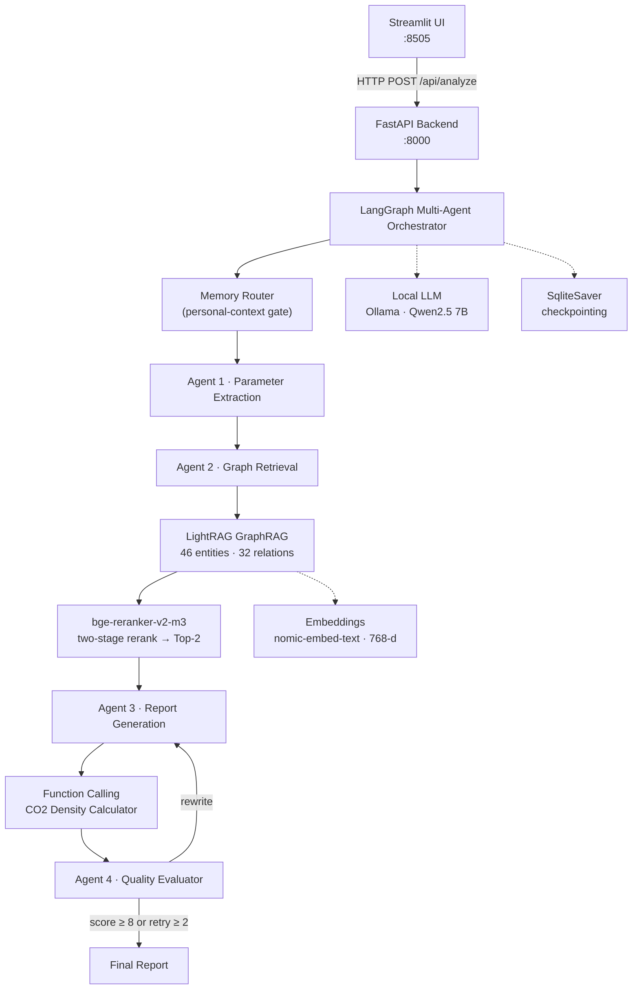

# CCUS Multi-Agent Risk Assessment System

**A localized AI system for CCUS risk assessment using LangGraph, GraphRAG (LightRAG), and physical tools.**

<!-- 中文注释：基于 LangGraph 多智能体 + LightRAG 知识图谱 + 物理计算工具的本地化 CCUS 风险评估系统，全链路离线运行，前后端解耦。 -->

<p>
  
  
  
  
  
  
</p>

<p>
  <a href="https://github.com/qinruizhang001-hash/petro-rag-agent/actions/workflows/ci.yml"></a>
  <a href="LICENSE"></a>
  
</p>

---

## Overview

<!-- 中文注释：项目定位——面向 CO2 地质封存（CCUS）的风险评估系统。用户输入一段项目描述，系统自动提取参数、检索知识图谱、调用物理计算工具、生成结构化风险报告并自评审。 -->

This project is an end-to-end, fully offline AI system for **CO2 Capture, Utilization and Storage (CCUS)** risk assessment. Given a free-text project description (reservoir type, injection pressure, temperature, fault conditions), the system extracts key geological parameters, retrieves evidence from a domain knowledge graph, invokes physical calculation tools when numerical constraints are required, and produces a structured risk report that is then scored by an automated reviewer.

The design goal is **trustworthy domain AI**: every claim in the generated report is grounded in retrieved graph evidence, numerical values come from deterministic tools rather than model guesswork, and the generation loop is bounded to prevent runaway cost.

<!-- 中文注释：设计目标——可信的领域 AI：报告结论基于图谱证据，数值来自确定性工具（不靠模型猜），生成循环有上限（防无限重写）。 -->

---

## Screenshots

<!-- 中文注释：真实运行截图（非设计稿）——输入界面、250bar/80℃ 断层场景的评估报告、LightRAG 构建的知识图谱。 -->

**Input** — a free-text CCUS project description:


**Output** — the generated risk report for a 250 bar / 80 °C faulted-carbonate scenario:


**Knowledge graph** — 46 entities / 32 relations extracted by LightRAG. The drawn subgraph is the largest connected component, which is exactly the causal chain the retriever reasons over (`fault activation → caprock → reservoir → wellbore integrity → monitoring`). Regenerate it with `python render_graph_svg.py`; open the [raw SVG](docs/knowledge-graph.svg) to read full relation descriptions on hover.


---

## Architecture

<!-- 中文注释：链路——Streamlit 前端 → FastAPI 后端 → LangGraph 多智能体 → LightRAG 图谱检索 + Reranker + 本地 LLM → Function Calling 物理计算。 -->



<!-- 中文注释：四个 Agent 分工——1 参数提取、2 图谱检索+精排、3 报告生成（含工具调用）、4 评审打分。评审 <8 分且重写未超 2 次则打回重写，否则结束。 -->

---

## Core Highlights

<!-- 中文注释：核心亮点，面向评审/面试官的重点。 -->

- **GraphRAG Integration** — A LightRAG knowledge graph is built from CCUS literature, extracting **46 geological entities** and **32 relations** (fault activation, caprock integrity, breakthrough pressure, injection pressure, etc.). This enables **multi-hop reasoning** that flat vector search cannot express.
- **Two-Stage Retrieval** — Graph recall surfaces **81 candidate fragments**; fragments are merged into entity-relation-complete segments (average 305 characters) and reranked by a local **bge-reranker-v2-m3** model down to **Top-2** (peak score **0.9971**). Longer, semantically complete segments give the reranker real discriminative power.
- **Function Calling** — A deterministic physical tool computes CO₂ density from injection pressure and temperature (e.g. **250 bar / 80 °C → 1.35 kg/m³**), then a second LLM pass integrates the value into the report. Numerical claims are never hallucinated.
- **Production Ready** — **FastAPI** backend fully decoupled from a minimal **Streamlit** frontend. 120-second client timeout, bounded reflection (`score ≥ 8` or `retry_count ≥ 2`), SQLite checkpointing, and a 13-assertion end-to-end regression suite.
- **Self-Correcting Loop** — An evaluator agent scores each draft against the retrieved evidence and sends weak drafts back for rewrite, with a hard retry ceiling to bound latency and token cost.
- **Fully Offline** — The entire pipeline (LLM, embeddings, reranker, graph store, checkpoints) runs locally on Ollama and on-disk stores. No external API keys required for the core path.
- **Optional Extensions** — Personal long-term memory (Notion + ChromaDB) and web-search auto-ingestion (Tavily) can be enabled without touching the core graph.

<!-- 中文注释：亮点补充——自纠正评审循环、完全离线、可选扩展（个人记忆 / 联网检索自动入库）。 -->

---

## Tech Stack

<!-- 中文注释：技术栈一览。 -->

| Layer | Technology |
|---|---|
| Frontend | Streamlit (pure HTTP client, no domain logic) |
| Backend | FastAPI + Uvicorn |
| Orchestration | LangGraph `StateGraph` + `SqliteSaver` checkpointing |
| Graph RAG | LightRAG 1.5.7 (NetworkX graph + NanoVectorDB vectors) |
| Reranker | `bge-reranker-v2-m3` via sentence-transformers |
| LLM | Qwen2.5 7B served by Ollama (local) |
| Embeddings | `nomic-embed-text` (768-dim) |
| Long-term Memory *(optional)* | Notion API + ChromaDB |
| Web Search *(optional)* | Tavily |

---

## Project Structure

<!-- 中文注释：文件结构。前端 app.py 只管 UI；后端 api_server.py 暴露 HTTP；multi_agent_ccus.py 是 LangGraph 主图；lightrag_retriever.py 封装图谱检索。 -->

```
petro-rag-agent/
├── app.py                    # Streamlit frontend (HTTP client only)
├── api_server.py             # FastAPI backend: POST /api/analyze
├── multi_agent_ccus.py       # LangGraph multi-agent workflow
├── lightrag_retriever.py     # LightRAG sync wrapper (thread + event loop bridge)
├── fragment_builder.py       # Pure fragment assembly logic (unit-tested)
├── graph_rag_test.py         # Graph construction & multi-hop query test
├── render_graph_svg.py       # Render the graphml into docs/knowledge-graph.svg
├── test_graph_rag_e2e.py     # End-to-end regression suite (13 assertions)
├── tests/
│   └── test_fragment_builder.py   # Offline unit tests (no Ollama needed)
├── memory/                   # Optional personal memory (Notion + ChromaDB)
├── tools/                    # Optional web search + auto-ingestion (Tavily)
├── docs/                     # Screenshots
├── .github/workflows/        # CI (fast checks) + E2E (manual, self-hosted)
├── ccus_data.txt             # CCUS seed corpus for graph construction
├── requirements.txt
└── lightrag_storage/         # Graph & vector store (gitignored)
```

<!-- 中文注释：fragment_builder.py 是纯函数模块——把「片段构建」这段决定检索质量的核心逻辑从需要 Ollama 的链路里剥离出来，才能被 CI 独立验证。 -->

---

## Quick Start

<!-- 中文注释：三步启动——装依赖 → 建图谱索引（首次）→ 起后端 → 起前端。 -->

**Prerequisites:** Python 3.10+, [Ollama](https://ollama.com) running locally.

```bash
# 1. Pull local models
ollama pull qwen2.5
ollama pull nomic-embed-text

# 2. Install dependencies
pip install -r requirements.txt

# 3. Build the knowledge graph (first run only, takes a few minutes)
python graph_rag_test.py

# 4. Start the backend  →  http://127.0.0.1:8000
python api_server.py

# 5. Start the frontend  →  http://127.0.0.1:8505
streamlit run app.py --server.port 8505
```

Open `http://127.0.0.1:8505`, paste a project description, and click **启动评估** (*Start Assessment*).

<!-- 中文注释：启动顺序很重要——必须先起后端，前端才能调通；图谱索引只需建一次。 -->

---

## API Reference

<!-- 中文注释：后端接口。前端只依赖 /api/analyze。 -->

| Method | Endpoint | Description |
|---|---|---|
| `POST` | `/api/analyze` | Run the full assessment pipeline |
| `GET` | `/health` | Health check |
| `GET` | `/docs` | Interactive Swagger UI |

**Request**

```json
{ "user_input": "某CCUS项目注入压力250bar，温度80℃，存在隐伏碳酸盐岩储层断层，请评估风险。" }
```

**Response**

```json
{
  "status": "success",
  "report": "### CCUS项目风险评估报告 ...",
  "extracted_params": "...",
  "score": 8
}
```

Typical end-to-end latency: **~55–90 s** on CPU-only local inference.

<!-- 中文注释：一次完整评估约 55-90 秒（纯 CPU 推理），前端 timeout 设 120 秒。 -->

---

## Testing

<!-- 中文注释：两层测试——1) 离线单元测试（CI 每次 push 都跑，秒级，无需 Ollama）；2) 端到端回归（需本地 Ollama + 图谱索引）。 -->

### Unit tests — offline, no Ollama required

```bash
python -m unittest discover -s tests -v
```

```
Ran 15 tests in 0.000s
OK
```

Covers the fragment-assembly logic that decides retrieval quality: relation fragments must embed **both** endpoint descriptions (this is what gives the reranker discriminative power), isolated entities must survive, ordering and de-duplication must be stable.

### End-to-end regression — requires local Ollama + built graph

```bash
python test_graph_rag_e2e.py
```

The suite verifies Ollama availability, model presence, graph storage integrity, retrieval fragment quality, full workflow execution, report grounding (density value present), reviewer score, and that retrieval is served by the LightRAG engine.

```
Test summary: 13 PASS / 0 FAIL
```

### Continuous integration

| Workflow | Trigger | Scope |
|---|---|---|
| `ci.yml` | every push / PR | byte-compile, secret scan, 15 offline unit tests across Python 3.10–3.12, frontend-backend contract check |
| `e2e.yml` | manual (`workflow_dispatch`) | full 13-assertion pipeline on a self-hosted runner with Ollama |

<!-- 中文注释：CI 故意分成两层——托管 runner 跑不起 7B 模型，所以 E2E 只在自建 runner 上手动触发；这样 badge 永远是绿的，同时重型验证仍然存在。 -->

---

## Limitations & Roadmap

<!-- 中文注释：诚实列出限制，比吹嘘更专业。 -->

**Known limitations**

- The CO₂ density tool uses a simplified equation of state (`ρ = 1.9·P / T`), not a full Span–Wagner formulation. It is a demonstration of the tool-calling contract, not a reservoir-engineering calculator.
- Local 7B-model entity extraction occasionally normalizes Chinese descriptions into English; graph semantics remain intact, and English entities are preferable for cross-lingual literature retrieval.
- The API runs a single worker; concurrent requests are not yet supported.
- Graph construction is currently offline and corpus-specific; incremental ingestion is planned.

**Roadmap**

- [ ] Replace the density approximation with a proper CO₂ EOS (Span–Wagner / NIST tables)
- [ ] Incremental graph ingestion from PDFs (`ccus_docs/`)
- [ ] Async task queue for concurrent assessments
- [ ] Containerized deployment (Docker Compose: backend + frontend + Ollama)

---

## Acknowledgements

<!-- 中文注释：致谢开源项目。 -->

Built on [LightRAG](https://github.com/HKUDS/LightRAG) (HKUDS), [LangGraph](https://github.com/langchain-ai/langgraph), [BAAI bge-reranker](https://huggingface.co/BAAI/bge-reranker-v2-m3), and [Qwen](https://github.com/QwenLM/Qwen2.5). Graph storage by NetworkX; vector storage by NanoVectorDB.

<!-- 中文注释：本项目为个人学习与科研训练用途，CCUS 领域知识来源于公开学术文献。 -->
