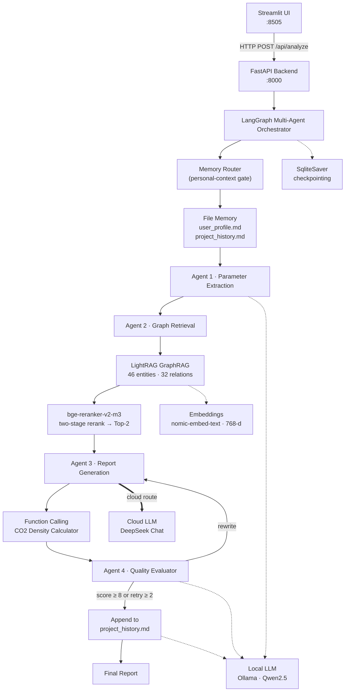

# CCUS Multi-Agent Risk Assessment System

**A localized AI system for CCUS risk assessment using LangGraph, GraphRAG (LightRAG), and physical tools.**

<!-- 中文注释：基于 LangGraph 多智能体 + LightRAG 知识图谱 + 物理计算工具的本地化 CCUS 风险评估系统，全链路离线运行，前后端解耦。 -->

<p>
  
  
  
  
  
  
</p>

<p>
  <a href="https://github.com/qinruizhang001-hash/petro-rag-agent/actions/workflows/ci.yml"></a>
  <a href="LICENSE"></a>
  
</p>

---

## Overview

<!-- 中文注释：项目定位——面向 CO2 地质封存（CCUS）的风险评估系统。用户输入一段项目描述，系统自动提取参数、检索知识图谱、调用物理计算工具、生成结构化风险报告并自评审。 -->

This project is an end-to-end, fully offline AI system for **CO2 Capture, Utilization and Storage (CCUS)** risk assessment. Given a free-text project description (reservoir type, injection pressure, temperature, fault conditions), the system extracts key geological parameters, retrieves evidence from a domain knowledge graph, invokes physical calculation tools when numerical constraints are required, and produces a structured risk report that is then scored by an automated reviewer.

The design goal is **trustworthy domain AI**: every claim in the generated report is grounded in retrieved graph evidence, numerical values come from deterministic tools rather than model guesswork, and the generation loop is bounded to prevent runaway cost.

<!-- 中文注释：设计目标——可信的领域 AI：报告结论基于图谱证据，数值来自确定性工具（不靠模型猜），生成循环有上限（防无限重写）。 -->

---

## Screenshots

<!-- 中文注释：真实运行截图（非设计稿）——输入界面、250bar/80℃ 断层场景的评估报告、LightRAG 构建的知识图谱。 -->

**Input** — a free-text CCUS project description:


**Output** — the generated risk report for a 250 bar / 80 °C faulted-carbonate scenario:


**Knowledge graph** — 46 entities / 32 relations extracted by LightRAG. The drawn subgraph is the largest connected component, which is exactly the causal chain the retriever reasons over (`fault activation → caprock → reservoir → wellbore integrity → monitoring`). Regenerate it with `python render_graph_svg.py`; open the [raw SVG](docs/knowledge-graph.svg) to read full relation descriptions on hover.


---

## Architecture

<!-- 中文注释：链路——Streamlit 前端 → FastAPI 后端 → LangGraph 多智能体 → LightRAG 图谱检索 + Reranker + 本地 LLM → Function Calling 物理计算。 -->



<!-- 中文注释：四个 Agent 分工——1 参数提取、2 图谱检索+精排、3 报告生成（含工具调用）、4 评审打分。评审 <8 分且重写未超 2 次则打回重写，否则写入文件记忆后结束。
     模型路由：只有 Agent 3（粗箭头）走云端，其余全部本地跑。 -->

---

## Model Routing

<!-- 中文注释：多模型路由——按角色对"智商"的需求分配模型，把钱只花在真正影响产出质量的那一步。 -->

Different agents have very different intelligence requirements. Parameter extraction and quality scoring are short, structured judgments that a local 7B model handles perfectly at zero marginal cost. Report generation is the opposite: long-form, logic-heavy, professional prose — exactly where cloud models still pull ahead. So the expensive model is used **only** where it changes the output.

| Stage | Role | Route | Rationale |
|---|---|---|---|
| `extract` | Agent 1 · Parameter extraction | `local` | Short structured output, judgment is trivial |
| `report` | Agent 3 · Report generation | **`cloud`** | The actual deliverable — quality gap is largest here |
| `evaluate` | Agent 4 · Quality evaluator | `local` | Rubric scoring, runs up to 3× per task |
| `history` | File-memory compression | `local` | Pure extraction, no reasoning needed |

Everything routes through a single `llm_chat(stage, messages, temperature)` entry point, so "which model did this role actually use" has exactly one source of truth. The resolved route is written into state as `model_routing = {stage: "tier:model"}` and returned by the API — routing is **observable**, not implied.

```bash
# .env  —  DeepSeek is OpenAI-compatible; swap for OpenAI / SiliconFlow / Qwen by changing 2 lines
CLOUD_API_KEY=sk-...
CLOUD_BASE_URL=https://api.deepseek.com/v1
CLOUD_MODEL=deepseek-chat
```

**Graceful degradation is mandatory, not a nicety.** With no `CLOUD_API_KEY`, the `report` stage falls back to the local model and *says so* — in the log, in `model_routing`, and in the API response. It never silently pretends the cloud route ran. This keeps the whole system runnable for anyone who clones it without a paid key.

To change the strategy, edit one dict — `MODEL_ROUTING` — and no node code.

### Per-stage models, and pointing at a local gateway

Each stage can name its own model, which matters as soon as you put a gateway in front of several vendors:

```bash
# ROUTE_<STAGE> = local | cloud | cloud:<model> | local:<model>
ROUTE_REPORT=cloud:deepseek/deepseek-chat
ROUTE_EVALUATE=cloud:kimi/kimi-k2
ROUTE_EXTRACT=local
```

`CLOUD_BASE_URL` only has to speak the OpenAI wire format, so any aggregator works — [magpie](https://github.com/yetone/magpie), one-api, LiteLLM, or a self-hosted vLLM/Ollama. With a gateway, model names usually become `provider/model`, e.g.:

```bash
CLOUD_BASE_URL=http://127.0.0.1:3425/v1   # magpie's gateway
CLOUD_API_KEY=magpie                      # loopback gateways accept any key
CLOUD_MODEL=deepseek/deepseek-chat
```

Two things this buys you: one place to hold all vendor keys with failover, and per-stage model choice across vendors. Two things it costs: an extra hop, and a new failure mode — *which* component is broken is no longer obvious. `check_gateway.py` exists for exactly that:

```bash
python check_gateway.py          # reachability, model list, route/model match
python check_gateway.py --send   # also fire one tiny real request
python check_gateway.py --local  # same checks against Ollama
```

It distinguishes the four failures that otherwise look alike: gateway not running, a proxy hijacking the loopback request (returns a misleading **502** instead of connection refused), model name mismatch, and bad credentials.

#### Wiring up magpie specifically

[magpie](https://github.com/yetone/magpie) (MIT) runs a gateway on `127.0.0.1:3425` that speaks OpenAI Chat/Responses, Anthropic Messages and Gemini, translating between them.

```bash
# 1. install (Windows: magpie-cli-windows-amd64.exe from the releases page)
curl -fsSL https://usemagpie.ai/install.sh | sh

# 2. add an upstream — a vendor key, or the local server you already have
magpie provider add deepseek sk-...
magpie provider add ollama            # no key needed

# 3. confirm what the gateway exposes
curl -s http://127.0.0.1:3425/v1/models
```

Then in `.env` point the cloud slot at it — no code change required:

```bash
CLOUD_BASE_URL=http://127.0.0.1:3425/v1
CLOUD_API_KEY=magpie
CLOUD_MODEL=deepseek/deepseek-chat
```

```bash
python check_gateway.py --send
```

**A gateway is not a source of quota.** It holds and rotates credentials you already have; it cannot conjure access to a vendor you have no key for. So the honest verification order is: bring up the gateway with **Ollama** as its upstream first (works with zero keys, proves the plumbing end to end), then add the paid vendor key and change one line — `CLOUD_MODEL=deepseek/deepseek-chat`.

> **A note on keys.** The routing table moves *your own* credentials around; it is not a way to obtain models without them. Pointing this at a paid vendor's API with a key you hold — or at a subscription you already pay for, where that vendor's terms permit API use — is the supported path. Driving web sessions or free tiers programmatically in ways their terms forbid is not, and several gateway plugins in the wild do exactly that; don't wire them in here.

<!-- 中文注释：关键设计——没有 key 时必须显式降级并留下痕迹，不能静默假装走了云端。调策略只改 MODEL_ROUTING 一张表。
     per-stage 模型覆盖是为"网关后面挂多厂商"准备的：网关统一用 provider/model 命名，各角色可以用不同厂商的模型。
     check_gateway.py 的存在理由：接入网关后，"到底哪一环坏了"不再显然，四类失败（没启动/代理劫持502/模型名不符/鉴权失败）报错很像。 -->

---

## File-Based Memory

<!-- 中文注释：极简长期记忆——两个 Markdown 文件，不引入任何向量库。 -->

Long-term memory without a vector database. Two plain Markdown files at the repo root:

| File | Written by | Contents |
|---|---|---|
| `user_profile.md` | **human** | Durable preferences: domains of interest, report style, terminology habits |
| `project_history.md` | **system** | One entry per assessment: scenario, key parameters, core conclusion, reviewer score |

**How it's used.** Before `generate_report` runs, both files are read and injected into the **System Prompt** (not the user message) alongside the role definition and writing constraints. The report prompt then instructs the model to obey the style preferences and, when the current scenario resembles a past one, to make an explicit longitudinal comparison.

**How it's written.** After the evaluator passes, a dedicated `save_file_memory` node asks the local model to compress the assessment into a four-field entry and appends it to `project_history.md`.

Two design decisions worth calling out, because the naive version of this feature degrades over time:

- **Append happens in a separate node, not inside `evaluate_report`.** The evaluator is inside the reflection loop and can run up to three times; writing there would persist intermediate drafts and corrupt the history. Hanging the node off the `pass` branch guarantees exactly one write per task.
- **Reads are bounded (last 6 entries, 3 000 chars).** `project_history.md` grows forever. Injecting the whole file would eventually blow the context window and dilute the model's attention with stale scenarios. Reads are truncated by entry count first, then by character count — both covered by unit tests.

### Memory summarization

Bounded reads fix the *prompt*, not the *file*. Left alone, `project_history.md` keeps growing on disk. So immediately before the file is read for the prompt, a threshold check runs: **above 3 000 characters, the old entries are handed to the local model, distilled into 3 reusable "core lessons", and the file is rewritten** to hold just those lessons plus the most recent entries.

```
project_history.md  (4 951 chars, 30 entries)
        │
        ├─ keep last 2 entries verbatim ──────────────┐
        │                                             │
        └─ older 28 entries ──▶ LLM ──▶ 3 lessons ────┤
                                                      ▼
project_history.md  (547 chars: header + lessons + last 2)
```

A real distillation from the test corpus:

```
- 注入压力 > 250 bar 且存在隐伏断层时，断层活化风险显著上升，需布设微地震监测并控制注入速率。
- 压力积聚速度快，盖层突破压力是首要控制因素，需实时压力监测与分注调控。
- 井筒完整性是多层系风险源，需重点核查固井质量与套管腐蚀余量。
```

Configuration in `.env`: `HISTORY_COMPRESS_THRESHOLD` (default `3000` **characters**), `HISTORY_KEEP_RECENT` (default `2`).

Four guards, each aimed at a specific way this feature fails:

1. **Only *old* entries are compressed; the last N stay verbatim.** Recent assessments are what longitudinal comparison actually uses — summarizing them into one sentence destroys parameter-level comparability (250 bar vs 300 bar is the whole point).
2. **Fewer than 2 old entries → skip.** This is the self-limiting switch: after compression the old pool is empty, so nothing happens until enough new entries accumulate. Without it, a single oversized entry would trigger an LLM call on *every* read — latency explosion and lessons that drift on each run.
3. **Summarizer failure never touches the file.** A failed or empty summary leaves the history byte-identical and the run continues with truncated reads. Losing accumulated history to a transient LLM error is far worse than skipping one compression.
4. **Rewrites are atomic** (`tempfile` + `os.replace`). A crash mid-write cannot leave a truncated history file.

The threshold is measured in **characters, not bytes**. With Chinese text one character occupies 3 UTF-8 bytes, so comparing `os.path.getsize()` against 3000 would fire at roughly 1 000 characters — three times earlier than intended. There is a dedicated regression test that builds a file exceeding 3 000 bytes but under 3 000 characters and asserts nothing happens.

The LLM call is **injected as a callback** rather than imported inside `file_memory.py`. That keeps the module free of any LLM dependency, so it imports cleanly under a circular-import-free path and its unit tests run offline with a fake summarizer — including a test that asserts the loop guard by calling compression twice.

`user_profile.md` is deliberately left human-curated. Auto-inferring preferences from a single interaction produces noisy, self-reinforcing drift; a stale hand-written line is far easier to debug than a hallucinated one.

The repo ships `project_history.md` with a few real entries so you can see the format — delete them and the file regenerates its header on the next run.

<!-- 中文注释：截断只解决 Prompt 体积，文件本身仍在膨胀，所以加了阈值触发的压缩。
     四个防御对应四种真实失效模式：1) 最近条目必须原样保留（纵向对比要参数级可比）；2) 旧条目不足就跳过——
     这是自限开关，否则单条超长记录会导致每次读取都调模型；3) 摘要失败绝不动文件；4) 原子重写防截断。
     阈值按字符而非字节——中文 1 字 3 字节，用 getsize 会在约 1000 字时误触发（早三倍），有专门回归测试锁死。
     LLM 调用用回调注入，避免循环导入并保住离线单测。用户画像保持人工维护，自动推断偏好会自我强化漂移。 -->

---

## Core Highlights

<!-- 中文注释：核心亮点，面向评审/面试官的重点。 -->

- **GraphRAG Integration** — A LightRAG knowledge graph is built from CCUS literature, extracting **46 geological entities** and **32 relations** (fault activation, caprock integrity, breakthrough pressure, injection pressure, etc.). This enables **multi-hop reasoning** that flat vector search cannot express.
- **Two-Stage Retrieval** — Graph recall surfaces **81 candidate fragments**; fragments are merged into entity-relation-complete segments (average 305 characters) and reranked by a local **bge-reranker-v2-m3** model down to **Top-2** (peak score **0.9971**). Longer, semantically complete segments give the reranker real discriminative power.
- **Model Routing** — Each role is assigned the cheapest model that still does its job: extraction, evaluation and memory compression run locally on Qwen2.5 at zero marginal cost, while **only** report generation goes to a cloud model. One routing dict, one call entry point, and the resolved route is recorded in state as `model_routing` so the choice is auditable rather than assumed.
- **File-Based Memory** — Long-term memory with **no vector database**: `user_profile.md` (human-curated preferences) and `project_history.md` (auto-appended assessment summaries) are injected into the report System Prompt, enabling longitudinal comparison across assessments. Reads are bounded to the last 6 entries so memory cannot silently outgrow the context window.
- **Function Calling** — A deterministic physical tool computes CO₂ density from injection pressure and temperature (e.g. **250 bar / 80 °C → 1.35 kg/m³**, **300 bar / 90 °C → 1.57 kg/m³**), then a second LLM pass integrates the value into the report. The model is asked to emit a JSON tool instruction, but a regex guard on the extracted parameters invokes the tool anyway if it doesn't — so the density is guaranteed to come from physics rather than from the model's arithmetic.
- **Production Ready** — **FastAPI** backend fully decoupled from a minimal **Streamlit** frontend. 120-second client timeout, bounded reflection (`score ≥ 8` or `retry_count ≥ 2`), SQLite checkpointing, 64 offline unit tests, and a 45-assertion end-to-end regression suite.
- **Self-Correcting Loop** — An evaluator agent scores each draft against the retrieved evidence and sends weak drafts back for rewrite, with a hard retry ceiling to bound latency and token cost.
- **Runs Fully Offline** — LLM, embeddings, reranker, graph store and checkpoints all run locally. A cloud key is **optional**: without one, the report stage degrades to the local model and records the downgrade explicitly.
- **Optional Extensions** — Personal long-term memory (Notion + ChromaDB) and web-search auto-ingestion (Tavily) can be enabled without touching the core graph.

<!-- 中文注释：亮点补充——多模型路由（可审计）、文件记忆（不建向量库、读取有上界）、自纠正评审循环、无 key 也能全离线跑、可选扩展。 -->

---

## Tech Stack

<!-- 中文注释：技术栈一览。 -->

| Layer | Technology |
|---|---|
| Frontend | Streamlit (pure HTTP client, no domain logic) |
| Backend | FastAPI + Uvicorn |
| Orchestration | LangGraph `StateGraph` + `SqliteSaver` checkpointing |
| Graph RAG | LightRAG 1.5.7 (NetworkX graph + NanoVectorDB vectors) |
| Reranker | `bge-reranker-v2-m3` via sentence-transformers |
| Local LLM | Qwen2.5 7B served by Ollama — extraction, evaluation, memory compression |
| Cloud LLM *(report stage)* | DeepSeek Chat via OpenAI-compatible API — swappable for any provider |
| Embeddings | `nomic-embed-text` (768-dim) |
| Long-term Memory | File-based (`user_profile.md` + `project_history.md`) |
| Long-term Memory *(optional)* | Notion API + ChromaDB |
| Web Search *(optional)* | Tavily |

---

## Project Structure

<!-- 中文注释：文件结构。前端 app.py 只管 UI；后端 api_server.py 暴露 HTTP；multi_agent_ccus.py 是 LangGraph 主图；lightrag_retriever.py 封装图谱检索；file_memory.py 是文件记忆模块。 -->

```
petro-rag-agent/
├── app.py                    # Streamlit frontend (HTTP client only)
├── api_server.py             # FastAPI backend: POST /api/analyze
├── multi_agent_ccus.py       # LangGraph workflow + model routing
├── lightrag_retriever.py     # LightRAG sync wrapper (thread + event loop bridge)
├── fragment_builder.py       # Pure fragment assembly logic (unit-tested)
├── file_memory.py            # File-based long-term memory (bounded reads)
├── user_profile.md           # Long-term preferences (human-curated)
├── project_history.md        # Per-assessment summaries (auto-appended)
├── graph_rag_test.py         # Graph construction & multi-hop query test
├── model_router.py           # Pure routing logic (unit-tested)
├── check_gateway.py          # Gateway doctor: reachability / models / routes
├── render_graph_svg.py       # Render the graphml into docs/knowledge-graph.svg
├── test_graph_rag_e2e.py     # End-to-end regression suite (45 assertions)
├── tests/
│   ├── test_fragment_builder.py   # Offline unit tests (retrieval fragments)
│   ├── test_file_memory.py        # Offline unit tests (memory bounds & IO)
│   └── test_model_router.py       # Offline unit tests (routing / degradation)
├── memory/                   # Optional personal memory (Notion + ChromaDB)
├── tools/                    # Optional web search + auto-ingestion (Tavily)
├── docs/                     # Screenshots
├── .github/workflows/        # CI (fast checks) + E2E (manual, self-hosted)
├── ccus_data.txt             # CCUS seed corpus for graph construction
├── requirements.txt
└── lightrag_storage/         # Graph & vector store (gitignored)
```

<!-- 中文注释：fragment_builder.py 与 file_memory.py 都是"重依赖剥离"的产物——把决定检索质量、记忆上界的核心逻辑做成纯函数/纯文件 IO，才能被 CI 独立验证。 -->

---

## Quick Start

<!-- 中文注释：启动顺序——装依赖 → 配 .env（可选云端 key）→ 建图谱索引（首次）→ 起后端 → 起前端。 -->

**Prerequisites:** Python 3.10+, [Ollama](https://ollama.com) running locally.
A cloud API key is **optional** — the report stage falls back to the local model without one.

```bash
# 1. Pull local models
ollama pull qwen2.5
ollama pull nomic-embed-text

# 2. Install dependencies
pip install -r requirements.txt

# 3. (Optional) enable cloud routing for the report stage
cp .env.example .env
#    then set CLOUD_API_KEY / CLOUD_BASE_URL / CLOUD_MODEL in .env

# 4. Build the knowledge graph (first run only, takes a few minutes)
python graph_rag_test.py

# 5. Start the backend  →  http://127.0.0.1:8000

python api_server.py

# 5. Start the frontend  →  http://127.0.0.1:8505
streamlit run app.py --server.port 8505
```

Open `http://127.0.0.1:8505`, paste a project description, and click **启动评估** (*Start Assessment*).

<!-- 中文注释：启动顺序很重要——必须先起后端，前端才能调通；图谱索引只需建一次。 -->

---

## API Reference

<!-- 中文注释：后端接口。前端只依赖 /api/analyze。 -->

| Method | Endpoint | Description |
|---|---|---|
| `POST` | `/api/analyze` | Run the full assessment pipeline |
| `GET` | `/health` | Health check |
| `GET` | `/docs` | Interactive Swagger UI |

**Request**

```json
{ "user_input": "某CCUS项目注入压力250bar，温度80℃，存在隐伏碳酸盐岩储层断层，请评估风险。" }
```

**Response**

```json
{
  "status": "success",
  "report": "### CCUS项目风险评估报告 ...",
  "extracted_params": "...",
  "score": 8,
  "model_routing": {
    "extract": "local:qwen2.5",
    "report": "cloud:deepseek-chat",
    "report_tool_call": "cloud:deepseek-chat",
    "evaluate": "local:qwen2.5",
    "history": "local:qwen2.5"
  },
  "history_entry": "**场景**: 含烃碳酸盐岩储层 ... \n**核心结论**: ..."
}
```

`model_routing` reports the model **actually used** per stage, so a degraded run (no cloud key) is visible in the response instead of being silently hidden.

Typical end-to-end latency: **~55–95 s** on CPU-only local inference.

<!-- 中文注释：一次完整评估约 55-95 秒（纯 CPU 推理），前端 timeout 设 120 秒。响应里回传 model_routing 与 history_entry，降级与否一眼可见。 -->

---

## Testing

<!-- 中文注释：两层测试——1) 离线单元测试（CI 每次 push 都跑，秒级，无需 Ollama）；2) 端到端回归（需本地 Ollama + 图谱索引）。 -->

### Unit tests — offline, no Ollama required

```bash
python -m unittest discover -s tests -v
```

```
Ran 64 tests in 0.179s
OK
```

Three suites:

- `test_fragment_builder.py` — the fragment-assembly logic that decides retrieval quality: relation fragments must embed **both** endpoint descriptions (this is what gives the reranker discriminative power), isolated entities must survive, ordering and de-duplication must be stable.
- `test_file_memory.py` — memory bounds and compression: reads must return **only the most recent N entries**; compression must fire above threshold, keep the newest entries verbatim, never leave temp files, never corrupt the file on summarizer failure, never fire twice in a row, and must count **characters rather than bytes**.
- `test_model_router.py` — routing: `provider/model` names with slashes parse correctly, a blank `ROUTE_*` env var does not silently wipe the default, missing cloud keys degrade **with a reason**, unknown tiers degrade instead of crashing, and each stage can be pinned to a different vendor's model behind one gateway.

### End-to-end regression — requires local Ollama + built graph

```bash
python test_graph_rag_e2e.py
```

The suite verifies Ollama availability, model presence, graph storage integrity, retrieval fragment quality, full workflow execution, report grounding (density value present), reviewer score, and that retrieval is served by the LightRAG engine.

```
Test summary: 13 PASS / 0 FAIL
```

### Continuous integration

| Workflow | Trigger | Scope |
|---|---|---|
| `ci.yml` | every push / PR | byte-compile, secret scan, 15 offline unit tests across Python 3.10–3.12, frontend-backend contract check |
| `e2e.yml` | manual (`workflow_dispatch`) | full 45-assertion pipeline on a self-hosted runner with Ollama |

<!-- 中文注释：CI 故意分成两层——托管 runner 跑不起 7B 模型，所以 E2E 只在自建 runner 上手动触发；这样 badge 永远是绿的，同时重型验证仍然存在。 -->

---

## Limitations & Roadmap

<!-- 中文注释：诚实列出限制，比吹嘘更专业。 -->

**Known limitations**

- The CO₂ density tool uses a simplified equation of state (`ρ = 1.9·P / T`), not a full Span–Wagner formulation. It is a demonstration of the tool-calling contract, not a reservoir-engineering calculator.
- Local 7B-model entity extraction occasionally normalizes Chinese descriptions into English; graph semantics remain intact, and English entities are preferable for cross-lingual literature retrieval.
- The API runs a single worker; concurrent requests are not yet supported.
- Graph construction is currently offline and corpus-specific; incremental ingestion is planned.
- **The cloud route is verified structurally, not by output quality.** The routing logic, fallback path and observability are all tested (including a simulated key), but the repository was developed without a paid key, so no side-by-side quality comparison between Qwen2.5 and DeepSeek is claimed here. Configure `CLOUD_API_KEY` and re-run to measure it.
- File memory is single-process only. Concurrent writers are protected by a lock within one process, but there is no cross-process locking — two backend instances sharing the same two `.md` files could interleave.

**Roadmap**

- [ ] Replace the density approximation with a proper CO₂ EOS (Span–Wagner / NIST tables)
- [ ] Incremental graph ingestion from PDFs (`ccus_docs/`)
- [ ] Async task queue for concurrent assessments
- [ ] Containerized deployment (Docker Compose: backend + frontend + Ollama)
- [ ] Per-stage cost accounting in `token_usage` (local calls are free, cloud calls are not)

<!-- 中文注释：诚实标注——云端路由只验证了"结构与降级"，没有 paid key 就不宣称输出质量对比；文件记忆只有单进程锁。 -->

---

## Acknowledgements

<!-- 中文注释：致谢开源项目。 -->

Built on [LightRAG](https://github.com/HKUDS/LightRAG) (HKUDS), [LangGraph](https://github.com/langchain-ai/langgraph), [BAAI bge-reranker](https://huggingface.co/BAAI/bge-reranker-v2-m3), and [Qwen](https://github.com/QwenLM/Qwen2.5). Graph storage by NetworkX; vector storage by NanoVectorDB.

<!-- 中文注释：本项目为个人学习与科研训练用途，CCUS 领域知识来源于公开学术文献。 -->
