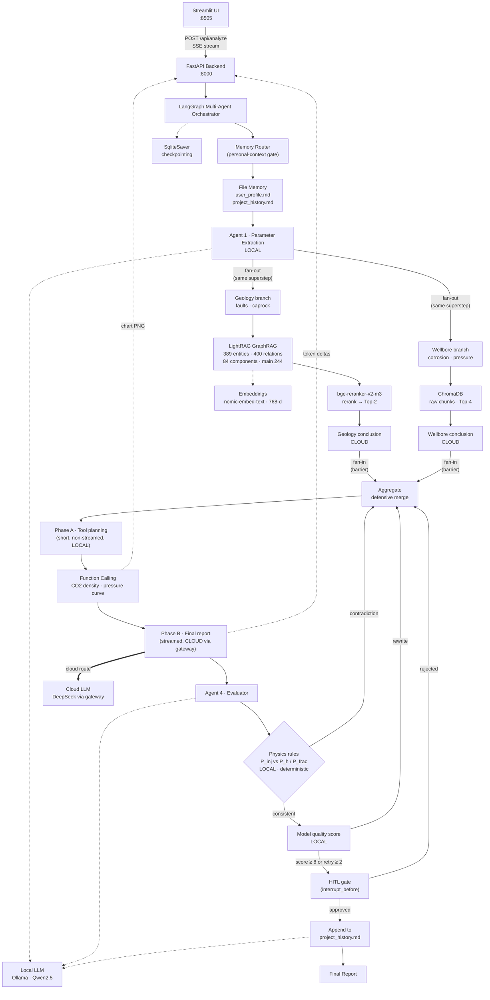

# CCUS Multi-Agent Risk Assessment System

**A Local-first Hybrid AI system for CCUS risk assessment using LangGraph, GraphRAG (LightRAG), and deterministic physical tools.**

<!-- 中文注释：基于 LangGraph 多智能体 + LightRAG 知识图谱 + 物理计算工具的 CCUS 风险评估系统。
     架构定位是 Local-first Hybrid —— 本地负责隐私与确定性（参数提取、图谱检索、物理校验），
     云端负责智商（长文本报告生成）。 -->

<p>
  
  
  
  
  
  
  
</p>

<p>
  <a href="https://github.com/qinruizhang001-hash/petro-rag-agent/actions/workflows/ci.yml"></a>
  <a href="LICENSE"></a>
  
</p>

---

## 🚀 Key Achievements

<!-- 中文注释：四条硬指标。每一条都能在本仓库内用脚本复现，审计记录在 docs/graph-normalization.json，
     不是估算值。数字之所以精确到个位，是因为它们来自 --dry-run 预演 + 真实执行的双重记录。 -->

| # | Metric | Before → After | Change |
|---|--------|----------------|--------|
| 1 | Knowledge-graph connected components | 247 → **84** | **−66 %** |
| 2 | Largest connected component | 83 → **244** nodes | **×2.9** |
| 3 | Rerank candidate fragments | 120 → **87** | **−28 %** |
| 4 | Rerank latency (identical Top-1 / Top-2) | 76 s → **51 s** | **−33 %** |

### 1–2. From a fragment cloud to a geological knowledge network

Naively ingesting the 23-paper CCUS corpus produced 765 entities — but **247 separate islands**, the largest holding only 83 nodes. The cause was not a weak extractor: **5.6 % of the nodes were author affiliations, publication years and paper titles.** Every paper mentions the same university and the same year, so those nodes became *cross-paper false hubs* — they connected unrelated papers to each other while the actual geology stayed disconnected.

Two interventions fixed it, and the measurement shows which one mattered:

| Stage | Nodes | Edges | Components | Largest | What changed |
|-------|------:|------:|-----------:|--------:|--------------|
| Default LightRAG type table | 765 | 559 | 247 | 83 | — |
| **+ 8-type domain ontology** | 433 | 426 | **96** | 252 | explicit *never-extract* list |
| + corpus screening | 422 | 419 | 91 | 252 | `ccus4.pdf` dropped (NOMA paper, not CCUS) |
| **+ entity disambiguation** | 389 | 400 | **84** | **244** | 17 alias groups merged, 8 dirty nodes deleted |

**The ontology constraint did 61 % of the work (247 → 96); alias merging only did 91 → 84.** That is the useful finding: *typed* extraction beats *synonym* merging, because the damage was never "two names for one thing" — it was "things that should not be entities at all." Merging `CO2` / `Carbon Dioxide (CO2)` matters, but deleting `AGH University of Krakow` matters far more.

The merge rules are deliberately boring — case, plural, parenthetical gloss, citation suffix, plus a hand-written synonym table. No fuzzy matching, no edit distance, no embedding similarity: **a missed merge costs one edge, a wrong merge permanently fuses two distinct geological concepts.** `normalize_graph.py` therefore defaults to `--dry-run`, which replays the whole plan through a union-find projection before touching storage; the projection (389/400/84/244) matched the real rebuild exactly, so the 15-minute re-ingest never had to be repeated.

### 3–4. 33 % off the rerank, with the answer left untouched

The default LightRAG caps pulled 120 candidate fragments through a cross-encoder for 76 s — long enough to blow the frontend's 120 s timeout. Tightening two knobs gave back a third of the latency **without changing the retrieved evidence**:

| `LIGHTRAG_TOP_K` / `CHUNK_TOP_K` | Fragments | Rerank | Top-1 score | Top-2 fragment |
|----------------------------------|----------:|-------:|------------:|----------------|
| `40 / 20` (default) | 120 | 76 s | 0.9679 | — |
| **`25 / 12`** | **87** | **51 s** | **0.9679** | **identical** |

Those 33 extra candidates were never going to be selected. Two honest caveats, both measured rather than assumed: after disambiguation the same `25 / 12` yields **124–150 fragments instead of 87**, because alias merging gives every node more relations and the cross-encoder is linear in candidates — connectivity is paid for in the rerank stage. And tightening further to `15 / 8` was tested and **rejected**: it saves 3 s but the second-best fragment changes to a worse one (0.0553 → 0.0334).

### Beyond the graph

- **Physics instead of vibes** — numerical claims are produced by Function Calling against deterministic tools (PVT, fracture gradient, caprock integrity), not by asking the model to recall a number. A rule engine then re-checks the report's conclusions against hard physics before any model is allowed to grade it.
- **Decoupled by construction** — FastAPI backend and Streamlit frontend speak over SSE, so the pipeline is testable without a browser. **146 end-to-end assertions pass** through the real HTTP path, alongside 306 unit tests in CI.

---

## Overview

<!-- 中文注释：项目定位——面向 CO2 地质封存（CCUS）的风险评估系统。用户输入一段项目描述，
     系统自动提取参数、检索知识图谱、调用物理计算工具、生成结构化风险报告，
     再由**确定性规则引擎**核对物理一致性，最后由模型评审质量。 -->

This project is a **Local-first Hybrid** AI system for **CO2 Capture, Utilization and Storage (CCUS)** risk assessment. Given a free-text project description (reservoir type, injection pressure, temperature, fault conditions), the system extracts key geological parameters, retrieves evidence from a domain knowledge graph, invokes physical calculation tools when numerical constraints are required, and produces a structured risk report — which is then checked against hard physics by a rule engine, scored by an automated reviewer, and held for human approval when the conclusion is a safety-critical one.

**The architecture is explicitly hybrid, and the split is a design decision, not an accident:**

- **Local (Ollama)** — parameter extraction, graph retrieval + reranking, physics validation, quality scoring, history compression. Sensitive project data never leaves the machine, and these steps are short, structured, and do not benefit from a frontier model.
- **Cloud (via gateway)** — the final report generation. Long-form reasoning and professional wording is the one step where model quality is directly visible in the deliverable, so it is the only step worth paying for.

Put differently: **sensitive data extraction and local retrieval run on Ollama; the high-intelligence report generation goes through the gateway to the cloud.** A cloud key is optional — without one, the report stage degrades to the local model and records the downgrade explicitly rather than pretending nothing happened.

The design goal is **trustworthy domain AI**: every claim in the generated report is grounded in retrieved graph evidence, numerical values come from deterministic tools rather than model guesswork, and the physical conclusions are checked by code before any model is allowed to grade them.

<!-- 中文注释：设计目标——可信的领域 AI：报告结论基于图谱证据，数值来自确定性工具（不靠模型猜），
     物理结论先由代码核对再交给模型评分；生成循环有上限（防无限重写）。 -->

---

## Screenshots

<!-- 中文注释：真实运行截图（非设计稿）——输入界面、250bar/80℃ 断层场景的评估报告、LightRAG 构建的知识图谱。 -->

**Input** — a free-text CCUS project description:


**Output** — the streamed risk report plus a generated formation-pressure chart (250 bar injected at 2 500 m). The chart's verdict here is *hard to inject*, not *fracture risk*: at 2 500 m the formation pressure is 253 bar, slightly above the 250 bar injection pressure:


**Knowledge graph** — 389 entities / 400 relations extracted by LightRAG from 22 CCUS papers, sitting in **84 connected components with 244 nodes (63 %) in the main one**. The drawn subgraph is that largest component, which is exactly the causal chain the retriever reasons over (`CO2 plume → caprock → fault → wellbore integrity → monitoring`). Its hubs are domain concepts, not metadata: `Digital Twin` (26 edges), `CO2` (25), `CO2 Plume` (25), `Permeability` (23), `Reservoir` (18), `Caprock` (9). Regenerate it with `python render_graph_svg.py`; open the [raw SVG](docs/knowledge-graph.svg) to read full relation descriptions on hover.


---

## Architecture — Local-first Hybrid (Local Privacy + Cloud Intelligence)

<!-- 中文注释：链路——Streamlit 前端 → FastAPI 后端 → LangGraph 多智能体 → LightRAG 图谱检索 + Reranker
     → 物理规则校验 → 本地 LLM 或云端网关 → Function Calling 物理计算 → 人工闸门。 -->

### What runs where

| Layer | Runs on | Why it lives there |
|---|---|---|
| Parameter extraction (Agent 1) | **Local** Ollama · Qwen2.5 | Raw project descriptions may contain commercially sensitive well/reservoir data; extraction is structured and short, a 7B model is enough |
| Graph retrieval + reranking (geology branch) | **Local** LightRAG + bge-reranker | The corpus and the query never need to leave the machine |
| Vector retrieval (wellbore branch) | **Local** ChromaDB | Same reason; and it is a 20 ms embedding lookup, not a network call |
| Physics validation (Agent 4, rule layer) | **Local** pure Python | Determinism beats intelligence here — see [Physics-consistency gate](#physics-consistency-gate) |
| Report scoring (Agent 4, model layer) | **Local** | Judging structure and grounding is cheap; no need for a frontier model |
| History compression | **Local** | Pure information extraction |
| **Branch conclusions + final synthesis** | **Cloud** via gateway (DeepSeek by default) | Long-form engineering prose is exactly where model quality shows. These are the only steps worth paying for |
| Human approval (HITL gate) | **Human** | A safety-critical conclusion should not be auto-approved |

Everything is per-stage configurable (`ROUTE_<STAGE>=local|cloud|cloud:provider/model`), so "which side of the line a step sits on" is a config change, not a code change. If the cloud is unreachable or unconfigured, the branch and report stages degrade to the local model and the degradation is recorded in `model_routing` — it is never silent.



<!-- 中文注释：四个 Agent 分工——1 参数提取、2 图谱检索+精排、3 报告生成（两阶段：先规划工具、再流式写终稿）、
     4 评审（先跑确定性物理规则，再让模型打分）。
     物理规则与模型打分是**串联**的：规则说矛盾就直接 0 分打回，模型根本没机会给漂亮但错误的报告打高分。
     人工闸门用 interrupt_before 暂停，通过 → 落盘，驳回 → 带意见回 report 重写。
     token 与图表都从节点内部经由 config 里的回调推给 API，再转成 SSE。 -->

### Physics-consistency gate

The evaluator used to be a pure LLM grader, which is a black box: a report that says "risk is controllable" while the injection pressure exceeds the formation fracture pressure can still score 9/10 if it is well written. In CCUS that is not a cosmetic problem — the report becomes an engineering basis.

So the evaluator now runs in two layers, **in this order**:

1. **Rule layer (`utils/physics_rules.py`, pure Python, no model).** It recomputes the two hard limits from the extracted depth and compares them with what the report claims:

   ```
   P_h(d)    = ρ_w·g·d / 1e5        ρ_w = 1030 kg/m³
   P_frac(d) = 1.5 · P_h(d)

   P_inj > P_frac  → caprock fracturing / leakage — the report MUST say so
   P_inj < P_h     → cannot inject — the report MUST NOT claim "smooth injection"
   otherwise       → inside the safe injection window
   ```

   A contradiction is **blocking**: the report gets score 0, is sent back for rewrite, and receives a *numeric* correction instruction (e.g. "lower bottom-hole pressure to ≤ 227 bar, or deepen the reservoir to ≥ 1 649 m"), not a vague "there is a physical error".

2. **Model layer.** Only if the rules pass does the LLM score structure, grounding and actionability — with the rule-engine verdict injected into its prompt as ground truth, so it cannot overrule a deterministic conclusion.

The distinction between `blocking` and `warning` matters: *"the report says it is safe, but it is not"* is a contradiction and blocks; *"the report did not mention it"* is an omission and only warns. Text matching is directional — `"破裂压力 379 bar 高于注入压力"` (a **safe** claim) is deliberately *not* counted as acknowledging the risk, and negations (`未超过` / `不超过` / `没有超过`) are excluded.

### Human-in-the-loop

The graph contains a `hitl_gate` node. Two compile targets share the same graph definition:

| Graph | Compile flags | Behaviour |
|---|---|---|
| `app` / `app_stream` | no `interrupt_before` | gate auto-approves and **records** `human_decision.auto = true` — the API response says `human_review.auto: true`, so "nobody looked at this" is never disguised as "approved" |
| `app_hitl` | `interrupt_before=["hitl_gate"]` | pauses before the gate; state persists in SQLite, so approval can arrive hours later from a different process |

```bash
# 1) run until the gate, get the report + physics verdict
curl -s -X POST http://127.0.0.1:8000/api/analyze/hitl \
     -H 'Content-Type: application/json' \
     -d '{"user_input":"某CCUS项目埋深2000m，注入压力250bar，温度80℃"}'
# → {"status":"awaiting_approval","thread_id":"hitl_...","report":"...","physics_check":{...}}

# 2) reject with a reason → rewrites and stops at the gate again
curl -s -X POST http://127.0.0.1:8000/api/approve \
     -H 'Content-Type: application/json' \
     -d '{"thread_id":"hitl_...","approved":false,"reviewer":"you","comment":"补充断层活化的定量影响"}'

# 3) approve → persists to project_history.md and ends
curl -s -X POST http://127.0.0.1:8000/api/approve \
     -H 'Content-Type: application/json' \
     -d '{"thread_id":"hitl_...","approved":true,"reviewer":"you"}'
```

Rejections are capped (`_MAX_HUMAN_REJECTIONS = 2`). Without a cap, "human keeps rejecting / machine keeps rewriting" is an unbounded spend, and it is almost always caused by a review comment that did not say what to change.

---

## Parallel Fan-out / Fan-in

<!-- 中文注释：extract 之后同时触发地质与井筒两条分支，两条都写完后在 aggregate 合流。
     为什么不是"一个检索节点查两个库"：两个域的问题性质不同，检索的失效模式也不同。 -->

After parameter extraction the graph **splits into two branches that run in the same superstep**, and joins them before anything is written:

| Branch | Store | Answers | Why that store |
|---|---|---|---|
| `geology` | LightRAG graph (389 entities / 400 relations) + bge-reranker | "what is the relation between fault reactivation and injection pressure" | Multi-hop, cross-paper — needs entities and relations, not sentences |
| `wellbore` | ChromaDB raw chunks (Top-4) | "which papers mention casing corrosion or annular pressure" | Single-fact, lexical — graph extraction would miss `环空带压` entirely if it never became an entity |

Both branches **generate their own conclusion** (150–250 characters) rather than returning raw fragments, so the aggregate stage receives two digested opinions instead of thousands of characters of evidence. Raw evidence only ever enters a branch's own prompt.

### Measured, not assumed

`python bench_parallel.py` runs one workflow and reads the timestamps each branch writes into state:

```
地质分支        74.72 s
井筒分支        19.01 s
串行需          93.73 s   （两者相加）
并行实际        74.73 s   （扇出墙钟）
重叠            19.00 s
加速比           1.25 ×
汇总节点        14.92 s
```

Inside the full E2E suite (three workflows, 146 candidate fragments per round) the same numbers read 1.16× and 1.05× — the wellbore branch only takes 5–16 s, so the more the geology rerank dominates, the less there is to overlap.

**The honest part: this does not make the pipeline faster.** End-to-end per workflow went from ~98 s (linear) to ~121 s (fan-out + synthesis), and the E2E suite from 447 s to 513 s. Three effects, all measured:

1. **Two extra generations per request.** Each branch writes its own conclusion, so the cloud is called twice more. That is the price of the architecture, not a bug.
2. **GPU contention.** The wellbore branch's generation runs *while* the cross-encoder is reranking, and both compete for the same GPU. Geology took 74.7 s with the sibling running versus ~61 s of pure retrieval+rerank work — the overlap is real but it is not free.
3. **Rerank candidate count varies run to run** (100 → 146 fragments for the same input, because LightRAG's keyword extraction is not deterministic). Cross-encoder cost is linear in candidates, so this alone moves the total by ~30 s and swamps any architectural comparison.

What the split buys is **fault isolation, per-domain evidence, and independent routing** — a wellbore failure now costs a paragraph instead of the whole report. If you want latency back, the lever is a faster cross-encoder or fewer candidates, not the fan-out; claiming parallelism made this faster would be dishonest arithmetic.

### Two traps that fail loudly, but only if you know where to look

1. **Concurrent writes need reducers.** Two branches writing the same state key in one superstep raises `InvalidUpdateError: At key 'token_usage': Can receive only one value per step`. `token_usage` and `model_routing` therefore carry `Annotated[dict, merge_dict]` reducers in `core/state.py`; the branch products use *separate fields* (`geology_report` / `wellbore_report`) so there is nothing to merge and nothing to overwrite.
2. **A branch that raises destroys the other branch's work.** In LangGraph a node exception fails the whole superstep, discarding whatever the sibling already computed. So `geology` and `wellbore` catch everything and record it in `geology_status` / `wellbore_status` instead of raising.

### Degradation is code, not a prompt instruction

If a branch produces nothing, `aggregate` still writes a report — but the missing module is stated in the report body, **appended deterministically** rather than left to the model:

```
> ⚠️ **数据完整性提示**：本次报告未能获得全部分支的证据，
> 以下模块失败，其结论**不代表该维度无风险**，请人工复核：
> - 地质模块检索超时，请人工复核（原因：TimeoutError: read timed out）
```

The wording matters: without "不代表该维度无风险", a reader interprets a missing section as *no risk* — the most dangerous possible misreading of a safety report. `utils/branch_merge.py` owns this logic as pure functions, so all four combinations (both ok / geology down / wellbore down / both down) are unit-tested without a model.

The rewrite loop (`evaluate → aggregate`) **does not re-run the branches**: the conclusions are already in state, and a rewrite changes wording and structure, not evidence. That is both cheaper and semantically correct.

---

## Literature Expansion Pipeline

The corpus is an **input**, not part of the repository. Three scripts take it from "5 hand-picked papers" to a 22-paper corpus and a knowledge graph you can defend: fetch, ingest, then disambiguate. All three are safe to re-run, and each one is idempotent for a different reason.

### 1. Fetch — `fetch_ccus_papers.py`

```bash
python fetch_ccus_papers.py --target 18          # download
python fetch_ccus_papers.py --dry-run            # rank only, download nothing
```

arXiv is the source because it exposes a public REST API, serves stable PDF links, and has no anti-bot layer — a scraper aimed at publisher pages breaks on the next redesign and gets rate-limited at 2 a.m. The cost is recall quality: arXiv's `all:` field is **full-text**, so `all:"CO2 sequestration"` happily returns plankton carbon fixation, livestock emissions and drone-based gas sensing. All three contain the phrase and none of them are about geological storage.

So the script filters twice:

1. **Geological-context gate (hard).** Title + abstract must contain at least one of `geological / caprock / aquifer / reservoir / fault / saline / subsurface / wellbore / …`, otherwise the paper is discarded. This single rule removes the biological-sequestration class entirely.
2. **Relevance scoring (soft).** Core terms (`CO2 storage`, `CCUS`, `caprock`, `fault reactivation`, `breakthrough pressure`) weigh 2.5–3; method terms (`machine learning`, `surrogate`, `inversion`, `monitoring`) weigh 1. Terms in the *title* score again, because a paper that announces itself as CCUS is more reliable than one that mentions it once in the abstract.

On the current run: **163 candidates → 120 unique → 105 passing the gate → top 18 selected**. Every paper's arXiv id, title, the query that found it, and its score go into `ccus_docs/manifest.json` — so "where did this corpus come from" has an answer that does not depend on remembering.

### 2. Ingest — `ingest_ccus_batch.py`

```bash
python ingest_ccus_batch.py --graph-budget 3000    # both stores
python ingest_ccus_batch.py --skip-graph           # vectors only
python ingest_ccus_batch.py --stats                # what do I have now
python ingest_ccus_batch.py --reset-stuck          # recover from an interrupted run
```

Two stores, treated differently because their costs differ by three orders of magnitude:

| | ChromaDB (`ccus_knowledge_v3`) | LightRAG (knowledge graph) |
|---|---|---|
| Cost driver | embedding only | one LLM entity-extraction call **per chunk** |
| Scope | full text, 1200-char chunks | first `--graph-budget` chars per paper |
| Measured | seconds for the whole corpus | ~42 s per paper at 4 000 chars (18–59 s, 23 papers) |

The asymmetry is the whole design. Embedding 23 papers is cheap, so **nothing is thrown away**. Entity extraction costs a generation call per chunk, so the graph gets the **title + abstract + start of the introduction** — the part that says what problem the paper attacks and which geological concepts it involves. Results and discussion are mostly numbers, which contribute few *relations*.

That budget is a measured tradeoff, not a guess. Full-text graph building for 23 papers would be hours of inference; if you want it, the right move is a faster extraction model, not a bigger number in this flag.

**Incremental and idempotent:**

- ChromaDB chunks get deterministic IDs (`ccus_auto_07::0042`) and each document is **deleted before it is re-written**. `upsert` alone is not enough: switching extractor or chunk size can make a re-run produce *fewer* chunks (165 → 130 in practice), and the leftover tail would keep being retrieved from the previous extraction.
- LightRAG dedupes by content hash, and `ccus_docs/graph_ingest_state.json` records what was fed and how long it took, so a re-run skips unchanged papers instead of burning another 45 s each.
- `--reset-stuck` exists because an interrupted insert leaves the document in `status=processing`, and **every later insert is then silently skipped**. Re-running does not error — it just does nothing. The recovery path is "delete the half-built document, then insert again".

`ccus_knowledge_v3` is built as a **clone of v2 plus the PDF chunks** (671 existing vectors copied verbatim, not re-embedded). Starting an empty v3 and pointing the default at it would have been a silent knowledge *reduction*.

```bash
python ingest_ccus_batch.py --reset-graph --skip-chroma   # wipe the graph, rebuild from scratch
```

`--reset-graph` exists because the extraction prompt is part of the graph's definition. Changing it and re-running without wiping produces a graph where half the papers were read by the old instructions and half by the new ones — a mixture that shows up only as "the graph is worse than expected", never as an error. It deletes `lightrag_storage/` (including the LLM response cache) and the ingest state file; ChromaDB is untouched, because re-embedding 1 982 chunks has nothing to do with how entities are extracted.

### 3. Disambiguate — `normalize_graph.py`

```bash
python normalize_graph.py              # dry run: project the result, change nothing
python normalize_graph.py --apply      # delete noise, merge aliases
```

Two deterministic clean-ups that no amount of prompting fully solves:

**Type constraints** (in `utils/kg_prompt.py`) tell the extractor what a node may be. LightRAG's default type table is encyclopaedic — *Person / Organization / Location / Content* — so it happily turns `AGH University of Krakow`, `2050` and `10100 Burnet Rd., Bldg. 130, Austin, TX 78758, USA` into graph nodes. The replacement table admits eight domain types only (`GeologicalBody`, `WellboreComponent`, `Material`, `Process`, `Technology`, `Parameter`, `Risk`, `Regulation`) and **explicitly lists what not to extract**, because a negative list is what the model actually needs. It is injected through `addon_params["entity_types_guidance"]` — a documented hook, no package patching.

**Alias merging** (in `utils/entity_aliases.py`) fixes what the prompt cannot. LightRAG merges nodes by **exact string**, so `CO2` and `Carbon dioxide (CO2)` are two nodes no matter how clearly the prompt asks for one. The module normalises four things only — case, plural, parenthetical gloss, citation suffix — plus an explicit synonym table, and then merges each group through LightRAG's own `amerge_entities` so the graph, entity vectors, relation vectors and chunk tracking stay consistent. Hand-editing the graphml would leave vectors pointing at nodes that no longer exist: retrieval then hits an entity the graph does not have, which is invisible until recall quietly drops.

The design rule is that **failure must point toward missing a merge, never toward making a wrong one**. A missed merge costs one edge; a wrong merge permanently fuses two different geological concepts and cannot be undone. So there is no fuzzy matching, no edit distance, no embedding similarity — only reductions you can explain to a reviewer.

`--dry-run` is the default because it *projects* the outcome first: the alias plan is applied in memory (union-find over the projected edge set) and the resulting component count is printed before anything is touched. If the projection shows no improvement, the rules are wrong and nothing should be executed. On this corpus the projection matched the actual result exactly: 422 → 389 nodes, 91 → 84 components.

---

## Observability

<!-- 中文注释：print 不是工程标准——没有级别、不落盘、没有模块归属。运行链路统一走 logging。 -->

`print()` is gone from the runtime path (`nodes/`, `core/`, `utils/`, `tools/`, `memory/`, `api_server.py`, `workflow.py`) and is now **CI-enforced**. Every module logs through `utils.logging_setup`, which writes to `app.log` (rotating, 5 MB × 3) and stderr with a fixed five-field format:

```
2026-10-18 09:12:33 | INFO    | nodes.report_node        | model=cloud:deepseek-chat | tokens=4521 | 报告生成完成
└── timestamp ──────┘ └level┘  └─ module ─────┘         └ current model ┘        └ tokens ┘ └ message ┘
```

The model and token counts are **structured fields**, not free text, because they answer the two questions that actually get asked during an incident — *did this run go to the cloud, and how much did it cost?*

```bash
grep 'model=cloud' app.log        # every cloud call, with its stage
grep 'tokens=0' app.log           # calls that returned no usage (a silent billing hole)
```

Missing fields render as `-` rather than raising: most log lines have no model or token count, and a formatter that throws would turn "write a log line" into "crash the call stack". Third-party noise (httpx, chromadb, lightrag, sentence-transformers) is pinned to `WARNING` so business logs stay readable. `LOG_LEVEL` and `APP_LOG_FILE` are environment-configurable.

---

## Deployment (Docker)

<!-- 中文注释：一键部署。Ollama 不在 compose 里——它在宿主机上，容器通过 host.docker.internal 访问。 -->

```bash
docker compose up -d --build
# API      → http://localhost:8000/docs
# Frontend → http://localhost:8505
```

Two services from **one image**, differing only in `command` — so "works on the frontend, broken on the backend" cannot happen:

| Service | Port | Command |
|---|---|---|
| `api` | 8000 | `uvicorn api_server:api --host 0.0.0.0 --port 8000` |
| `ui` | 8505 | `streamlit run app.py --server.port=8505 --server.address=0.0.0.0` |

Details that are easy to get wrong and are handled in the `Dockerfile`:

- `libgl1` / `libglib2.0-0` — chromadb's opencv dependency; missing it throws `libGL.so.1: cannot open shared object file` at import time, which looks like broken code rather than a missing system library.
- `fonts-noto-cjk` — without it matplotlib renders every Chinese label as a tofu box, silently producing an unreadable chart.
- CPU-only torch is installed first (`--index-url .../whl/cpu`); the default PyPI wheel drags in ~2 GB of CUDA that a CPU-inference container never uses.
- Models and graph storage are **volumes, not layers** — the 2.3 GB reranker must not be baked into the image.
- Ollama is *not* in the compose file. It runs on the host and is reached via `host.docker.internal` (`extra_hosts: host-gateway` on Linux).
- The UI talks to `http://api:8000` (service DNS), not `127.0.0.1:8000` — `API_BASE_URL` exists precisely for this.

---

## Streaming &amp; Charts

<!-- 中文注释：流式输出与专业图表——两个"体验升级"，但实现上有三个坑必须处理掉。 -->

### Streaming: SSE from a sync LangGraph graph

The frontend shows the report the way ChatGPT does — token by token — over a single SSE connection. Four event types: `node` (progress), `token` (text delta), `chart` (image ready), `done` (score, routing, final report).

Getting there required working around three things that don't do what you'd expect:

1. **`astream_events` silently drops `get_stream_writer()` output.** The idiomatic LangGraph way to stream custom data is `stream_mode="custom"`; with `astream_events` those writes never appear (only state `on_chain_stream`). Verified experimentally before building on it. So the token channel is our own: the sink callable is handed to the node through `config["configurable"]["token_sink"]`, and the node pushes each delta through it.

2. **`SqliteSaver` has no async support.** `astream_events` walks the async path and raises `NotImplementedError: The SqliteSaver does not support async methods`. The streaming endpoint therefore uses a second compilation — `app_stream = workflow.compile()` with no checkpointer. The trade-off is documented where it's made: a streamed request can't be resumed across requests, but a single assessment always runs to completion in one go anyway, and long-term memory is served by the file memory, which is a separate mechanism. Side benefit: `checkpoint.db` no longer grows on every API call.

3. **Two-pass generation would stream the report twice.** The old flow produced a full draft (with a ` ```json ` tool instruction inside) and then regenerated. Streaming both passes shows the user raw JSON followed by a duplicate report. The node is now two-phase: **Phase A** is a short, non-streamed call that only returns the tool plan (~65 tokens); **Phase B** streams the single final report with the tool results already in hand. Fewer tokens than before, one clean stream, no JSON on screen.

```
POST /api/analyze   (text/event-stream)

data: {"type":"node","node":"geology","label":"地质分支：图谱检索断层 / 盖层","status":"start"}
data: {"type":"node","node":"wellbore","label":"井筒分支：文献检索套管 / 压力异常","status":"start"}
data: {"type":"node","node":"aggregate","label":"汇总两路结论并成稿","status":"start"}
data: {"type":"token","text":"###","stage":"report"}
data: {"type":"token","text":" 风险评估报告","stage":"report"}
data: {"type":"chart","chart":{"rel_path":"charts/pressure_curve_....png","summary":"..."}}
data: {"type":"done","score":9,"elapsed_s":73.7,"model_routing":{...},"report":"..."}
```

`POST /api/analyze/sync` keeps the old one-shot JSON behaviour for scripts and curl.

### Charts: a real figure, generated as a tool

`generate_pressure_curve(depth, injection_pressure_bar)` renders a formation-pressure-vs-depth chart (matplotlib, Agg backend) into `charts/` and returns its path. The model is asked to call it; if it doesn't, the code calls it anyway — the same deterministic-fallback rule used for density, because "the report has no figure" is not something to leave to a 7B model's discretion.

Reading the chart correctly matters. Injection pressure is **one constant value**, and fracture pressure rises with depth, so comparing them across all depths is meaningless — nothing is being injected in the shallow section. The judgement is made at **one depth**, the reservoir:

| Condition at reservoir depth | Verdict |
|---|---|
| `P_inj > P_frac` | above fracture pressure → caprock fracturing / leakage risk |
| `P_inj < P_h` | below formation pressure → hard to inject |
| otherwise | inside the safe injection window |

A useful derived quantity falls out: the **admissible depth range** `[d_min, d_max]` where that injection pressure is both high enough to enter the formation and low enough not to fracture it. For 250 bar that is roughly 1 649–2 474 m — which is why injecting 250 bar into a 3 000 m reservoir is flagged as *under-pressure*, not as a fracture risk.

Two robustness details worth naming: charts use a CJK font when one exists and fall back to English labels otherwise (matplotlib renders Chinese as tofu boxes without it), and `os.path.relpath` is wrapped because it raises `ValueError` across Windows drive letters — a chart directory on `C:` with the project on `D:` would otherwise crash the node.

---

## Model Routing

<!-- 中文注释：多模型路由——按角色对"智商"的需求分配模型，把钱只花在真正影响产出质量的那一步。 -->

Different agents have very different intelligence requirements. Parameter extraction and quality scoring are short, structured judgments that a local 7B model handles perfectly at zero marginal cost. Report generation is the opposite: long-form, logic-heavy, professional prose — exactly where cloud models still pull ahead. So the expensive model is used **only** where it changes the output.

| Stage | Role | Route | Rationale |
|---|---|---|---|
| `extract` | Agent 1 · Parameter extraction | `local` | Short structured output, judgment is trivial |
| `geology` | Geology branch · conclusion | **`cloud`** | Domain judgment over graph evidence; runs concurrently with `wellbore` |
| `wellbore` | Wellbore branch · conclusion | **`cloud`** | Same, over vector evidence |
| `report` | Aggregate · final synthesis | **`cloud`** | The actual deliverable — quality gap is largest here |
| `evaluate` | Agent 4 · Quality evaluator | `local` | Rubric scoring, runs up to 3× per task |
| `history` | File-memory compression | `local` | Pure extraction, no reasoning needed |

Everything routes through a single `llm_chat(stage, messages, temperature)` entry point, so "which model did this role actually use" has exactly one source of truth. The resolved route is written into state as `model_routing = {stage: "tier:model"}` and returned by the API — routing is **observable**, not implied.

```bash
# .env  —  DeepSeek is OpenAI-compatible; swap for OpenAI / SiliconFlow / Qwen by changing 2 lines
CLOUD_API_KEY=sk-...
CLOUD_BASE_URL=https://api.deepseek.com/v1
CLOUD_MODEL=deepseek-chat
```

**Graceful degradation is mandatory, not a nicety.** With no `CLOUD_API_KEY`, the `report` stage falls back to the local model and *says so* — in the log, in `model_routing`, and in the API response. It never silently pretends the cloud route ran. This keeps the whole system runnable for anyone who clones it without a paid key.

To change the strategy, edit one dict — `MODEL_ROUTING` — and no node code.

### Per-stage models, and pointing at a local gateway

Each stage can name its own model, which matters as soon as you put a gateway in front of several vendors:

```bash
# ROUTE_<STAGE> = local | cloud | cloud:<model> | local:<model>
ROUTE_REPORT=cloud:deepseek/deepseek-chat
ROUTE_EVALUATE=cloud:kimi/kimi-k2
ROUTE_EXTRACT=local
```

`CLOUD_BASE_URL` only has to speak the OpenAI wire format, so any aggregator works — [magpie](https://github.com/yetone/magpie), one-api, LiteLLM, or a self-hosted vLLM/Ollama. With a gateway, model names usually become `provider/model`, e.g.:

```bash
CLOUD_BASE_URL=http://127.0.0.1:3425/v1   # magpie's gateway
CLOUD_API_KEY=magpie                      # loopback gateways accept any key
CLOUD_MODEL=deepseek/deepseek-chat
```

Two things this buys you: one place to hold all vendor keys with failover, and per-stage model choice across vendors. Two things it costs: an extra hop, and a new failure mode — *which* component is broken is no longer obvious. `check_gateway.py` exists for exactly that:

```bash
python check_gateway.py          # reachability, model list, route/model match
python check_gateway.py --send   # also fire one tiny real request
python check_gateway.py --local  # same checks against Ollama
```

It distinguishes the four failures that otherwise look alike: gateway not running, a proxy hijacking the loopback request (returns a misleading **502** instead of connection refused), model name mismatch, and bad credentials.

#### The in-repo gateway — `gateway.py`

If you would rather not install a third-party aggregator, this repository ships one: `gateway.py`, standard library only. It listens on the same `127.0.0.1:3425` and speaks the same OpenAI wire format, so it is a drop-in replacement for magpie — `.env` does not change.

```bash
python gateway.py                  # 127.0.0.1:3425, routes provider/model to configured upstreams
python check_gateway.py --send     # verify the hop
```

It routes `provider/model` names to whichever upstream is actually configured (`ollama` / `deepseek` / `openai`), aggregates `/v1/models` across them with the `provider/` prefix preserved, and passes streams through as `text/event-stream`. An upstream with no key is **absent** from `/v1/models` rather than failing later with a 401 — the model list is the truth about what you can call. `GET /health` reports the live provider table.

One incompatibility it fixes rather than inherits: this app sends `stream_options={"include_usage": true}` to obtain token counts, which Ollama rejects outright. The gateway strips that field for the `ollama` provider and forwards it untouched for everyone else. Binding a non-loopback host is refused unless `GATEWAY_API_KEY` is set — an open relay to your paid keys is not a default worth having.

**What it is not:** a source of models. With no vendor keys it is a gateway in front of local Ollama, and the `report` stage still runs on Qwen2.5 — which is precisely what makes it a useful test of the hop.

#### Wiring up magpie specifically

[magpie](https://github.com/yetone/magpie) (MIT) runs a gateway on `127.0.0.1:3425` that speaks OpenAI Chat/Responses, Anthropic Messages and Gemini, translating between them.

```bash
# 1. install (Windows: magpie-cli-windows-amd64.exe from the releases page)
curl -fsSL https://usemagpie.ai/install.sh | sh

# 2. add an upstream — a vendor key, or the local server you already have
magpie provider add deepseek sk-...
magpie provider add ollama            # no key needed

# 3. confirm what the gateway exposes
curl -s http://127.0.0.1:3425/v1/models
```

Then in `.env` point the cloud slot at it — no code change required:

```bash
CLOUD_BASE_URL=http://127.0.0.1:3425/v1
CLOUD_API_KEY=magpie
CLOUD_MODEL=deepseek/deepseek-chat
```

```bash
python check_gateway.py --send
```

**A gateway is not a source of quota.** It holds and rotates credentials you already have; it cannot conjure access to a vendor you have no key for. So the honest verification order is: bring up the gateway with **Ollama** as its upstream first (works with zero keys, proves the plumbing end to end), then add the paid vendor key and change one line — `CLOUD_MODEL=deepseek/deepseek-chat`.

> **A note on keys.** The routing table moves *your own* credentials around; it is not a way to obtain models without them. Pointing this at a paid vendor's API with a key you hold — or at a subscription you already pay for, where that vendor's terms permit API use — is the supported path. Driving web sessions or free tiers programmatically in ways their terms forbid is not, and several gateway plugins in the wild do exactly that; don't wire them in here.

<!-- 中文注释：关键设计——没有 key 时必须显式降级并留下痕迹，不能静默假装走了云端。调策略只改 MODEL_ROUTING 一张表。
     per-stage 模型覆盖是为"网关后面挂多厂商"准备的：网关统一用 provider/model 命名，各角色可以用不同厂商的模型。
     check_gateway.py 的存在理由：接入网关后，"到底哪一环坏了"不再显然，四类失败（没启动/代理劫持502/模型名不符/鉴权失败）报错很像。 -->

---

## File-Based Memory

<!-- 中文注释：极简长期记忆——两个 Markdown 文件，不引入任何向量库。 -->

Long-term memory without a vector database. Two plain Markdown files at the repo root:

| File | Written by | Contents |
|---|---|---|
| `user_profile.md` | **human** | Durable preferences: domains of interest, report style, terminology habits |
| `project_history.md` | **system** | One entry per assessment: scenario, key parameters, core conclusion, reviewer score |

**How it's used.** Before `generate_report` runs, both files are read and injected into the **System Prompt** (not the user message) alongside the role definition and writing constraints. The report prompt then instructs the model to obey the style preferences and, when the current scenario resembles a past one, to make an explicit longitudinal comparison.

**How it's written.** After the evaluator passes, a dedicated `save_file_memory` node asks the local model to compress the assessment into a four-field entry and appends it to `project_history.md`.

Two design decisions worth calling out, because the naive version of this feature degrades over time:

- **Append happens in a separate node, not inside `evaluate_report`.** The evaluator is inside the reflection loop and can run up to three times; writing there would persist intermediate drafts and corrupt the history. Hanging the node off the `pass` branch guarantees exactly one write per task.
- **Reads are bounded (last 6 entries, 3 000 chars).** `project_history.md` grows forever. Injecting the whole file would eventually blow the context window and dilute the model's attention with stale scenarios. Reads are truncated by entry count first, then by character count — both covered by unit tests.

### Memory summarization

Bounded reads fix the *prompt*, not the *file*. Left alone, `project_history.md` keeps growing on disk. So immediately before the file is read for the prompt, a threshold check runs: **above 3 000 characters, the old entries are handed to the local model, distilled into 3 reusable "core lessons", and the file is rewritten** to hold just those lessons plus the most recent entries.

```
project_history.md  (4 951 chars, 30 entries)
        │
        ├─ keep last 2 entries verbatim ──────────────┐
        │                                             │
        └─ older 28 entries ──▶ LLM ──▶ 3 lessons ────┤
                                                      ▼
project_history.md  (547 chars: header + lessons + last 2)
```

A real distillation from the test corpus:

```
- 注入压力 > 250 bar 且存在隐伏断层时，断层活化风险显著上升，需布设微地震监测并控制注入速率。
- 压力积聚速度快，盖层突破压力是首要控制因素，需实时压力监测与分注调控。
- 井筒完整性是多层系风险源，需重点核查固井质量与套管腐蚀余量。
```

Configuration in `.env`: `HISTORY_COMPRESS_THRESHOLD` (default `3000` **characters**), `HISTORY_KEEP_RECENT` (default `2`).

Four guards, each aimed at a specific way this feature fails:

1. **Only *old* entries are compressed; the last N stay verbatim.** Recent assessments are what longitudinal comparison actually uses — summarizing them into one sentence destroys parameter-level comparability (250 bar vs 300 bar is the whole point).
2. **Fewer than 2 old entries → skip.** This is the self-limiting switch: after compression the old pool is empty, so nothing happens until enough new entries accumulate. Without it, a single oversized entry would trigger an LLM call on *every* read — latency explosion and lessons that drift on each run.
3. **Summarizer failure never touches the file.** A failed or empty summary leaves the history byte-identical and the run continues with truncated reads. Losing accumulated history to a transient LLM error is far worse than skipping one compression.
4. **Rewrites are atomic** (`tempfile` + `os.replace`). A crash mid-write cannot leave a truncated history file.

The threshold is measured in **characters, not bytes**. With Chinese text one character occupies 3 UTF-8 bytes, so comparing `os.path.getsize()` against 3000 would fire at roughly 1 000 characters — three times earlier than intended. There is a dedicated regression test that builds a file exceeding 3 000 bytes but under 3 000 characters and asserts nothing happens.

The LLM call is **injected as a callback** rather than imported inside `file_memory.py`. That keeps the module free of any LLM dependency, so it imports cleanly under a circular-import-free path and its unit tests run offline with a fake summarizer — including a test that asserts the loop guard by calling compression twice.

`user_profile.md` is deliberately left human-curated. Auto-inferring preferences from a single interaction produces noisy, self-reinforcing drift; a stale hand-written line is far easier to debug than a hallucinated one.

The repo ships `project_history.md` with a few real entries so you can see the format — delete them and the file regenerates its header on the next run.

<!-- 中文注释：截断只解决 Prompt 体积，文件本身仍在膨胀，所以加了阈值触发的压缩。
     四个防御对应四种真实失效模式：1) 最近条目必须原样保留（纵向对比要参数级可比）；2) 旧条目不足就跳过——
     这是自限开关，否则单条超长记录会导致每次读取都调模型；3) 摘要失败绝不动文件；4) 原子重写防截断。
     阈值按字符而非字节——中文 1 字 3 字节，用 getsize 会在约 1000 字时误触发（早三倍），有专门回归测试锁死。
     LLM 调用用回调注入，避免循环导入并保住离线单测。用户画像保持人工维护，自动推断偏好会自我强化漂移。 -->

---

## Token Economics

<!-- 中文注释：把"省钱"做成三条可测量、可解释、可复算的机制，而不是口号。
     关键设计原则：任何一次降级或压缩，都必须在状态里留下原因和数字，
     否则"以为在用云端、其实在用 7B"这类问题根本查不出来。 -->

Three mechanisms, each answering a different question: *should we call the expensive model at all*, *how much context does it need*, and *what did this run actually cost*.

### 1. Context pruning — cheap tokens in, fewer expensive tokens out

After reranking, if the text about to be injected exceeds **4 000 characters**, the local Qwen2.5 compresses it into a bullet list of numeric thresholds and causal chains, and only the compressed version is handed to the cloud report model. Implemented as `prune_context()` in `utils/context_pruner.py`, exported as `compress_context()` — the same object under both names, no second implementation.

```
Top-K fragments ──▶ > 4000 chars? ──no──▶ inject as-is
                          │
                         yes
                          ▼
                  local Qwen2.5 ──▶ "- 注入压力 250 bar 时断层活化风险上升" ──▶ cloud model
```

**An honest measurement first.** With the current corpus, Top-2 lands at **602–959 characters** — nowhere near 4 000. So this guard is a *safety valve*, not the daily path: it exists for when the graph grows or `RAG_TOP_K` is raised. Rather than claim a feature that never fires, the E2E suite asserts the real numbers (`Top-2 = N 字；全量候选 = M 字`) **and** drives a synthetic 7 000-character context through the real local model to prove the compression path itself works.

**Chunked, because the local model's window is 4 096 tokens.** Measured against Ollama's OpenAI-compatible endpoint: the default context is 4 096 tokens, requests over that return **HTTP 400** rather than being silently truncated, and `extra_body={"options": {"num_ctx": …}}` is **ignored** on that endpoint. With Chinese at roughly 0.74 tokens/char, 4 096 tokens buys about 5 000 characters. A single-shot call on a 7 000-character context would therefore fail and fall back to the original text — the feature would silently do nothing exactly when it is needed.

So input is split on paragraph boundaries into ≤3 000-character chunks, each compressed separately, and the bullets merged with de-duplication and a 12-bullet cap:

```
7 000 chars ──▶ 3 chunks (2953 / 2863 / 1159) ──▶ 3 local calls ──▶ dedupe ──▶ 401 chars (94% saved)
```

Three failure modes all fall back to the original text, because losing retrieved context is far worse than paying for it:

| Failure | Detection | Behaviour |
|---|---|---|
| Model call errors | exception | original text, `status=failed` |
| Empty / prose output | no `- ` line | original text, `status=failed` |
| No real gain | `after ≥ before × 0.85` | original text, `status=failed` |

The last one matters most in practice: a model that paraphrases instead of compressing would otherwise *replace* complete context with an equally long, less faithful version — a paid call that makes the report worse. A single chunk failing does **not** abort the whole prune: successfully compressed chunks still contribute bullets, and the failure is recorded in `reason`.

Configuration: `CONTEXT_PRUNE_THRESHOLD` (default `4000`), `RAG_TOP_K` (default `2`).

### 2. Dynamic routing by complexity — per request, not per role

The static routing table answers *"what model does this role usually need"*. It cannot answer *"is this particular request worth the cloud model"*. So `extract_params` makes a per-run decision and records it:

| Signal | Rule | Why |
|---|---|---|
| Input length | `> 50` chars → cloud | short input usually means a parameter-complete simple query |
| RAG hit | top rerank score `≥ 0.05` → cloud | the knowledge base genuinely has something to say |

Both `extract` and `report` obey the decision; every other role (`report_plan`, `evaluate`, `history`, `summary`, `prune`) stays local by design.

**"Retrieved" is not "relevant."** The graph returns 35–44 fragments for *any* query, including `今天天气怎么样`. The measured rerank scores separate the two cases completely:

| Query | Top-1 score | Decision |
|---|---|---|
| 井筒腐蚀 固井质量 泄漏 | **0.7440** | cloud |
| 注入压力 250 bar 温度 80 ℃ 隐伏断层 风险 | **0.2664** | cloud |
| 推荐一部电影 | 0.0007 | local |
| 今天天气怎么样 | 0.0001 | local |

Without that threshold, every request would look like a RAG hit and the "local mode" branch would be dead code.

The log line is explicit, as required:

```
[Router] [Premium: Cloud Mode] 输入 40 字 ≤ 50 字阈值；知识库命中（相关度 0.2664 ≥ 0.05） → 云端
[Router] [Cost-Saving: Local Mode] 输入 14 字 ≤ 50 字阈值；知识库未命中（相关度 0.0001 < 0.05） → 本地
```

Two guards keep the decision honest:

- **Escalation is one-way.** `extract` runs before retrieval, so it can only judge on length; `retrieve` may upgrade `local → cloud` once the rerank score is known. It never downgrades — the money is already spent, and a report half-written by the cloud model and half by a 7B reads inconsistently.
- **When forcing `local`, the cloud model name is dropped.** If `ROUTE_REPORT=cloud:ollama/qwen2.5:latest`, sending that name to the local endpoint would 404 — it is a gateway identifier, not an Ollama model.

### 3. Cost dashboard — priced by model, not by tier label

Every response now carries `cost_estimation`, computed from per-stage token counts against a hardcoded CNY price table:

| Model | Input ¥/M tok | Output ¥/M tok | Source |
|---|---|---|---|
| `deepseek-chat` / `deepseek-flash` | 2.0 | 8.0 | DeepSeek list price, peak hours |
| `deepseek-v4-pro` | 9.0 | 27.0 | DeepSeek list price, peak hours |
| `local` (Qwen2.5) | 0.1 | 0.8 | derived from GPU electricity |

Local inference is **not** priced at zero. At roughly 60 tok/s and 250 W, one million output tokens is about 1.16 kWh ≈ ¥0.7 — the same order of magnitude as the numbers above. Modelling it as zero would make "saved" look better than it is.

```
本次评估预估成本：¥0.0160（已为你节省 ¥0.0181）
```

Three definitions that make the saving figure meaningful instead of decorative:

1. **Priced by the model that actually ran, not by the tier label.** This project currently points `CLOUD_BASE_URL` at a local gateway (`gateway.py`, or magpie — same port, same protocol) whose only upstream is Ollama — so `tier="cloud"` calls are served by the local 7B and cost electricity. Pricing by tier would report a fake ¥0.017 charge and then "save" a fictional amount. `ollama/deepseek-r1` is therefore matched as local: the name says DeepSeek, the compute is on this machine.
2. **The baseline is a stated counterfactual.** `saved_cny = (all tokens at deepseek-chat list price) − actual`. It is *not* "what your last bill was" — the previous version also ran locally. The response carries `baseline_note` saying exactly this.
3. **Unknown models fall back to the most expensive tier.** Over-reporting a bill is recoverable; under-reporting it is not.

Each breakdown row is recomputable by hand (`tokens ÷ 1e6 × unit price`), and the E2E suite re-derives every row from the price table rather than trusting the totals. `format_cny` keeps four decimals below ¥1 — two decimals would render ¥0.015 as `0.01`, a 33 % error, and ¥0.0021 as `0.00`, which reads as free.

<!-- 中文注释：三条机制分别回答"要不要用贵模型"、"要用多少上下文"、"这次花了多少"。
     上下文压缩：实测 Top-2 只有 600~960 字，4000 阈值在当前语料下是安全阀——所以 E2E 既断言真实数字，
     又用合成 7000 字上下文走真实模型验证压缩路径本身。三种失败（异常/非要点/无收益）一律回退原文，
     因为丢上下文比多花钱严重得多；"无收益"这一条最实用，防止用一次付费调用把完整上下文换成等长但不忠实的复述。
     必须分块：实测 Ollama 默认上下文 4096 tokens，超限返回 400 而非静默截断，且 extra_body 的 num_ctx 在
     OpenAI 兼容端点上无效——不分块的话 7000 字输入会整次失败、悄悄退回原文，功能等于不存在。
     动态路由：召回≠相关——图谱对任何提问都返回 35~44 个片段，实测无关提问 Top-1 是 0.0001、真实提问 0.27~0.74，
     用 0.05 分开。升级单向：extract 只看长度，retrieve 拿到分数后只能升不能降（钱已花，风格一致性更重要）。
     强制 local 时必须丢掉云端模型名，否则 ollama/qwen2.5:latest 发给本地端点会 404。
     成本：按实际跑的模型计价而非档位标签——当前 CLOUD_BASE_URL 指向本地网关、上游只有 Ollama，
     按档位算会报出虚假的 ¥0.017 再"省下"一个幻觉数字。基线是明示的反事实（全部按 deepseek-chat 列表价），
     不是"你上个月账单"。未知模型按最高档估，宁可高估。本地按电费计价而非零，否则"节省"被夸大。 -->

---

## Core Highlights

<!-- 中文注释：核心亮点，面向评审/面试官的重点。 -->

- **GraphRAG Integration** — A LightRAG knowledge graph is built from CCUS literature, extracting **389 geological entities** and **400 relations** (fault activation, caprock integrity, breakthrough pressure, injection pressure, etc.), with **63 % of the nodes in one connected component**. This enables **multi-hop reasoning** that flat vector search cannot express — and the graph is kept honest by a domain type constraint at extraction time plus deterministic alias merging afterwards, not by hoping the model spells things consistently.
- **Parallel Two-Store Retrieval** — after extraction the graph fans out into a **geology** branch (LightRAG graph recall → bge-reranker down to Top-2, peak score 0.99) and a **wellbore** branch (ChromaDB raw chunks, Top-4), which run in the same superstep and join at the aggregate node. Longer, entity-relation-complete segments give the reranker real discriminative power — and the rerank score doubles as the signal for whether the knowledge base actually matched (irrelevant questions score ~0.0001). Splitting by *domain* rather than by *hop count* means each branch gets the retrieval method that suits its question, and a failure in one branch degrades the report instead of killing the run.
- **Model Routing** — Two layers. A **static** table assigns each role the cheapest model that still does its job; a **per-request** decision then overrides `extract` and `report` based on input length and whether retrieval really hit, logging `[Cost-Saving: Local Mode]` or `[Premium: Cloud Mode]` with the reason. One call entry point, and the resolved route is recorded in state as `model_routing` so the choice is auditable rather than assumed.
- **File-Based Memory** — Long-term memory with **no vector database**: `user_profile.md` (human-curated preferences) and `project_history.md` (auto-appended assessment summaries) are injected into the report System Prompt, enabling longitudinal comparison across assessments. Reads are bounded to the last 6 entries so memory cannot silently outgrow the context window.
- **Token Economics** — Three measurable mechanisms rather than a slogan: **context pruning** (local Qwen2.5 compresses long retrieved text in ≤3 000-char chunks before it reaches the paid model — measured 7 000 → 401 chars, 94 % saved), **dynamic routing** (per-request tier chosen from input length *and* whether the knowledge base actually matched, with a one-way `local → cloud` escalation), and a **cost dashboard** that prices every stage by the model that really ran — local inference at electricity cost, not zero. Every degradation carries a reason in state, so "we thought it was on the cloud" is auditable instead of invisible.
- **Token-level Streaming** — Reports arrive over a single SSE connection: node-level progress from `astream_events` plus real token deltas, rendered by `st.write_stream` so the text appears as it is generated. Two framework limitations had to be worked around (documented in [Streaming & Charts](#streaming--charts)): `astream_events` silently drops `get_stream_writer()` output, and `SqliteSaver` has no async support.
- **Generated Figures, Not Text** — A `generate_pressure_curve` tool renders a formation-pressure/depth chart with matplotlib and returns its path; the frontend displays it with `st.image` under the report. The chart judges one specific thing — whether the injection pressure sits inside the safe window `[P_h, P_frac]` at reservoir depth — because comparing a constant pressure against a depth-varying gradient everywhere else is physically meaningless.
- **Function Calling** — A deterministic physical tool computes CO₂ density from injection pressure and temperature (e.g. **250 bar / 80 °C → 1.35 kg/m³**, **300 bar / 90 °C → 1.57 kg/m³**), then a second LLM pass integrates the value into the report. The model is asked to emit a JSON tool instruction, but a regex guard on the extracted parameters invokes the tool anyway if it doesn't — so the density is guaranteed to come from physics rather than from the model's arithmetic.
- **Production Ready** — **FastAPI** backend fully decoupled from a minimal **Streamlit** frontend. SSE streaming, bounded reflection (`score ≥ 8` or `retry_count ≥ 2`), SQLite checkpointing, structured logging to `app.log`, Docker Compose deployment, **306 offline unit tests**, and a **146-assertion** end-to-end regression suite.
- **Self-Correcting Loop** — An evaluator agent scores each draft against the retrieved evidence and sends weak drafts back for rewrite, with a hard retry ceiling to bound latency and token cost.
- **Local-first Hybrid Architecture** — Sensitive extraction, retrieval, reranking, physics validation and scoring all run locally on Ollama; only the final long-form report generation goes through the gateway to a cloud model, because that is the one step where model quality is visible in the deliverable. The boundary is configuration (`ROUTE_<STAGE>`), not code. A cloud key is **optional**: without one, the report stage degrades to the local model and records the reason in `model_routing`.
- **Deterministic Physics Gate** — Before any model grades a report, a rule engine recomputes formation pressure and fracture pressure from the extracted depth and checks whether the report's own claims contradict them. A contradiction scores 0 and is sent back with numeric correction instructions. Rules are pure functions, unit-tested offline, and directional: "fracture pressure is above injection pressure" is a *safety* claim and is not mistaken for acknowledging risk.
- **Human-in-the-Loop** — A `hitl_gate` node with `interrupt_before` pauses the graph before the conclusion is persisted. Three REST endpoints (`/api/analyze/hitl`, `/api/review/{thread_id}`, `/api/approve`) let a reviewer approve or reject hours later from a different process, since state lives in SQLite. Auto mode records `human_review.auto: true` so an unreviewed run can never masquerade as an approved one.
- **Observability** — No `print()` in the runtime path (CI-enforced). Every log line carries timestamp, module, **current model (local vs cloud)** and **token count** as structured fields, written to a rotating `app.log`.
- **Modular, Not a Monolith** — The graph used to live in one 65 KB file. It is now `core/` (config, state, shared singletons), `nodes/` (one node per file), `utils/` (token accounting, pruning, cost, physics rules, logging — all dependency-free so CI can test them at zero install cost) and `workflow.py` (nodes, edges, conditional routing, three compile targets). The split was performed by **AST-recorded line-range slicing**, then verified by re-parsing both versions: all **57** top-level functions/classes/constants are AST-identical to the original, and a `symtable` pass reports zero undefined globals. CI now refuses to let the entry shim grow past 40 lines or to let `add_node` / `add_edge` appear anywhere but `workflow.py`.
- **Optional Extensions** — Personal long-term memory (Notion + ChromaDB) and web-search auto-ingestion (Tavily) can be enabled without touching the core graph.

<!-- 中文注释：亮点补充——多模型路由（可审计）、文件记忆（不建向量库、读取有上界）、
     自纠正评审循环、确定性物理闸门、人工在环、结构化日志、Local-first 混合架构。 -->

---

## Tech Stack

<!-- 中文注释：技术栈一览。 -->

| Layer | Technology |
|---|---|
| Frontend | Streamlit (pure HTTP client, no domain logic) |
| Backend | FastAPI + Uvicorn |
| Orchestration | LangGraph `StateGraph` + `SqliteSaver` checkpointing |
| Graph RAG | LightRAG 1.5.7 (NetworkX graph + NanoVectorDB vectors) |
| Reranker | `bge-reranker-v2-m3` via sentence-transformers |
| Local LLM | Qwen2.5 7B served by Ollama — extraction, evaluation, memory compression |
| Cloud LLM *(report stage)* | DeepSeek Chat via OpenAI-compatible API — swappable for any provider |
| Embeddings | `nomic-embed-text` (768-dim) |
| Cost accounting | `utils/cost_model.py` — hardcoded CNY price table, recomputable per stage |
| Context pruning | `utils/context_pruner.py` — paragraph-aware chunking + local summarization |
| Long-term Memory | File-based (`user_profile.md` + `project_history.md`) |
| Long-term Memory *(optional)* | Notion API + ChromaDB |
| Web Search *(optional)* | Tavily |

---

## Project Structure

<!-- 中文注释：文件结构。前端 app.py 只管 UI；后端 api_server.py 暴露 HTTP；workflow.py 是 LangGraph 主图（节点注册 / 边 / 条件路由 / 编译）；multi_agent_ccus.py 只剩入口转发；core/ 放配置与状态；nodes/ 一个节点一个文件；utils/ 放可离线单测的纯逻辑；lightrag_retriever.py 封装图谱检索；file_memory.py 是文件记忆模块。 -->

```
petro-rag-agent/
├── app.py                    # Streamlit frontend (pure HTTP client, API_BASE_URL-aware)
├── api_server.py             # FastAPI: SSE stream + sync + HITL (hitl/review/approve)
├── Dockerfile                # python:3.10-slim, exposes 8000 (API) + 8505 (UI)
├── docker-compose.yml        # One image, two services: api + ui
├── multi_agent_ccus.py       # Entry shim only: `from workflow import app`
├── workflow.py               # Graph: add_node / add_edge / conditional / 3 compile targets
├── core/
│   ├── __init__.py           # HF_HUB_OFFLINE=1 + sys.path + logging (must run first)
│   ├── config.py             # OpenAI clients, API keys, routing table, llm_chat / _streamed
│   ├── state.py              # AgentState TypedDict only (zero dependencies)
│   └── reranker.py           # Shared bge-reranker-v2-m3 singleton (2.3 GB, load once)
├── nodes/
│   ├── memory_node.py        # memory_router → search_memory → inject_memory
│   ├── extract_node.py       # Agent 1: parameter extraction + complexity decision
│   ├── geology_node.py       # fan-out L: LightRAG → rerank → geology conclusion (never raises)
│   ├── wellbore_node.py      # fan-out R: ChromaDB → wellbore conclusion (never raises)
│   ├── retrieve_node.py      # Graph retrieval used by the geology branch (rerank + pruning)
│   ├── aggregate_node.py     # fan-in: defensive merge → tool planning → one streamed report
│   ├── evaluate_node.py      # Agent 4: physics rules first, then model scoring
│   ├── hitl_node.py          # Human gate: auto-approve with trace, or wait for a human
│   ├── history_node.py       # save_file_memory: append to project_history.md
│   ├── conditions.py         # Conditional-edge functions (check_quality / route_memory)
│   └── web_search_node.py    # Tavily fallback: should_search / web_search_save
├── utils/
│   ├── tokens.py             # Token counting & usage accounting (single source of truth)
│   ├── physics_rules.py      # Deterministic P_inj vs P_h / P_frac consistency checks
│   ├── logging_setup.py      # app.log + stderr, model & token as structured fields
│   ├── text_cleaning.py      # PDF text cleaning + paragraph-aware chunking (unit-tested)
│   ├── embeddings.py         # The ONE place the ChromaDB embedding model is chosen
│   ├── kg_prompt.py          # Domain entity-type constraint injected into LightRAG
│   ├── entity_aliases.py     # Alias normalisation + dirty-node rules (unit-tested)
│   ├── graph_analysis.py     # Connected components, stdlib-only (unit-tested)
│   ├── context_pruner.py     # Chunked context compression (unit-tested)
│   ├── branch_merge.py       # Fan-in merge / degradation / timing, pure (unit-tested)
│   ├── retry.py              # Exponential backoff for transient upstream errors (unit-tested)
│   └── cost_model.py         # Token → CNY pricing & savings baseline (unit-tested)
├── tools/
│   ├── knowledge_tools.py    # Optional Tavily web search + auto-ingestion
│   └── physics_tools.py      # calculate_co2_density (Function Calling tool)
├── fetch_ccus_papers.py      # arXiv search → relevance filter → PDF download + manifest
├── ingest_ccus_batch.py      # PDFs → ChromaDB (full text) + LightRAG (budgeted)
├── normalize_graph.py        # Alias merge + noise removal on a built graph (dry-run first)
├── lightrag_retriever.py     # LightRAG sync wrapper (thread + event loop bridge)
├── chroma_retriever.py       # ChromaDB chunk retrieval for the wellbore branch
├── fragment_builder.py       # Pure fragment assembly logic (unit-tested)
├── file_memory.py            # File-based long-term memory (bounded reads)
├── chart_tools.py            # Formation-pressure chart generator (unit-tested)
├── model_router.py           # Pure routing logic + complexity decision (unit-tested)
├── user_profile.md           # Long-term preferences (human-curated)
├── project_history.md        # Per-assessment summaries (auto-appended)
├── graph_rag_test.py         # Graph construction & multi-hop query test
├── check_gateway.py          # Gateway doctor: reachability / models / routes
├── gateway.py                # In-repo OpenAI-compatible gateway on 127.0.0.1:3425
├── render_graph_svg.py       # Render the graphml into docs/knowledge-graph.svg
├── bench_parallel.py         # Run one workflow, print measured fan-out speedup
├── test_graph_rag_e2e.py     # End-to-end regression suite (146 assertions)
├── tests/
│   ├── test_fragment_builder.py   # Offline unit tests (retrieval fragments)
│   ├── test_file_memory.py        # Offline unit tests (memory bounds & IO)
│   ├── test_model_router.py       # Offline unit tests (routing / degradation / complexity)
│   ├── test_context_pruner.py     # Offline unit tests (thresholds / chunking / fallback)
│   ├── test_cost_model.py         # Offline unit tests (pricing / baseline / formatting)
│   ├── test_physics_rules.py      # Offline unit tests (pressure limits / claim direction)
│   ├── test_logging_setup.py      # Offline unit tests (format fields / idempotency)
│   ├── test_text_cleaning.py      # Offline unit tests (de-hyphenation / references / chunks)
│   ├── test_entity_aliases.py     # Offline unit tests (what merges, what must NOT merge)
│   ├── test_graph_analysis.py     # Offline unit tests (components / projection)
│   └── test_chart_tools.py        # Offline unit tests (chart physics & output)
├── memory/                   # Optional personal memory (Notion + ChromaDB)
├── charts/                   # Generated figures (gitignored)
├── logs/                     # app.log lives here in Docker (gitignored)
├── docs/                     # Screenshots
├── .github/workflows/        # CI (fast checks) + E2E (manual, self-hosted)
├── ccus_data.txt             # CCUS seed corpus for graph construction
├── ccus_docs/                # Corpus PDFs (gitignored) + manifest.json (tracked)
├── requirements.txt
└── lightrag_storage/         # Graph & vector store (gitignored)
```

<!-- 中文注释：为什么这么拆。core/ 承担两件"必须最先执行"的事（HF_HUB_OFFLINE 与 sys.path），放在包的 __init__ 里，任何 import core.* / nodes.* / utils.* 都会先触发它，不依赖"调用方记得先 import"；utils/ 的 __init__ 刻意留空，一旦在里面 import 重依赖，"零依赖离线单测"这个前提就没了；workflow.py 只回答"步骤怎么串"，nodes/ 只回答"这一步做什么"，改路由时不必在千行文件里翻 add_edge。 -->

<!-- 中文注释：fragment_builder.py 与 file_memory.py 都是"重依赖剥离"的产物——把决定检索质量、记忆上界的核心逻辑做成纯函数/纯文件 IO，才能被 CI 独立验证。 -->

---

## Quick Start

<!-- 中文注释：启动顺序——装依赖 → 配 .env（可选云端 key）→ 建图谱索引（首次）→ 起后端 → 起前端。 -->

**Prerequisites:** Python 3.10+, [Ollama](https://ollama.com) running locally.
A cloud API key is **optional** — the report stage falls back to the local model without one.

```bash
# 1. Pull local models
ollama pull qwen2.5
ollama pull nomic-embed-text

# 2. Install dependencies
pip install -r requirements.txt

# 3. (Optional) enable cloud routing for the report stage
cp .env.example .env
#    then set CLOUD_API_KEY / CLOUD_BASE_URL / CLOUD_MODEL in .env

# 4. Build the knowledge graph (first run only, takes a few minutes)
python graph_rag_test.py

# 5. Start the backend  →  http://127.0.0.1:8000

python api_server.py

# 5. Start the frontend  →  http://127.0.0.1:8505
streamlit run app.py --server.port 8505
```

Open `http://127.0.0.1:8505`, paste a project description, and click **启动评估** (*Start Assessment*).

<!-- 中文注释：启动顺序很重要——必须先起后端，前端才能调通；图谱索引只需建一次。 -->

### Or: one command with Docker

```bash
docker compose up -d --build
# API      → http://localhost:8000/docs
# Frontend → http://localhost:8505
```

Ollama stays on the host (`host.docker.internal:11434`); models and graph storage are mounted, not baked into the image. See [Deployment](#deployment-docker) for why the image installs CPU-only torch and CJK fonts.

---

## API Reference

<!-- 中文注释：后端接口。前端只依赖 /api/analyze。 -->

| Method | Endpoint | Description |
|---|---|---|
| `POST` | `/api/analyze` | **SSE stream** — node progress, token deltas, chart, final result |
| `POST` | `/api/analyze/sync` | Same pipeline, one-shot JSON (scripts, curl, debugging) |
| `POST` | `/api/analyze/hitl` | Same pipeline, but **pauses before the human gate** and returns `awaiting_approval` |
| `GET` | `/api/review/{thread_id}` | Current state of a paused thread (survives a process restart) |
| `POST` | `/api/approve` | Human decision: `approved:true` persists and ends; `false` rewrites with the comment |
| `GET` | `/health` | Health check |
| `GET` | `/charts/{file}` | Generated chart PNGs |
| `GET` | `/docs` | Interactive Swagger UI |

**Request**

```json
{ "user_input": "某CCUS项目埋深2500m，注入压力250bar，温度80℃，存在隐伏碳酸盐岩储层断层，请评估风险。" }
```

**Streaming response** (`POST /api/analyze`, `text/event-stream`)

```
data: {"type":"node","node":"extract","label":"提取 CCUS 关键参数","status":"start"}
data: {"type":"token","text":"###","stage":"report"}
data: {"type":"chart","chart":{"rel_path":"charts/pressure_curve_....png", ...}}
data: {"type":"done","score":9,"elapsed_s":73.7,"cost_estimation":{...}, ...}
```

**Sync response** (`POST /api/analyze/sync`)

```json
{
  "status": "success",
  "report": "### 风险评估报告 ...",
  "extracted_params": "...",
  "score": 9,
  "model_routing": {
    "extract": "local:qwen2.5",
    "report_plan": "local:qwen2.5",
    "report": "cloud:deepseek-chat",
    "evaluate": "local:qwen2.5",
    "history": "local:qwen2.5"
  },
  "chart": { "rel_path": "charts/pressure_curve_....png", "verdict": "ok", "summary": "..." },
  "history_entry": "**场景**: 含烃碳酸盐岩储层 ... \n**核心结论**: ...",
  "physics_check": {
    "status": "pass",
    "blocking": false,
    "verdict": "safe_window",
    "params": { "injection_pressure_bar": 250, "temperature_c": 80, "depth_m": 2500 },
    "limits": { "hydrostatic_bar": 252.6, "fracture_bar": 378.9, "safety_margin_bar": 128.9 },
    "violations": [],
    "checks": [
      { "code": "pressure_vs_fracture", "ok": true, "detail": "P_inj 250.0 bar ≤ P_frac 378.9 bar" },
      { "code": "pressure_vs_hydrostatic", "ok": false, "detail": "P_inj 250.0 bar < P_h 252.6 bar（注入困难）" }
    ],
    "summary": "注入压力 250 bar < 2500 m 处地层压力 253 bar（注入困难）"
  },
  "human_review": {
    "required": true,
    "approved": true,
    "auto": true,
    "reviewer": "auto",
    "comment": "自动模式：未经人工确认",
    "rejections": 0,
    "max_rejections": 2
  },
  "cost_estimation": {
    "currency": "CNY",
    "total_cny": 0.001389,
    "baseline_cny": 0.018606,
    "saved_cny": 0.017217,
    "saved_pct": 0.9254,
    "baseline_model": "deepseek-chat",
    "caption": "本次评估预估成本：¥0.0014（已为你节省 ¥0.0172）",
    "breakdown": [
      { "stage": "extract", "tier": "local", "model": "qwen2.5",
        "input_tokens": 320, "output_tokens": 180, "cny": 0.000176,
        "baseline_cny": 0.00208, "estimated": false }
    ],
    "estimated": false,
    "unpriced_models": []
  },
  "complexity": {
    "mode": "cloud",
    "label": "[Premium: Cloud Mode]",
    "chars": 43,
    "rag_triggered": true,
    "top_score": 0.9995,
    "reason": "extract 阶段：输入 43 字 ≤ 50 字阈值；知识库未命中 → 本地；retrieve 阶段升级：… → 云端"
  },
  "context_pruning": {
    "status": "skipped", "before_chars": 465, "after_chars": 465,
    "saved_chars": 0, "reason": "未达阈值（4000 字）", "chunks": 0, "calls": 0
  }
}
```

`model_routing` reports the model **actually used** per stage, so a degraded run (no cloud key) is visible in the response instead of being silently hidden. `cost_estimation` is priced from those same records, and `complexity` / `context_pruning` explain *why* each routing and compression decision went the way it did — a cost figure with no reasoning behind it is not auditable.

`physics_check` is the rule engine's verdict, not a model's opinion: `checks` lists every comparison it made with its numbers, and `blocking: true` means the report contradicted a hard limit. `human_review.auto: true` means the conclusion was **not** reviewed by a person — the field exists so an auto-approved run can never be mistaken for a human-approved one.

**HITL response** (`POST /api/analyze/hitl`, then `POST /api/approve`)

```json
{
  "thread_id": "hitl_1761000000_a1b2c3",
  "status": "awaiting_approval",
  "report": "### 风险评估报告 ...",
  "score": 9,
  "physics_check": { "...": "..." },
  "human_review": { "approved": null, "auto": false, "rejections": 0, "max_rejections": 2 }
}
```

After `POST /api/approve` with `"approved": false`, the response is again `awaiting_approval` with a **rewritten** report and `rejections: 1`. Approving instead returns `status: "success"` with a populated `history_entry`. Rejecting beyond the cap returns **429**; approving a finished thread returns **409**; an unknown `thread_id` returns **404**.

Typical end-to-end latency: **~85 s** on the pre-normalisation graph, **~150 s on the current one** — and the reason is worth stating precisely. Retrieval dominates in both cases, but alias merging made every node denser: the same `top_k=25` now expands into **124–150 candidate fragments instead of 87**, and the cross-encoder is linear in candidates. Fewer nodes, more edges, more fragments. That is the cost of connectivity, and it is paid in the rerank stage rather than in answer quality. Streaming doesn't make the pipeline faster — it makes the wait legible: node-level progress events start at 0.04 s, so the user sees which stage is running instead of a frozen spinner.

That number is a **budget**, not a constant. Rerank cost is linear in candidate count, so growing the corpus — or densifying it — grows latency until something bounds it. The default `top_k=40 / chunk_top_k=20` produced 120 fragments and a 76 s rerank, enough to push the workflow into the frontend's 120 s timeout. `LIGHTRAG_TOP_K=25 / LIGHTRAG_CHUNK_TOP_K=12` brought that to 87 fragments and 51 s **with an identical Top-1 score (0.9679) and identical Top-2 selection** — those 33 extra candidates were never going to be chosen.

The same knob is *not* free after normalisation, and this is worth being explicit about. Measured on the current graph with one fixed query: `25/12` → 52 fragments, 25 s rerank, second-best fragment scores 0.0553; `15/8` → 40 fragments, 22 s, and the second-best fragment is a **different, worse one** (0.0334). The 3 s saved is not worth losing the better evidence, so the caps stay at 25/12 and the latency stays where it is. If you need the seconds back, the honest options are a faster cross-encoder or a smaller `--graph-budget`, not a tighter retrieval cap.

<!-- 中文注释：一次完整评估约 55-95 秒（纯 CPU 推理），前端 timeout 设 120 秒。响应里回传 model_routing 与 history_entry，降级与否一眼可见。 -->

---

## Testing

<!-- 中文注释：两层测试——1) 离线单元测试（CI 每次 push 都跑，秒级，无需 Ollama）；2) 端到端回归（需本地 Ollama + 图谱索引）。 -->

### Unit tests — offline, no Ollama required

```bash
python -m unittest discover -s tests -v
```

```
Ran 306 tests in 3.497s
OK
```

Thirteen suites:

- `test_fragment_builder.py` — the fragment-assembly logic that decides retrieval quality: relation fragments must embed **both** endpoint descriptions (this is what gives the reranker discriminative power), isolated entities must survive, ordering and de-duplication must be stable.
- `test_file_memory.py` — memory bounds and compression: reads must return **only the most recent N entries**; compression must fire above threshold, keep the newest entries verbatim, never leave temp files, never corrupt the file on summarizer failure, never fire twice in a row, and must count **characters rather than bytes**.
- `test_model_router.py` — routing: `provider/model` names with slashes parse correctly, a blank `ROUTE_*` env var does not silently wipe the default, missing cloud keys degrade **with a reason**, unknown tiers degrade instead of crashing, and each stage can be pinned to a different vendor's model behind one gateway. Plus the complexity decision: the 50-char boundary is `>` not `≥`, a RAG score below `0.05` must not count as a hit, a rerank score overrides a contradictory boolean flag, and escalation never downgrades.
- `test_context_pruner.py` — pruning: threshold is character-based and exclusive at the boundary, chunking never loses a character and never exceeds the per-chunk cap, oversized paragraphs are hard-split, duplicate bullets collapse, a single failing chunk does not discard the successful ones, and **all three failure modes fall back to the original text byte-for-byte**.
- `test_cost_model.py` — pricing: `ollama/deepseek-r1` prices as local (the name says DeepSeek, the compute is local), unknown models fall back to the most expensive tier, `retrieve` statistics are not billed as tokens, `llm_total_tokens` is not double-counted, every stage row is recomputable by hand, savings never go negative, and `format_cny` keeps enough decimals that ¥0.015 does not render as `0.01`.
- `test_physics_rules.py` — the deterministic gate: pressure formulas match `chart_tools` exactly, `MPa`/`km` are converted (not silently treated as bar/metres), injection pressure is preferred over the bare word "pressure" (otherwise the check compares fracture pressure with itself and always passes), a depth of `3` is rejected rather than used, claim detection is **directional** ("fracture pressure is above injection pressure" is a safety claim, not an acknowledgment) and negation-aware (`未超过` / `不超过` / `没有超过`), passive voice is accepted, and the 25 % fracture-value tolerance covers the legitimate 1.4–1.8× gradient range without letting a 32 % error through. It also locks the **prompt-rendering contract**: an `unverifiable` verdict must render to an **empty string**, so the reviewer is never shown a "check" that carries no result — a distinction that once cost a healthy report 4 points because the model read "not computed" as "did not pass".
- `test_logging_setup.py` — observability: every line carries timestamp, module, model and token fields; missing fields render `-` instead of raising; repeated configuration does not stack handlers (a duplication that only shows up as an unexpectedly large log file); `LOG_LEVEL` is honoured and an unknown level falls back to `INFO`.
- `test_text_cleaning.py` — the ingestion front end, where failures are silent by construction: `permea-` / `ability` across a line break must become one word (a missed join sends "permea ability" to the embedding model and that chunk can never match "permeability" again); the arXiv watermark stamp and bare page numbers must go; the reference list must be cut **only** when the heading is in the latter half (a paper *about* citation analysis must not lose its body); and chunking must not drop a character when a page arrives as one giant paragraph. Also locks the ordering constraint — hyphenation must be repaired **before** whitespace is collapsed, because afterwards there is no `\n` left to anchor on.
- `test_entity_aliases.py` — the merge rules, tested in **both directions**, because the two failure modes cost very different amounts. A missed merge leaves two nodes where there should be one (one edge lost). A wrong merge permanently fuses two distinct geological concepts, concatenates their descriptions, and cannot be undone. So the suite asserts what must merge (`CO2` / `Carbon Dioxide (CO2)` / `Carbon dioxide (CO2)`; `CCS` / seven spellings; `Fault` / `Faults`; `Cap Rock` / `Caprock`) **and** what must not (`Fault` vs `Pre-Existing Faults`, `Caprock` vs `Caprock Fracturing`). It also pins three traps: `Gas` must not singularise to `Ga`, two-character Chinese geology terms (`井筒` / `储层` / `断层` / `盖层`) must survive the "too short" filter, and `IPCC` typed as `organization` must not be deleted — the type is unreliable enough that deleting by type loses real policy entities.
- `test_graph_analysis.py` — connected components on graphs whose answer can be counted by hand (a chain is one component; two chains plus an isolated node is three), plus edge cases that corrupt the metric silently: duplicate edges must not inflate anything, an edge pointing at a node that is not in the node list must be *added* rather than dropped (dropping it makes the component count look better than it is), and empty graphs must return empty rather than raise. It also locks the `--dry-run` projection: merging two variants must join two components, removing a noise node must take its edges with it, and a merge that collapses an edge into a self-loop must delete that edge.
- `test_branch_merge.py` — the fan-in logic, i.e. the code that only runs when something has already gone wrong. All four combinations are enumerated (both branches ok / geology down / wellbore down / both down), and two properties are locked: the text handed downstream for a failed branch is **never an empty string** (an empty section reads as "no requirement", a fallback sentence reads as "this requirement failed" — opposite meanings to a reader), and `parallel_timing_of` derives its speedup from branch timestamps rather than node names, so it reports ~1.0 if anyone ever turns the fan-out back into a serial chain. Non-string / non-dict state values are exercised too, because those functions are exactly what gets called on a corrupted state.
- `test_retry.py` — exponential backoff, tested without any network or SDK: 429 and 5xx retry, **4xx does not** (retrying a 401 just repeats the same failure three times and delays the real error), delays grow exponentially and stop at the cap, jitter stays inside its band, the attempt budget is honoured, and the exception that escapes is the **original one** rather than a wrapper — so the caller still sees `401` instead of "retry failed".
- `test_chart_tools.py` — chart generation: hydrostatic/fracture formulas, all three verdicts (safe / above fracture / below formation pressure) plus their consistency with the plotted numbers, valid non-blank PNG output, unique filenames under repeated calls, out-of-range inputs clamped instead of crashing, and no pyplot figure leak across calls.

### End-to-end regression — requires local Ollama + built graph

```bash
python test_graph_rag_e2e.py
```

The suite verifies Ollama availability, model presence, graph storage integrity, retrieval fragment quality, full workflow execution, report grounding (density value present), reviewer score, and that retrieval is served by the LightRAG engine — plus the token-economics paths: a 7 000-character context is compressed by the real local model through three chunks, the routing decision is checked against the tier actually used, and every cost row is re-derived from the price table rather than trusted.

```
Test summary: 146 PASS / 0 FAIL   (513 s — three retrieval rounds, each now fanning out into two branches)
```

This run went **through the gateway**, not around it: `.env` was untouched (`CLOUD_BASE_URL=http://127.0.0.1:3425/v1`, `ROUTE_REPORT=cloud:ollama/qwen2.5:latest`), `gateway.py` was listening on 3425, and its log recorded 10 successful upstream calls during the suite (3 workflows × 2 branches + 3 syntheses, plus the SSE one) — 4 of them streamed. So the hop that `check_gateway.py` probes is the same hop the end-to-end run exercises; there is no separate "gateway-only" test that could pass while the app fails.

If that gateway is not running, the suite fails at *workflow execution* with `Connection error` — correctly, since the report stage genuinely cannot run. That failure mode is worth knowing precisely: it looks like a broken application and is actually an unstarted dependency, which is why `check_gateway.py` exists as a separate first check.

Step 8 is the newest: it drives the physics rules as pure functions (a case that must be blocked, the same case once the report acknowledges the risk, a "smooth injection" claim that contradicts a sub-hydrostatic pressure, and a missing-depth case that must stay `unverifiable` rather than pass or fail), then runs a **full HTTP round-trip through the human gate** — `hitl` → `review` → reject → rewrite → approve — including the 404/409 error paths.

Step 6 brings up the API server **inside the test process** when nothing is listening on port 8000 (it reuses an already-running one if there is). That is not a shortcut around the HTTP path — the request still goes over a real socket and the SSE frames are parsed from the wire — it exists because `bge-reranker-v2-m3` needs ~3.95 GB of commit and a second process holding its own copy gets killed by the OS mid-request (`ConnectionReset` / segfault, with no traceback anywhere). Sharing the loaded model keeps the extra commit near zero.

### Continuous integration

| Workflow | Trigger | Scope |
|---|---|---|
| `ci.yml` | every push / PR | byte-compile, secret scan, offline unit tests across Python 3.10–3.12, package-boundary guard, **no-`print()` guard**, container-file guard, frontend-backend contract check |
| `e2e.yml` | manual (`workflow_dispatch`) | full 146-assertion pipeline on a self-hosted runner with Ollama |

<!-- 中文注释：CI 故意分成两层——托管 runner 跑不起 7B 模型，所以 E2E 只在自建 runner 上手动触发；这样 badge 永远是绿的，同时重型验证仍然存在。 -->

---

## Acknowledgements

<!-- 中文注释：致谢开源项目。 -->

Built on [LightRAG](https://github.com/HKUDS/LightRAG) (HKUDS), [LangGraph](https://github.com/langchain-ai/langgraph), [BAAI bge-reranker](https://huggingface.co/BAAI/bge-reranker-v2-m3), and [Qwen](https://github.com/QwenLM/Qwen2.5). Graph storage by NetworkX; vector storage by NanoVectorDB.

<!-- 中文注释：本项目为个人学习与科研训练用途，CCUS 领域知识来源于公开学术文献。 -->

---

## 🚧 Roadmap & Limitations

<!-- 中文注释：这一节故意写得不好看。一个项目对自己缺点的描述，比它对自己的吹嘘更有信息量；
     把"还没做"和"做不到"分开写，读者才知道哪些是工程量、哪些是能力边界。 -->

### What this system is not, yet

**The graph is now a network, but only just — and it took normalisation, not more papers, to get there.** The honest trajectory, all measured on the same corpus:

| Stage | Nodes | Edges | Components | Largest component |
|---|---|---|---|---|
| Hand-written seed (5 papers) | 46 | 32 | — | 46 |
| 23 papers, LightRAG's default prompt | 765 | 559 | **247** | 83 (10.8 %) |
| 23 papers, domain type constraints | 433 | 426 | 96 | 252 (58.2 %) |
| …minus one off-topic paper | 422 | 419 | 91 | 252 (59.7 %) |
| …plus alias merging and noise removal | **389** | **400** | **84** | **244 (62.7 %)** |

The middle row is the one worth staring at. Going from 5 papers to 23 **multiplied the node count by 16 and left the graph more fragmented than before** — 247 components, the largest holding 11 % of the nodes. Feeding a graph more documents does not weave it together, because LightRAG merges entities by **exact string**, and two abstracts about caprock integrity rarely spell it the same way. The corpus was growing; the connectivity was not.

What actually fixed it was making the extractor agree with itself: a closed type list with an explicit *do-not-extract* list, plus deterministic alias merging (`CO2` ← `Carbon dioxide (CO2)` ← `Carbon Dioxide`, `CCS` ← 7 spellings, `Fault` ← `Faults`). Node count fell by half while the main component tripled, which is the shape you want — fewer nodes, more edges between them.

What is still true: **61 of the 84 remaining components are isolated single nodes** (entities mentioned once, in one paper, with no relation extracted around them), and the graph only sees the first 4 000 characters of each paper. And string normalisation is not entity resolution: `Caprock`, `Caprock Integrity` and `Caprock Seal` are still three nodes, correctly, because they are three different things — but `CO2 plume migration` and `plume migration` are also still two, and that one is a miss. Closing it needs cross-paper coreference, not a bigger alias table.

It also only knows what each paper is *about*, not what it *found* — the 4 000-character budget stops before the results sections where the numbers live.

Closing either gap needs three things this pipeline does not do yet: **entity canonicalisation** (`caprock` / `Cap rock` / `Caprock Integrity` are three nodes today, and only exact-string matching merges them), **entity resolution across papers** rather than per-document extraction, and **full-text extraction** at a cost that does not mean hours of inference. Until then the graph is a good multi-hop index over abstracts, not a domain model.

**The physics tools are demonstrations, not engineering calculators.**

- `calculate_co2_density` uses `ρ = 1.9·P/T`, not Span–Wagner or a NIST table. It exists to prove the *tool-calling contract* — that numbers come from code rather than the model's arithmetic — not to produce a value you would put in a permit application.
- The chart tool and the consistency gate both assume a constant **1.5× hydrostatic** fracture gradient and a single overburden model. Real fracture pressure depends on the stress state, lithology, pore pressure and depletion history.
- The gate checks **arithmetic and stated claims**, not geomechanics. A report can be perfectly consistent with a 1.5× gradient and still be wrong about the actual caprock. Consistency is necessary, not sufficient.

**Next: uncertainty quantification (UQ).** Every number here is a point estimate presented with more confidence than the input deserves — the depth is often inferred, the fracture gradient is a range (1.4–1.8×), and density comes from a two-parameter fit. The plan is to propagate input distributions through the pressure model (Monte Carlo first, because the model is cheap) and report intervals rather than scalars, then let the gate reason about the **probability of exceeding fracture pressure** instead of a binary comparison. A binary "exceeded / not exceeded" is the wrong shape for a decision that has a cost curve: the difference between 0.6 and 0.95 probability of fracturing is the entire decision, and this system currently cannot express it.

**Next: a real physics-simulation interface.** Today the tool layer is a dictionary of Python functions. The intended next step is an adapter protocol — `validate()` / `run()` / `summarise()` — so a reservoir simulator (ECLIPSE, CMG, OpenGeoSys) or a geomechanical solver can sit behind the same Function-Calling contract with the same "numbers never come from the model" guarantee. That also forces two things the current design has never had to handle: **asynchronous tools** (a simulator run is minutes to hours, not milliseconds) and a **timeout/budget policy** for them.

### Known limitations

- **The cloud route is verified structurally, not by output quality.** Routing, fallback and observability are all tested (including a simulated key), but the repository was developed without a paid key, so no side-by-side quality comparison between Qwen2.5 and DeepSeek is claimed here. Configure `CLOUD_API_KEY` and re-run to measure it.
- **The physics gate only sees what the extractor extracted.** If Agent 1 misses the depth, the gate returns `unverifiable` and cannot check anything. It fails *open*, deliberately: blocking on missing data would make the system unusable on sparse descriptions. The `checks` array makes that visible rather than hiding it.
- **The graph only sees the first 4 000 characters of each paper.** Entity extraction costs one generation call per chunk, so the corpus is fed to LightRAG at the abstract + introduction level. Concepts introduced later in a paper (specific fault names, model setups, measured coefficients) will not become nodes. Raising `--graph-budget` is a linear cost increase, not a free improvement — measured at ~42 s per paper at 4 000 characters (18–59 s across 23 papers, depending on how many entities the chunk yields).
- **Front-matter noise is fixed at the prompt, not just filtered afterwards.** The previous build carried 43 author affiliations and years in 765 nodes (5.6 %). The fix was three layers, and only the first two are guarantees: `strip_front_matter` removes the block from the text, the type constraint stops the extractor from wanting it, and `normalize_graph.py` deletes whatever still slips through (8 nodes on this build, 2 %). The remaining risk is that a node which *looks* like an affiliation but is actually knowledge gets deleted — the rules are conservative and every deletion is written to `docs/graph-normalization.json`, so it is auditable rather than silent.
- **One corpus file was off-topic and had been since the beginning.** `ccus4.pdf` is *"Deep Q-Learning-Driven Power Control for Enhanced NOMA User Performance"* — a telecommunications paper about uplink power control, not CCUS. It contributed `Base Station`, `Cell-Center User`, `UAV-relay` and similar nodes, and because almost every paper "shares" them they made the graph look more connected than it was. It is now listed in `EXCLUDED_PAPERS` in `ingest_ccus_batch.py` with the reason, and skipped at ingest time rather than deleted from disk — the corpus is an input, and an exclusion nobody can audit is indistinguishable from a bug. **The ChromaDB collection still contains its chunks**; they are off-topic enough that they never rank near the top, but they are there.
- **The corpus was selected by keyword scoring, not by citation impact.** `fetch_ccus_papers.py` ranks by term presence and recency. It cannot tell a landmark paper from a mediocre one, and it has no notion of which venues matter. Treat the corpus as "relevant and recent", not "authoritative".
- **Text extraction quality depends on the PDF's text layer.** PyMuPDF is used first because pypdf silently returns `actiontostabilizeatmosphericconcentrations` for some files (words positioned individually rather than separated by space glyphs). That class of failure is invisible downstream — the embedding model happily embeds nonsense. Where even PyMuPDF produces a poor layer (scans, complex two-column layouts), the chunks are degraded and nothing flags it.
- **A report can still ship below the quality threshold.** Reflection is bounded at two rewrites; if the score is still under 8 the report is released anyway. That exit is now logged as a **warning** ("强制放行, 结论质量未达阈值") rather than "报告达标", because conflating "it passed" with "we gave up" makes the logs untrustworthy. In other words the model score is a **quality signal**, not a gate — only the physics check can veto.
- **A verdict the gate could not compute is never shown to the reviewer.** When the parameters are insufficient the gate's block is omitted from the review prompt entirely, instead of being passed along as "unverifiable". This is deliberate (an empty verdict reads as a failed check to a small model, and cost a healthy report 4 points before it was fixed), but it means the reviewer's score for sparse inputs is based on the literature and the report alone — the "no physics check was possible" fact lives in `physics_check` for the human, not in the scoring.
- **The gate's claim detection is regex-based.** It handles direction and negation, but a creative sentence ("the caprock would only fail under conditions this project does not reach") reads as an acknowledgment. The model layer is the backstop — which is exactly why the gate runs *first* and the model *second*.
- **The API runs a single worker.** Concurrent requests are not supported: a second worker would load a second copy of the 2.3 GB reranker, the same memory ceiling documented in the Testing section.
- File memory is single-process only. Writes are protected by a lock within one process, but there is no cross-process locking — two backend instances sharing the same two `.md` files could interleave.
- **Streaming does not make the pipeline faster, only more legible.** Retrieval dominates (~2 min of reranking on the densified graph), so the first token still lands well past a minute and the report itself streams for ~10 s. What changes is that node-level progress starts at 0.04 s.
- **The streamed request runs without a checkpointer.** `SqliteSaver` is sync-only, so `/api/analyze` uses a separately compiled graph and a dropped client means the work is discarded. The HITL path *does* checkpoint, because pausing across hours requires it.
- **`charts/` grows without bound.** Every assessment writes a new PNG (~100 KB) and nothing prunes them. Gitignored, so it never reaches the repo, but on a long-running deployment it is the same class of leak as the one fixed for `project_history.md`.
- **The cost figure is an estimate, not a bill.** Prices are hardcoded from DeepSeek's list page plus local electricity assumptions; they are not fetched, not currency-converted, and ignore cache hits, off-peak discounts and free-tier credits. `unpriced_models` flags anything that fell back to the default tier.
- **"Saved" is measured against a counterfactual, not a past bill.** `saved_cny` is *what this run would have cost entirely on the cloud model at list price* minus what it did cost. If the cloud route is itself pointed at a local upstream, the actual cost is electricity while the baseline is DeepSeek's price.
- **The complexity heuristic is deliberately crude.** Input length plus a rerank threshold is a proxy for "does this request need a bigger model", and proxies are wrong sometimes: a short question with an unusual scenario may deserve the cloud model, and a long paste of boilerplate may not. It is chosen over a learned classifier because it is explainable, free to evaluate, and every decision is logged with its reason.
- **Context pruning never fires on the current corpus.** Top-2 is 602–959 characters against a 4 000-character threshold, so the daily path is "inject as-is" and the pruner is a safety valve exercised against a synthetic 7 000-character context in tests.
- **Local inference has a hard 4 096-token window.** Ollama's OpenAI-compatible endpoint rejects longer requests with HTTP 400 and ignores `num_ctx` passed via `extra_body`, which is why pruning chunks at 3 000 characters.
- **Logs are single-writer.** Rotation uses `RotatingFileHandler`; on Windows, two processes writing the same `app.log` can fail to rotate. Only the backend writes logs today, so this has not bitten yet.
- **Docker Compose runs one API replica.** Scaling horizontally would multiply the reranker footprint and split the SQLite checkpoint file — a shared vector/graph store and a real queue are prerequisites, not follow-ups.

### Roadmap

- [ ] **Uncertainty quantification** — Monte Carlo over depth / fracture gradient / density; report intervals, not scalars
- [ ] **Probability-based gate** — replace `P_inj > P_frac` with `P(exceed) > threshold`, with the threshold exposed as config
- [ ] **Physics-simulation adapter** — `validate/run/summarise` protocol so a reservoir or geomechanical solver sits behind the same tool contract, with async execution and budgets
- [ ] Replace the density approximation with a proper CO₂ EOS (Span–Wagner / NIST tables)
- [ ] Incremental graph ingestion from PDFs (`ccus_docs/`), with entity canonicalisation
- [ ] Async task queue for concurrent assessments (and a reranker shared across workers)
- [ ] Fetch model prices instead of hardcoding them (off-peak / cache-hit rates)
- [ ] Feed real per-run costs back into the routing decision (currently the decision is made before the cost is known)
- [ ] Resume a dropped stream instead of discarding the run (needs an async checkpointer)
- [ ] Stream node outputs other than the report (retrieval progress, per-fragment scores)
- [ ] Bound `charts/`: retention policy or content-addressed filenames
- [ ] Emit structured JSON logs alongside the human-readable format, for aggregation

<!-- 中文注释：诚实标注——云端路由只验证了"结构与降级"，没有 paid key 就不宣称输出质量对比；
     物理校验是"算术与表述一致性"，不是地质力学正确性；下一步明确指向 UQ 与真实物理仿真接口。 -->
